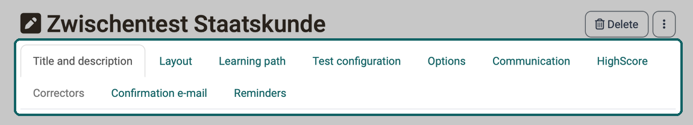
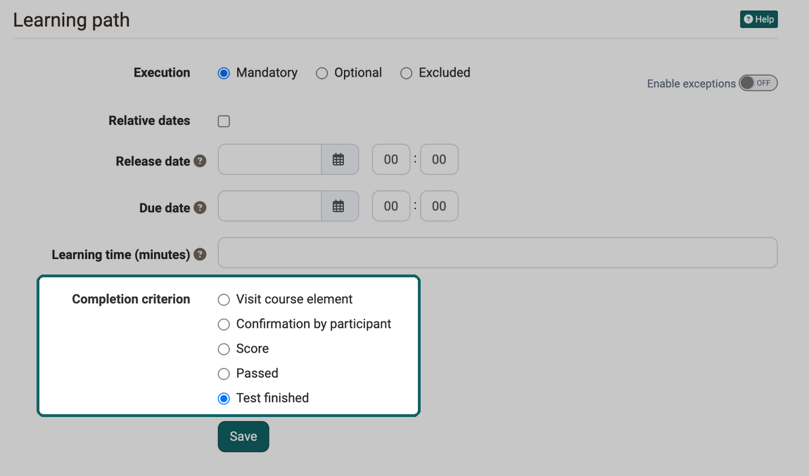
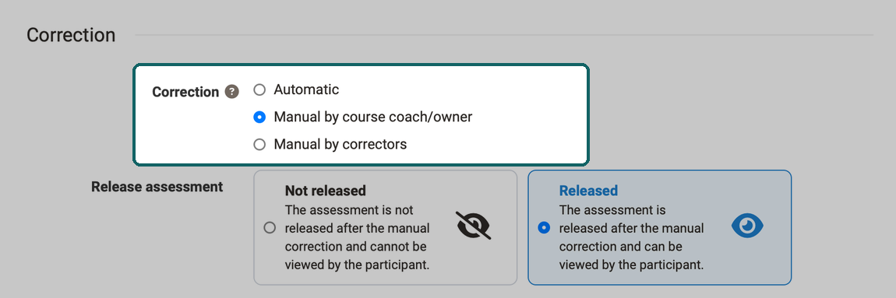
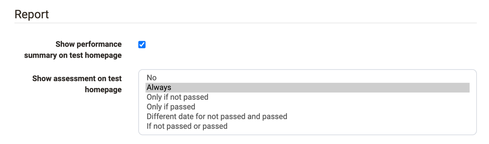
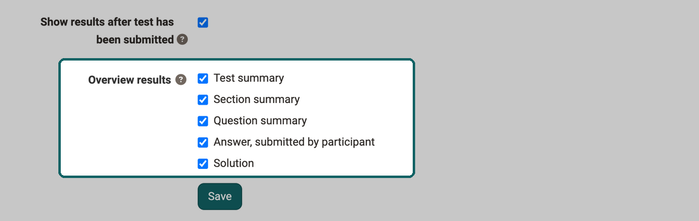
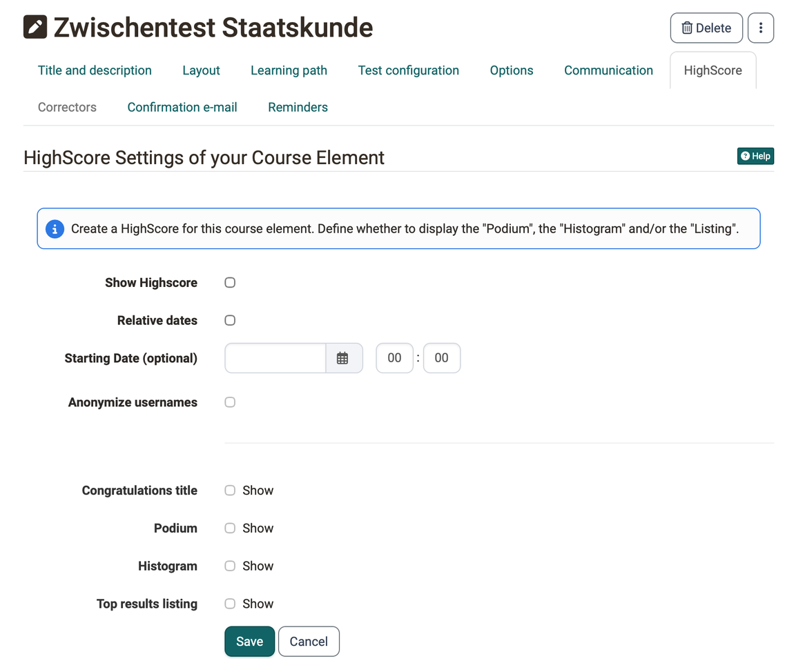

# Set up a test {: #config}

You have included a test in your course and now define which test the course element shows, when participants work on it, who corrects it and which results they see afterwards. This page is intended for course owners and describes the settings of the [course element "Test"](index.md) in the course editor, tab by tab in the order of the user interface. What follows once the test is included in the course, from replacing a test to archiving the results, is described on the page [Evaluate and manage tests](Test_Results.md).

Course owners, learning resource managers and administrators as well as persons with the right "Course editor" open the course editor. Open the course editor via `Course > Administration > Course editor`. Add a course element "Test" or select an already added course element "Test". You will now see the following tabs:

{ class="shadow lightbox" title="Course element Test in the course editor · 2026.10.01" }

The tabs "Title and description" and "Layout" are the same for all course elements. The "Correctors" tab is only active if the option "Manual by correctors" is selected in the "Correction" section. The "Badges" tab is added if awarding badges is enabled in the course.

## Tab "Learning path" [:octicons-tag-16:{ title="from Release 15.0 (OO-4206)" }](https://track.frentix.com/issue/OO-4206) {: #tab_learning_path}

In the "Learning path" tab, you define under "Execution" whether the test is "Mandatory" or "Optional" in the learning path course, or whether the course element does not appear at all ("Excluded"). With "Enable exceptions", a different execution applies to certain persons or groups. You also define a "Release date", a date under "Due date" and the expected "Learning time (minutes)", with "Relative dates" also relative to an event such as the first course visit. The fields of this tab are described on the page [Learning path course - Course editor](../Learning_path_course_Course_editor.md).

The following options are also available for tests under "Completion criterion": "Visit course element", "Confirmation by participant", "Score", "Passed" and "Test finished".

{ class="shadow lightbox" title="Learning path tab of the course element Test · 2026.10.01" }

Only when the selected condition is met does OpenOlat show the participants the progress in the learning path display and in the progress percentage.

[To the top of the page ^](#config)

## Tab "Test configuration" {: #tab_configuration}

If assessments already exist for the test, OpenOlat displays the settings under "Grading configuration" in this tab as read-only: "Levels/Grading" and "Include in course assessment". With "Enable edit mode" you make them editable again, see [Read-only assessment configuration](../Course_Elements/index.md#assessment_config_read_only). The read-only mode only exists in the course element "Test", not in the self-test and not in the questionnaire. [:octicons-tag-16:{ title="from Release 21.1 (OO-9647)" }](https://track.frentix.com/issue/OO-9647)

If you have not yet selected a test, a corresponding message will appear in the "Test configuration" tab. You can now "Select" or "Import" an existing test or "Create" a new test.

Click on "Select" to assign a test to the course element. The following dialog also offers the options for creating and importing. Here you select or create the test that you assign to the course element "Test". You then define further settings, for example the type of correction or the display of the test results.

If the course element is already linked to a test, the tab "Test configuration" shows the name of the test and further information. With "Edit learning resource", you edit the test.

Via the "Preview" button, you open a preview of the test; via the "Replace" button, you replace the test by selecting, creating or importing another test. If test results already exist for the test, you receive a message when replacing it, and OpenOlat creates an archive file that you can save. What happens to previous test runs and assessments when you replace a test is described in the section [Replacing tests that have already been edited](Test_Results.md#tab_replace_tests).

You configure an added test in more detail as follows. The tab shows the settings in this order: at the top "Relative dates" and "Set assessment period", below that the legend "Grading configuration", below that "Correction" and finally the legend "Report".

### Set assessment period [:octicons-tag-16:{ title="from Release 12.3 (OO-3146)" }](https://track.frentix.com/issue/OO-3146) {: #assessment_period}

During the test period, the test can be started. As soon as the "Until" time is reached, OpenOlat ends the test automatically, even if the defined time limit has not yet run out. If "Relative dates" is switched on, you set a relative date instead of a fixed date, for example x days after the first course visit. How the test period and the assessment mode work together is shown in [How do the times of an exam fit together?](../../../manual_how-to/exam_preparation/exam_preparation.md#exam_times)

If nothing is activated here, the test is accessible at all times, provided there is no restriction elsewhere, for example under "Visibility" for conventional courses or through a sequential order for learning path courses.

### Section Grading configuration {: #section_test}

Under the legend "Grading configuration" you define whether OpenOlat assesses the test with levels/grading and whether it counts towards the course assessment. If assessments already exist, the message with the button "Enable edit mode" appears here.

#### Levels/Grading {: #grading}

Select one of the given rating scales, for example grades, levels or emojis, and adjust the details if required, for example the "Score lower bound" of a level. Also decide whether OpenOlat assigns the level automatically and shows it to the participants or whether coaches assign it manually.

#### Include in course assessment {: #include_in_course_assessment}

If you switch off this toggle, the test is not taken into account in the course assessment of a [learning path course](../Learning_path_course/index.md). This setting is not available for a conventional course.

#### Scaling factor for course assessment {: #score_scaling}

The field appears if the course assessment adds up the points with weighting and "Include in course assessment" is switched on. OpenOlat multiplies the points of the test by this factor for the course assessment. More about this under [Course assessment with points: Sum with weighting](../Course_Settings_Assessment/index.md#evaluation_with_points_weighting).

### Section Correction {: #section_correction}

Under "Correction" you define who corrects the test runs and when the participants see their assessment. The correction is a step of the assessment: whoever corrects awards the points, and the assessment of the test results from them. The difference between assessment, correction and levels/grading is explained under [Assessment, correction and levels/grading](../../area_modules/Coaching_Assessment_Orders.md#assessment_terms).

#### Correction {: #correction_mode}

The correction is either automatic or manual. As soon as the test contains a [question type](../Test_question_types.md) to be evaluated manually, for example free text, a manual correction is mandatory. With automatic correction, OpenOlat corrects all questions directly, the result is visible to the participants immediately.

In case of manual correction, the visibility of the result is limited and the coach or corrector has to complete the correction manually. Questions to be edited manually include free text, upload file and draw. However, manual correction can also be set if required when the test consists only of automatically evaluable question types.

Three options are available:

* **Automatic**: OpenOlat corrects all questions directly.
* **Manual by course coach/owner**: The coaches or owners of the course do the correction. For each completed attempt an order is created in the coaching under [Assessment orders](../../area_modules/Coaching_Assessment_Orders.md#tab_open_assessments), in the tab "Open reviews".
* **Manual by correctors**: The correctors from the correction workflow of the learning resource Test do the correction. They can correct a test without being a member or even a coach of the course. Their orders appear in the coaching in the tab [Grading assignments](../../area_modules/Coaching_Assessment_Orders.md#tab_grading_assignments). This selection also activates the "Correctors" tab, and you can see who is assigned to the test as a corrector.

!!! info "Important"

    The option "Manual by correctors" is available if the [correction workflow](../Test_correction_workflow.md) is switched on in the learning resource Test. Correctors are managed independently of the course element, directly on the Test learning resource, and apply across courses. If the correction workflow is switched on and another option is selected, the "Correction" section shows a hint: with this setting no grading assignments are generated, "Manual by correctors" is recommended.

#### Release assessment {: #release_assessment}

The field appears with the two manual options. With "Released", the participants see the assessment directly after the manual correction; with "Not released", only once you release the assessment. Until then the entry is in the coaching in the tab [Reviews to release](../../area_modules/Coaching_Assessment_Orders.md#tab_assessments_to_be_released).

{ class="shadow lightbox" title="Correction section in the Test configuration tab · 2026.10.02" }

### Section Report {: #section_report}

Here you define whether and in what form the participants see their test results and their performance status. If you select nothing here, the participants do not receive any information.

#### Show performance summary on test homepage {: #show_score_info}

If this option is selected, the participants see the points and further performance information such as success status, number of solution attempts and the level reached on the rating scale on the start page of the test.

In addition to the performance summary, OpenOlat can also show the participants the specific test evaluation, permanently on the test homepage and directly after processing.

#### Show assessment on test homepage {: #show_results_on_homepage}

In this drop-down list you define whether and under which conditions the test evaluation appears on the start page of the test. With "Always", the results are available immediately after the test is finished; with "No", they do not appear at all. With the other options you define with "From" and "Until" in which period the results appear: only if the test was not passed, only if it was passed, with different periods for both cases or with a common period.

{ class="shadow lightbox" title="Report section in the Test configuration tab · 2026.10.01" }

#### Show results after test has been submitted {: #show_results_on_finish}

If this checkbox is activated, the participants see the test evaluation directly after submitting.

#### Overview results {: #results_overview}

Here you select in which form the results appear. The selection applies to both displays. The field appears as soon as "Show results after test has been submitted" is activated or an option other than "No" is selected under "Show assessment on test homepage".

{ class="shadow lightbox" title="Report section in the Test configuration tab · 2026.10.01" }

* **Test summary**: shows, among other things, the percentage achieved, the time taken to complete the test, the number of questions worked on, the score achieved and the status.
* **Section summary**: is only relevant if a test also contains [sections](../Configure_tests.md#section).
* **Question summary**: shows the title of the question and the points achieved in each case or the matching percentage value, but not the question itself.
* **Answer, submitted by participant**: shows the question, all answer options and the choice of the participants, but no rating of whether the answer is correct or incorrect. If this is desired, combine the option with other feedback options.
* **Solution**: contains the correct answers.

Depending on the combination of display options, the participants receive different types of feedback.

[To the top of the page ^](#config)

## Tab "Options" {: #tab_options}

If you include a test in a course, OpenOlat takes over the settings from the configuration of the learning resource "Test" by default (see [Test: Settings](../Test_settings.md) and [Configure Test](../Configure_tests.md)). Therefore, in the "Options" tab, "Apply configuration from learning resource" is preselected, and the tab shows the settings of the learning resource Test.

If you want to change the settings for the test included in the course, select "Customize configuration" and adjust the settings. For example, you define a time limit, restrict the number of solution attempts or allow guests to take the test. In addition, you configure various display options.

If the "Show question title" option is not selected but menu navigation is enabled, the navigation shows only anonymized titles instead of the actual titles.

!!! info "Important"

    These adjustments in the test have no effect on the configuration of the test learning resource itself.

In addition, you set up an information text (HTML page) for the test, which the participants see on the start page of the test above the start button. To do this, click on "Create", "Select" or "Import" in the "Information (HTML page)" section of the "Options" tab.

Activate "Allow links in the entire storage folder." if you want to link to other HTML files or graphics in the information text, for example. However, with this setting experienced participants can also gain insight into the entire storage folder of the course.

[To the top of the page ^](#config)

## Tab "Communication" [:octicons-tag-16:{ title="from Release 16.2.0 (OO-5966)" }](https://track.frentix.com/issue/OO-5966) {: #tab_communication}

Here you define whether participants may send live chat requests to the coaches or owners of the course during the test. This is only useful if coaches observe the test execution during a defined test period, for example in online examinations or synchronous admission examinations by test.

[To the top of the page ^](#config)

## Tab "HighScore" [:octicons-tag-16:{ title="from Release 11.3 (OO-2133)" }](https://track.frentix.com/issue/OO-2133) {: #tab_highscore}

Here you activate and configure a highscore overview for a test. This overview compares the test results of the participants and ranks the individual result in comparison.

{ class="shadow lightbox" title="HighScore tab of the course element Test · 2026.10.01" }

First activate "Show Highscore". Under "Starting Date (optional)" you define from when the highscore appears. With "Relative dates" you specify this date relative to an event, for example the first course visit. With "Anonymize usernames", the participants appear in the highscore without first and last names.

Below, you select what is displayed: "Congratulations title", "Podium", "Histogram" and "Top results listing". At least one display option must be activated. For the listing, you also define whether all or only the top users appear and how many. How the highscore works in course elements and when it appears is described on the page [Types of Course Elements](../Course_Elements/index.md#highscore).

[To the top of the page ^](#config)

## Tab "Correctors" [:octicons-tag-16:{ title="from Release 15.0 (OO-4442)" }](https://track.frentix.com/issue/OO-4442) {: #tab_correctors}

The tab is active if the option "Manual by correctors" is selected in the "Correction" section; otherwise it is greyed out. It shows the configuration of the correction workflow and the correctors entered in the learning resource Test. Via the link to the learning resource of the test, you change these details.

[To the top of the page ^](#config)

## Tab "Confirmation e-mail" [:octicons-tag-16:{ title="from Release 17.2.0 (OO-6672)" }](https://track.frentix.com/issue/OO-6672) {: #tab_email_confirmation}

Activate the "Confirmation e-mail" if the participants should receive a confirmation after submitting the test. On request, a copy of the e-mail also goes to the owners of the course, the assigned coaches or external e-mail addresses.

For the e-mail text, you use the template and a preset subject with the title of the course element. Alternatively, you change both: select the option "Own text" under "Template" to edit or completely change the text.

In the e-mail text, you also use variables such as name or score. The variables available are listed in the tooltip of the help icon next to the field "Text e-mail", once "Own text" is selected: `$firstName`, `$lastName`, `$fullName`, `$email`, `$username`, `$courseName`, `$courseDescription`, `$courseUrl`, `$courseElementName`, `$attempt`, `$score`, `$maxScore`, `$passed` and `$grading`. How variables work in e-mail texts is described at the [course element "E-Mail"](../Course_Element_EMail.md#use-of-variables).

[To the top of the page ^](#config)

## Tab "Reminders" [:octicons-tag-16:{ title="from Release 16.0.0 (OO-5447)" }](https://track.frentix.com/issue/OO-5447) {: #tab_reminders}

Here you configure reminders by e-mail according to certain criteria. How you set up and send reminders is described on the page [Course Reminders](../Course_Reminders.md).

[To the top of the page ^](#config)

## Tab "Badges" [:octicons-tag-16:{ title="from Release 18.0 (OO-7003)" }](https://track.frentix.com/issue/OO-7003) {: #tab_badges}

If owners of the course have activated the awarding of badges under `Course > Administration > Settings > Tab "Assessment" > Section "Badges"`, the course editor shows the tab "Badges" for this course element. There you create a badge specifically for this course element. How badges are created and awarded is described on the page [Badges](../OpenBadges.md).

[To the top of the page ^](#config)

---

## Further information {: #further_information}

**Mentioned on this page** 
[Course Element "Test" >](index.md) 
[Evaluate and manage tests >](Test_Results.md) 
[Learning path course - Course editor >](../Learning_path_course_Course_editor.md) 
[Course elements at a glance >](../Course_Elements/index.md) 
[How do I prepare an online exam? >](../../../manual_how-to/exam_preparation/exam_preparation.md) 
[Learning path course - Overview >](../Learning_path_course/index.md) 
[Course Settings - Tab Assessment >](../Course_Settings_Assessment/index.md) 
[Test question types >](../Test_question_types.md) 
[Coaching - Assessment Orders >](../../area_modules/Coaching_Assessment_Orders.md) 
[Test: Correction workflow >](../Test_correction_workflow.md) 
[Configure tests >](../Configure_tests.md) 
[Test: Settings >](../Test_settings.md) 
[Course Element "E-Mail" >](../Course_Element_EMail.md) 
[Course Reminders >](../Course_Reminders.md) 
[Badges >](../OpenBadges.md)

**Further reading** 
[Tests at course level >](../Tests_at_course_level.md) 
[Course Element "Self-test" >](../Course_Element_Self_Test.md) 
[Configure test questions >](../Configure_test_questions.md)

[To the top of the page ^](#config)
