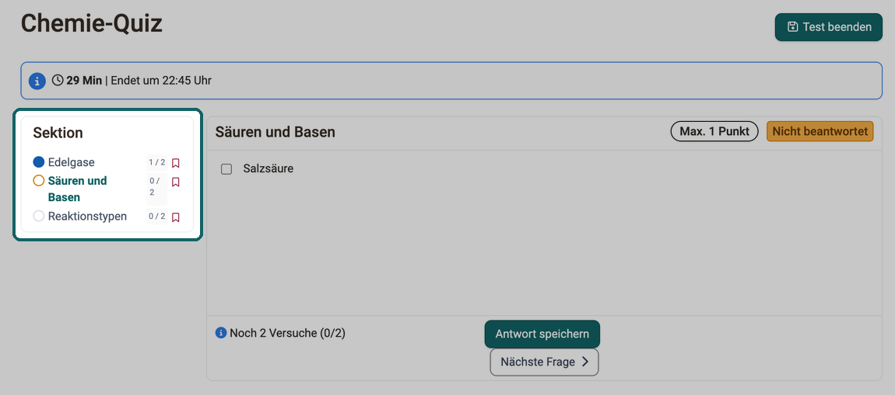
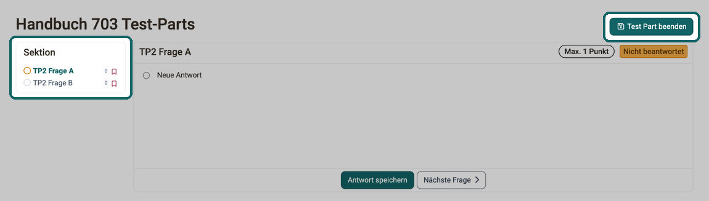
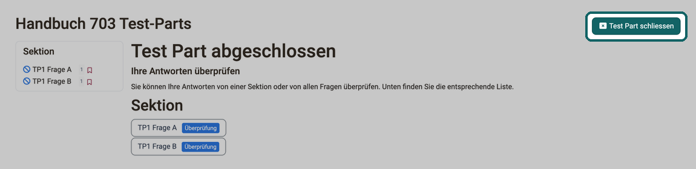
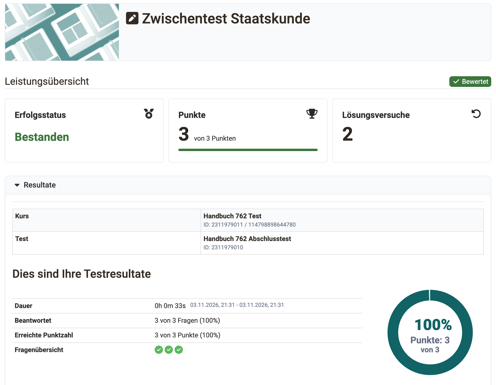

# Kursbaustein "Test"  {: #course_element_test}

## Steckbrief

Name | Test
---------|----------
Icon | :o_icon_o_iqtest_icon:
Verfügbar seit | Release 7.1 oder früher
Funktionsgruppe | Wissensüberprüfung
Verwendungszweck | Kursbaustein zum Einbinden einer Test-Lernressource in einen Kurs
Bewertbar | ja
Spezialität / Hinweis |

Mit dem Kursbaustein "Test" binden Sie eine OpenOlat Lernressource "Test" in Ihren Kurs ein. Ein Test dient im Kurs der Leistungsüberprüfung oder als Quiz und umfasst verschiedene [Fragetypen](../Test_question_types.de.md).

Je nach Fragetyp kreuzen Teilnehmende eine oder mehrere Antworten an, verschieben Elemente per Drag-and-drop, geben Texte oder Zahlen ein, fügen Dateien hinzu oder erstellen Markierungen und einfache Zeichnungen. Je nach Fragetyp wertet OpenOlat die Antworten automatisch aus, oder Betreuer:innen korrigieren sie manuell.

Ein Kurs kann auch mehrere Tests für unterschiedliche Zwecke enthalten. OpenOlat zeichnet die Resultate der Teilnehmenden personalisiert auf.

OpenOlat verwendet für Tests das Format IMS QTI 2.1 (Question and Test Interoperability). Damit lassen sich Tests mit anderen Test-Systemen und Learning Management Systemen austauschen, die diesen Standard ebenfalls unterstützen.

Die zwei zentralen Tabs, in denen Sie die Einstellungen für Ihren Test festlegen, sind "Test-Konfiguration" und "Optionen". Beide beschreibt die Seite [Test einrichten](Test_Setup.de.md).

!!! warning "Achtung"

    Tauschen Sie den Test im Kursbaustein aus, zieht OpenOlat laufende und pausierte Testläufe der Teilnehmenden ein und markiert sie als ungültig. Was mit beendeten Testläufen und bestehenden Bewertungen geschieht, steht auf der Seite [Tests auswerten und verwalten](Test_Results.de.md#tab_replace_tests) im Abschnitt "Bereits bearbeitete Tests austauschen".

!!! note "Hinweis"

    In OpenOlat gibt es zwei unterschiedliche Kursbausteine für Tests: "Test" und ["Selbsttest"](../Course_Element_Self_Test.de.md). Im Gegensatz zum Test speichert der Selbsttest die Testresultate anonymisiert. Selbsttests eignen sich für Übungszwecke, und Teilnehmende absolvieren sie beliebig oft. Zudem zeigt OpenOlat bei Selbsttests die Ergebnisse nach dem Beenden automatisch an.

    Der Umgang mit Selbsttests ist ansonsten identisch mit der Handhabung der Tests.

Weitere Informationen zur Lernressource Test: [Tests erstellen](../Test/index.de.md)

[Zum Seitenanfang ^](#course_element_test)

---

## Test einrichten {: #overview_setup}

Sie binden einen Test in Ihren Kurs ein und legen fest, wann Teilnehmende ihn bearbeiten, wer korrigiert und welche Resultate sie danach sehen. Die Seite "Test einrichten" führt Kursbesitzer:innen durch alle Tabs des Kursbausteins im Kurseditor, vom Tab "Lernpfad" über die Tabs "Test-Konfiguration" und "Optionen" bis zum Tab "Badges".

[Test einrichten >](Test_Setup.de.md)

[Zum Seitenanfang ^](#course_element_test)

---

## Test und Selbsttest im Vergleich {: #compare_test_self-test}

Merkmal | :fontawesome-solid-square-pen: Test | :fontawesome-solid-square-pen: Selbsttest
------|------|------
 Einsatzzweck | Prüfungstest, Test mit Einblick für die Lehrenden, Standard Test | Übung, Selbstevaluation, keine Einsicht durch Lehrperson
 Herstellung mit | [Testeditor](../Test_editor_QTI_2.1/index.de.md) | [Testeditor](../Test_editor_QTI_2.1/index.de.md)
 Fragetypen QTI 2.1 | Alle [Fragetypen](../Test_question_types.de.md) möglich | Alle [Fragetypen](../Test_question_types.de.md) möglich, aber nur automatisch auswertbare Fragetypen können auch für Punkte verwendet werden.
 Einbindung mit Kursbaustein | Test| Selbsttest
 Anzahl Aufrufe durch Teilnehmende | konfigurierbar | unlimitiert
 Ergebnisse | erscheinen im [Bewertungswerkzeug](../Assessment_tool_overview/index.de.md) sowie in den [Teststatistiken](../Statistics_Test.de.md) und sind für Betreuer:innen einsehbar | erscheinen _nicht_ im [Bewertungswerkzeug](../Assessment_tool_overview/index.de.md) und in den [Teststatistiken](../Statistics_Test.de.md) und sind nicht personalisiert für Betreuer:innen und Besitzer:innen einsehbar
 Datenarchivierung| ja, personalisiert| ja, anonymisiert. Eine personenbezogene Zuordnung oder Feedbacks sind aber nicht möglich.

!!! tip "Tipp"

    Manchmal ist es sinnvoll, den Typ "Test" zu verwenden, auch wenn Sie den Teilnehmenden eigentlich einen Selbsttest zur Verfügung stellen möchten. Mit einem Test unterstützen Sie die Teilnehmenden bei Bedarf individuell und geben auch Feedback zu manuell bewertbaren Fragetypen. Zudem erhalten Lehrende Rückmeldung zur Qualität und Wirkung ihrer Fragen.

[Zum Seitenanfang ^](#course_element_test)

---

## Tests auswerten und verwalten {: #overview_results}

Sobald Teilnehmende einen Test bearbeitet haben, geht es um Korrektur, Bewertung und Sicherung der Ergebnisse. Die Seite "Tests auswerten und verwalten" beschreibt für Kursbesitzer:innen und Betreuer:innen, wie sie Tests ändern und austauschen, Testläufe einsehen und bewerten, die Test-Historie nachverfolgen und Testergebnisse archivieren.

[Tests auswerten und verwalten >](Test_Results.de.md)

[Zum Seitenanfang ^](#course_element_test)

---

## Arbeiten mit Tests {: #work_with_tests}

### Einsatzbeispiele

Tests eignen sich unter anderem für folgende Szenarien:

* **Abschluss-Assessment**: Überprüfung des erworbenen Wissens nach einer Lern- oder Trainingsphase oder eines Online-Kurses

* **Pre-Test**: Erfassung des aktuellen Wissensstands vor Kursbeginn, um vorhandene Lücken zu erkennen und Schwerpunkte für den Kurs festzulegen

* **Interessen-Test**: Selbstüberprüfung zum eigenen Wissensstand sowie zur Identifikation persönlicher Vorlieben und Interessen

* **Antwortspezifisches Feedback**: Tests als individuelle Feedbackgeber bei intensiver Nutzung der OpenOlat-Feedbackfunktionen

* **Quiz-Game**: Spielerische Wissensüberprüfung in Form von Quiz, Quests, Storytelling und Ähnlichem

* **Online-Klausur**: Durchführung von prüfungsrelevanten Online- oder E-Klausuren

### So bearbeiten Sie einen Test (Teilnehmende) [:octicons-tag-16:{ title="ab Release 20.3.0 (OO-8321)" }](https://track.frentix.com/issue/OO-8321) {: #participate_as_learner}

Als Teilnehmer:in bearbeiten Sie einen Test Frage für Frage und sehen dabei jederzeit, was schon beantwortet ist. Klicken Sie auf "Test starten", um mit der Bearbeitung zu beginnen. Beantworten Sie die angezeigten Fragen und klicken Sie anschliessend bei jeder Frage auf "Antwort speichern". Ist die linke Navigation sichtbar, zeigt sie, welche Fragen Sie bereits beantwortet haben (ausgefüllter Punkt), welche Sie nur angeschaut haben (hervorgehobener Kreis) und welche Sie noch gar nicht geöffnet haben (grauer Kreis). Über das Symbol rechts neben einer Frage fügen Sie eine private Markierung hinzu, als Erinnerung, die Frage später noch einmal anzuschauen.

{ class="shadow lightbox" title="Test aus Sicht der Teilnehmenden · 2026.10.01" }

Je nach Einstellung navigieren Sie über den Button "Nächste Frage" oder einen Link in der linken Navigation weiter, oder OpenOlat zeigt automatisch die nächste Frage an. Ob Sie Fragen überspringen können oder einen Beantwortungsfortschritt sehen, hängt ebenfalls von der Konfiguration durch die Lehrenden ab. Je nach Konfiguration unterbrechen Sie den Test und fahren später fort, oder Sie brechen ihn ganz ab, ohne dass Resultate gespeichert werden.

Bearbeiten Sie einen Test in nur einem Browserfenster. Wird der Test in einem anderen Fenster unterbrochen oder beendet, meldet das noch offene Fenster bei der nächsten Eingabe "Test unterbrochen" beziehungsweise "Test beendet" mit dem Text "Eingaben in diesem Fenster werden nicht mehr gespeichert, da der Test bereits beendet oder unterbrochen wurde. Bitte schliessen Sie es jetzt." [:octicons-tag-16:{ title="ab Release 21.0.3 (OO-9707)" }](https://track.frentix.com/issue/OO-9707)

Ist die Anzahl Lösungsversuche für eine Frage, eine Sektion oder den gesamten Test eingeschränkt, zeigt OpenOlat die verbleibende Anzahl direkt bei der Frage an, zum Beispiel "Noch 2 Versuche (1/3)". In der linken Navigation steht bei jeder Frage die Zahl der genutzten und der möglichen Versuche, zum Beispiel "1 / 2"; die verbleibende Anzahl erscheint dort als Tooltip.

Wenn Sie fertig sind mit der Bearbeitung und den Test abschliessen wollen, klicken Sie auf den Button "Test beenden". OpenOlat fragt noch einmal nach. Bestätigen Sie, speichert OpenOlat den Test, und er ist für die Lehrenden sichtbar.

Besteht ein Test aus mehreren [Test-Parts](../Configure_tests.de.md#testpart), bearbeiten Sie diese nacheinander und schliessen jeden einzeln ab. Ein beendeter Test-Part ist abgegeben: Seine Antworten sind gespeichert, und Sie kehren nicht mehr dorthin zurück. Zu Beginn zeigt OpenOlat die Seite "Testbeginn" mit der Anzahl Teile, zum Beispiel "Der Test hat bis 2 Teile.", und dem Button "Test starten".

* Das Menü links zeigt nur die Sektionen und Fragen des aktuellen Test-Parts. Ist im Kursbaustein die Menü-Navigation ausgeschaltet, führt der Button "Menu-Navigation Test" auf die Seite "Test Part" mit diesen Fragen.
* Oben rechts steht der Button "Test Part beenden" statt "Test beenden". Je nach Einstellung des Tests erscheint er erst, wenn alle Fragen des Test-Parts beantwortet sind.

{ class="shadow lightbox" title="Test mit mehreren Test-Parts aus Sicht der Teilnehmenden · 2026.10.07" }

* Nach dem Klick auf "Test Part beenden" fragt OpenOlat nach: "Sind Sie sicher dass Sie den Test Part beenden wollen? Ihre Antworten werden dadurch gespeichert." Mit "Ok" geben Sie den Test-Part ab.
* Ist ein Rückblick vorgesehen, erscheint danach die Seite "Test Part abgeschlossen". Unter "Ihre Antworten überprüfen" sehen Sie Ihre Antworten an, ändern können Sie sie nicht mehr. Mit "Test Part schliessen" und der Rückfrage "Test Part weiter gehen" gelangen Sie in den nächsten Test-Part. Ohne Rückblick geht es direkt in den nächsten Test-Part.
* Im letzten Test-Part heisst der Button ebenfalls "Test Part beenden", die Rückfrage trägt den Titel "Test beenden". Mit der Bestätigung ist der ganze Test abgeschlossen.

{ class="shadow lightbox" title="Seite Test Part abgeschlossen · 2026.10.07" }

Ob, wie und wann Sie die Resultate und die Leistungsübersicht sehen, hängt von der Test-Konfiguration ab. Die Leistungsübersicht zeigt Ihren Erfolgsstatus, Ihre Punkte und die Zahl Ihrer Lösungsversuche. Darunter zeigt der Bereich "Resultate" Ihre Testresultate mit Dauer, Zahl der beantworteten Fragen und erreichter Punktzahl.

{ class="shadow lightbox" title="Leistungsübersicht eines Tests aus Sicht der Teilnehmenden · 2026.11.06" }

Wenn Ihnen weitere Versuche zur Bearbeitung des Tests zur Verfügung stehen, können Sie mit "Test starten" den Test noch einmal durchlaufen. Bisherige Durchläufe bleiben dabei erhalten.

[Zum Seitenanfang ^](#course_element_test)

---

## Weiterführende Informationen {: #further_information}

**Auf dieser Seite erwähnt** 
[Test Fragetypen >](../Test_question_types.de.md) 
[Test einrichten >](Test_Setup.de.md) 
[Tests auswerten und verwalten >](Test_Results.de.md) 
[Kursbaustein "Selbsttest" >](../Course_Element_Self_Test.de.md) 
[Tests erstellen >](../Test/index.de.md) 
[Testeditor >](../Test_editor_QTI_2.1/index.de.md) 
[Bewertungswerkzeug - Übersicht >](../Assessment_tool_overview/index.de.md) 
[Teststatistiken >](../Statistics_Test.de.md) 
[Test konfigurieren >](../Configure_tests.de.md)

**Weiterführend** 
[Kursbausteine im Überblick >](../Course_Elements/index.de.md) 
[Testfragen konfigurieren >](../Configure_test_questions.de.md) 
[Tests bewerten >](../Assessing_tests.de.md)

[Zum Seitenanfang ^](#course_element_test)
