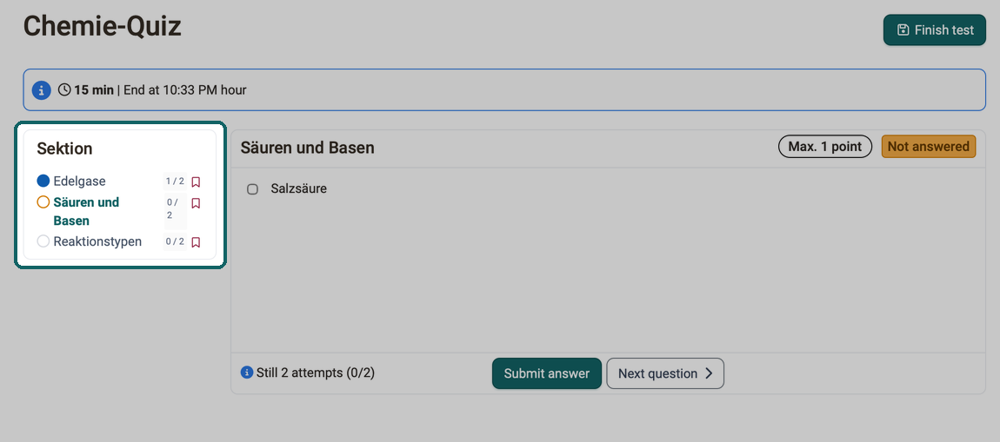
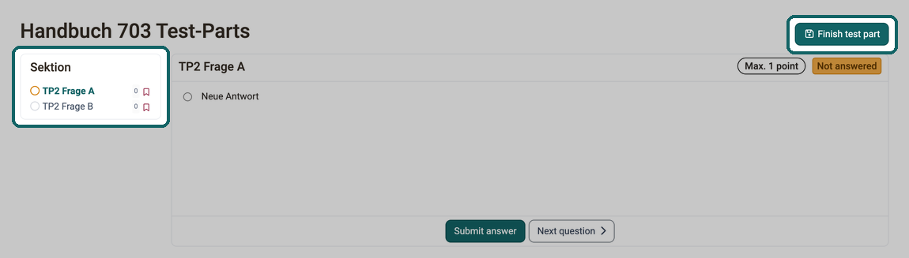
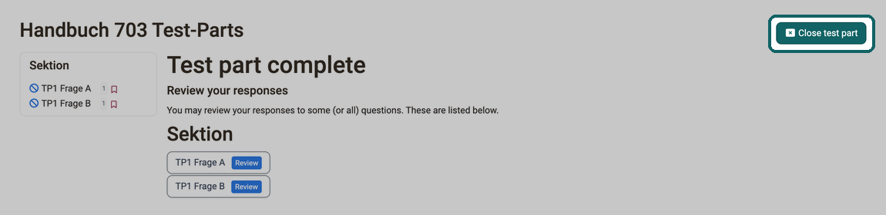
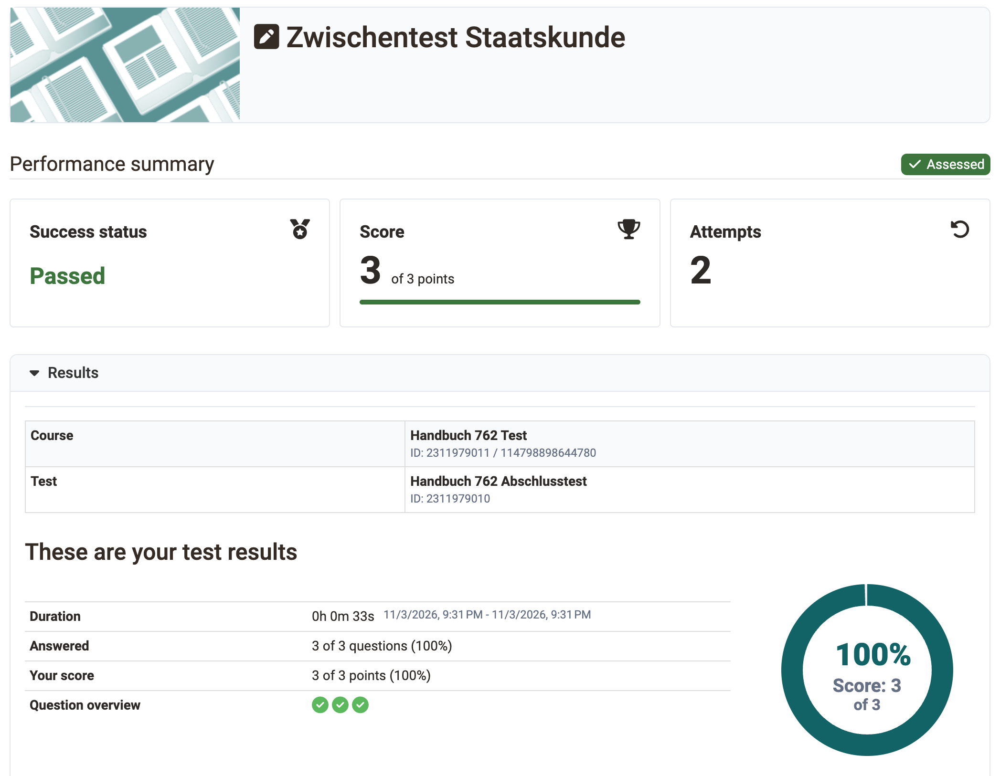

# Course Element "Test" {: #course_element_test}

## Profile

Name | Test
---------|----------
Icon | :o_icon_o_iqtest_icon:
Available since | Release 7.1 or earlier
Functional group | Assessment
Purpose | Course element for integration of a learning resource test into a course
Assessable | yes
Specialty / Note |

With the course element "Test" you integrate an OpenOlat learning resource "Test" into your course. In a course, a test serves to assess performance or as a quiz and includes various [question types](../Test_question_types.md).

Depending on the question type, participants tick one or more answers, move elements by drag and drop, enter texts or numbers, add files or create markers and simple drawings. Depending on the question type, OpenOlat evaluates the answers automatically, or coaches correct them manually.

A course can also contain several tests for different purposes. OpenOlat records the results of the participants on a personalized basis.

OpenOlat uses the IMS QTI 2.1 (Question and Test Interoperability) format for tests. This allows you to exchange tests with other test systems and learning management systems that also support this standard.

The two main tabs in which you define the settings for your test are "Test configuration" and "Options". Both are described on the page [Set up a test](Test_Setup.md).

!!! warning "Attention"

    If you replace the test in the course element, OpenOlat collects ongoing and suspended test runs of the participants and marks them as invalid. What happens to finished test runs and existing assessments is described on the page [Evaluate and manage tests](Test_Results.md#tab_replace_tests) in the section "Replacing tests that have already been edited".

!!! note "Note"

    There are two different course elements for tests in OpenOlat: "Test" and ["Self-test"](../Course_Element_Self_Test.md). In contrast to the test, the self-test saves the test results anonymously. Self-tests are suitable for practice purposes, and participants complete them as often as they like. In addition, OpenOlat automatically shows the results of self-tests once they are finished.

    The handling of self-tests is otherwise identical to the handling of the tests.

Further information on the learning resource Test: [Create tests](../Test.md)

[To the top of the page ^](#course_element_test)

---

## Set up a test {: #overview_setup}

You include a test in your course and define when participants work on it, who corrects it and which results they see afterwards. The page "Set up a test" guides course owners through all tabs of the course element in the course editor, from the tab "Learning path" through the tabs "Test configuration" and "Options" to the tab "Badges".

[Set up a test >](Test_Setup.md)

[To the top of the page ^](#course_element_test)

---

## Compare tests and self-tests {: #compare_test_self-test}

Attribute | :fontawesome-solid-square-pen: Test | :fontawesome-solid-square-pen: Self-test
------|------|------
 Purpose of use | Assessment test, test with assessment option by the teacher, standard test | Exercise, self-assessment, no insight by teacher
 Fabrication with | [Test editor](../Test_editor_QTI_2.1.md) | [Test editor](../Test_editor_QTI_2.1.md)
 Question types QTI 2.1 | All [Question types](../Test_question_types.md) possible | All [Question types](../Test_question_types.md) possible, but only automatically assessable question types can be used for points.
 Integration with course element | Test | Self-test
 Number of views by course participants | configurable | unlimited
 Results | appear in the [Assessment tool](../Assessment_tool_overview.md) as well as in the [test statistics](../Statistics_Test.md) and can be viewed by coaches | do _not_ appear in the [Assessment tool](../Assessment_tool_overview.md) and in the [test statistics](../Statistics_Test.md) and are not personalized for coaches and owners to view
 Data archiving | Yes, personalized | Yes, anonymized. However, personal allocation or feedback is not possible.

!!! tip "Tip"

    Sometimes it makes sense to use the "Test" type, even if you actually want to provide participants with a self-test. With a test, you support the participants individually as needed and also give feedback on manually assessable question types. In addition, teachers receive feedback on the quality and effect of their questions.

[To the top of the page ^](#course_element_test)

---

## Evaluate and manage tests {: #overview_results}

As soon as participants have worked on a test, the next steps are correcting, assessing and securing the results. The page "Evaluate and manage tests" describes for course owners and coaches how they change and replace tests, view and assess test runs, trace the test history and archive test results.

[Evaluate and manage tests >](Test_Results.md)

[To the top of the page ^](#course_element_test)

---

## Working with tests {: #work_with_tests}

### Application examples

Tests are suitable for the following scenarios, among others:

* **Final assessment**: Review of acquired knowledge after a learning or training phase or an online course

* **Pre-test**: Assessment of current knowledge before the start of the course in order to identify existing gaps and determine the focus of the course

* **Interest test**: Self-assessment of one's own level of knowledge and identification of personal preferences and interests

* **Answer-specific feedback**: Tests as individual feedback providers with intensive use of the OpenOlat feedback functions

* **Quiz game**: Playful knowledge assessment in the form of quizzes, quests, storytelling, etc.

* **Online exam**: Conducting exam-relevant online or e-exams

### How to work on a test (participants) [:octicons-tag-16:{ title="from Release 20.3.0 (OO-8321)" }](https://track.frentix.com/issue/OO-8321) {: #participate_as_learner}

As a participant, you work through a test question by question and can see at any time what has already been answered. Click on "Start test" to begin. Answer the questions displayed and then click "Submit answer" for each question. If the left navigation is visible, it shows which questions you have already answered (filled dot), which you have only looked at (highlighted circle) and which you have not opened at all (grey circle). Using the icon to the right of a question, you add a personal marking as a reminder to review the question later.

{ class="shadow lightbox" title="Test from the participants' view · 2026.10.01" }

Depending on the setting, you navigate further using the "Next question" button or a link in the left-hand navigation, or OpenOlat shows the next question automatically. Whether you can skip questions or see the progress of answers also depends on the configuration by the teachers. Depending on the configuration, you interrupt the test and continue later, or you cancel it completely without saving results.

Work on a test in only one browser window. If the test is interrupted or completed in another window, the window that is still open reports "Test interrupted" or "Test completed" at the next input, with the text "Any input in this window will no longer be saved, as the test has already been completed or interrupted. Please close it now." [:octicons-tag-16:{ title="from Release 21.0.3 (OO-9707)" }](https://track.frentix.com/issue/OO-9707)

If the number of solution attempts is limited for a question, a section, or the entire test, OpenOlat shows the remaining number directly next to the question, for example "Still 2 attempts (1/3)". In the left navigation, each question shows the number of attempts used and possible, for example "1 / 2"; the remaining number appears there as a tooltip.

When you have finished editing and want to complete the test, click on the "Finish test" button. OpenOlat asks once again for confirmation. If you confirm, OpenOlat saves the test, and it is visible to the teachers.

If a test consists of several [test parts](../Configure_tests.md#testpart), you work on them one after the other and finish each one separately. A finished test part is submitted: its answers are saved, and you do not return to it. At the beginning, OpenOlat shows the page "Begin test" with the number of parts, for example "This test consists of up to 2 parts.", and the button "Enter Test".

* The menu on the left only shows the sections and questions of the current test part. If menu navigation is switched off in the course element, the button "Test question menu" leads to the page "Test part question menu" with these questions.
* At the top right, the button "Finish test part" is shown instead of "Finish test". Depending on the setting of the test, it only appears when all questions of the test part have been answered.

{ class="shadow lightbox" title="Test with several test parts from the participants' view · 2026.10.07" }

* After clicking "Finish test part", OpenOlat asks: "Finish / Are you sure? This will commit your answers for this test part." With "Ok" you submit the test part.
* If a review is provided, the page "Test part complete" appears next. Under "Review your responses" you can view your answers, but you can no longer change them. With "Close test part" and the confirmation "Advance test part" you go to the next test part. Without review, you go directly to the next test part.
* In the last test part, the button is also called "Finish test part", the confirmation has the title "Finish test". With the confirmation, the whole test is completed.

{ class="shadow lightbox" title="Page Test part complete · 2026.10.07" }

Whether, how and when you see the results and the performance summary depends on the test configuration. The performance summary shows your success status, your score and the number of your attempts. Below it, the area "Results" shows your test results with duration, number of answered questions and score achieved.

{ class="shadow lightbox" title="Performance summary of a test from the participants' view · 2026.11.06" }

If you have more attempts available to process the test, you can run through the test again with "Start test". Previous runs will be retained.

[To the top of the page ^](#course_element_test)

---

## Further information {: #further_information}

**Mentioned on this page** 
[Test question types >](../Test_question_types.md) 
[Set up a test >](Test_Setup.md) 
[Evaluate and manage tests >](Test_Results.md) 
[Course Element "Self-test" >](../Course_Element_Self_Test.md) 
[Creating Tests >](../Test.md) 
[Test editor >](../Test_editor_QTI_2.1.md) 
[Assessment tool - overview >](../Assessment_tool_overview.md) 
[Test statistics >](../Statistics_Test.md) 
[Configure tests >](../Configure_tests.md)

**Further reading** 
[Course elements at a glance >](../Course_Elements.md) 
[Configure test questions >](../Configure_test_questions.md) 
[Assessing tests >](../Assessing_tests.md)

[To the top of the page ^](#course_element_test)
