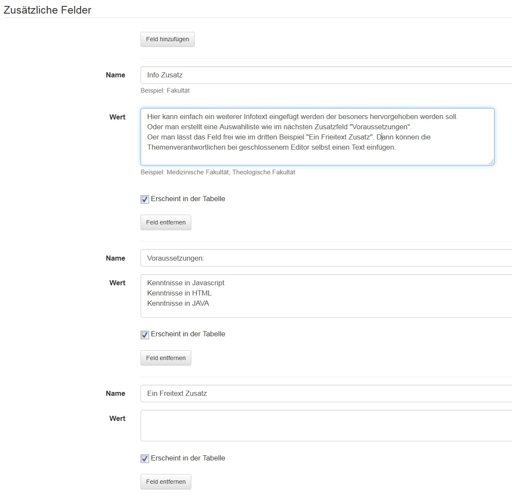
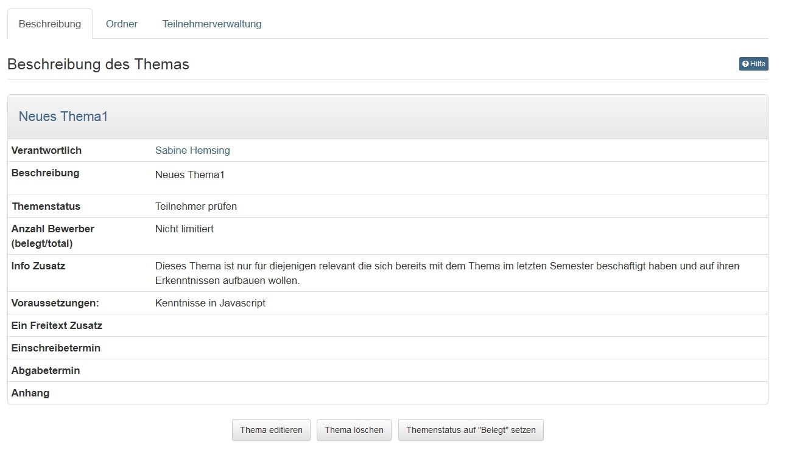
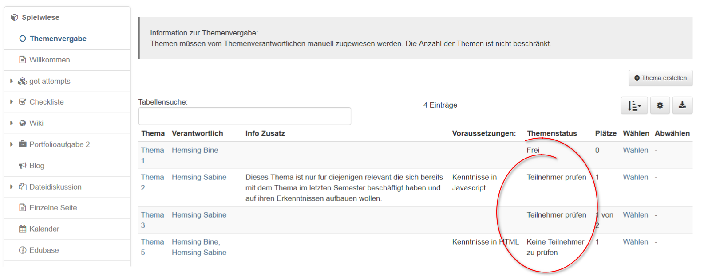
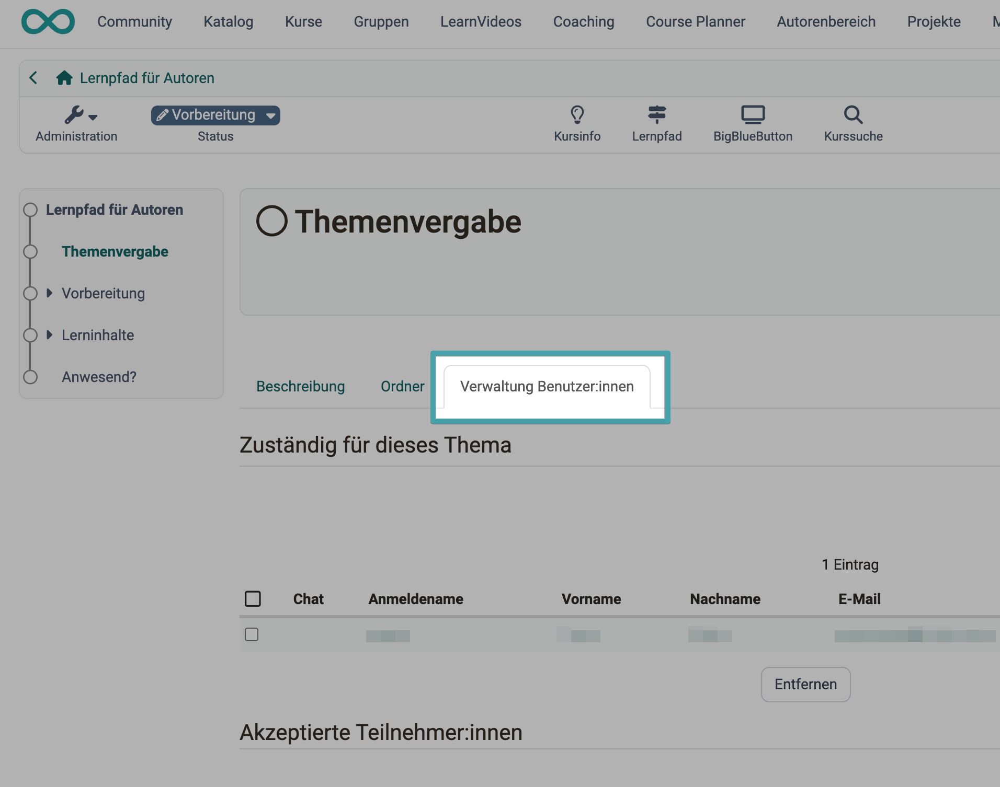

# Kursbaustein "Themenvergabe"  {: #topic_assignment}

## Steckbrief

Name | Themenvergabe
---------|----------
Icon | :o_icon_o_projectbroker_icon:
Verfügbar seit | Release 7.1 oder früher
Funktionsgruppe | Andere
Verwendungszweck | Ausschreibung, Auswahl und Betreuung von Themen zur Bearbeitung durch die Kursteilnehmer:innen
Bewertbar | nein
Spezialität / Hinweis |

Der Kursbaustein "Themenvergabe" eignet sich, wenn Sie in Ihrem Kurs Themen wie beispielsweise Semesterarbeiten ausschreiben und betreuen lassen wollen. Als Besitzer:in des Kurses bestimmen Sie die Konfiguration der Themenvergabe. Dazu gehört unter anderem, wer Themen ausschreiben und betreuen darf, wie die Themen beschrieben sind und wie viele Themen Teilnehmende wählen können. Speziell am Kursbaustein "Themenvergabe" ist, dass nicht Sie als Besitzer:in des Kurses, sondern Themenverantwortliche die Themen ausschreiben und betreuen.

## Editoransicht

### Themenvergabe konfigurieren

Im Tab "Konfiguration" bestimmen Sie zuerst, wie viele Themen Teilnehmende wählen können und ob ihre Wahl gleich gilt oder zuerst von den Themenverantwortlichen akzeptiert werden muss. Weiter fügen Sie zusätzliche Felder hinzu, welche die Themen beschreiben und in der Tabelle mit allen ausgeschriebenen Themen erscheinen. Hier legen Sie auch fest, ob Einschreibung und Abgabe nur innerhalb einer bestimmten Frist möglich sind. Teilbausteine sind die Teile eines Kursbausteins, die Sie einzeln zuschalten. Im Tab "Teilbausteine" wählen Sie aus, ob es in Ihrer Themenvergabe einen Abgabeordner und einen Rückgabeordner gibt. Nur die zugeschalteten Ordner stehen im Kursbaustein zur Verfügung. Teilnehmende laden ihre Dateien in den Abgabeordner, und Themenverantwortliche geben Dateien über den Rückgabeordner zurück.

**Anzahl Themen pro Teilnehmer:in limitieren?:**
Wählen Sie diese Option, erscheint ein Feld für die Anzahl Themen, die Teilnehmende in diesem Kursbaustein höchstens wählen dürfen.

**Themenverantwortliche müssen Teilnehmer:innen akzeptieren:**
Mit dieser Option schreiben sich Teilnehmende nur provisorisch für ein Thema ein. Die Themenverantwortlichen wählen dann aus den Kandidat:innen die definitiven Teilnehmenden aus und akzeptieren sie. Ohne diese Option akzeptiert OpenOlat automatisch alle Teilnehmenden, die sich für das Thema eingeschrieben haben. Die Themenverantwortlichen können vorgängig die maximale Anzahl Plätze festlegen.

**Nur ein Thema erlaubt (Akzeptierte Teilnehmer:innen werden automatisch aus allen anderen Themen ausgetragen):** 
Mit dieser Option trägt OpenOlat Teilnehmende, die Themenverantwortliche akzeptiert haben, automatisch aus allen anderen gewählten Themen aus. Teilnehmende sind also höchstens für ein Thema definitiv eingeschrieben.

**Zusätzliche Felder hinzufügen:**
Über "Feld hinzufügen" fügen Sie höchstens fünf eigene Felder für die genauere Beschreibung der Themen hinzu.

Im Feld "Name" geben Sie den gewünschten Feldnamen ein.

Sie können den Themenverantwortlichen vordefinierte Werte oder Texte zur Auswahl anbieten, die in einem Drop-down-Menü erscheinen. Geben Sie dazu die Auswahlmöglichkeiten getrennt durch Strichpunkte oder Zeilenumbrüche im Feld "Wert" ein. Für ein Freitextfeld lassen Sie das Feld "Wert" leer. Die Themenverantwortlichen geben dann einen beliebigen Wert ein.

Wählen Sie "Erscheint in der Tabelle", zeigt OpenOlat das Feld in der Themenübersicht an. Sonst erscheint die Information erst in der detaillierten Themenbeschreibung.

Über "Feld entfernen" löschen Sie zusätzliche Felder wieder.

{ class="shadow lightbox" title="Zusätzliche Felder im Tab Konfiguration im Kurseditor" }

**Einschreibetermin:**
Themenverantwortliche legen eine Einschreibefrist für ein Thema fest. Nach Ablauf dieser Frist können Teilnehmende das Thema weder wählen noch abwählen. Themenverantwortliche können Teilnehmende auch danach noch ein- und austragen.

**Abgabetermin:**
Ist der Abgabetermin abgelaufen, schliesst OpenOlat den Abgabeordner, und Teilnehmende können keine Dokumente mehr hochladen.

Wählen Sie "Erscheint in der Tabelle", zeigt OpenOlat den Termin in der Themenübersicht an.

---

### Weitere Einstellungen der Themenvergabe  {: #persons}

**Themenverantwortliche ernennen - Tab "Verantwortliche"**

  Im Tab "Verantwortliche" fügen Sie die Personen hinzu, die Themen ausschreiben und betreuen dürfen. Diese Personen brauchen keine Autorenrechte.

  Die hinzugefügten Personen erscheinen in der Gruppe "Zuständig für dieses Thema". Über die Aktion "Benutzer:in hinzufügen" :o_icon_o_icon_add_member: öffnen Sie den Dialog zum Hinzufügen einer weiteren Person [:octicons-tag-16:{ title="ab Release 20.3.1 (OO-9307)" }](https://track.frentix.com/issue/OO-9307){:target="_blank"}.

  Entfernen Sie Themenverantwortliche, die bereits Themen ausgeschrieben haben, betreuen sie diese weiterhin, können aber keine neuen Themen ausschreiben.

  Importieren Sie den Kursbaustein "Themenvergabe" aus einem anderen Kurs, trägt OpenOlat die importierende Person automatisch als verantwortliche Person der importierten Themen ein, sofern sie Mitglied des Zielkurses ist. Ist die importierende Person kein Mitglied des Zielkurses, haben die importierten Themen keine verantwortliche Person [:octicons-tag-16:{ title="ab Release 20.2.2 (OO-9184)" }](https://track.frentix.com/issue/OO-9184){:target="_blank"}.

* **Rolle der Themenverantwortlichen**

  Trägt Sie die Besitzer:in des Kurses im Tab "Verantwortliche" ein, schreiben Sie selbst Themen aus und betreuen sie. Öffnen Sie die Kursansicht und navigieren Sie zur Themenvergabe. Als verantwortliche Person haben Sie Zugriff auf die zugehörigen Ordner. Zudem editieren Sie das Thema, verwalten die Teilnehmenden des Themas und fügen weitere Themenverantwortliche hinzu.

* **Ordner - Tab "Teilbausteine"**

  Im Abgabeordner laden Teilnehmende Dateien hoch, die dann für die Themenverantwortlichen zugänglich sind. Die Themenverantwortlichen legen Dateien in den Rückgabeordner. Voraussetzung ist, dass die Ordner in der Konfiguration im Kurseditor aktiviert sind.

* **Bestätigung der Abgabe - Tab "Abgabe"**

  Optional geben Sie einen Text ein, den OpenOlat der teilnehmenden Person nach erfolgreicher Abgabe der Datei in einem Fenster zeigt. Ohne eigenen Text zeigt OpenOlat sinngemäss: Hiermit wird bestätigt, dass Meier Hubert (hmeier) die Datei "test.html" am 21.09.04 um 00:14:42 hochgeladen hat.

  Wählen Sie die Option _Text zusätzlich als E-Mail verschicken_, schickt OpenOlat der teilnehmenden Person nach erfolgreicher Abgabe zusätzlich eine E-Mail mit dem Bestätigungstext.

## Kursansicht {: #topic_assignment_runtime}

### Thema erstellen

Als Besitzer:in des Kurses oder als Themenverantwortliche richten Sie neue Themen ein. Tragen Sie Teilnehmende als Themenverantwortliche ein, stellen diese selbst Themenvorschläge in den Kurs, zum Beispiel für die weitere Gestaltung des Kurses oder für mögliche Hausarbeiten und Referate.

Klicken Sie auf "Thema erstellen" und geben Sie Titel und Beschreibung des Themas ein. Je nach Konfiguration der Themenvergabe beschreiben Sie das Thema mit weiteren Angaben, legen die Einschreibe- und Abgabefrist fest, bestimmen, wie viele Teilnehmende Ihr Thema wählen dürfen, und laden bei Bedarf Dateien als Anhang hoch. Zudem legen Sie fest, ob Teilnehmende ein Thema wieder abwählen dürfen und ob die Themenverantwortlichen bei Auswahl und Abwahl eine E-Mail erhalten.

!!! tip "Tipp"

    Wollen Sie später die Konfiguration ändern, klicken Sie auf den Titel des Themas. Dort editieren Sie das Thema, ändern den Themenstatus von "Frei" auf "Belegt" oder umgekehrt oder löschen das Thema.

### Thema erstellen und bearbeiten im Detail

* **Thema:**

  Hier steht der Titel des Themas. Themenverantwortliche können ihn ändern.

* **Verantwortlich:**

  Hier stehen die Themenverantwortlichen. Ein Klick auf einen Namen öffnet die Visitenkarte der Person, über die Sie sie kontaktieren.

!!! info "Wichtig"

    Legen Sie ein Thema an, erscheinen Sie automatisch als themenverantwortliche Person. Im Tab "Verwaltung Benutzer:innen" übertragen Sie diese Rolle einer anderen Person oder ernennen weitere Themenverantwortliche.

* **Beschreibung:**

  Im Feld "Beschreibung" tragen Sie Detailinformationen zum Thema ein.

* **Themenstatus:**

  In diesem Feld zeigt OpenOlat automatisch den Themenstatus an.

  Für Themenverantwortliche und Besitzer:innen des Kurses steht der Themenstatus auf "Keine Teilnehmer:innen zu prüfen", solange sich noch niemand für das Thema eingeschrieben hat. Haben sich Teilnehmende eingetragen, steht der Status auf "Teilnehmer:in prüfen". Haben Sie aus den Kandidat:innen Teilnehmende akzeptiert, zeigt OpenOlat den Status "Teilnehmer:in akzeptiert".

* **Anzahl Bewerber limitieren:**

  Hier begrenzen die Themenverantwortlichen die verfügbare Anzahl Plätze.

* **Abmelden von Thema erlauben:**

  Ist die Option aktiviert, dürfen sich Teilnehmende auch wieder aus einem Thema austragen.

* **Zusätzliche Felder:**

  Hat die Besitzer:in des Kurses im Kurseditor zusätzliche Felder eingerichtet (siehe oben), stehen sie den Themenverantwortlichen hier zur Verfügung. Je nach Feld wählen die Themenverantwortlichen einen Wert aus einem Drop-down-Menü oder geben selbst Text ein.

* **Einschreibetermin:**

  Ist der Termin im Editor eingerichtet, legen Themenverantwortliche hier eine Einschreibefrist fest. Nur in dieser Zeitspanne lässt sich ein Thema wählen oder abwählen. Vor und nach der Frist sind die Links "Wählen" und "Abwählen" deaktiviert, und Teilnehmende können sich nicht in Ihr Thema ein- und austragen. Themenverantwortliche können Teilnehmende vor und nach der Frist manuell ein- oder austragen.

* **Abgabetermin:**

  Ist der Termin im Editor eingerichtet, legen Themenverantwortliche eine Abgabefrist fest. Nur in dieser Zeitspanne lassen sich Dokumente in den Abgabeordner hochladen.

* **Anhang:**

  Im Feld "Anhang" laden die Themenverantwortlichen eine Datei hoch, zum Beispiel ein umfangreiches Dokument zum Thema. Mehrere Dateien laden Sie als ZIP-Datei hoch.

* **E-Mail-Benachrichtigung bei Themen Auswahl/Abwahl:**

  Mit dieser Option erhalten Sie eine E-Mail, wenn Teilnehmende Ihr Thema wählen oder abwählen.

{ class="shadow lightbox" title="Tab Beschreibung eines Themas" }

Über "Thema editieren" gelangen Sie in den Bearbeitungsmodus und ändern die aufgeführten Felder.

Klicken Sie auf "Thema löschen", um Ihr Thema aus der Themenvergabe zu entfernen.

Wählen Sie "Themenstatus auf "Belegt" setzen", wenn keine weiteren Teilnehmenden das Thema wählen sollen.

Über "Themenstatus auf "Frei" setzen" öffnen Sie ein Thema erneut zur Wahl, auch wenn sich bereits Teilnehmende eingeschrieben und Sie diese akzeptiert haben.

!!! info "Wichtig"

    Die beiden letzten Schaltflächen erscheinen nur, wenn die Besitzer:in des Kurses die Themenvergabe so konfiguriert hat, dass Themenverantwortliche die Teilnehmenden manuell akzeptieren.

## Tabs "Ordner" und "Verwaltung Benutzer:innen" [:octicons-tag-16:{ title="ab Release 20.3.1 (OO-9307)" }](https://track.frentix.com/issue/OO-9307){:target="_blank"} {: #folder_user_management}

### Teilnehmende verwalten

Sieht die Konfiguration der Themenvergabe vor, dass Themenverantwortliche die Wahl der Teilnehmenden akzeptieren, sehen Sie auf der Startseite der Themenvergabe in der Tabelle den Vermerk "Teilnehmer:in prüfen", sobald sich jemand für Ihr Thema eingeschrieben hat.

{ class="shadow lightbox" title="Startseite der Themenvergabe" }

{ class="shadow lightbox" title="Tab Verwaltung Benutzer:innen eines Themas" }

Öffnen Sie den Tab "Verwaltung Benutzer:innen" und akzeptieren Sie die Kandidat:innen.

Über "Als Teilnehmer:in akzeptieren" wählen Sie, wem Sie das Thema vergeben. OpenOlat fügt die akzeptierten Personen der Gruppe "Akzeptierte Teilnehmer:innen" hinzu und benachrichtigt sie auf Ihren Wunsch per E-Mail. Markieren Sie die Kandidat:innen, die Sie nicht akzeptieren, und klicken Sie auf "Entfernen". Auf Ihren Wunsch benachrichtigt OpenOlat auch die abgelehnten Kandidat:innen per E-Mail.

Haben Sie die Anzahl der Plätze nicht limitiert, wiederholen Sie den Vorgang beliebig oft. Wählen Sie danach im Tab "Beschreibung" "Themenstatus auf "Belegt" setzen", damit sich keine weiteren Teilnehmenden für Ihr Thema bewerben.

In der Gruppe "Akzeptierte Teilnehmer:innen" fügen Sie über die Aktion "Teilnehmer:in hinzufügen" :o_icon_o_icon_add_member: auch manuell eine Person hinzu, ohne dass sie den Bewerbungsprozess durchläuft. Ebenso ergänzen oder entfernen Sie in der Gruppe "Zuständig für dieses Thema" über "Benutzer:in hinzufügen" weitere Themenverantwortliche. Teilnehmende haben kein Recht, das Thema zu editieren.

### Dateien herunterladen und zurückgeben

Im Tab "Ordner" finden Sie im Abschnitt "Abgabeordner" alle Dateien, die Teilnehmende abgegeben haben. Im Abschnitt "Rückgabeordner" geben Sie korrigierte Dateien zurück. Für jede teilnehmende Person steht dazu ein Unterordner bereit.

Abonnieren Sie den Abgabeordner Ihres Themas, damit OpenOlat Sie über neu eingereichte Dateien benachrichtigt und Sie nicht selbst nachsehen müssen. [:octicons-tag-16:{ title="ab Release 10.3 (OO-1404)" }](https://track.frentix.com/issue/OO-1404)

## Nutzerperspektive

Steht der Themenstatus auf "Frei", schreiben sich Teilnehmende für ein Thema ein, sofern sie die maximal mögliche Anzahl Themen noch nicht gewählt haben. Steht der Themenstatus auf "Belegt", können sich keine weiteren Teilnehmenden einschreiben. Haben Sie bereits ein Thema gewählt, steht der Themenstatus entweder auf "Provisorisch zugewiesen", wenn die Themenverantwortlichen Sie noch akzeptieren müssen, oder auf "Zugewiesen", wenn die Einschreibung automatisch gilt. Sobald die Themenverantwortlichen Sie akzeptieren, wechselt der Themenstatus auf "Definitiv zugewiesen".

## Themen einer Themenvergabe verwalten

Der Kursbaustein "Themenvergabe" kommt innerhalb eines OpenOlat-Kurses zum Einsatz. Die Besitzer:in eines Kurses konfiguriert den Kursbaustein nach Bedarf und bestimmt die Themenverantwortlichen. Als themenverantwortliche Person bieten Sie den Teilnehmenden Themen zur Auswahl an und verwalten die Teilnehmenden Ihrer Themen. Die Teilnehmenden reichen schriftliche Arbeiten über den Abgabeordner ein, und Sie geben ihnen die korrigierten Arbeiten über den Rückgabeordner zurück.

## :o_icon_o_projectbroker_icon: Arbeiten mit der Themenvergabe

### Thema auswählen {: #select}

In der Themenvergabe stellen Themenverantwortliche Themen zur Verfügung, zum Beispiel für Semesterarbeiten, Referate, Webinare oder Projekte. Je nach Konfiguration wählen Sie ein oder mehrere Themen aus, laden Dateien hoch und sehen die Dateien, die Ihnen die Themenverantwortlichen zurückgegeben haben.

### Tabellenübersicht Themenvergabe

Als Teilnehmer:in sehen Sie in der Tabelle die ausgeschriebenen Themen und weitere Informationen, etwa die Namen der Verantwortlichen, den Einschreibe- und Abgabezeitraum oder die Anzahl der freien Plätze. Ihr gewünschtes Thema wählen Sie mit "Wählen". Je nach Konfiguration wählen Sie ein oder mehrere Themen aus.

**Themenstatus**: Steht der Themenstatus auf "Frei", tragen Sie sich für ein Thema ein. Das ist möglich, bis die maximale Anzahl Plätze oder das Ende der Einschreibefrist erreicht ist. Steht der Themenstatus auf "Belegt", können sich bei diesem Thema keine weiteren Teilnehmenden eintragen. Haben Sie bereits ein Thema gewählt und müssen die Themenverantwortlichen Sie noch akzeptieren, steht der Themenstatus auf "Provisorisch zugewiesen". Sobald die Themenverantwortlichen Sie akzeptieren, wechselt der Themenstatus auf "Definitiv zugewiesen". Ist die Themenvergabe ohne manuelle Akzeptanz konfiguriert, gilt Ihre Wahl sofort.

Sobald Ihre Wahl definitiv ist, sehen Sie den Eintrag in der Tabelle und finden rechts oben den Link zur Gruppe mit dem Titel Ihres Themas (eventuell erscheint der Eintrag erst nach dem nächsten Login). Sie können ein Thema nur abwählen, wenn die Themenverantwortlichen es für dieses Thema erlauben. Besteht eine Einschreibefrist, können Sie sich nach deren Ablauf nicht mehr austragen.

Möglicherweise sehen Sie nicht alle aufgeführten Angaben, weil die Themenverantwortlichen nicht alle Funktionen verwenden.

Klicken Sie auf ein Thema, um weitere Informationen dazu zu erhalten.

### Themendetails

**Thema**: Hier steht die Bezeichnung des Themas.

**Verantwortlich**: Hier stehen die Themenverantwortlichen. Ein Klick auf einen Namen öffnet die Visitenkarte der Person, über die Sie sie kontaktieren.

**Beschreibung**: Im Feld "Beschreibung" finden Sie, sofern angegeben, Detailinformationen zum Thema.

**Zusätzliche Felder**: Eventuell finden Sie weitere Informationen in Zusatzfeldern.

**Einschreibetermin**: Haben die Themenverantwortlichen eine Einschreibefrist festgelegt, wählen oder abwählen Sie ein Thema nur in dieser Zeitspanne. Vor und nach der Einschreibefrist können die Themenverantwortlichen Sie manuell ein- oder austragen.

**Abgabetermin**: Bis zu diesem Datum reichen Sie Dateien im Ordner der Themenvergabe ein.

**Anhang**: Im Feld "Anhang" stellen die Themenverantwortlichen eine Datei bereit.

### Einreichungsprozess

Optional verwaltet die Themenvergabe auch Einsendungen.

**Dateien in den Abgabeordner der Themenvergabe hochladen**

Klicken Sie auf den Titel des Themas. Im Tab "Ordner" finden Sie den Abgabeordner. Je nach Konfiguration ist die Abgabe termingebunden, und Sie laden Dateien nur innerhalb der Abgabefrist hoch. Genaue Informationen zu den Terminen finden Sie im Tab "Beschreibung".

**Dateien aus dem Rückgabeordner herunterladen**

Im Tab "Ordner" finden Sie im Abschnitt "Rückgabeordner" die Dateien, die Ihnen die Themenverantwortlichen zurückgegeben haben.

Sind Sie als themenverantwortliche Person eingetragen, schreiben Sie selbst Themen aus. Mehr dazu finden Sie unter [Weitere Einstellungen der Themenvergabe](#persons), zum Akzeptieren und Betreuen der Teilnehmenden unter [Tabs "Ordner" und "Verwaltung Benutzer:innen"](#folder_user_management).

## Weiterführende Informationen {: #further_information}

[Kursbausteine >](Course_Elements.de.md) 
[Kursbaustein "Themenbörse" >](Course_Element_Topic_Broker.de.md) 
[Kursbaustein "Aufgabe" >](Course_Element_Task.de.md)

[Zum Seitenanfang ^](#topic_assignment)
