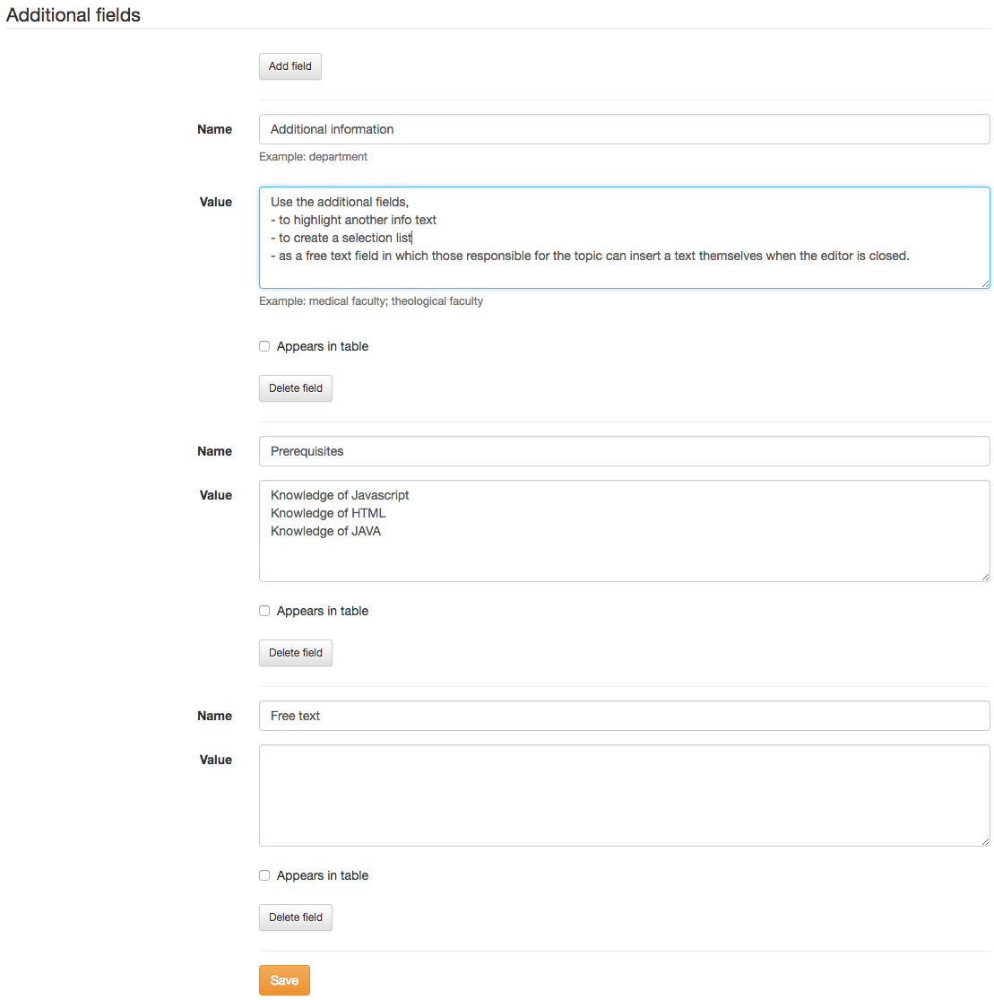
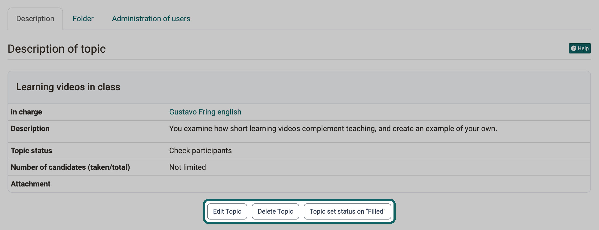
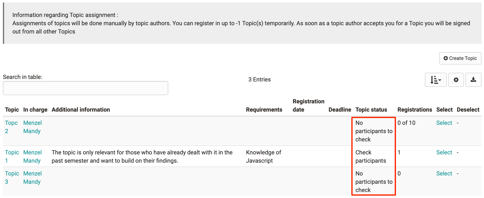
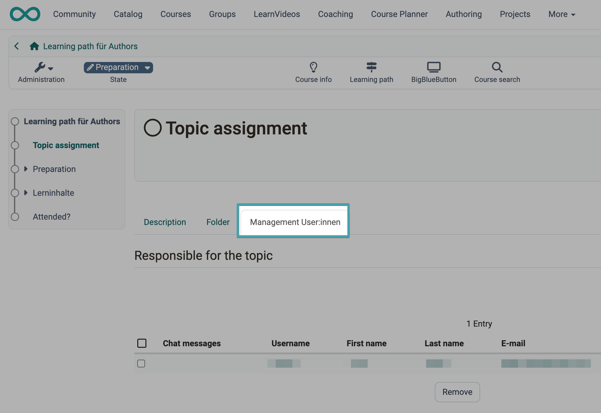

# Course Element "Topic Assignment" {: #topic_assignment}

## Profile

Name | Topic Assignment
---------|----------
Icon | :o_icon_o_projectbroker_icon:
Available since | Release 7.1 or earlier
Functional group | Others
Purpose | Invitation to tender, selection and coaching of topics to be worked on by the course participants
Assessable | no
Specialty / Note |

The course element "Topic assignment" is suitable if you want to announce topics such as term papers in your course and have them supervised. As an owner of the course, you determine the configuration of the topic assignment. This includes, among other things, who may announce and supervise topics, how the topics are described and how many topics participants can select. What makes the course element "Topic assignment" special is that not you as an owner of the course, but topic authors announce and supervise the topics.

## Editor view

###  How to configure topic assignments

In the tab "Configuration", you first determine how many topics participants can select and whether their selection applies immediately or must first be accepted by the topic authors. Furthermore, you add additional fields that describe the topics and appear in the table with all announced topics. Here you also define whether registration and submission are only possible within a certain period. Partial elements are the parts of a course element that you switch on individually. In the tab "Partial elements", you choose whether your topic assignment has a drop box and a return box. Only the folders that are switched on are available in the course element. Participants upload their files to the drop box, and topic authors return files via the return box.

**Do you want to limit the number of topics per participant?:**
If you select this option, a field appears for the number of topics participants may select at most in this course element.

**Topic authors have to accept participants:**
With this option, participants only register temporarily for a topic. The topic authors then select the definitive participants from the candidates and accept them. Without this option, OpenOlat automatically accepts all participants who have registered for the topic. The topic authors can define the maximum number of places beforehand.

**Only one Topic allowed (participants accepted will be signed out automatically from other Topics):** 
With this option, OpenOlat automatically signs participants accepted by topic authors out of all other selected topics. Participants are therefore definitively registered for one topic at most.

**Add additional fields:**
Via "Add field", you add up to five fields of your own for a more detailed description of the topics.

In the field "Name", you enter the desired field name.

You can offer the topic authors predefined values or texts for selection, which appear in a drop-down menu. To do so, enter the options separated by semicolons or line breaks in the field "Value". For a free-text field, leave the field "Value" empty. The topic authors then enter any value.

If you select "Appears in table", OpenOlat shows the field in the topic overview. Otherwise, the information only appears in the detailed topic description.

Via "Delete field", you delete additional fields again.

{ class="shadow lightbox" title="Additional fields in the tab Configuration in the course editor" }

**Registration date:**
Topic authors define a registration deadline for a topic. After this deadline, participants can neither select nor deselect the topic. Topic authors can still sign participants in and out afterwards.

**Due date:**
Once the due date has passed, OpenOlat closes the drop box, and participants can no longer upload documents.

If you select "Appears in table", OpenOlat shows the date in the topic overview.

----

### Further settings for topic assignment  {: #persons}

**How to appoint topic authors - Tab "Persons in charge"**

  In the tab "Persons in charge", you add the persons who may announce and supervise topics. These persons do not need author rights.

  The added persons appear in the group "Responsible for the topic". Use the "Add user" :o_icon_o_icon_add_member: action to open the dialog for adding another person [:octicons-tag-16:{ title="from Release 20.3.1 (OO-9307)" }](https://track.frentix.com/issue/OO-9307){:target="_blank"}.

  If you remove topic authors who have already announced topics, they continue to supervise them but cannot announce new topics.

  If you import the course element "Topic assignment" from another course, OpenOlat automatically enters the importing person as the person in charge of the imported topics, provided they are a member of the target course. If the importing person is not a member of the target course, the imported topics have no person in charge [:octicons-tag-16:{ title="from Release 20.2.2 (OO-9184)" }](https://track.frentix.com/issue/OO-9184){:target="_blank"}.

* **Role of topic authors**

  If the owner of the course enters you in the tab "Persons in charge", you announce and supervise topics yourself. Open the course view and navigate to the topic assignment. As a person in charge, you have access to the associated folders. You also edit the topic, manage the participants of the topic and add further topic authors.

* **Folders - Tab "Partial elements"**

  In the drop box, participants upload files that are then accessible to the topic authors. The topic authors place files in the return box. The prerequisite is that the folders are activated in the configuration in the course editor.

* **Confirmation of submission - Tab "Due date"**

  Optionally, you enter a text that OpenOlat shows the participant in a window after successfully handing in a file. Without your own text, OpenOlat shows something like: This is to confirm that John Miller (jmiller) has sent the file "test.html" on 21-09-04 at 00:14:42.

  If you select the option _Send text additionally as e-mail_, OpenOlat additionally sends the participant an e-mail with the confirmation text after a successful submission.

##  Course view {: #topic_assignment_runtime}

### Create topic

As an owner of the course or as a topic author, you set up new topics. If you enter participants as topic authors, they put topic suggestions in the course themselves, for example for the further design of the course or for potential term papers and presentations.

Click on "Create Topic" and enter the title and description of the topic. Depending on the configuration of the topic assignment, you describe the topic with further details, set the registration and due dates, determine how many participants may select your topic and upload files as attachments if required. You also define whether participants may deselect a topic again and whether the topic authors receive an e-mail on selection and deselection.

!!! tip "Hint"

    If you want to change the configuration later, click on the title of the topic. There you edit the topic, change the topic status from "Vacancies" to "Filled" or vice versa, or delete the topic.

### Create and edit topic in detail

* **Topic:**

  Here is the title of the topic. Topic authors can change it.

* **In charge:**

  Here are the topic authors. A click on a name opens the visiting card of the person, via which you contact them.

!!! info "Important"

    If you create a topic, you automatically appear as the person in charge. In the tab "Administration of users", you transfer this role to another person or appoint further topic authors.

* **Description:**

  In the field "Description", you enter detailed information about the topic.

* **Topic status:**

  In this field, OpenOlat automatically shows the topic status.

  For topic authors and owners of the course, the topic status is "No participants to check" as long as nobody has registered for the topic yet. If participants have registered, the status is "Check participants". If you have accepted participants from the candidates, OpenOlat shows the status "Participants accepted".

* **Limit number of candidates?:**

  Here the topic authors limit the available number of places.

* **Allow deselection of topic?:**

  If the option is activated, participants may also sign out of a topic again.

* **Additional fields:**

  If the owner of the course has set up additional fields in the course editor (see above), they are available to the topic authors here. Depending on the field, the topic authors select a value from a drop-down menu or enter text themselves.

* **Registration date:**

  If the date is set up in the editor, topic authors define a registration deadline here. Only within this period can a topic be selected or deselected. Before and after the deadline, the links "Select" and "Deselect" are deactivated, and participants cannot sign in or out of your topic. Topic authors can sign participants in or out manually before and after the deadline.

* **Due date:**

  If the date is set up in the editor, topic authors define a due date. Only within this period can documents be uploaded to the drop box.

* **Attachment:**

  In the field "Attachment", the topic authors upload a file, for example an extensive document on the topic. You upload multiple files as a ZIP file.

* **E-mail notification when selecting/deselecting Topics:**

  With this option, you receive an e-mail when participants select or deselect your topic.

{ class="shadow lightbox" title="Tab Description of a topic · 2026.11.03" }

Via "Edit Topic", you get to the editing mode and change the listed fields.

Click on "Delete Topic" to remove your topic from the topic assignment.

Select "Topic set status on "Filled"" if no further participants should select the topic.

Via "Reset Topic status to "Vacancies"", you open a topic for selection again, even if participants have already registered and you have accepted them.

!!! info "Important"

    The last two buttons only appear if the owner of the course has configured the topic assignment so that topic authors accept the participants manually.

## "Folder" and "Administration of users" tabs [:octicons-tag-16:{ title="from Release 20.3.1 (OO-9307)" }](https://track.frentix.com/issue/OO-9307){:target="_blank"} {: #folder_user_management}

###  Managing participants

If the configuration of the topic assignment requires topic authors to accept the selection of participants, you see the note "Check participants" in the table on the home page of the topic assignment as soon as somebody has registered for your topic.

{ class="shadow lightbox" title="Home page of the topic assignment" }

{ class="shadow lightbox" title="Tab Administration of users of a topic" }

Open the tab "Administration of users" and accept the candidates.

Via "Accept participant as", you select to whom you assign the topic. OpenOlat adds the accepted persons to the group "Participants accepted" and notifies them by e-mail if you wish. Select the candidates you do not accept and click on "Remove". If you wish, OpenOlat also notifies the rejected candidates by e-mail.

If you have not limited the number of places, you repeat the procedure as often as you like. Then select "Topic set status on "Filled"" in the tab "Description" so that no further participants apply for your topic.

In the group "Participants accepted", you can also add a person manually via the "Add participant" :o_icon_o_icon_add_member: action, without that person going through the application process. Similarly, in the group "Responsible for the topic", you add or remove further topic authors via "Add user". Participants have no right to edit the topic.

### How to upload and return files

In the tab "Folder", section "Drop box", you find all files that participants have submitted. In the section "Return box", you return corrected files. There is one subfolder for each participant.

Subscribe to the drop box of your topic so that OpenOlat notifies you about newly submitted files and you do not have to check yourself. [:octicons-tag-16:{ title="from Release 10.3 (OO-1404)" }](https://track.frentix.com/issue/OO-1404)

## From the user's perspective

If the topic status is "Vacancies", participants register for a topic, as long as they have not yet selected the maximum possible number of topics. If the topic status is "Filled", no further participants can register. If you have already selected a topic, the topic status is either "Temporary assignment" if the topic authors still have to accept you, or "Assigned" if the registration applies automatically. As soon as the topic authors accept you, the topic status changes to "Definite assignment".

## Managing Topics of Topic Assignments

The course element "Topic assignment" is used within an OpenOlat course. The owner of a course configures the course element as needed and determines the topic authors. As a person in charge, you offer the participants topics to choose from and manage the participants of your topics. The participants submit written work via the drop box, and you return the corrected work to them via the return box.

## :o_icon_o_projectbroker_icon: Working with topic assignment

### Select topic {: #select}

In the topic assignment, topic authors provide topics, for example for term papers, presentations, webinars or projects. Depending on the configuration, you select one or more topics, upload files and see the files that the topic authors have returned to you.

### Table overview Topic assignment

As a participant, you see the announced topics in the table and further information, such as the names of the persons in charge, the registration and submission period or the number of free places. You select your desired topic with "Select". Depending on the configuration, you select one or more topics.

**Topic status**: If the topic status is "Vacancies", you sign up for a topic. This is possible until the maximum number of places or the end of the registration deadline is reached. If the topic status is "Filled", no further participants can sign up for this topic. If you have already selected a topic and the topic authors still have to accept you, the topic status is "Temporary assignment". As soon as the topic authors accept you, the topic status changes to "Definite assignment". If the topic assignment is configured without manual acceptance, your selection applies immediately.

As soon as your selection is final, you see the entry in the table and find the link to the group with the title of your topic in the upper right corner (the entry may only appear after your next login). You can only deselect a topic if the topic authors allow it for this topic. If there is a registration deadline, you can no longer sign out after it has passed.

You may not see all of the listed information, because the topic authors do not use all functions.

Click on a topic to get more information about it.

### Topic details

**Topic**: Here is the name of the topic.

**In charge**: Here are the topic authors. A click on a name opens the visiting card of the person, via which you contact them.

**Description**: In the field "Description", you find detailed information about the topic, if specified.

**Additional fields**: You may find further information in additional fields.

**Registration date**: If the topic authors have defined a registration deadline, you only select or deselect a topic within this period. Before and after the registration deadline, the topic authors can sign you in or out manually.

**Due date**: Until this date, you submit files in the folder of the topic assignment.

**Attachment**: In the field "Attachment", the topic authors provide a file.

### Submission process

Optionally, the topic assignment also manages submissions.

**Upload files to the submission folder of the topic assignment**

Click on the title of the topic. In the "Folder" tab, you find the drop box. Depending on the configuration, the submission is bound to a deadline, and you only upload files within the due date. You find detailed information about the dates in the tab "Description".

**Download files from the return folder**

In the "Folder" tab, in the "Return box" section, you find the files that the topic authors have returned to you.

If you are entered as a person in charge, you announce topics yourself. You can read more about this under [Further settings for topic assignment](#persons), and about accepting and coaching participants under ["Folder" and "Administration of users" tabs](#folder_user_management).

## Further information {: #further_information}

[Types of Course Elements >](Course_Elements.md) 
[Course Element "Topic Broker" >](Course_Element_Topic_Broker.md) 
[Course Element "Task" >](Course_Element_Task/index.md)

[To the top of the page ^](#topic_assignment)

