# Kursbaustein "Themenbörse" {: #topic_broker}

## Steckbrief {: #profile}

Name | Themenbörse
---------|----------
Icon | :o_icon_o_icon_topicbroker:
Verfügbar seit | Release 19
Funktionsgruppe | Verwaltung und Organisation
Verwendungszweck | eigenständige Eintragung der Teilnehmer:innen zur Bearbeitung bestimmter Themen
Bewertbar | nein
Spezialität / Hinweis | Im Unterschied zu den Kursbausteinen "Themenvergabe" und "Einschreibung" können in der Themenbörse alle Teilnehmer:innen mehrere Themen mit Prioritäten auswählen. OpenOlat bildet dann anhand dieser Themen- und Priorisierungswünsche Zuteilungen.

Mit dem Kursbaustein "Themenbörse" verteilen Sie Themen fair auf die Teilnehmer:innen eines Kurses. Die Einschreibung verläuft in zwei Schritten: 
1. Schritt: Alle Teilnehmer:innen wählen die Themen, die sie bearbeiten möchten, und legen deren Priorität fest. 
2. Schritt: OpenOlat teilt die Themen den Teilnehmer:innen zu.

Weil OpenOlat erst nach Ende des Auswahlzeitraums zuteilt, hängt die Zuteilung nicht davon ab, wer seine Wünsche zuerst abgegeben hat.

## Funktionsweise {: #topic_broker_functionality}

* Es können 1 oder mehrere Teilnehmer:innen des Kurses an der Themenbörse teilnehmen (keine Betreuer:innen).
* Es können 1 oder mehrere Themen zur Auswahl angeboten werden.
* Die Teilnehmer:innen können zu ihren gewählten Themen eine Prioritäten-Reihenfolge angeben.
* Es kann sowohl eine Themenauswahl, wie auch eine Begrenzung der Anzahl Personen pro Thema vorgegeben werden. Auch eine Begrenzung auf Gruppen ist möglich.
* Es kann auch eine bestimmte Anzahl Themen je Teilnehmer:in verpflichtend gemacht werden.
* Die Themenwahl ist auf ein bestimmtes Zeitfenster beschränkt.
* OpenOlat kann nach Schliessen des Zeitfensters anhand der angegebenen Prioritäten berechnen, wer welche Themen zugewiesen bekommt. Die Berechnung kann automatisch oder manuell angestossen werden. Das manuelle Anstossen der Zuordnung (empfohlen) ist den Kursbesitzer:innen vorbehalten.

[zum Seitenanfang ^](#topic_broker)

## Der Algorithmus für eine automatische Themenzuordnung [:octicons-tag-16:{ title="ab Release 19.0 (OO-7555)" }](https://track.frentix.com/issue/OO-7555) {: #topic_broker_algorithm}

Funktioniert ein Auswahl- und Zuordnungsverfahren nach dem Prinzip "first-come - first-serves" (wer zuerst kommt, wird zuerst bedient), dann ist dies unfair. Man kennt dies von der Vergabe von Tickets für Fussballspiele und Konzerte. Benutzer:innen mit besserer Internetverbindung werden bevorzugt, genauso wie Benutzer:innen, die zum Zeitpunkt der Veröffentlichung sofort Zeit für die Anmeldung haben.

Das Problem ist als "Stable Matching" Problem bekannt. Details zur Implementierung in OpenOlat finden Sie hier: [OpenOlat_Project_Broker_Matching_Algorithm.pdf](assets/OpenOlat_Project_Broker_Matching_Algorithm.pdf)

Die Themenvergabe im Kursbaustein Themenbörse geschieht deshalb in 2 Schritten:

- Wahl des Themas/Projektes/der Gruppe und Angabe der persönlichen Prioritäten (erste Wahl, zweite Wahl, usw.).
- Nach Ende des Auswahlzeitraums ordnet OpenOlat die Themen zu. Wurde ein Thema öfter mit erster Priorität gewünscht als Plätze vorhanden sind, verteilt der faire Algorithmus die Plätze anhand der Angaben zur zweiten Priorität.

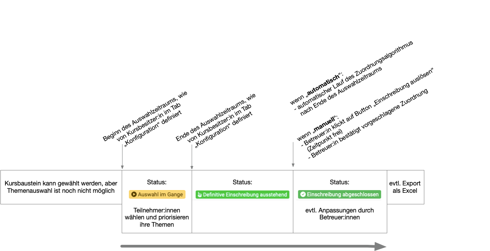{ class="shadow lightbox" title="Phasen der Themenbörse" }

!!! note "Hinweis"

    Aufgrund der vorangehend beschriebenen Funktionsweise ist verständlich, dass die Themenbörse in offenen Kursen, mit undefinierter Anzahl Teilnehmer:innen, nicht verwendet werden kann.

[zum Seitenanfang ^](#topic_broker)

## Wer kann wählbare Themen erfassen? {: #topic_broker_eligible_topics}

* Per Voreinstellung erfassen die Kursbesitzer:innen die Themen.

* Betreuer:innen kann im Tab "Konfiguration" unter "Berechtigungen" das Recht "Thema bearbeiten" erteilt werden. Sie erfassen Themen dann in der Kursansicht im Tab "Themen".

* Betreuer:innen kann auch das Recht "Teilnehmer:innen bearbeiten" erteilt werden (Thema zuweisen, Priorisierung anpassen, Teilnehmer:innen ein- oder ausschreiben).

* Themen lassen sich auch aus einer Excel-Tabelle importieren, siehe [Themen importieren](#topic_broker_import_topics).

[zum Seitenanfang ^](#topic_broker)

---

## Themenbörse einrichten (Perspektive Kursbesitzer:in) {: #topic_broker_setup}

Bevor die Teilnehmer:innen wählen, legen Sie im Kurseditor die Regeln der Themenbörse, die Zusatzfelder und die Themen fest. Die Tabs "Konfiguration", "Benutzerdefinierte Felder" und "Themen" finden Sie unter: 
`Kurs > Administration > Kurseditor > Kursbaustein "Themenbörse"`

### Tab "Konfiguration" {: #topic_broker_setup_tab_config}

Im Tab "Konfiguration" legen Sie fest, wann und wie viele Themen die Teilnehmer:innen wählen, wie OpenOlat sie danach einschreibt und wer neben den Kursbesitzer:innen Themen und Teilnehmer:innen bearbeiten darf. Das Formular ist in die Bereiche "Themenauswahl", "Einschreibung" und "Berechtigungen" gegliedert.

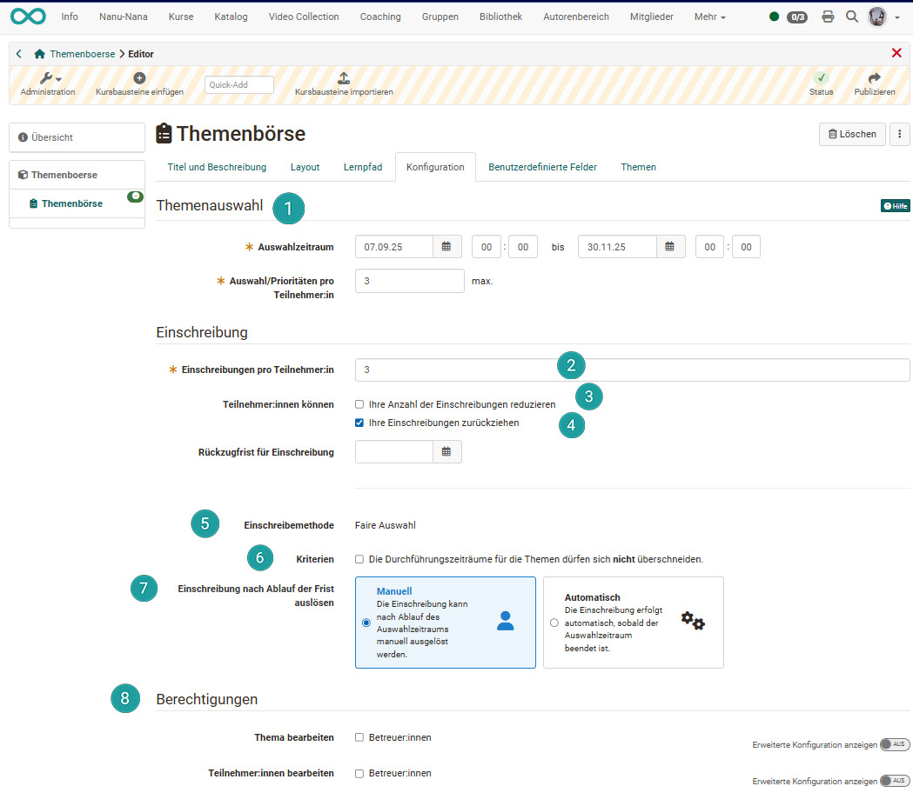{ class="shadow lightbox" title="Tab Konfiguration im Kurseditor" }

#### Themenauswahl {: #topic_broker_config_topic_selection}

Im Bereich "Themenauswahl" legen Sie fest, wann und wie viele Themen die Teilnehmer:innen wählen.

##### Relatives Datum {: #topic_broker_relative_dates}

Der Schalter erscheint nur, wenn der Kurs einen Durchführungszeitraum mit Beginn hat. Eingeschaltet legen Sie den Beginn des Auswahlzeitraums relativ zu "Kurs Beginn" fest und geben im Feld "Dauer des Auswahlzeitraumes" an, wie viele Tage er dauert.

##### Auswahlzeitraum {: #topic_broker_selection_period}

Der Auswahlzeitraum ist das Zeitfenster, innerhalb dessen die Teilnehmer:innen ihre Themenwünsche abgeben müssen. Nach Ende des Auswahlzeitraums folgt die Einschreibung, automatisch oder manuell, je nach Einstellung im Feld "Einschreibung nach Ablauf der Frist auslösen".

!!! info "Wichtig"

    Kursbesitzer:innen können den Auswahlzeitraum auch dann noch ändern, wenn OpenOlat die Teilnehmer:innen bereits eingeschrieben hat. In diesem Fall ändert sich der Status wieder auf "Auswahl im Gange". Bestehende Einschreibungen bleiben unverändert, die Teilnehmer:innen können sie jedoch wieder anpassen.

##### Auswahl/Prioritäten pro Teilnehmer:in {: #topic_broker_selections_per_participant}

Die Teilnehmer:innen ordnen die gewählten Themen nach ihren Prioritäten. In diesem Feld geben Sie an, wie viele Themen dabei höchstens zählen. Weitere Themen in der Liste einer Person tragen den Status "Überzählig" und zählen bei der Einschreibung nicht.

"Auswahlzeitraum" und "Auswahl/Prioritäten pro Teilnehmer:in" sind Pflichtfelder.

#### Einschreibung {: #topic_broker_config_enrollment}

Im Bereich "Einschreibung" legen Sie fest, für wie viele Themen OpenOlat jede Person einschreibt und wie die Einschreibung ausgelöst wird.

##### Einschreibungen pro Teilnehmer:in {: #topic_broker_enrollments_per_participant}

Hier legen Sie fest, für wie viele Themen eine Teilnehmerin oder ein Teilnehmer letztendlich eingeschrieben wird, unabhängig von der Anzahl der Prioritäten. Diese Angabe ist verbindlich.

##### Teilnehmer:innen können {: #topic_broker_participants_can}

- **Ihre Anzahl der Einschreibungen reduzieren**: Teilnehmende können die Zahl aus "Einschreibungen pro Teilnehmer:in" während des Auswahlzeitraums für sich selbst verkleinern, z.B. wenn sie gar nicht mehrere Themen bearbeiten möchten.
- **Ihre Einschreibungen zurückziehen**: Teilnehmende können sich nach der Einschreibung wieder aus einem Thema austragen.

##### Rückzugfrist für Einschreibung {: #topic_broker_withdraw_deadline}

Das Feld erscheint, wenn "Ihre Einschreibungen zurückziehen" angehakt ist. Hier tragen Sie das Datum ein, bis zu dem Teilnehmende eine Einschreibung zurückziehen können. Mit eingeschaltetem "Relatives Datum" geben Sie stattdessen an, wie viele Tage nach dem Auswahlzeitraum das Zurückziehen möglich bleibt.

##### Einschreibemethode {: #topic_broker_enrollment_method}

Verfügbar ist die Methode ["Faire Auswahl"](#topic_broker_algorithm).

##### Kriterien {: #topic_broker_criteria}

Themen können einen Durchführungszeitraum haben, z.B. wenn sie mit einer Präsenzveranstaltung verbunden sind. Damit einer Person keine Themen zugewiesen werden, deren Termine sich überschneiden, setzen Sie das Häkchen bei "Die Durchführungszeiträume für die Themen dürfen sich nicht überschneiden.". Der Algorithmus berücksichtigt dann die Durchführungszeiträume bei der Einschreibung.

##### Einschreibung nach Ablauf der Frist auslösen {: #topic_broker_trigger_enrollment}

Nach Ablauf des Auswahlzeitraums gibt es zwei Möglichkeiten, die Verteilung der Teilnehmenden auszulösen: "Manuell" durch die Kursbesitzer:innen (siehe [Manuelle Einschreibung](#topic_broker_assignment_manually)) oder "Automatisch" durch OpenOlat nach Ende des Auswahlzeitraums.

Wählen Sie "Automatisch", erscheint das Feld "Optimierungsstrategie". Dort legen Sie fest, nach welchem Prinzip OpenOlat die Teilnehmenden automatisch verteilt:

- **Maximale Anzahl Einschreibungen**: Hohe Einschreibequote bei minimaler Warteliste
- **Maximale Prioritätsberücksichtigung**: Hoher Grad an Erfüllung der Prioritäten der Teilnehmer:innen
- **Maximale Themenanzahl**: Hohe Themenquote durch ausreichende Teilnehmerzahl

#### Berechtigungen {: #topic_broker_config_rights}

Bei Bedarf können neben den Kursbesitzer:innen auch Betreuer:innen das Recht erhalten, Themen und/oder Teilnehmende zu bearbeiten.

##### Thema bearbeiten {: #topic_broker_edit_topic}

Standardmässig ist das Recht zum Bearbeiten der Themen den Kursbesitzer:innen vorbehalten. Mit dem Häkchen bei "Betreuer:innen" erhalten auch die Betreuer:innen dieses Recht. 
Mit dem Schalter "Erweiterte Konfiguration anzeigen" am rechten Rand vergeben Sie das Recht gezielt an Rollen, einzelne Personen oder Gruppen, auf Wunsch mit Beginn und Ende.

##### Teilnehmer:innen bearbeiten {: #topic_broker_edit_participants}

Standardmässig ist das Recht zum Übersteuern und Bearbeiten einer getroffenen Themenauswahl den Kursbesitzer:innen vorbehalten. Mit dem Häkchen bei "Betreuer:innen" erhalten auch die Betreuer:innen dieses Recht. (Ohne das Recht haben sie nur Leserecht, wenn sie einen der Namen wählen.) Die Möglichkeit zum Übersteuern sollte jedoch möglichst nur in Ausnahmefällen benutzt werden, denn sie läuft der eigentlichen Absicht zuwider, eine faire Verteilung durch einen neutralen Algorithmus zu ermöglichen. 
Mit dem Schalter "Erweiterte Konfiguration anzeigen" am rechten Rand vergeben Sie auch dieses Recht gezielt an Rollen, einzelne Personen oder Gruppen.

[nach oben (Perspektive Kursbesitzer:in) ^](#topic_broker_setup) 
[zum Seitenanfang ^](#topic_broker)

### Tab "Benutzerdefinierte Felder" {: #topic_broker_setup_tab_custom_fields}

Brauchen die Teilnehmer:innen für ihre Wahl weitere Angaben zu jedem Thema, etwa ECTS-Punkte oder ein Merkblatt, erstellen Sie dafür im Tab "Benutzerdefinierte Felder" Zusatzfelder. Jedes Zusatzfeld erscheint in jedem Thema. Über die drei Punkte am Ende einer Zeile bearbeiten oder löschen Sie ein Feld jederzeit.

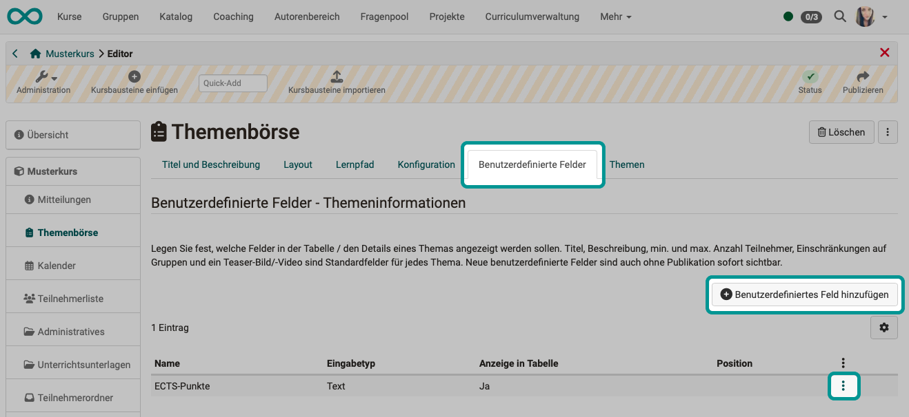{ class="shadow lightbox" title="Tab Benutzerdefinierte Felder im Kurseditor" }

Mit "Benutzerdefiniertes Feld hinzufügen" öffnet sich ein Dialog mit diesen Feldern:

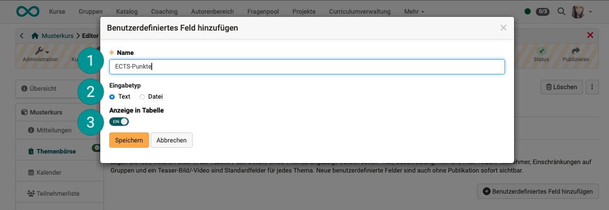{ class="shadow lightbox" title="Dialog Benutzerdefiniertes Feld hinzufügen" }

#### Name {: #topic_broker_custom_field_name}

Der hier eingegebene Name erscheint als zusätzliches Feld im Dialog "Thema hinzufügen".

#### Eingabetyp {: #topic_broker_custom_field_input_type}

- **Text**: Beim Erfassen kann zu jedem Thema eine Angabe in Textform eingegeben werden. Beim [Import](#topic_broker_import_topics) erhält jedes Textfeld eine eigene Spalte.
- **Datei**: Beim Erfassen kann zu jedem Thema eine Datei hochgeladen werden, z.B. eine PDF-Datei mit Informationen zum Thema. Beim [Import](#topic_broker_import_topics) erhält jedes Dateifeld einen eigenen Ordner in der Vorlage "files_import_template.zip".

#### Anzeige in Tabelle {: #topic_broker_custom_field_display_in_table}

Ist der Schalter eingeschaltet, erscheint dieses Feld standardmässig als Spalte in der Tabelle im Tab "Themen".

[nach oben (Perspektive Kursbesitzer:in) ^](#topic_broker_setup) 
[zum Seitenanfang ^](#topic_broker)

### Tab "Themen" (Erfassen von Themen) {: #topic_broker_setup_tab_topic}

Die wählbaren Themen fügen Kursbesitzer:innen im Kurseditor im Tab "Themen" hinzu und beschreiben sie dort mit "Thema hinzufügen". Dasselbe ist auch in der Kursansicht möglich, wenn Sie den Kursbaustein wählen, je nach Konfiguration auch durch Betreuer:innen.

Im Dialog "Thema hinzufügen" stehen unter "Standard-Felder" die Felder "Kennzeichen", "Titel", "Beschreibung", "Anzahl Teilnehmer:innen" mit Min. und Max., "Durchführungszeitraum", "Gruppeneinschränkung", "Teaser-Bild" und "Teaser-Video". Mit der Gruppeneinschränkung sehen nur die Mitglieder der gewählten Gruppen das Thema. Darunter folgen unter "Benutzerdefinierte Felder" die Zusatzfelder aus dem gleichnamigen Tab. Hochladen lassen sich ein Teaser-Bild bis 2 MB, ein Teaser-Video bis 100 MB und je Dateifeld eine Datei bis 10 MB.

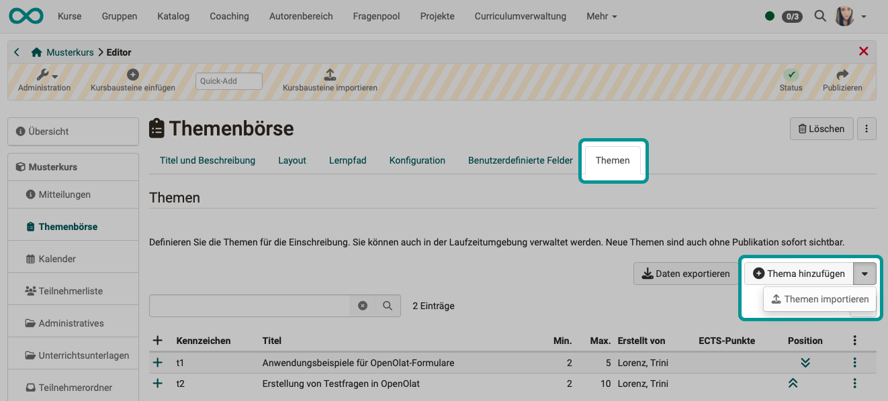{ class="shadow lightbox" title="Tab Themen im Kurseditor" }

Im nachstehenden Beispiel ist im unteren Bereich zusätzlich ein Feld enthalten, das im Tab "Benutzerdefinierte Felder" hinzugefügt wurde.

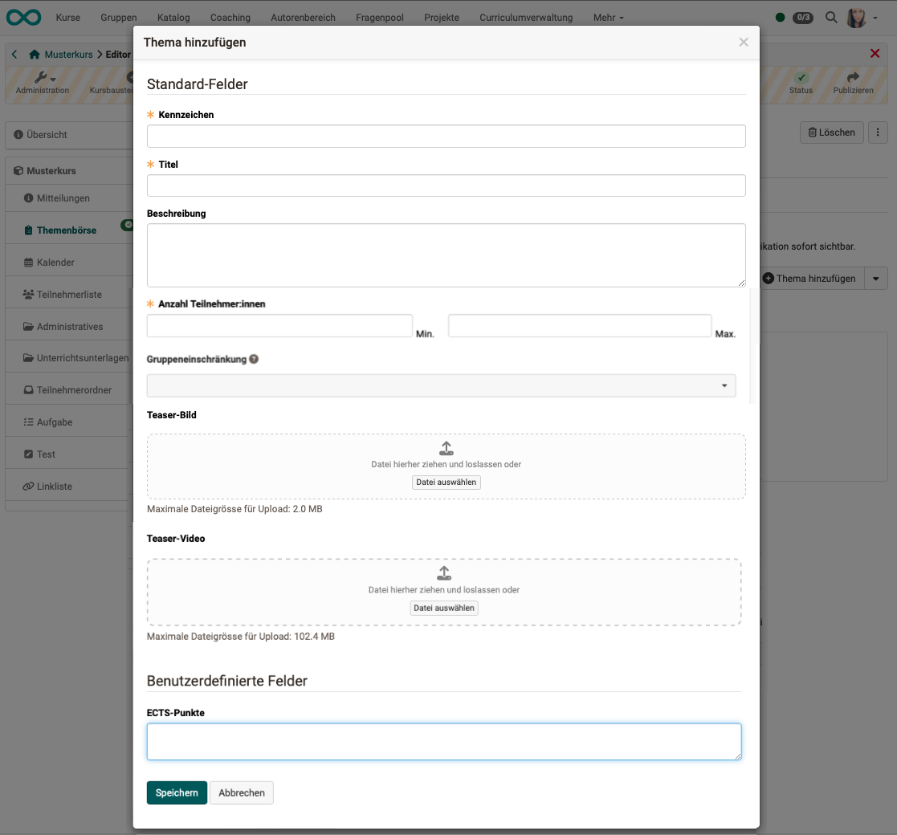{ class="shadow lightbox" title="Dialog Thema hinzufügen" }

[nach oben (Perspektive Kursbesitzer:in) ^](#topic_broker_setup) 
[zum Seitenanfang ^](#topic_broker)

---

### Themen und Daten exportieren/importieren {: #topic_broker_export_import_topics}

Mit dem Export sichern Sie Themen, Wünsche und Einschreibungen als Datei oder übernehmen die Themen in einen anderen Kurs. Mit dem Import erfassen Sie viele Themen auf einmal, samt Teaser-Bildern, Teaser-Videos und Dateien.

#### Themen exportieren {: #topic_broker_export_topics}

Wählen Sie im Kurseditor den Kursbaustein, dann den Tab "Themen" und dort den Button "Daten exportieren". Der Button steht auch in der Kursansicht zur Verfügung, wenn Sie den Kursbaustein und den Tab "Themen" wählen.

OpenOlat erstellt die ZIP-Datei "topicbroker.zip". Sie enthält:

- die Excel-Datei "topicbroker.xlsx" mit dem Tabellenblatt "Themen" (alle Themen) und dem Tabellenblatt "Teilnehmende" (je Person und Thema die Priorität und die Einschreibung),
- den Ordner "topic files" mit Teaser-Bild, Teaser-Video und den Dateien der benutzerdefinierten Felder je Thema,
- den Ordner "topic enrollments" mit einer Excel-Datei je Thema.

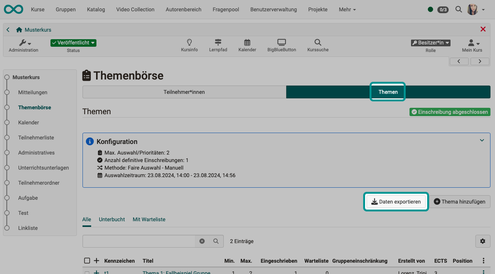{ class="shadow lightbox" title="Tab Themen in der Kursansicht" }

#### Themen importieren {: #topic_broker_import_topics}

Mit dem Import legen Sie mehrere Themen gleichzeitig an oder übernehmen Themen aus einem anderen Kursbaustein "Themenbörse". Gibt es im Kursbaustein schon ein Thema mit demselben Kennzeichen, aktualisiert OpenOlat dieses Thema mit den importierten Angaben.

Klicken Sie im Tab "Themen" auf den kleinen Pfeil neben dem Button "Thema hinzufügen" und wählen Sie "Themen importieren". Der Eintrag steht im Kurseditor und in der Kursansicht zur Verfügung, solange die Einschreibung nicht abgeschlossen ist. In der Kursansicht sehen ihn Kursbesitzer:innen und Betreuer:innen mit dem Recht "Thema bearbeiten".

{ class="shadow lightbox" title="Tab Themen im Kurseditor" }

Es öffnet sich das Fenster "Themen importieren" mit den Schritten "Themen" und "Übersicht". Im Schritt "Themen" füllen Sie den Bereich "Themen", den Bereich "Dateien" oder beide aus. Im Schritt "Übersicht" sehen Sie die erkannten Themen mit allfälligen Meldungen, bevor Sie mit "Fertigstellen" importieren.

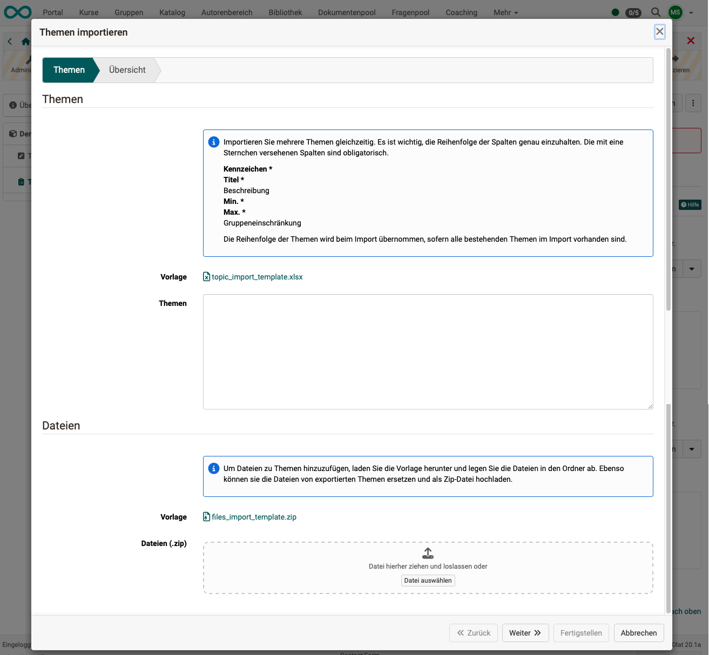{ class="shadow lightbox" title="Schritt Themen im Fenster Themen importieren" }

**Bereich "Themen"** 
Hier fügen Sie die Themen als Zeilen einer Excel-Tabelle ein. Kopieren Sie in Excel die Zeilen mit den Themen, ohne die Kopfzeile, und fügen Sie sie in das Textfeld "Themen" ein. Die Spalten müssen genau in dieser Reihenfolge stehen, die Spalten mit Stern (*) sind Pflicht:

Kennzeichen *, Titel *, Beschreibung, Min. *, Max. *, Beginn, Ende, Gruppeneinschränkung, danach je eine Spalte für jedes benutzerdefinierte Feld vom Eingabetyp "Text", in der Reihenfolge der Felder im Tab "Benutzerdefinierte Felder".

Jedes Kennzeichen darf im Import nur einmal vorkommen. Es darf keine Zeichen enthalten, die in einem Ordnernamen nicht erlaubt sind, denn OpenOlat verwendet es als Ordnername für die Dateien des Themas. Ein Kennzeichen, das sich von einem bestehenden nur in der Gross- und Kleinschreibung unterscheidet, lehnt OpenOlat ab. "Beginn" und "Ende" tragen Sie als Datum ein, zum Beispiel 15.03.2027. Enthält der Import alle bestehenden Themen, übernimmt OpenOlat die Reihenfolge der Zeilen als Reihenfolge der Themen.

Neben der Beschriftung "Vorlage" laden Sie mit dem Link "topic_import_template.xlsx" eine Excel-Tabelle herunter, die nur diese Kopfzeile enthält. OpenOlat erstellt die Vorlage beim Herunterladen für diesen Kursbaustein, sie enthält deshalb auch die Spalten Ihrer benutzerdefinierten Textfelder. Tragen Sie die Themen unter der Kopfzeile ein und kopieren Sie die Zeilen in das Textfeld.

Themen aus einem anderen Kurs übernehmen Sie über dessen Export: Entpacken Sie die ZIP-Datei "topicbroker.zip" und kopieren Sie die Zeilen aus dem Tabellenblatt "Themen" der Datei "topicbroker.xlsx". Die Spalten stehen dort in derselben Reihenfolge. Die Werte der benutzerdefinierten Textfelder kommen richtig an, wenn beide Kursbausteine dieselben Textfelder in derselben Reihenfolge haben.

**Bereich "Dateien"** 
Hier fügen Sie den Themen Teaser-Bild, Teaser-Video und die Dateien der benutzerdefinierten Felder vom Eingabetyp "Datei" hinzu. Neben der Beschriftung "Vorlage" laden Sie mit dem Link "files_import_template.zip" die passende Ordnerstruktur herunter. OpenOlat erstellt sie beim Herunterladen für diesen Kursbaustein: Für jedes bestehende Thema gibt es einen Ordner mit dem Kennzeichen als Namen, darin die leeren Ordner "teaserimage", "teaservideo" und je einen Ordner für jedes benutzerdefinierte Feld vom Eingabetyp "Datei". Für ein neues Thema, das Sie im selben Import im Bereich "Themen" einfügen, legen Sie einen Ordner mit dessen Kennzeichen in derselben Struktur an.

Legen Sie in jeden Ordner höchstens eine Datei, packen Sie die Ordner wieder als ZIP-Datei und laden Sie diese im Feld "Datei (.zip)" hoch. Statt der Vorlage können Sie auch die ganze ZIP-Datei aus "Daten exportieren" hochladen: OpenOlat übernimmt die Dateien aus deren Ordner "topic files". Dateien ordnet OpenOlat nur Themen zu, die es im Kursbaustein schon gibt oder die Sie im selben Import im Bereich "Themen" einfügen. [:octicons-tag-16:{ title="ab Release 20.1 (OO-7898)" }](https://track.frentix.com/issue/OO-7898)

[nach oben (Perspektive Kursbesitzer:in) ^](#topic_broker_setup) 
[zum Seitenanfang ^](#topic_broker)

---

## Themenbörse betreuen (Perspektive Kursbetreuer:in) {: #topic_broker_coaching}

Sobald die Themenbörse läuft, begleiten Kursbesitzer:innen und Betreuer:innen die Wahl in der Kursansicht: Sie sehen, wer schon gewählt hat, und korrigieren bei Bedarf die Einschreibungen. Die Tabs "Teilnehmer:innen", "Themen" und "Aktivitätslog" finden Sie unter: 
`Kurs > Kursbaustein "Themenbörse"`

Was Betreuer:innen dort bearbeiten dürfen, legen die Kursbesitzer:innen im Tab "Konfiguration" unter "Berechtigungen" fest. Den manuellen Einschreibevorgang starten nur Kursbesitzer:innen.

### Erfassen von Themen {: #topic_broker_coaching_capture_topics}

Die wählbaren Themen können schon durch Kursbesitzer:innen hinzugefügt und beschrieben worden sein (im Kurseditor im Tab "Themen"). Haben Kursbesitzer:innen Ihnen das Recht "Thema bearbeiten" erteilt, erfassen Sie als Betreuer:in ebenfalls Themen. Dazu wählen Sie in der Kursansicht den Kursbaustein und den Tab "Themen". Mit "Thema hinzufügen" erstellen Sie ein Thema. Über den kleinen Pfeil daneben und "Themen importieren" importieren Sie mehrere Themen und ihre Dateien, die Vorlagen dazu laden Sie im Fenster "Themen importieren" herunter (siehe [Themen importieren](#topic_broker_import_topics)).

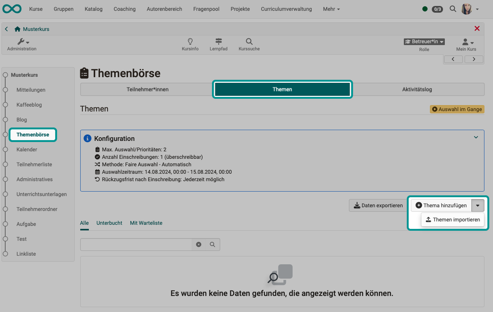{ class="shadow lightbox" title="Tab Themen in der Kursansicht" }

[nach oben (Perspektive Kursbetreuer:in) ^](#topic_broker_coaching) 
[zum Seitenanfang ^](#topic_broker)

### Ansicht der Themenwünsche {: #topic_broker_coaching_view_topic_requests}

Im Tab "Teilnehmer:innen" sehen Sie als Betreuer:in, wer die Themenwünsche schon abgegeben hat, auf der Warteliste steht oder schon eingeschrieben ist. Mit Klick auf das + vor einem der Namen öffnet sich die Detailansicht.

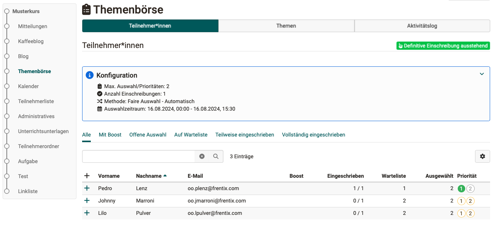{ class="shadow lightbox" title="Tab Teilnehmer:innen in der Kursansicht" }

!!! tip "Tipp"

    Haben Betreuer:innen das Recht "Teilnehmer:innen bearbeiten" erhalten, können sie jederzeit eingreifen und eine getroffene Auswahl übersteuern oder bei fehlender Auswahl eine Auswahl für die Person treffen.
    Mit "Thema auswählen" in der Detailansicht fügen sie der Person auch ein weiteres Thema hinzu.

    Nutzen Sie diese Möglichkeit nur in Ausnahmefällen.

[nach oben (Perspektive Kursbetreuer:in) ^](#topic_broker_coaching) 
[zum Seitenanfang ^](#topic_broker)

### Themenzuordnung (Definitive Einschreibung ausstehend) {: #topic_broker_coaching_topic_assignment}

Der Status oben rechts zeigt, in welcher Phase die Themenbörse steht:

* "Nicht gestartet"
* "Auswahl im Gange"
* "Definitive Einschreibung ausstehend"
* "Einschreibung abgeschlossen"

Mit dem Ende des Auswahlzeitraums ist die Phase "Auswahl im Gange" beendet, auch wenn noch nicht alle Teilnehmer:innen gewählt haben. Der Status wechselt zu "Definitive Einschreibung ausstehend".

Jetzt ordnet OpenOlat Teilnehmer:innen und Themen einander zu, anhand der Themen- und Priorisierungswünsche. Dazu verwendet OpenOlat einen [fairen Algorithmus](assets/OpenOlat_Project_Broker_Matching_Algorithm.pdf).

Die Zuordnung startet automatisch oder wird manuell angestossen. Welche der beiden Arten gilt, legen Kursbesitzer:innen im Kurseditor im Tab "Konfiguration" fest.

[nach oben (Perspektive Kursbetreuer:in) ^](#topic_broker_coaching) 
[zum Seitenanfang ^](#topic_broker)

### Automatische Einschreibung/Themenzuordnung {: #topic_broker_assignment_automatically}

Haben Kursbesitzer:innen im Kurseditor im Tab "Konfiguration" bei "Einschreibung nach Ablauf der Frist auslösen" die Option "Automatisch" gewählt, startet der Zuordnungsalgorithmus kurze Zeit nach dem Schliessen des Auswahlzeitraums von selbst. (Wie lange der Prozess läuft, hängt z.B. von der Anzahl der Themen und Teilnehmer:innen ab.)

Der Zuordnungsalgorithmus läuft nur einmal. OpenOlat schreibt die Teilnehmer:innen anhand des gefundenen Zuordnungsergebnisses ein.

Betreuer:innen mit dem Recht "Teilnehmer:innen bearbeiten" können die Einschreibungen danach manuell nachbessern und abändern (siehe [Korrektur](#topic_broker_adjustment)).

Nach einer automatischen Zuordnung erhalten alle Teilnehmer:innen, die eine Auswahl getroffen haben, eine E-Mail mit ihren Einschreibungen. Wer keine Auswahl getroffen hat, erhält keine E-Mail.

[nach oben (Perspektive Kursbetreuer:in) ^](#topic_broker_coaching) 
[zum Seitenanfang ^](#topic_broker)

### Manuelle Einschreibung (Themenzuordnung) {: #topic_broker_assignment_manually}

Haben Kursbesitzer:innen im Kurseditor im Tab "Konfiguration" bei "Einschreibung nach Ablauf der Frist auslösen" die Option "Manuell" gewählt, starten Kursbesitzer:innen den Zuordnungsalgorithmus selbst. Den Button "Einschreibevorgang starten" im Tab "Teilnehmer:innen" sehen nur Kursbesitzer:innen, Betreuer:innen sehen ihn nicht.

Der Zeitpunkt, wann Sie die Einschreibung auslösen, ist nicht festgelegt. Während der Zuordnung befindet sich der Kursbaustein immer noch im Status "Definitive Einschreibung ausstehend".

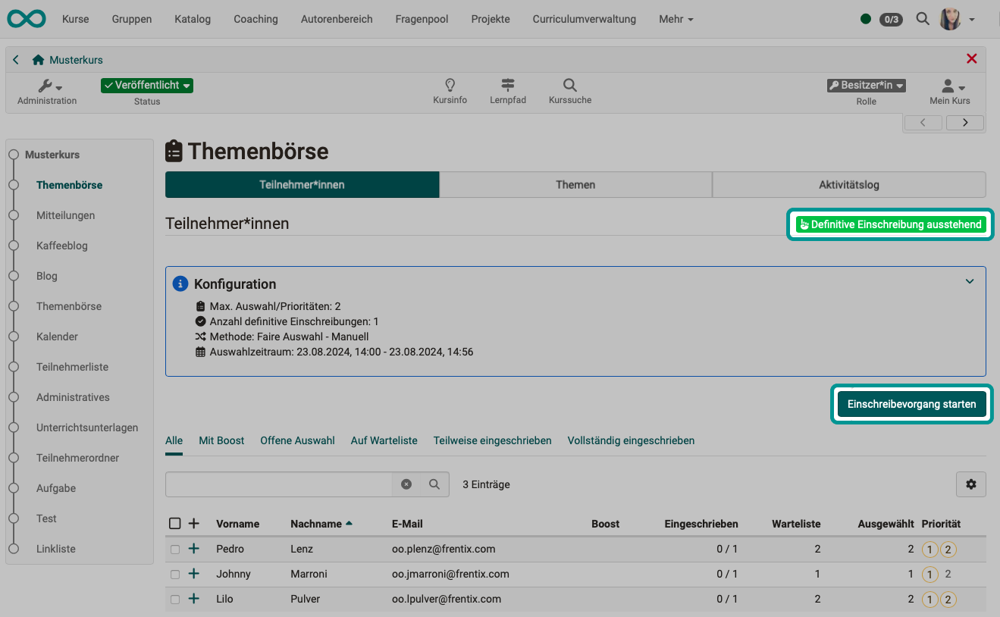{ class="shadow lightbox" title="Tab Teilnehmer:innen in der Kursansicht" }

Bei manuellem Anstossen des Zuordnungsalgorithmus sind mehrere Durchläufe möglich. Die Ergebnisse weichen voneinander ab, weil im Algorithmus auch ein Zufallsfaktor enthalten ist. Jeder Durchlauf zeigt bereits das beste von vielen berechneten Resultaten. Mit "Erneut ausführen" berechnen Sie einen weiteren Durchlauf. Die Durchläufe stehen in einem Dropdown, daraus wählen Sie den Durchlauf aus, der für die endgültige Einschreibung gelten soll.

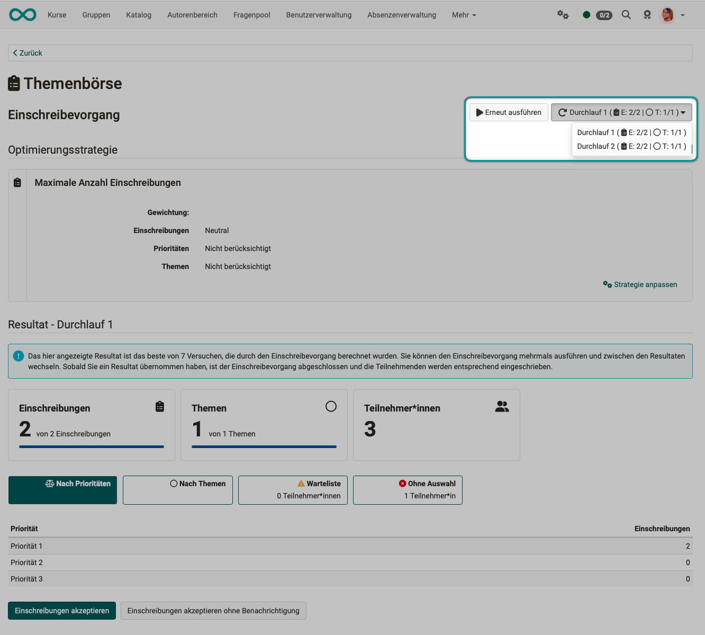{ class="shadow lightbox" title="Seite Einschreibevorgang" }

Haben Sie sich für einen Durchlauf (ein Zuordnungsergebnis) entschieden, schreibt OpenOlat die Teilnehmer:innen nach dieser Zuordnung ein:

- "Einschreibungen akzeptieren" informiert die Teilnehmer:innen mit einer Auswahl anschliessend per E-Mail über ihre Einschreibungen.
- "Einschreibungen akzeptieren ohne Benachrichtigung" schreibt ein, ohne E-Mail zu versenden.

In beiden Fällen bestätigen Sie den Schritt nochmals im Dialog "Einschreibungen akzeptieren" mit dem Häkchen "Einschreibungen akzeptieren" und dem Button "Akzeptieren".

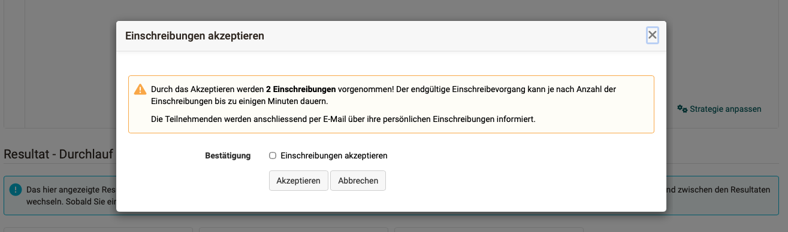{ class="shadow lightbox" title="Dialog Einschreibungen akzeptieren" }

!!! tip "Tipp"

    Stehen nach Klick auf "Akzeptieren" noch Personen auf der Warteliste oder ohne Auswahl, können Sie diese manuell zuordnen (siehe [Korrektur](#topic_broker_adjustment)). 
    Das ist z.B. nötig, wenn eine Person bis zum Ende des Auswahlzeitraums kein Thema gewählt hat und der Algorithmus sie deshalb nicht zuordnen konnte.

[nach oben (Perspektive Kursbetreuer:in) ^](#topic_broker_coaching) 
[zum Seitenanfang ^](#topic_broker)

### Optimierung durch Strategieanpassung [:octicons-tag-16:{ title="ab Release 20.1 (OO-8540)" }](https://track.frentix.com/issue/OO-8540) {: #topic_broker_adapt_strategy}

OpenOlat vergibt die Themen nach einer Optimierungsstrategie. Je nach Strategie erhalten möglichst viele Personen einen Platz, möglichst viele ihre erste Priorität oder möglichst viele Themen genug Teilnehmende. Beim manuellen Einschreibevorgang wählen Kursbesitzer:innen die Strategie selbst. Verwenden Sie dazu auf der Seite "Einschreibevorgang" den Link "Strategie anpassen" am rechten Rand bei den Angaben zur Optimierungsstrategie.

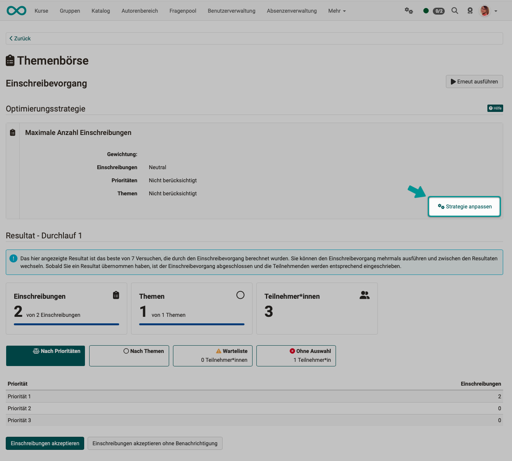{ class="shadow lightbox" title="Seite Einschreibevorgang" }

Es stehen dann folgende Strategien zur Auswahl:

* Maximale Anzahl Einschreibungen (Hohe Einschreibequote bei minimaler Warteliste)
* Maximale Prioritätsberücksichtigung (Hoher Grad an Erfüllung der Prioritäten der Teilnehmer:innen)
* Maximale Themenanzahl (Hohe Themenquote durch ausreichende Teilnehmerzahl)
* Individuell (Definieren Sie Ihre eigene Gewichtung und Feineinstellungen für die Prioritäten)

Mit "Übernehmen und ausführen" berechnet OpenOlat einen neuen Durchlauf mit der gewählten Strategie.

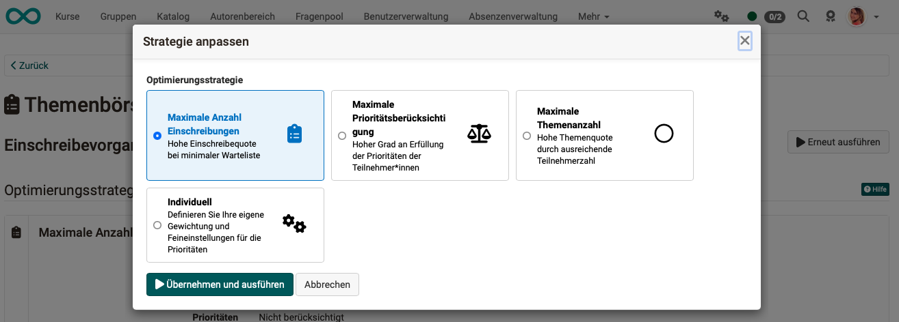{ class="shadow lightbox" title="Dialog Strategie anpassen" }

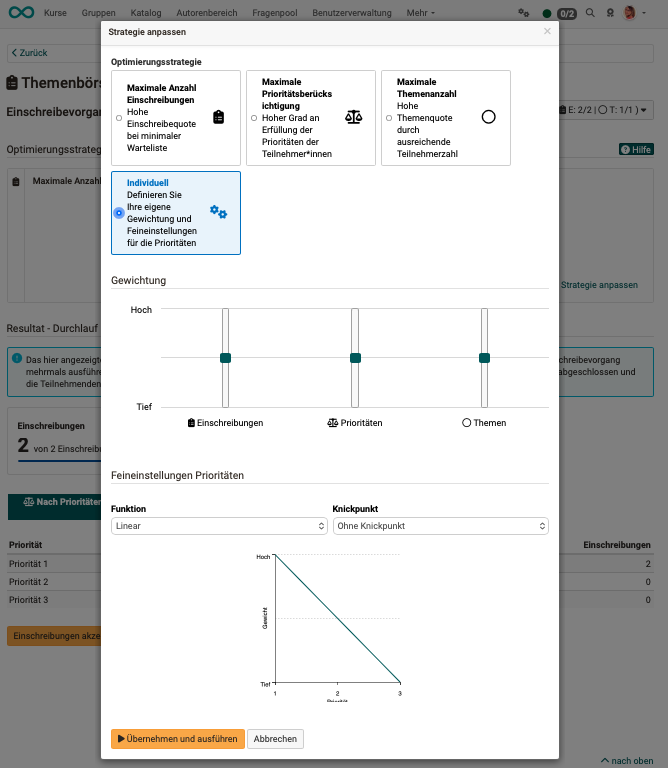{ class="shadow lightbox" title="Dialog Strategie anpassen, Strategie Individuell" }

[nach oben (Perspektive Kursbetreuer:in) ^](#topic_broker_coaching) 
[zum Seitenanfang ^](#topic_broker)

### Einschreibung (Themenzuordnung) beeinflussen {: #topic_broker_boost}

Mit dem Feld "Boost" können Kursbesitzer:innen und Betreuer:innen mit dem Recht "Teilnehmer:innen bearbeiten" pro Einzelperson eine Gewichtung ergänzen und so korrigierend eingreifen. Den Boost wählen Sie im Tab "Teilnehmer:innen" in der Detailansicht einer Person, die Sie mit dem Plus vor dem Namen öffnen. Das Feld lässt sich ändern, bis der Einschreibevorgang gestartet ist. Der Einschreibealgorithmus behandelt die Teilnehmer:innen mit einem Boost bevorzugt.

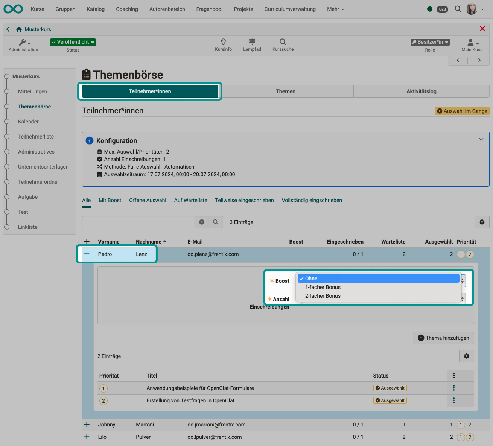{ class="shadow lightbox" title="Tab Teilnehmer:innen in der Kursansicht" }

[nach oben (Perspektive Kursbetreuer:in) ^](#topic_broker_coaching) 
[zum Seitenanfang ^](#topic_broker)

### Korrektur der Einschreibung (Themenzuordnung) durch Betreuer:innen {: #topic_broker_adjustment}

Bleibt eine Person ohne Thema oder passt eine Zuordnung nicht, korrigieren Kursbesitzer:innen und Betreuer:innen mit dem Recht "Teilnehmer:innen bearbeiten" die Auswahl dieser Person, zum Beispiel in der Phase "Definitive Einschreibung ausstehend".

Wählen Sie dazu den Kursbaustein und klicken Sie im Tab "Teilnehmer:innen" auf das Plussymbol vor einem Namen in der Liste. Es öffnet sich die Detailansicht mit der Wahl und den Prioritäten dieser Person.

Über die drei Punkte am Ende einer Zeile schreiben Sie die Person mit "Einschreiben" in dieses Thema ein, ziehen eine Einschreibung mit "Einschreibung zurückziehen" zurück oder entfernen das Thema mit "Auswahl zurücksetzen" aus ihrer Auswahl.

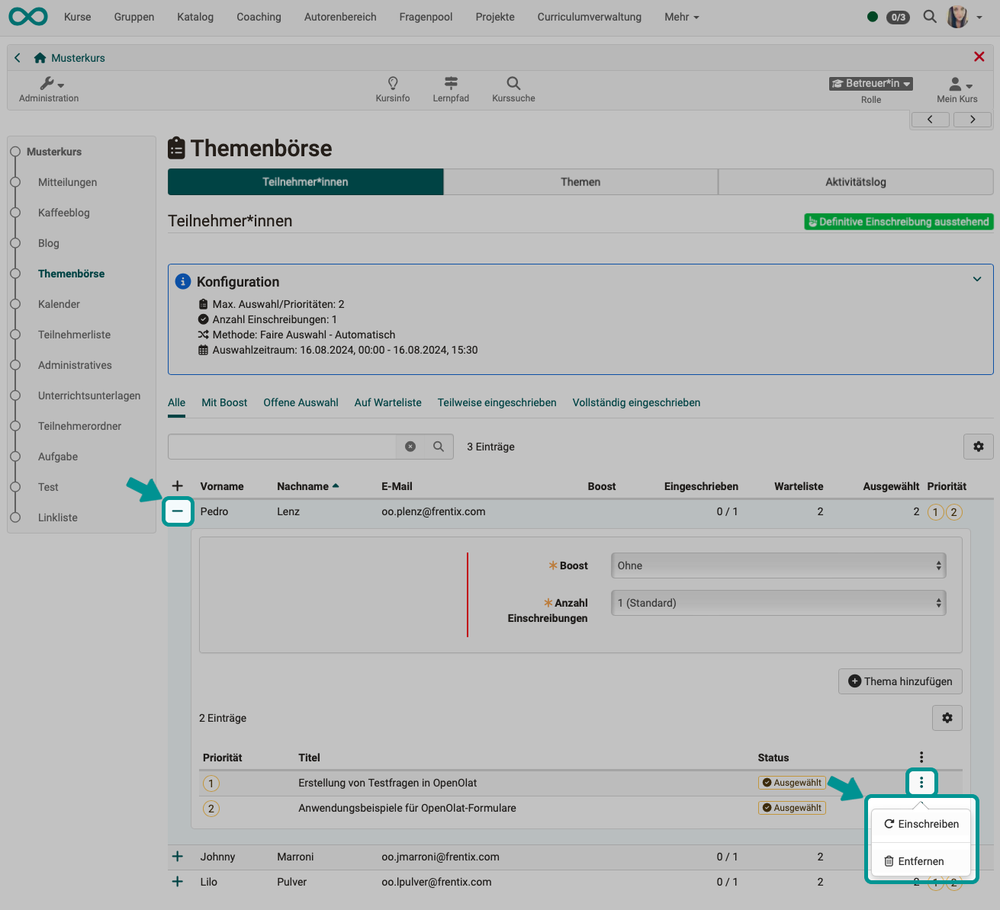{ class="shadow lightbox" title="Tab Teilnehmer:innen in der Kursansicht" }

[nach oben (Perspektive Kursbetreuer:in) ^](#topic_broker_coaching) 
[zum Seitenanfang ^](#topic_broker)

### Export der Themenwünsche und Priorisierungen {: #topic_broker_export}

Um die Wünsche und Prioritäten aller Personen auszuwerten, laden Sie im Tab "Themen" mit dem Button "Daten exportieren" die ZIP-Datei "topicbroker.zip" herunter. Sie enthält alle Themen, Wünsche und Prioritäten als Excel-Datei (Inhalt siehe [Themen exportieren](#topic_broker_export_topics)).

Den Button sehen Kursbesitzer:innen im Kurseditor und in der Kursansicht, Betreuer:innen in der Kursansicht.

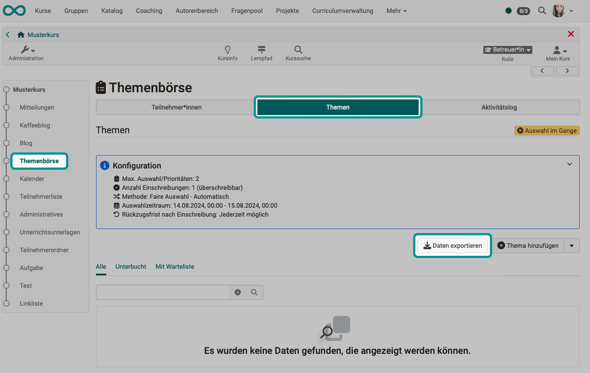{ class="shadow lightbox" title="Tab Themen in der Kursansicht" }

[nach oben (Perspektive Kursbetreuer:in) ^](#topic_broker_coaching) 
[zum Seitenanfang ^](#topic_broker)

### Korrektur abgeschlossener Einschreibungen durch Betreuer:innen {: #topic_broker_adjust_enrollment}

Auch in der Phase "Einschreibung abgeschlossen" korrigieren Kursbesitzer:innen und Betreuer:innen mit dem Recht "Teilnehmer:innen bearbeiten" noch Einschreibungen.

Wählen Sie dazu den Tab "Themen" und öffnen Sie durch Klick auf das "+" in der ersten Spalte ein Thema. Klicken Sie dann auf "Einschreibungen bearbeiten".

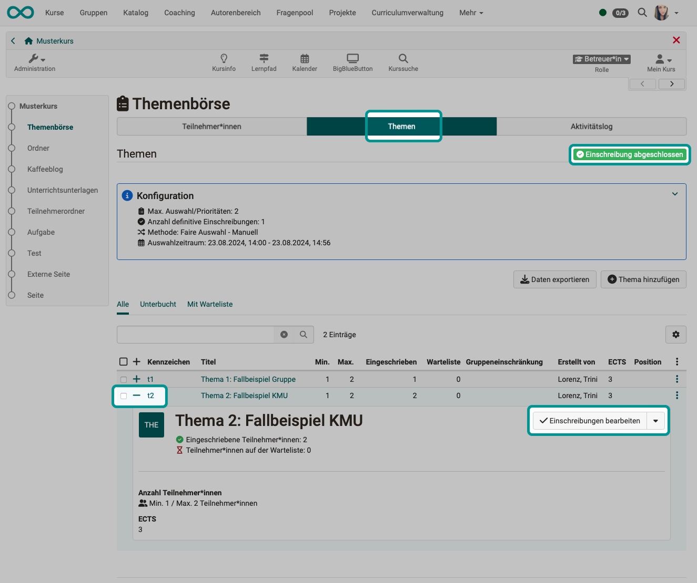{ class="shadow lightbox" title="Tab Themen in der Kursansicht" }

Jede Einschreibung lässt sich wieder aufheben, auch eine automatisch erstellte. Klicken Sie dazu im Dialog "Einschreibungen bearbeiten" auf "Austragen" in der Zeile der betreffenden Person.

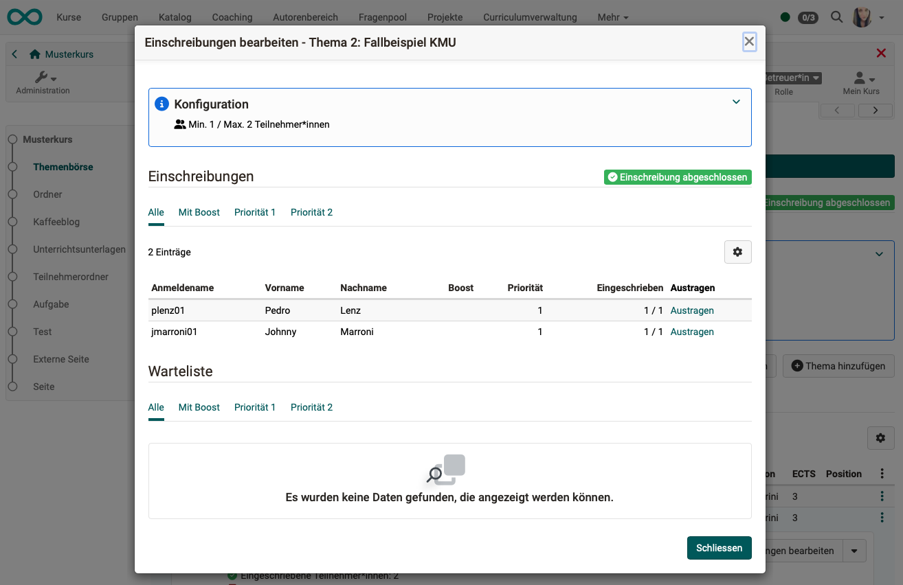{ class="shadow lightbox" title="Dialog Einschreibungen bearbeiten" }

[nach oben (Perspektive Kursbetreuer:in) ^](#topic_broker_coaching) 
[zum Seitenanfang ^](#topic_broker)

---

### Aktivitätslog [:octicons-tag-16:{ title="ab Release 20.1 (OO-7901)" }](https://track.frentix.com/issue/OO-7901) {: #topic_broker_activitylog}

Fragt eine Person, warum sie in einem Thema steht oder wer eine Einstellung geändert hat, finden Kursbesitzer:innen und Betreuer:innen die Antwort im Tab "Aktivitätslog". Er zeigt, wann und von wem Konfiguration, Themen, Auswahlen und Einschreibungen geändert wurden, mit dem Original- und dem neuen Wert. Das Aktivitätslog einer einzelnen Person oder eines einzelnen Themas öffnen Sie auch über die drei Punkte am Ende der Zeile im Tab "Teilnehmer:innen" oder "Themen".

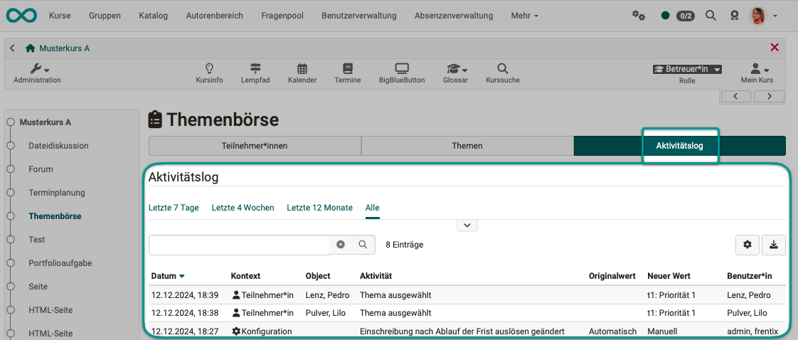{ class="shadow lightbox" title="Tab Aktivitätslog in der Kursansicht" }

[nach oben (Perspektive Kursbetreuer:in) ^](#topic_broker_coaching) 
[zum Seitenanfang ^](#topic_broker)

---

## Themenwahl (Perspektive Kursteilnehmer:in) {: #topic_broker_participant}

Als Teilnehmer:in wählen Sie in Ihrem Kurs den Kursbaustein "Themenbörse". Oben fasst der Bereich "Themenbörse: Ablauf und Informationen" die Regeln zusammen: wie viele Themen Sie wählen, für wie viele Themen Sie eingeschrieben werden und bis wann der Auswahlzeitraum läuft. Je nach Phase zeigt der Kursbaustein den aktuellen Stand der Themenvergabe.

### 1. Schritt: Themen wählen {: #topic_broker_participant_step1}

Unter "Angebotene Themen" sehen Sie alle Themen, die Sie wählen können. Klicken Sie bei einem Thema, für das Sie sich gern einschreiben würden, auf den Button "Hinzufügen". OpenOlat übernimmt es in die Liste "Meine Themen". Über den Pfeil neben "Hinzufügen" setzen Sie das Thema gleich an die gewünschte Stelle, zum Beispiel mit "Zuoberst hinzufügen" oder "Hinzufügen als Priorität 2". Mit "Details" lesen Sie die ganze Beschreibung eines Themas.

Je nach Einstellung der Kursbesitzer:innen passen Sie während des Auswahlzeitraums mit "Anzahl Einschreibungen bearbeiten" die Zahl Ihrer Einschreibungen an oder ziehen nach der Einschreibung eine Einschreibung wieder zurück.

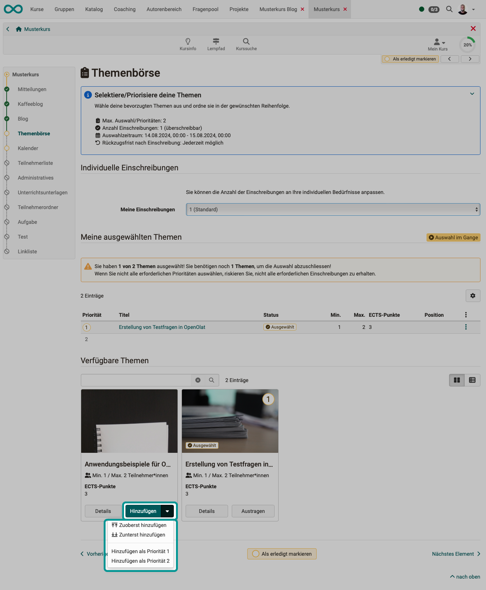{ class="shadow lightbox" title="Kursbaustein Themenbörse in der Ansicht als Teilnehmer:in" }

[nach oben (Perspektive Kursteilnehmer:in) ^](#topic_broker_participant) 
[zum Seitenanfang ^](#topic_broker)

### 2. Schritt: Themen priorisieren {: #topic_broker_participant_step2}

Wenn Sie aus vielen Themen wählen können, empfiehlt es sich, zunächst alle in Frage kommenden Themen in Ihre Auswahl aufzunehmen. In einem zweiten Schritt ordnen Sie diese Vorauswahl dann nach Ihren Prioritäten.

Solange der Status "Auswahl im Gange" lautet, ändern Sie mit den Doppelpfeilen in der Spalte "Position" die Reihenfolge der Themen in der Liste "Meine Themen". Die Reihenfolge bestimmt die Priorität. Themen über die erlaubte Anzahl hinaus tragen den Status "Überzählig" und zählen bei der Einschreibung nicht.

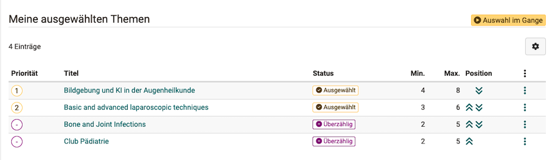{ class="shadow lightbox" title="Liste der ausgewählten Themen" }

[nach oben (Perspektive Kursteilnehmer:in) ^](#topic_broker_participant) 
[zum Seitenanfang ^](#topic_broker)

### 3. Schritt: Zuordnung abwarten {: #topic_broker_participant_step3}

Nach Ende des Auswahlzeitraums wechselt der Status zu "Definitive Einschreibung ausstehend". Jetzt teilt OpenOlat die Themen zu, automatisch oder ausgelöst durch die Kursbesitzer:innen. Damit die Zuteilung fair ist, berechnet ein Algorithmus sie aus den Prioritäten aller Teilnehmer:innen.

Sobald die Einschreibung abgeschlossen ist, erhalten Sie eine E-Mail mit Ihren Einschreibungen, ausser die Kursbesitzer:innen haben die Einschreibung ohne Benachrichtigung abgeschlossen.

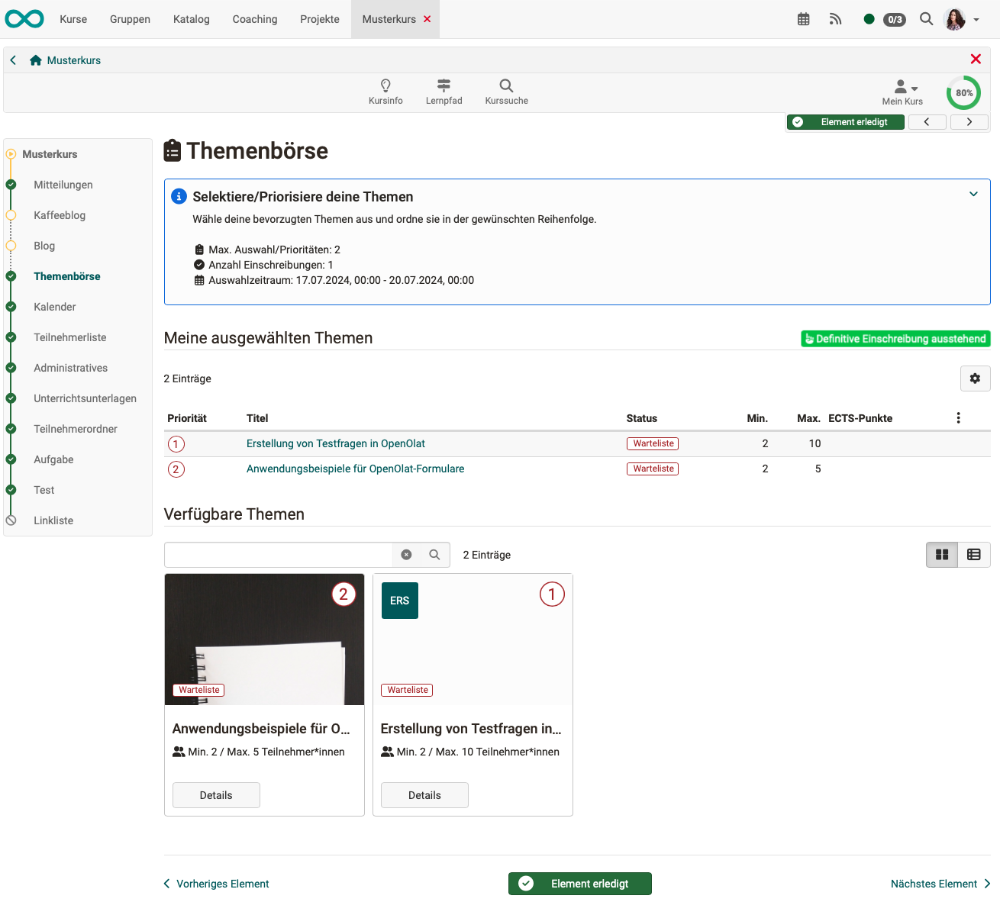{ class="shadow lightbox" title="Kursbaustein Themenbörse in der Ansicht als Teilnehmer:in" }

[nach oben (Perspektive Kursteilnehmer:in) ^](#topic_broker_participant) 
[zum Seitenanfang ^](#topic_broker)

### 4. Schritt: Einschreibung(en) abfragen {: #topic_broker_participant_step4}

Sobald der Status "Einschreibung abgeschlossen" lautet, sehen Sie in der Liste "Meine Themen", für welche Themen Sie eingeschrieben sind: Diese Themen tragen den Status "Eingeschrieben".

Erlauben die Kursbesitzer:innen das Zurückziehen, tragen Sie sich bis zur angezeigten Rückzugsfrist mit "Austragen" wieder aus einem Thema aus.

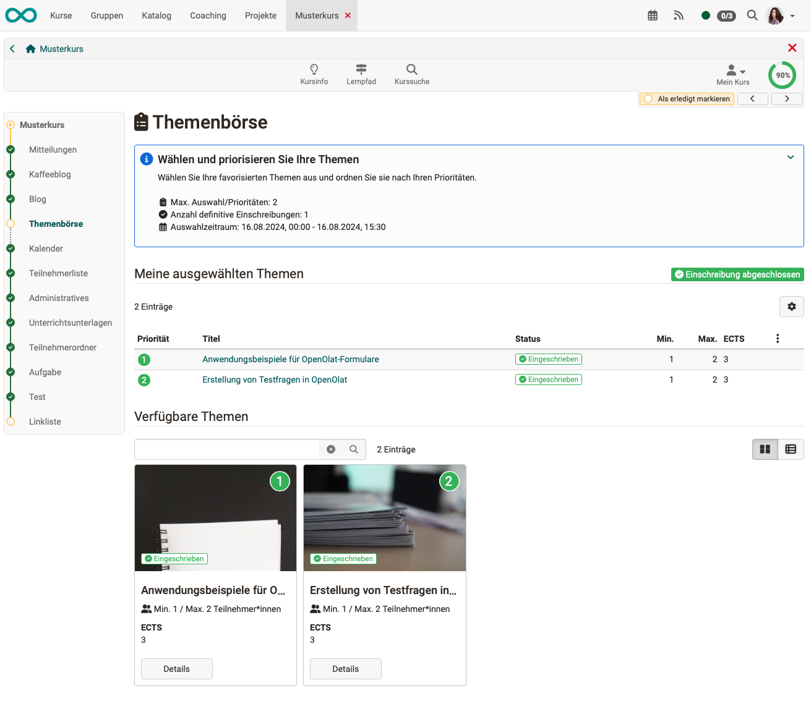{ class="shadow lightbox" title="Kursbaustein Themenbörse in der Ansicht als Teilnehmer:in" }

[nach oben (Perspektive Kursteilnehmer:in) ^](#topic_broker_participant) 
[zum Seitenanfang ^](#topic_broker)

---

## Weiterführende Informationen {: #further_information}

[Kursbaustein "Themenvergabe" >](../learningresources/Course_Element_Topic_Assignment.de.md) 
[Kursbaustein "Einschreibung" >](../learningresources/Course_Element_Enrolment.de.md) 
[Kursbaustein "Auswahl" >](../learningresources/Course_Element_Selection.de.md)

[zum Seitenanfang ^](#topic_broker)

