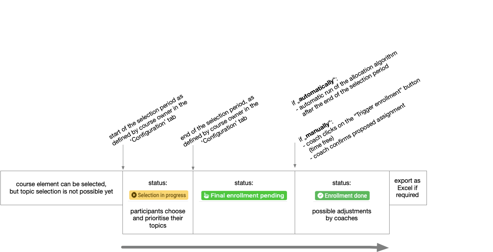
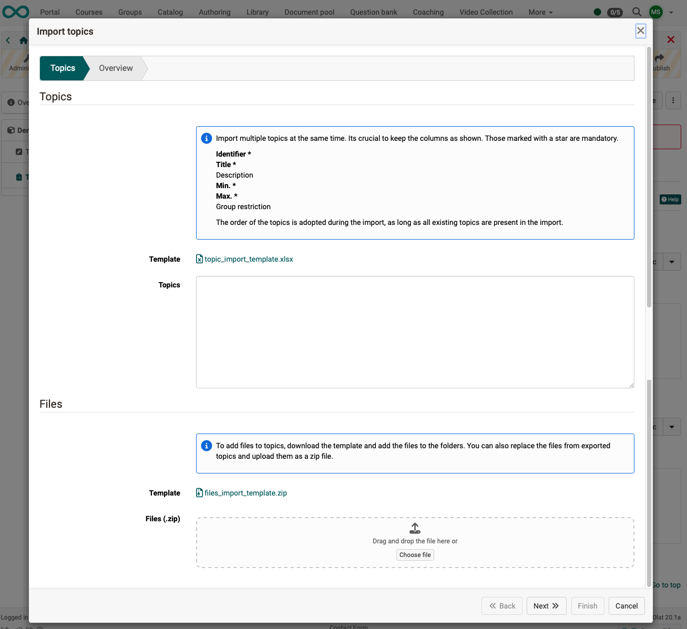

# Course Element "Topic Broker" {: #topic_broker}

## Profile {: #profile}

Name | Topic broker
---------|----------
Icon | :o_icon_o_icon_topicbroker:
Available since | Release 19
Functional group | Administration and organisation
Purpose | participants sign up themselves for working on particular topics
Assessable | no
Speciality / Note | In contrast to the course elements "Topic assignment" and "Enrolment", all participants can select several topics with priorities in the topic broker. OpenOlat then creates assignments based on these topic and priority requests.

With the course element "Topic broker" you distribute topics fairly among the participants of a course. The enrolment takes place in two steps: 
1. Step: All participants select the topics they would like to work on and set their priority. 
2. Step: OpenOlat assigns the topics to the participants.

Because OpenOlat assigns the topics only after the selection period has ended, the assignment does not depend on who submitted their wishes first.

## Functionality {: #topic_broker_functionality}

* One or more participants of the course can take part in the topic broker (no coaches).
* One or more topics can be offered for selection.
* Participants can specify a priority order for their chosen topics.
* Both a selection of topics and a limit on the number of people per topic can be specified. A limitation to groups is also possible.
* A certain number of topics per participant can also be made mandatory.
* The choice of topic is limited to a specific time slot.
* After closing the time window, OpenOlat can calculate who is assigned which topics based on the specified priorities. The calculation can be triggered automatically or manually. Manual initiation of the assignment (recommended) is reserved for course owners.

[To the top of the page ^](#topic_broker)

## The algorithm for automatic topic assignment [:octicons-tag-16:{ title="from Release 19.0 (OO-7555)" }](https://track.frentix.com/issue/OO-7555) {: #topic_broker_algorithm}

If a selection and allocation process works on a "first-come, first-served basis", then this is unfair. This is familiar from the allocation of tickets for football matches and concerts. Users with a better internet connection will be given preference, as will users who have time to log in immediately at the time of publication.

The problem is known as the "stable matching" problem. Details on the implementation in OpenOlat can be found here: [OpenOlat_Project_Broker_Matching_Algorithm.pdf](assets/OpenOlat_Project_Broker_Matching_Algorithm.pdf)

The assignment of topics in the course element "Topic broker" therefore takes place in 2 steps:

- Choice of topic/project/group and indication of personal priorities (first choice, second choice, etc.).
- After the selection period has ended, OpenOlat assigns the topics. If a topic was requested with first priority more often than there are places available, the fair algorithm distributes the places based on the second priority.

{ class="shadow lightbox" title="Phases of the topic broker" }

!!! note "Note"

    Due to the functionality described above, it is understandable that the topic broker cannot be used in open courses with an undefined number of participants.

[To the top of the page ^](#topic_broker)

## Who can record eligible topics? {: #topic_broker_eligible_topics}

* By default, the course owners record the topics.

* Coaches can be granted the right "Edit topic" in the "Configuration" tab under "User rights". They then record topics in the course view in the "Topics" tab.

* Coaches can also be granted the right "Edit participants" (assign topic, adjust priorities, enrol or remove participants).

* Topics can also be imported from an Excel spreadsheet, see [Import topics](#topic_broker_import_topics).

[To the top of the page ^](#topic_broker)

---

## Set up topic broker (course owner perspective) {: #topic_broker_setup}

Before the participants make their choice, you define the rules of the topic broker, the custom fields and the topics in the course editor. You find the tabs "Configuration", "Custom fields" and "Topics" under: 
`Course > Administration > Course editor > Course element "Topic broker"`

### "Configuration" Tab {: #topic_broker_setup_tab_config}

In the "Configuration" tab you define when and how many topics the participants select, how OpenOlat enrols them afterwards and who may edit topics and participants besides the course owners. The form is divided into the sections "Topic selection", "Enrollment" and "User rights".

{ class="shadow lightbox" title="Configuration tab in the course editor" }

#### Topic selection {: #topic_broker_config_topic_selection}

In the "Topic selection" section you define when and how many topics the participants select.

##### Relative dates {: #topic_broker_relative_dates}

The toggle only appears if the course has an execution period with a start date. When it is switched on, you define the start of the selection period relative to "Course start" and enter the number of days it lasts in the field "Duration of selection period".

##### Selection period {: #topic_broker_selection_period}

The selection period is the time frame within which the participants must submit their topic requests. After the selection period has ended, the enrolment follows, automatically or manually, depending on the setting in the field "Trigger enrollment after the deadline".

!!! info "Important"

    Course owners can change the selection period even if OpenOlat has already enrolled the participants. In this case, the status changes back to "Selection in progress". Existing enrolments remain unchanged, but the participants can adjust them again.

##### Selections/Priorities per participant {: #topic_broker_selections_per_participant}

The participants rank the selected topics by their priorities. In this field you specify how many topics count at most. Further topics in a person's list have the status "Surplus" and are not considered for enrolment.

"Selection period" and "Selections/Priorities per participant" are mandatory fields.

#### Enrollment {: #topic_broker_config_enrollment}

In the "Enrollment" section you define for how many topics OpenOlat enrols each person and how the enrolment is triggered.

##### Enrollments per participant {: #topic_broker_enrollments_per_participant}

Here you define for how many topics a participant is ultimately enrolled, regardless of the number of priorities. This information is binding.

##### Participants can {: #topic_broker_participants_can}

- **Reduce their number of enrollments**: During the selection period, participants can reduce the number from "Enrollments per participant" for themselves, e.g. if they do not want to work on several topics.
- **Withdraw their enrollments**: Participants can withdraw from a topic again after the enrolment.

##### Withdraw deadline {: #topic_broker_withdraw_deadline}

The field appears if "Withdraw their enrollments" is checked. Here you enter the date until which participants can withdraw an enrolment. With "Relative dates" switched on, you enter instead how many days after the selection period withdrawing remains possible.

##### Enrollment method {: #topic_broker_enrollment_method}

The method ["Fair selection"](#topic_broker_algorithm) is available.

##### Criteria {: #topic_broker_criteria}

Topics can have an execution period, e.g. if they are linked to an in-person session. To prevent a person from being assigned topics whose dates overlap, check "Execution periods of the topics must not overlap". The algorithm then takes the execution periods into account during the enrolment.

##### Trigger enrollment after the deadline {: #topic_broker_trigger_enrollment}

After the selection period has ended, there are two ways to trigger the distribution of the participants: "Manually" by the course owners (see [Manual enrolment](#topic_broker_assignment_manually)) or "Automatically" by OpenOlat after the end of the selection period.

If you select "Automatically", the field "Optimization strategy" appears. There you define the principle by which OpenOlat distributes the participants automatically:

- **Maximum number of enrollments**: High enrollment rate with minimal waiting list
- **Maximum priority consideration**: High degree of fulfillment of participants' priorities
- **Maximum number of topics**: High percentage of topics covered thanks to enough participants

#### User rights {: #topic_broker_config_rights}

If necessary, coaches can also be given the right to edit topics and/or participants in addition to the course owners.

##### Edit topic {: #topic_broker_edit_topic}

By default, the right to edit the topics is reserved for the course owners. With the checkbox "Coach", the coaches also receive this right. 
With the toggle "Show advanced configuration" on the right-hand side, you grant the right specifically to roles, individual persons or groups, optionally with a start and end date.

##### Edit participants {: #topic_broker_edit_participants}

By default, the right to override and edit a selected topic is reserved for the course owners. With the checkbox "Coach", the coaches also receive this right. (Without the right, they only have read access if they choose one of the names.) However, the override option should only be used in exceptional cases, as it runs counter to the actual intention of enabling fair distribution through a neutral algorithm. 
With the toggle "Show advanced configuration" on the right-hand side, you also grant this right specifically to roles, individual persons or groups.

[Up (Course owner perspective) ^](#topic_broker_setup) 
[To the top of the page ^](#topic_broker)

### "Custom fields" tab {: #topic_broker_setup_tab_custom_fields}

If the participants need further information on each topic for their choice, such as ECTS points or an information sheet, you create additional fields for this in the "Custom fields" tab. Each additional field appears in every topic. You edit or delete a field at any time using the three dots at the end of a row.

{ class="shadow lightbox" title="Custom fields tab in the course editor" }

With "Add custom field" a dialog with these fields opens:

{ class="shadow lightbox" title="Add custom field dialog" }

#### Name {: #topic_broker_custom_field_name}

The name entered here appears as an additional field in the dialog "Create topic".

#### Input type {: #topic_broker_custom_field_input_type}

- **Text**: When recording a topic, a text entry can be entered for each topic. In the [import](#topic_broker_import_topics) each text field gets its own column.
- **File**: When recording a topic, a file can be uploaded for each topic, e.g. a PDF file with information on the topic. In the [import](#topic_broker_import_topics) each file field gets its own folder in the template "files_import_template.zip".

#### Display in table {: #topic_broker_custom_field_display_in_table}

If the toggle is switched on, this field appears by default as a column in the table in the "Topics" tab.

[Up (Course owner perspective) ^](#topic_broker_setup) 
[To the top of the page ^](#topic_broker)

### "Topics" tab (Capturing topics) {: #topic_broker_setup_tab_topic}

Course owners add the selectable topics in the course editor in the "Topics" tab and describe them there with "Create topic". The same is also possible in the course view when you select the course element, depending on the configuration also by coaches.

In the dialog "Create topic", the section "Standard fields" contains the fields "Identifier", "Title", "Description", "Number of participants" with Min. and Max., "Execution period", "Group restriction", "Teaser image" and "Teaser video". With a group restriction, only the members of the selected groups see the topic. Below, the section "Custom fields" contains the additional fields from the tab of the same name. You can upload a teaser image of up to 2 MB, a teaser video of up to 100 MB and one file of up to 10 MB per file field.

{ class="shadow lightbox" title="Topics tab in the course editor" }

In the example below, the lower section also contains a field that was added in the "Custom fields" tab.

{ class="shadow lightbox" title="Create topic dialog" }

[Up (Course owner perspective) ^](#topic_broker_setup) 
[To the top of the page ^](#topic_broker)

---

### Export/Import topics and data {: #topic_broker_export_import_topics}

With the export you save topics, requests and enrolments as a file or transfer the topics to another course. With the import you record many topics at once, including teaser images, teaser videos and files.

#### Export topics {: #topic_broker_export_topics}

In the course editor, select the course element, then the "Topics" tab and there the button "Export data". The button is also available in the course view when you select the course element and the "Topics" tab.

OpenOlat creates the ZIP file "topicbroker.zip". It contains:

- the Excel file "topicbroker.xlsx" with the worksheet "Topics" (all topics) and the worksheet "Participants" (the priority and the enrolment for each person and topic),
- the folder "topic files" with the teaser image, the teaser video and the files of the custom fields for each topic,
- the folder "topic enrollments" with one Excel file per topic.

{ class="shadow lightbox" title="Topics tab in the course view" }

#### Import topics {: #topic_broker_import_topics}

With the import you create several topics at once or transfer topics from another course element "Topic broker". If the course element already contains a topic with the same identifier, OpenOlat updates this topic with the imported data.

In the "Topics" tab, click the small arrow next to the button "Create topic" and select "Import topics". The entry is available in the course editor and in the course view as long as the enrolment is not done. In the course view, course owners and coaches with the right "Edit topic" see it.

{ class="shadow lightbox" title="Topics tab in the course editor" }

The window "Import topics" opens with the steps "Topics" and "Overview". In the "Topics" step you fill in the section "Topics", the section "Files" or both. In the "Overview" step you see the recognized topics with any messages before you import them with "Finish".

{ class="shadow lightbox" title="Topics step in the Import topics window" }

**Section "Topics"** 
Here you insert the topics as rows of an Excel spreadsheet. In Excel, copy the rows with the topics, without the header row, and paste them into the text field "Topics". The columns must be in exactly this order, the columns with a star (*) are mandatory:

Identifier *, Title *, Description, Min. *, Max. *, Begin, End, Group restriction, followed by one column for each custom field with the input type "Text", in the order of the fields in the "Custom fields" tab.

Each identifier may appear only once in the import. It must not contain any characters that are not allowed in a folder name, because OpenOlat uses it as the folder name for the files of the topic. OpenOlat rejects an identifier that differs from an existing one only in upper and lower case. Enter "Begin" and "End" as a date, for example 15.03.2027. If the import contains all existing topics, OpenOlat adopts the order of the rows as the order of the topics.

Next to the label "Template", the link "topic_import_template.xlsx" downloads an Excel spreadsheet that contains only this header row. OpenOlat creates the template for this course element when you download it, so it also contains the columns of your custom text fields. Enter the topics below the header row and copy the rows into the text field.

You transfer topics from another course via its export: Unzip the ZIP file "topicbroker.zip" and copy the rows from the worksheet "Topics" of the file "topicbroker.xlsx". The columns are in the same order there. The values of the custom text fields arrive correctly if both course elements have the same text fields in the same order.

**Section "Files"** 
Here you add the teaser image, the teaser video and the files of the custom fields with the input type "File" to the topics. Next to the label "Template", the link "files_import_template.zip" downloads the matching folder structure. OpenOlat creates it for this course element when you download it: For each existing topic there is a folder named after the identifier, containing the empty folders "teaserimage", "teaservideo" and one folder for each custom field with the input type "File". For a new topic that you insert in the section "Topics" of the same import, create a folder with its identifier in the same structure.

Put at most one file in each folder, pack the folders as a ZIP file again and upload it in the field "File (.zip)". Instead of the template, you can also upload the whole ZIP file from "Export data": OpenOlat takes the files from its folder "topic files". OpenOlat assigns files only to topics that already exist in the course element or that you insert in the section "Topics" of the same import. [:octicons-tag-16:{ title="from Release 20.1 (OO-7898)" }](https://track.frentix.com/issue/OO-7898)

[Up (Course owner perspective) ^](#topic_broker_setup) 
[To the top of the page ^](#topic_broker)

---

## Coach topic exchange (course coach perspective) {: #topic_broker_coaching}

As soon as the topic broker is running, course owners and coaches accompany the selection in the course view: they see who has already made a choice and correct the enrolments if necessary. You find the tabs "Participants", "Topics" and "Activity log" under: 
`Course > Course element "Topic broker"`

The course owners define what coaches may edit there in the "Configuration" tab under "User rights". Only course owners start the manual enrolment process.

### Capture topics {: #topic_broker_coaching_capture_topics}

The selectable topics may already have been added and described by course owners (in the course editor in the "Topics" tab). If course owners have granted you the right "Edit topic", you as a coach also record topics. To do so, select the course element and the "Topics" tab in the course view. With "Create topic" you create a topic. Using the small arrow next to it and "Import topics" you import several topics and their files, you download the templates for this in the window "Import topics" (see [Import topics](#topic_broker_import_topics)).

{ class="shadow lightbox" title="Topics tab in the course view" }

[Up (Course coach perspective) ^](#topic_broker_coaching) 
[To the top of the page ^](#topic_broker)

### View of topic requests {: #topic_broker_coaching_view_topic_requests}

In the "Participants" tab, you as a coach see who has already submitted their topic requests, who is on the waiting list or who is already enrolled. Click on the + in front of one of the names to open the detail view.

{ class="shadow lightbox" title="Participants tab in the course view" }

!!! tip "Tip"

    If coaches have been given the right "Edit participants", they can intervene at any time and override a selection made or make a selection for the person if there is no selection.
    With "Select topic" in the detail view they also add another topic for the person.

    Only use this option in exceptional cases.

[Up (Course coach perspective) ^](#topic_broker_coaching) 
[To the top of the page ^](#topic_broker)

### Topic assignment (final enrolment pending) {: #topic_broker_coaching_topic_assignment}

The status at the top right shows the phase of the topic broker:

* "Not started"
* "Selection in progress"
* "Final enrollment pending"
* "Enrollment done"

With the end of the selection period, the phase "Selection in progress" is over, even if not all participants have made their choice yet. The status changes to "Final enrollment pending".

Now OpenOlat assigns participants and topics to each other, based on the topic and priority requests. For this purpose, OpenOlat uses a [fair algorithm](assets/OpenOlat_Project_Broker_Matching_Algorithm.pdf).

The assignment starts automatically or is triggered manually. Course owners define which of the two applies in the course editor in the "Configuration" tab.

[Up (Course coach perspective) ^](#topic_broker_coaching) 
[To the top of the page ^](#topic_broker)

### Automatic topic assignment {: #topic_broker_assignment_automatically}

If course owners have selected the option "Automatically" in the course editor in the "Configuration" tab under "Trigger enrollment after the deadline", the assignment algorithm starts by itself shortly after the selection period has closed. (How long the process runs depends, for example, on the number of topics and participants.)

The assignment algorithm runs only once. OpenOlat enrols the participants based on the assignment result found.

Coaches with the right "Edit participants" can correct and amend the enrolments manually afterwards (see [Adjustment](#topic_broker_adjustment)).

After an automatic assignment, all participants who have made a selection receive an e-mail with their enrolments. Those who have made no selection receive no e-mail.

[Up (Course coach perspective) ^](#topic_broker_coaching) 
[To the top of the page ^](#topic_broker)

### Manual topic assignment/enrolment {: #topic_broker_assignment_manually}

If course owners have selected the option "Manually" in the course editor in the "Configuration" tab under "Trigger enrollment after the deadline", the course owners start the assignment algorithm themselves. Only course owners see the button "Initiate enrollment process" in the "Participants" tab, coaches do not see it.

There is no set time when you must trigger the enrolment. During the assignment, the course element still has the status "Final enrollment pending".

{ class="shadow lightbox" title="Participants tab in the course view" }

When the assignment algorithm is triggered manually, several runs are possible. The results differ from one another because the algorithm includes a random component. Each run already shows the best of many calculated results. With "Run again" you calculate another run. The runs are listed in a dropdown, from which you select the run that is to apply to the final enrolment.

{ class="shadow lightbox" title="Enrollment process page" }

Once you have decided on a run (an assignment result), OpenOlat enrols the participants according to this assignment:

- "Accept enrollments" then informs the participants with a selection by e-mail about their enrolments.
- "Accept enrollments without notification" enrols without sending an e-mail.

In both cases, you confirm the step again in the dialog "Accept enrollments" with the checkbox "Accept enrollments" and the button "Accept".

{ class="shadow lightbox" title="Accept enrollments dialog" }

!!! tip "Tip"

    If there are still people on the waiting list or without selection after clicking "Accept", you can assign them manually (see [Adjustment](#topic_broker_adjustment)). 
    This is necessary, for example, if a person has not selected a topic by the end of the selection period and the algorithm therefore could not assign them.

[Up (Course coach perspective) ^](#topic_broker_coaching) 
[To the top of the page ^](#topic_broker)

### Adapt strategy [:octicons-tag-16:{ title="from Release 20.1 (OO-8540)" }](https://track.frentix.com/issue/OO-8540) {: #topic_broker_adapt_strategy}

OpenOlat assigns the topics according to an optimization strategy. Depending on the strategy, as many people as possible get a place, as many as possible get their first priority, or as many topics as possible get enough participants. In the manual enrolment process, course owners choose the strategy themselves. To do so, use the link "Adjust strategy" on the page "Enrollment process" on the right-hand side of the optimization strategy details.

{ class="shadow lightbox" title="Enrollment process page" }

The following strategies are then available:

* Maximum number of enrollments (High enrollment rate with minimal waiting list)
* Maximum priority consideration (High degree of fulfillment of participants' priorities)
* Maximum number of topics (High percentage of topics covered thanks to enough participants)
* Custom (Define your own weighting and fine-tuning for priorities)

With "Apply and run" OpenOlat calculates a new run with the selected strategy.

{ class="shadow lightbox" title="Adjust strategy dialog" }

{ class="shadow lightbox" title="Adjust strategy dialog, strategy Custom" }

[Up (Course coach perspective) ^](#topic_broker_coaching) 
[To the top of the page ^](#topic_broker)

### Influence topic assignment {: #topic_broker_boost}

With the field "Boost", course owners and coaches with the right "Edit participants" can add a weighting for each individual person and thus take corrective action. You select the boost in the "Participants" tab in the detail view of a person, which you open with the plus in front of the name. The field can be changed until the enrolment process has started. The enrolment algorithm gives preference to participants with a boost.

{ class="shadow lightbox" title="Participants tab in the course view" }

[Up (Course coach perspective) ^](#topic_broker_coaching) 
[To the top of the page ^](#topic_broker)

### Correction of topic assignment/enrolment by coaches {: #topic_broker_adjustment}

If a person remains without a topic or an assignment does not fit, course owners and coaches with the right "Edit participants" correct the selection of this person, for example in the phase "Final enrollment pending".

To do so, select the course element and click the plus icon in front of a name in the list in the "Participants" tab. The detail view with the choice and the priorities of this person opens.

Using the three dots at the end of a row, you enrol the person in this topic with "Enroll", withdraw an enrolment with "Withdraw enrollment" or remove the topic from their selection with "Reset selection".

{ class="shadow lightbox" title="Participants tab in the course view" }

[Up (Course coach perspective) ^](#topic_broker_coaching) 
[To the top of the page ^](#topic_broker)

### Export of topic requests and prioritizations {: #topic_broker_export}

To evaluate the requests and priorities of all persons, download the ZIP file "topicbroker.zip" in the "Topics" tab with the button "Export data". It contains all topics, requests and priorities as an Excel file (for the content see [Export topics](#topic_broker_export_topics)).

Course owners see the button in the course editor and in the course view, coaches in the course view.

{ class="shadow lightbox" title="Topics tab in the course view" }

[Up (Course coach perspective) ^](#topic_broker_coaching) 
[To the top of the page ^](#topic_broker)

### Adjust enrolment {: #topic_broker_adjust_enrollment}

Even in the phase "Enrollment done", course owners and coaches with the right "Edit participants" can still correct enrolments.

To do so, select the "Topics" tab and open a topic by clicking the "+" in the first column. Then click "Edit enrollments".

{ class="shadow lightbox" title="Topics tab in the course view" }

Every enrolment can be cancelled again, including one created automatically. To do so, click "Withdraw" in the dialog "Edit enrollments" in the row of the person concerned.

{ class="shadow lightbox" title="Edit enrollments dialog" }

[Up (Course coach perspective) ^](#topic_broker_coaching) 
[To the top of the page ^](#topic_broker)

---

### Activity log [:octicons-tag-16:{ title="from Release 20.1 (OO-7901)" }](https://track.frentix.com/issue/OO-7901) {: #topic_broker_activitylog}

If a person asks why they are in a topic or who changed a setting, course owners and coaches find the answer in the "Activity log" tab. It shows when and by whom the configuration, topics, selections and enrolments were changed, with the original and the new value. You also open the activity log of an individual person or topic using the three dots at the end of the row in the "Participants" or "Topics" tab.

{ class="shadow lightbox" title="Activity log tab in the course view" }

[Up (Course coach perspective) ^](#topic_broker_coaching) 
[To the top of the page ^](#topic_broker)

---

## Choice of topic (course participant perspective) {: #topic_broker_participant}

As a participant, select the course element "Topic broker" in your course. At the top, the section "Topic broker: Procedure and information" summarizes the rules: how many topics you select, for how many topics you will be enrolled and until when the selection period runs. Depending on the phase, the course element shows the current status of the topic allocation.

### 1. Step: Select topics {: #topic_broker_participant_step1}

Under "Topics offered" you see all topics you can select. For a topic you would like to enrol in, click the button "Add". OpenOlat adds it to the list "My topics". Using the arrow next to "Add" you put the topic directly at the desired position, for example with "Add on top" or "Add as priority 2". With "Details" you read the full description of a topic.

Depending on the settings of the course owners, you adjust the number of your enrolments during the selection period with "Edit number of enrollments" or withdraw an enrolment again after the enrolment.

{ class="shadow lightbox" title="Course element Topic broker in the participant view" }

[Up (Course participant perspective) ^](#topic_broker_participant) 
[To the top of the page ^](#topic_broker)

### 2. Step: Prioritize topics {: #topic_broker_participant_step2}

If you have many topics to choose from, it is advisable to first include all possible topics in your selection. In a second step, you then rank this preselection by your priorities.

As long as the status is "Selection in progress", you change the order of the topics in the list "My topics" with the double arrows in the column "Position". The order determines the priority. Topics beyond the permitted number have the status "Surplus" and do not count for the enrolment.

{ class="shadow lightbox" title="List of selected topics" }

[Up (Course participant perspective) ^](#topic_broker_participant) 
[To the top of the page ^](#topic_broker)

### 3. Step: Wait for assignment {: #topic_broker_participant_step3}

After the selection period has ended, the status changes to "Final enrollment pending". Now OpenOlat assigns the topics, automatically or triggered by the course owners. To make the assignment fair, an algorithm calculates it from the priorities of all participants.

As soon as the enrolment is done, you receive an e-mail with your enrolments, unless the course owners have completed the enrolment without notification.

{ class="shadow lightbox" title="Course element Topic broker in the participant view" }

[Up (Course participant perspective) ^](#topic_broker_participant) 
[To the top of the page ^](#topic_broker)

### 4. Step: Request enrolment(s) {: #topic_broker_participant_step4}

As soon as the status is "Enrollment done", you see in the list "My topics" for which topics you are enrolled: these topics have the status "Enrolled".

If the course owners allow withdrawing, you withdraw from a topic with "Withdraw" until the displayed withdraw deadline.

{ class="shadow lightbox" title="Course element Topic broker in the participant view" }

[Up (Course participant perspective) ^](#topic_broker_participant) 
[To the top of the page ^](#topic_broker)

---

## Further information {: #further_information}

[Course element "Topic Assignment" >](../learningresources/Course_Element_Topic_Assignment.md) 
[Course element "Enrolment" >](../learningresources/Course_Element_Enrolment.md) 
[Course element "Selection" >](../learningresources/Course_Element_Selection.md) 
[Import templates >](../basic_concepts/Import_Templates.md)

[To the top of the page ^](#topic_broker)

