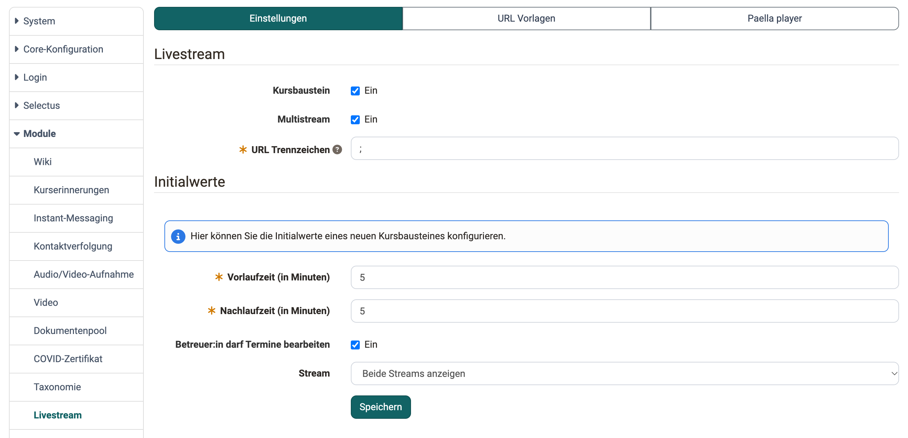

# Kursbaustein "Video Livestream" {: #livestream}

## Steckbrief

Name | Video Livestream
---------|----------
Icon | :o_icon_o_livestream_icon:
Verfügbar seit | Release 14.0 (OO-4043)
Funktionsgruppe | Wissensvermittlung
Verwendungszweck | Anzeige eines Video-Livestreams (von Systemadministrator:innen eingerichtet)
Bewertbar | nein
Spezialität / Hinweis |

Mit dem Kursbaustein "Video Livestream" zeigen Sie Ihren Teilnehmenden Livestreams direkt im Kurs, zum Beispiel einen Livestream von YouTube. Während eines festgelegten Zeitfensters zeigt der Kursbaustein bis zu zwei Livestreams gleichzeitig, einzeln oder nebeneinander.

**Anwendungsbeispiele:**

* Übertragung einer Vorlesung mit zwei Live-Kameras (erste Kamera auf die vortragende Person, zweite Kamera auf die Präsentation)
* Regelmässige Beobachtung von Wetter-Webcams mit einem Auswertungsauftrag im folgenden Kursbaustein (zum Beispiel im Kursbaustein "Checkliste")
* Regelmässige Tierbeobachtung per Webcam mit einem Protokollauftrag (zum Beispiel im Kursbaustein "Dokument")

## Vorbereitung durch Systemadministrator:innen

Systemadministrator:innen finden die Konfiguration in der System-Administration unter: `Administration > Module > Livestream`. 
Dort aktivieren sie den Kursbaustein und bei Bedarf die Option Multistream für zwei gleichzeitige Livestreams; bei aktiviertem Multistream legen sie zusätzlich das Trennzeichen für mehrere URLs eines Termins fest. Unter Initialwerte hinterlegen sie die Vor- und Nachlaufzeit in Minuten, das Bearbeitungsrecht für Betreuer:innen sowie den anzuzeigenden Stream als Vorgabe für neue Kursbausteine.

{ class="shadow lightbox" title="Seite Livestream im Menü Module · 2026.11.03" }

Die beiden weiteren Tabs der Seite, "URL Vorlagen" und "Paella player", beschreibt das Administrationshandbuch unter [Modul Livestream](../../manual_admin/administration/Modules/index.de.md#livestream).

## Tab Konfiguration

Wie lange vor und nach einem Termin der Livestream sichtbar ist und wer die Termine pflegt, legen Sie als Autor:in im Kurseditor fest. Nach dem Einfügen des Kursbausteins öffnen Sie dafür den Tab "Konfiguration": 
`Kurs > Administration > Kurseditor > Kursbaustein wählen > Tab "Konfiguration"`

Dort stellen Sie "Vorlaufzeit (in Minuten)" und "Nachlaufzeit (in Minuten)" ein und legen mit "Betreuer:in darf Termine bearbeiten" fest, ob Betreuer:innen die Termine bearbeiten dürfen. Ist Multistream eingeschaltet, wählen Sie unter "Stream", ob beide Livestreams oder nur einer angezeigt wird.

## Livestreams als Termine im Kalender {: #events}

Einen Livestream planen Sie wie einen Termin: mit Beginn, Ende und der Adresse des Streams. Zur geplanten Zeit zeigt der Kursbaustein den Stream von selbst, ohne dass Sie den Kurs ändern. Der Kursbaustein liest die Termine aus dem Kurskalender und aus den Kalendern der Gruppen, die mit dem Kurs verbunden sind. Er berücksichtigt nur Termine, bei denen das Feld "URL Live Stream" ausgefüllt ist. Welche Termine eine Person sieht, richtet sich nach der [Sichtbarkeit](../personal_menu/Calendar.de.md#visibility) des Termins.

Die Termine erfassen Sie im Kursbaustein selbst, im Tab "Termine bearbeiten". Den Tab sehen Besitzer:innen des Kurses, Betreuer:innen nur, wenn im Tab "Konfiguration" die Option "Betreuer:in darf Termine bearbeiten" eingeschaltet ist. Termine des Kurskalenders bearbeiten Betreuer:innen dort, wenn zusätzlich in den Kurseinstellungen im Tab "Toolbar" die Option ["Betreuer:innen dürfen den Kalender bearbeiten"](Course_Settings_Toolbar.de.md#calendar) eingeschaltet ist. [:octicons-tag-16:{ title="ab Release 21.2 (OO-9968)" }](https://track.frentix.com/issue/OO-9968) Der Tab zeigt den Kalender mit allen Terminen. Im Termin tragen Sie Titel, Beginn und Ende ein und im Feld "URL Live Stream" die Adresse des Streams. Ist Multistream eingeschaltet, tragen Sie zwei Adressen ein, getrennt durch das "URL Trennzeichen", das in der System-Administration unter `Administration > Module > Livestream` hinterlegt ist. Das Feld "URL Live Stream" erscheint nur, wenn Sie den Termin im Kursbaustein bearbeiten, nicht im Kurskalender.

Sind auf derselben Seite im Tab "URL Vorlagen" Vorlagen hinterlegt, wählen Sie unter "URL Live Stream" eine Vorlage aus der Liste, statt die Adresse einzutippen. Mit dem Häkchen "Manuell" bei "Live Stream Auswahl" tragen Sie die Adresse wieder selbst ein. Ändert sich die Adresse einer Vorlage, zeigt der Kursbaustein bei laufenden Livestreams die neue Adresse [:octicons-tag-16:{ title="ab Release 15.3 (OO-5163)" }](https://track.frentix.com/issue/OO-5163){:target="_blank"}.

## Ansicht für Teilnehmende {: #view}

Im Tab "Live Streams" zeigt der Kursbaustein den laufenden Livestream, und zwar ab dem Beginn des Termins abzüglich der Vorlaufzeit bis zum Ende zuzüglich der Nachlaufzeit. Läuft kein Termin, erscheint die Meldung "Aktuell wird kein Livestream ausgestrahlt." Darunter listet "Anstehende Livestreams" die nächsten Termine mit Titel, Beginn, Ende, Ort und Beschreibung. Die Ansicht aktualisiert sich alle 10 Sekunden von selbst.

Besitzer:innen und Betreuer:innen sehen zusätzlich den Tab "Statistik". Er listet unter "Ausgestrahlte Livestreams" die laufenden und vergangenen Termine mit der Zahl der Zuschauer.

## Weiterführende Informationen {: #further_information}

[Kursbausteine im Überblick >](Course_Elements/index.de.md) 
[Kursbaustein "Opencast" >](Course_Element_Opencast.de.md) 
[Kursbaustein "Kalender" >](Course_Element_Calendar.de.md) 
[Toolbar >](Course_Settings_Toolbar.de.md) 
[Persönliche Werkzeuge: Kalender >](../personal_menu/Calendar.de.md) 
[Module: Übersicht >](../../manual_admin/administration/Modules/index.de.md)

[Zum Seitenanfang ^](#livestream)

