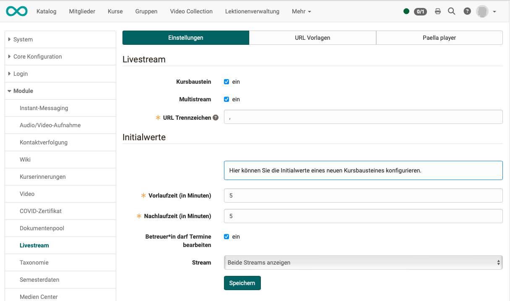

# Course Element "Video live stream" {: #livestream}

## Profile

Name | Video live stream
---------|----------
Icon | :o_icon_o_livestream_icon:
Available since | Release 14.0 (OO-4043)
Functional group | Knowledge transfer
Purpose | Display of a live video stream (set up by the administrator)
Assessable | no
Specialty / Note | 

With the course element "Video live stream" you show live streams to your participants directly in the course, for example a live stream from YouTube. During a set time window, the course element shows up to two live streams at the same time, individually or side by side.

**Application examples:**

* Transmission of a lecture with two live cameras (first camera on the lecturer, second camera on the presentation)
* Regular observation of weather webcams with an evaluation assignment in the following course element (for example in the course element "Checklist")
* Regular animal observation via webcam with a protocol assignment (for example in the course element "Document")

## Preparation by the administrator

The administrators find the configuration in the system administration under: `Administration > Modules > Live stream`. 
There, they activate the course element and, if needed, the Multi stream option for two simultaneous live streams; with multi stream active, they also set the separator for multiple URLs of a single event. Under Default values, they set the buffer time before start and after end in minutes, whether coaches are allowed to edit, and the stream to display as the default for new course elements.

{ class="shadow lightbox" title="Live stream page in the Modules menu" }

## Tab Configuration

As an author, you define in the course editor how long before and after an event the live stream is visible and who maintains the events. After inserting the course element, open the tab "Configuration" for this: 
`Course > Administration > Course editor > Select course element > Tab "Configuration"`

There, you set "Buffer time before start (in minutes)" and "Buffer time after end (in minutes)" and use "Coach is allowed to edit" to define whether coaches may edit the events. If multi stream is switched on, you choose under "Stream" whether both live streams or only one is displayed.

## Further information {: #further_information}

[Types of Course Elements >](Course_Elements.md) 
[Course Element "Opencast" >](Course_Element_Opencast.md) 
[Course Element "Calendar" >](Course_Element_Calendar.md)

[To the top of the page ^](#livestream)
