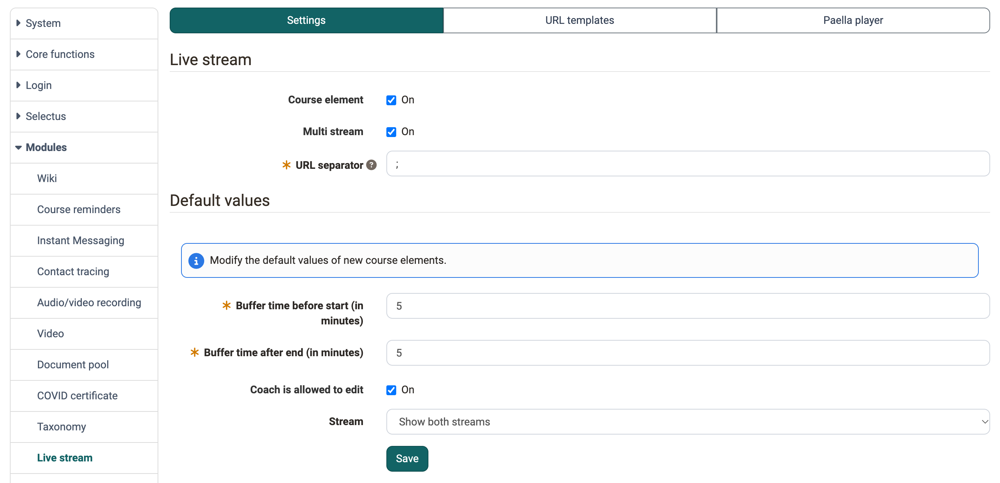

# Course Element "Video live stream" {: #livestream}

## Profile

Name | Video live stream
---------|----------
Icon | :o_icon_o_livestream_icon:
Available since | Release 14.0 (OO-4043)
Functional group | Knowledge transfer
Purpose | Display of a live video stream (set up by system administrators)
Assessable | no
Specialty / Note | 

With the course element "Video live stream" you show live streams to your participants directly in the course, for example a live stream from YouTube. During a set time window, the course element shows up to two live streams at the same time, individually or side by side.

**Application examples:**

* Transmission of a lecture with two live cameras (first camera on the lecturer, second camera on the presentation)
* Regular observation of weather webcams with an evaluation assignment in the following course element (for example in the course element "Checklist")
* Regular animal observation via webcam with a protocol assignment (for example in the course element "Document")

## Preparation by system administrators

System administrators find the configuration in the system administration under: `Administration > Modules > Live stream`. 
There, they activate the course element and, if needed, the Multi stream option for two simultaneous live streams; with multi stream active, they also set the separator for multiple URLs of a single event. Under Default values, they set the buffer time before start and after end in minutes, whether coaches are allowed to edit, and the stream to display as the default for new course elements.

{ class="shadow lightbox" title="Live stream page in the Modules menu · 2026.11.03" }

The two other tabs of the page, "URL templates" and "Paella player", are described in the administration manual under [Module Live stream](../../manual_admin/administration/Modules.md#livestream).

## Tab Configuration

As an author, you define in the course editor how long before and after an event the live stream is visible and who maintains the events. After inserting the course element, open the tab "Configuration" for this: 
`Course > Administration > Course editor > Select course element > Tab "Configuration"`

There, you set "Buffer time before start (in minutes)" and "Buffer time after end (in minutes)" and use "Coach is allowed to edit" to define whether coaches may edit the events. If multi stream is switched on, you choose under "Stream" whether both live streams or only one is displayed.

## Live streams as events in the calendar {: #events}

You plan a live stream like an event: with a start, an end and the address of the stream. At the planned time, the course element shows the stream by itself, without you changing the course. The course element reads the events from the course calendar and from the calendars of the groups that are linked to the course. It only takes into account events in which the field "URL live stream" is filled in. Which events a person sees depends on the [visibility](../personal_menu/Calendar.md#visibility) of the event.

You enter the events in the course element itself, in the tab "Edit events". Owners of the course see the tab, coaches only if the option "Coach is allowed to edit" is switched on in the tab "Configuration". Coaches edit events of the course calendar there if, in addition, the option ["Coaches can edit the calendar"](Course_Settings_Toolbar.md#calendar) is switched on in the course settings in the "Toolbar" tab. [:octicons-tag-16:{ title="from Release 21.2 (OO-9968)" }](https://track.frentix.com/issue/OO-9968) The tab shows the calendar with all events. In the event, you enter the subject, the start and the end, and in the field "URL live stream" the address of the stream. If multi stream is switched on, you enter two addresses, separated by the "URL separator" that is stored in the system administration under `Administration > Modules > Live stream`. The field "URL live stream" only appears when you edit the event in the course element, not in the course calendar.

If templates are stored on the same page in the tab "URL templates", you select a template from the list under "URL live stream" instead of typing the address. With the checkbox "Manually" at "Live stream selection" you enter the address yourself again. If the address of a template changes, the course element shows the new address for running live streams [:octicons-tag-16:{ title="from Release 15.3 (OO-5163)" }](https://track.frentix.com/issue/OO-5163){:target="_blank"}.

## View for participants {: #view}

In the tab "Livestreams", the course element shows the running live stream, from the start of the event minus the buffer time before start until the end plus the buffer time after end. If no event is running, the message "Currently no live stream is broadcasted." appears. Below, "Upcoming live streams" lists the next events with subject, start, end, location and description. The view refreshes itself every 10 seconds.

Owners and coaches also see the tab "Statistic". Under "Broadcast live streams" it lists the running and past events with the number of viewers.

## Further information {: #further_information}

[Course elements at a glance >](Course_Elements/index.md) 
[Course Element "Opencast" >](Course_Element_Opencast.md) 
[Course Element "Calendar" >](Course_Element_Calendar.md) 
[Toolbar >](Course_Settings_Toolbar.md) 
[User tools: Calendar >](../personal_menu/Calendar.md) 
[Modules: Overview >](../../manual_admin/administration/Modules.md)

[To the top of the page ^](#livestream)
