# Kursbaustein "Videoaufgabe"  {: #video_task}

## Steckbrief

Name | Videoaufgabe
---------|----------
Icon | { class=size24  }
Verfügbar seit | Release 17.2
Funktionsgruppe | Wissensüberprüfung
Verwendungszweck | ermöglicht Beurteilungsaufgaben in einem Video
Bewertbar | ja
Spezialität / Hinweis | Zusätzliche im Video enthaltene Quizzes sind nicht bewertbar

Mit dem Kursbaustein "Videoaufgabe" verwenden Sie Lernressourcen "Video" für interaktive Übungen (formativ) oder für Aufgaben mit Bewertung (summativ). Teilnehmende erkennen im Video relevante Situationen und ordnen ihnen Begriffe zu. Die Abschnitte im Video (Segmente) und die Begriffe legen Sie im Videoeditor der Lernressource "Video" fest. Zur Wahl stehen zwei Übungen und ein Test. Bewertbar ist nur der Test.

[Zum Seitenanfang ^](#video_task)

---

## Aufgabenstellungen [:octicons-tag-16:{ title="ab Release 17.2 (OO-6643)" }](https://track.frentix.com/issue/OO-6643)

### Übung: Begriffe zuordnen

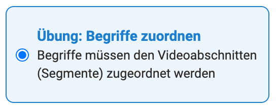{ width="272" class="shadow lightbox" title="Modus Übung: Begriffe zuordnen im Tab Konfiguration · 2026.11.02" }

In diesem Modus sind die Segmente (Videoabschnitte) im Video markiert.

**Beispiel:**

* Das Video zeigt den Ablauf einer medizinischen Pflegebehandlung.
* Im unteren Bereich des Videos werden Schritte der Behandlung angezeigt.
* Während das Video läuft, klicken Teilnehmende im erkannten Schritt auf die passende Bezeichnung der Massnahme (Begriff).
* Teilnehmende erhalten das Feedback direkt nach der Wahl eines Begriffs.
* Eine manuelle Bewertung durch Betreuer:innen gibt es nicht, damit Teilnehmende ohne Kontrolle üben.

---

### Übung: Situationen erkennen

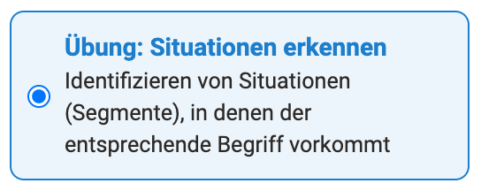{ width="272" class="shadow lightbox" title="Modus Übung: Situationen erkennen im Tab Konfiguration · 2026.11.02" }

In diesem Modus sind die Segmente (Videoabschnitte) im Video **nicht markiert**.

**Beispiel:**

* Das Video zeigt ein Beratungsgespräch.
* Im unteren Bereich des Videos sind keine Segmente (Videoabschnitte) markiert.
* Während das Video abgespielt wird, muss die lernende Person erkennen, um welche Gesprächsphase es sich gerade handelt.
* Teilnehmende erhalten das Feedback direkt nach der Wahl eines Begriffs.
* Eine manuelle Bewertung durch Betreuer:innen gibt es nicht, damit Teilnehmende ohne Kontrolle üben.

---

### Test: Situationen erkennen [:octicons-tag-16:{ title="ab Release 17.2 (OO-6686)" }](https://track.frentix.com/issue/OO-6686)

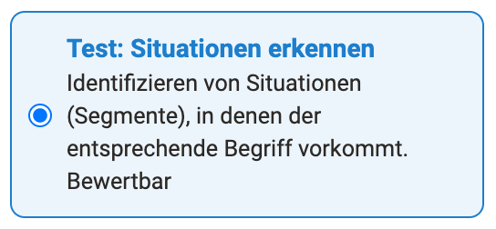{ width="272" class="shadow lightbox" title="Modus Test: Situationen erkennen im Tab Konfiguration · 2026.11.02" }

In diesem Modus sind die Segmente (Videoabschnitte) im Video **nicht markiert**.  Im Unterschied zur Übung ist der Test **bewertbar**. 

**Beispiel:**

* Das Video zeigt ein Beratungsgespräch.
* Im unteren Bereich des Videos sind keine Segmente (Videoabschnitte) markiert.
* Während das Video abgespielt wird, muss die lernende Person erkennen, um welche Gesprächsphase es sich gerade handelt.
* Während eines Tests erhalten die Teilnehmer:innen kein Feedback.
* Am Ende zeigt die Leistungsübersicht den Status "Bewertet" und je nach Einstellung im Tab "Bewertung" auch Punkte und Erfolgsstatus. Das detaillierte Bewertungsergebnis sehen nur Besitzer:innen und Betreuer:innen.

!!! info "Wichtig"

    Neben den drei Aufgabenstellungen mit Segmenten kann das Video auch Quizfragen zu verschiedenen Zeitpunkten zeigen. Die Auswertung berücksichtigt sie nicht.

[Zum Seitenanfang ^](#video_task)

---

## Übungsmodus - Testmodus

Beim Üben sollen die Ergebnisse anonym bleiben. Betreuer:innen sehen deshalb nur anonym dargestellte Ergebnisse. Im Test sehen Besitzer:innen und Betreuer:innen die Resultate jeder Person.

Mit "Anzahl Lösungsversuche limitieren" begrenzen Sie die Anzahl der Versuche auf 1 bis 9999.

In der Übung "Begriffe zuordnen" begrenzen Sie zusätzlich die "Anzahl Antwortversuche pro Segment" auf 1 bis 5.

---

## Erforderliche Lernressource

Jeder Kursbaustein "Videoaufgabe" braucht eine Lernressource "Video".

Das ist eine MP4-Datei, die Sie im Autorenbereich hochladen, oder ein Link auf ein Video im Internet, zum Beispiel auf YouTube.

In OpenOlat ergänzen Sie die MP4-Datei um die Elemente in der Tabelle. Die Datei bildet mit diesen Elementen die Lernressource "Video", die im Autorenbereich aufgelistet ist.

Um Segmente (Videoabschnitte) zuordnen zu können, braucht die Videoaufgabe eine Lernressource "Video", in der Segmente angelegt sind.

| Elemente der Lernressource:                  |                                    |
| ----------------- | ---------------------------------- |
| Kapitel           | optional                           |
| Anmerkungen       | optional                           |
| Segmente          | Für eine Videoaufgabe erforderlich |
| Kommentare        | optional                           |
| Quiz              | optional (nicht ausgewertet)       | 

!!! tip "Tipp"

    Verweist die Lernressource "Video" auf einen Link, zum Beispiel auf YouTube, wird die Videoaufgabe unbrauchbar, sobald der Link nicht mehr gültig ist. Laden Sie deshalb wenn möglich eine MP4-Datei in OpenOlat hoch.

[Zum Seitenanfang ^](#video_task)

---

## Videoaufgabe erstellen

### Schritt 1

Erstellen Sie im Autorenbereich eine Lernressource "Video". Öffnen Sie den Videoeditor und fügen Sie Segmente und Begriffe hinzu. [Mehr dazu >](../../manual_user/learningresources/Learning_resource_Video.de.md#video_segments)

### Schritt 2

Fügen Sie einen Kursbaustein "Videoaufgabe" in den Kurs ein.

### Schritt 3

Im Tab "Konfiguration" des Kursbausteins:

1. Wählen Sie die Lernressource "Video" mit den vorbereiteten Segmenten aus.
2. Wählen Sie unter "Modus" die gewünschte Aufgabenstellung.

### Schritt 4

Prüfen Sie im Tab "Konfiguration":

* Unter "Verwendete Begriffe" sind die richtigen Begriffe gewählt.
* Unter "Reihenfolge der Begriffe in der Videoaufgabe" stimmt die Reihenfolge.

Unter "Videoelemente anzeigen" ist "Segmente" immer gewählt und lässt sich nicht abwählen.

!!! tip "Tipp"

    Mit "Lernressource bearbeiten" öffnen Sie den Videoeditor und bearbeiten die Segmente weiter.

### Tab "Bewertung" [:octicons-tag-16:{ title="ab Release 21.1 (OO-9647)" }](https://track.frentix.com/issue/OO-9647){:target="_blank"} {: #tab_assessment}

Den Tab "Bewertung" können Sie nur im Modus "Test: Situationen erkennen" öffnen, denn bewertet wird nur der Test. Der Tab gliedert sich in zwei Bereiche:

* **Konfiguration Bewertung**: Hier legen Sie fest, wie OpenOlat den Test bewertet. Mit "Punkte vergeben" erscheinen "Minimal erreichbare Punkte", "Maximal erreichbare Punkte", "Stellen nach Komma" und "Gewichtung falsche Antwort". "Minimal erreichbare Punkte" steht immer auf 0 und lässt sich nicht ändern. Dazu kommen "Bewertung mit Einstufung/Noten", "Bestanden/Nicht bestanden ausgeben" mit "Erfolgsstatus ausgeben" und "Punkteschwelle für Bestanden" sowie in Lernpfadkursen "Bei Kurs-Bewertung berücksichtigen".
* **Bewertungsformular**: Mit "Individueller Kommentar" und "Individuelle Bewertungsdokumente" stellen Betreuer:innen den Teilnehmenden bei der Bewertung Kommentare oder Dokumente bereit.

Sind für die Videoaufgabe bereits Bewertungen vorhanden, zeigt OpenOlat alle Einstellungen unter "Konfiguration Bewertung" schreibgeschützt an. Bearbeitbar bleibt der Bereich "Bewertungsformular". Mit "Bearbeitungsmodus aktivieren" machen Sie die Einstellungen wieder bearbeitbar, siehe [Schreibschutz der Bewertungskonfiguration](Course_Elements.de.md#assessment_config_read_only).

[Zum Seitenanfang ^](#video_task)

---

## Auswertung

### Prinzipien

* Übungen bewertet OpenOlat automatisch. Betreuer:innen können diese Bewertung nicht ändern.
* Auch Tests bewertet OpenOlat automatisch. Betreuer:innen sehen alle Lösungsversuche im Bewertungswerkzeug und entscheiden über die Freigabe der Bewertung.
* Quizfragen der Lernressource "Video" zählen nicht zur Auswertung. Im Kursbaustein "Videoaufgabe" bezieht sich die Auswertung ausschliesslich auf die Segmente.
* Bei Übungen sollen die Ergebnisse anonym bleiben. Betreuer:innen sehen deshalb nur anonym dargestellte Ergebnisse.
* Falsche Antworten gewichtet OpenOlat nach dieser Formel: 
    t = Anzahl der Segmente mit den verwendeten Begriffen 
    c = Anzahl der richtig erkannten Segmente 
    w = Anzahl der falschen Klicks 
    g = "Gewichtung falsche Antwort" 
    Resultat in % = (c / t) - (w / t * g) 
    Punkte = "Maximal erreichbare Punkte" * Resultat, mindestens 0 Punkte

### Ergebnis für Teilnehmer:innen

In Übungen erhalten Teilnehmer:innen beim Lösen der Aufgabe direkt ein Feedback.

Am Ende der Übung zeigt OpenOlat eine Zusammenfassung, und mit "Lösung anzeigen" sehen Teilnehmer:innen die Lösung.

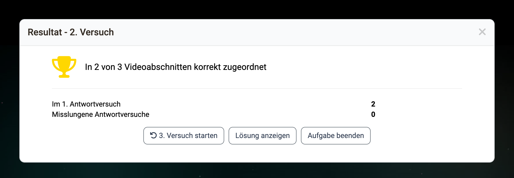{ class="shadow lightbox" title="Resultat eines Übungsversuchs · 2026.11.02" }

Während eines **Tests** erhalten die Teilnehmer:innen dagegen keinerlei Feedback. Am Ende zeigt die Leistungsübersicht die Anzahl der Lösungsversuche, je nach Einstellung im Tab "Bewertung" auch Punkte und Erfolgsstatus. (Falls weitere Versuche erlaubt sind, erscheint auch nochmals die Aufgabenstellung und der Button zum Starten der Videoaufgabe.)

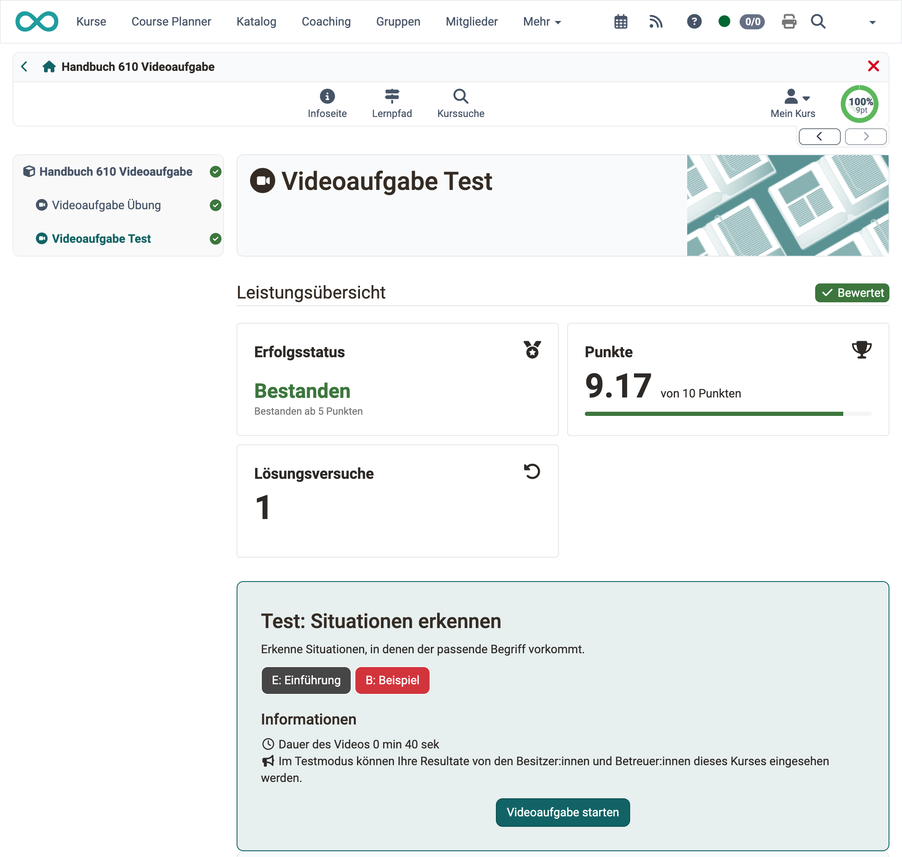{ class="shadow lightbox" title="Abschlussansicht der Videoaufgabe im Testmodus · 2026.11.02" }

### Ergebnisse für Betreuer:innen in Übungen

Öffnen Betreuer:innen bei einer Übung den Kursbaustein im Kurs, sehen sie die Tabs "Teilnehmer:innen" und "Vorschau".

* **Teilnehmer:innen**: Eine Liste zeigt den Bearbeitungsstand der betreuten Teilnehmer:innen.
* **Vorschau**: Das Video erscheint so, wie es Teilnehmer:innen sehen.

Im Menü mit drei Punkten in der Zeile einer teilnehmenden Person stehen Betreuer:innen je nach Status der Bewertung und je nach Kurseinstellungen diese Einträge zur Verfügung:

* **Details anzeigen / bewerten** öffnet die Bewertung der Person.
* **Bewertung abschliessen** bzw. **Bewertung wieder eröffnen** ändert den Status der Bewertung.
* **Freigeben** bzw. **Freigabe zurückziehen** legt fest, ob die Person ihr Resultat sieht.
* **Anzahl Versuche zurücksetzen** setzt die Versuche der Person zurück.

Die Daten aller Teilnehmer:innen löschen Sie mit dem Eintrag "Alle Daten löschen", siehe unten.

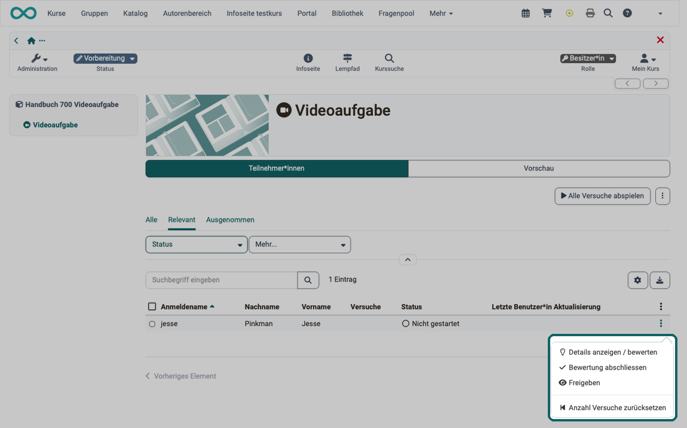{ class="shadow lightbox" title="Tab Teilnehmer:innen der Betreuer:innen-Ansicht · 2026.10.07" }

### Button "Alle Versuche abspielen"

Damit die Versuche in Übungen anonym bleiben, sehen Betreuer:innen keine Resultate, die sich bestimmten Personen zuordnen lassen. Stattdessen zeigt eine gemeinsame Darstellung die Versuche aller Teilnehmer:innen als Striche.

Klicken Sie dazu auf den Button "Alle Versuche abspielen".

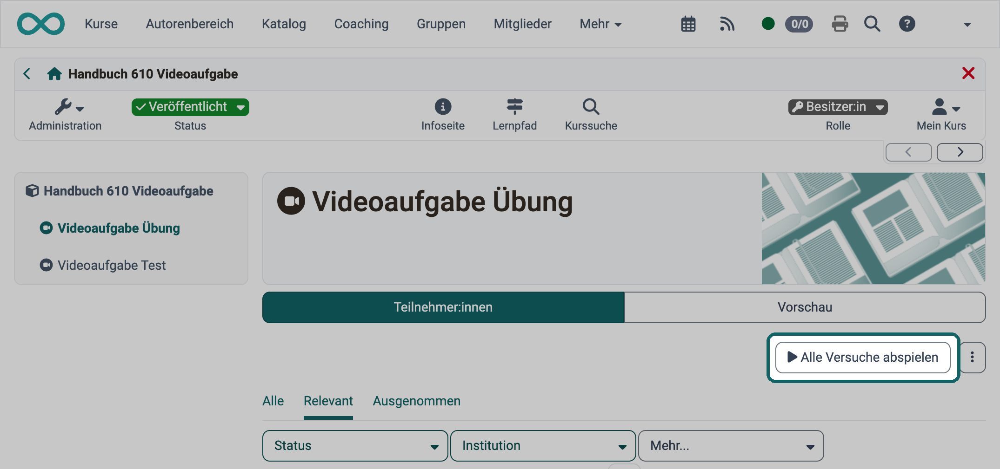{ class="shadow lightbox" title="Tab Teilnehmer:innen der Betreuer:innen-Ansicht einer Videoaufgabe · 2026.11.02" }

In der Timeline des Videos erscheinen richtige Antworten als grüne Striche, falsche Antworten als rote Striche. So erkennen Betreuer:innen zum Beispiel Wissenslücken, die viele Teilnehmer:innen teilen, oder eine Aufgabenstellung, die angepasst werden sollte.

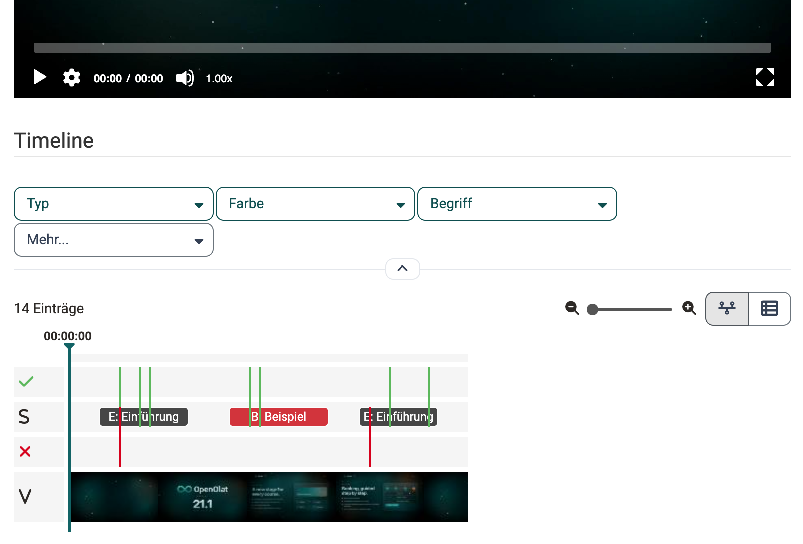{ class="shadow lightbox" title="Ansicht Alle Versuche abspielen einer Videoaufgabe · 2026.11.02" }

### "Alle Daten löschen"

Den Eintrag "Alle Daten löschen" finden Sie im Menü mit drei Punkten neben den Buttons des Tabs "Teilnehmer:innen".

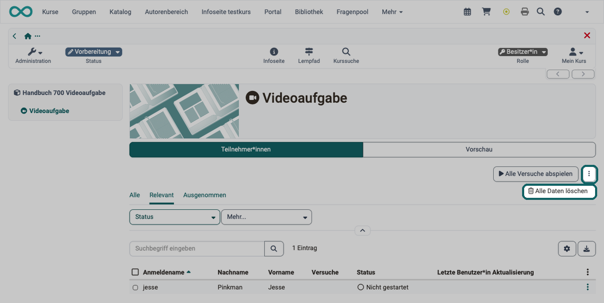{ class="shadow lightbox" title="Tab Teilnehmer:innen der Betreuer:innen-Ansicht einer Videoaufgabe · 2026.10.07" }

Nach Klick auf den Eintrag erscheint der Dialog "Daten von Videoaufgabe löschen". Er nennt die Anzahl Personen, deren Resultate endgültig gelöscht werden. Sie bestätigen das Kontrollkästchen "Ich verstehe, dass die Daten endgültig gelöscht werden." und klicken auf "Alle Daten löschen". Vor dem Löschen erstellt OpenOlat eine Archivdatei mit den bisherigen Daten.

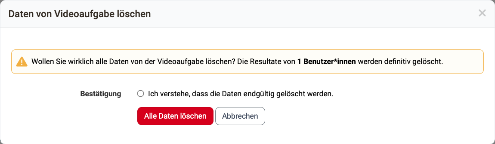{ class="shadow lightbox" title="Sicherheitsabfrage vor dem Löschen aller Daten einer Videoaufgabe · 2026.10.07" }

### Ergebnisse für Betreuer:innen in Tests

Ist für die Videoaufgabe der Modus "Test: Situationen erkennen" gewählt, erscheinen ausser den Tabs "Teilnehmer:innen" und "Vorschau" auch die Tabs "Übersicht" und "Erinnerungen". Im Tab "Erinnerungen" richten Betreuer:innen automatische E-Mails an Kursmitglieder ein. OpenOlat verschickt sie, sobald die hinterlegten Regeln zutreffen, zum Beispiel einen Tag vor einem noch nicht absolvierten Test.

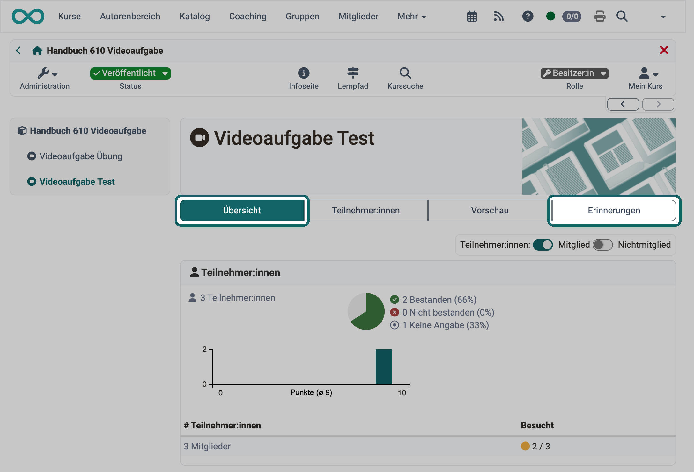{ class="shadow lightbox" title="Betreuer:innen-Ansicht einer Videoaufgabe im Testmodus · 2026.11.02" }

Im Tab "Teilnehmer:innen" sehen Besitzer:innen und Betreuer:innen des Kurses die Resultate jeder Person im Detail. Statt des Buttons "Alle Versuche abspielen" stehen im Testmodus zwei andere Buttons über der Liste:

* **Resultate exportieren** lädt eine Excel-Datei mit allen Versuchen in dieser Videoaufgabe herunter.
* **Videoaufgabe Statistiken** öffnet die Auswertung des Tests: den Bereich "Kennzahlen" unter anderem mit der Anzahl Teilnehmer:innen, Bestanden und Nicht bestanden, Mittelwert, Median, Standardabweichung und durchschnittlicher Bearbeitungsdauer, darunter den Bereich "Versuche".

[Zum Seitenanfang ^](#video_task)

---

## Weiterführende Informationen {: #further_information}

[Lernressource: Video >](../../manual_user/learningresources/Learning_resource_Video.de.md) 
[Kursbausteine >](Course_Elements.de.md) 
[Kursbaustein "Video" >](../../manual_user/learningresources/Course_Element_Video.de.md) 
[Bewertungswerkzeug - Übersicht >](Assessment_tool_overview.de.md)

[Zum Seitenanfang ^](#video_task)
