# Course Element "Video task" {: #video_task}

## Profile

Name | Video Task
---------|----------
Icon | { class=size24 }
Available since | Release 17.2
Functional group | Assessment
Purpose | Enables assessment tasks in a video
Assessable | yes
Specialty / Note | Additional quizzes included in the video are not assessable

With the course element "Video task" you use learning resources "Video" for interactive exercises (formative) or for tasks with assessment (summative). Participants identify relevant situations in the video and assign terms to them. You define the sections in the video (segments) and the terms in the video editor of the learning resource "Video". Two practices and one test are available. Only the test can be assessed.

[To the top of the page ^](#video_task)

---

## Tasks [:octicons-tag-16:{ title="from Release 17.2 (OO-6643)" }](https://track.frentix.com/issue/OO-6643)

### Practice: Assign terms

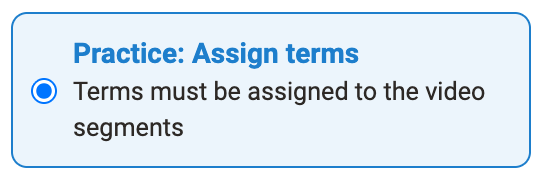{ width="272" class="shadow lightbox" title="Mode Practice: Assign terms in the Configuration tab · 2026.11.02" }

In this mode, the segments (video sections) in the video are marked.

**Example:**

* The video shows the process of a medical care treatment.
* In the lower area of the video, steps of the treatment are shown.
* While the video is playing, participants click the appropriate name of the measure (term) during the recognised step.
* Participants receive the feedback directly after selecting a term.
* There is no manual assessment by coaches, so that participants practise without control.

---

### Practice: Identify situations

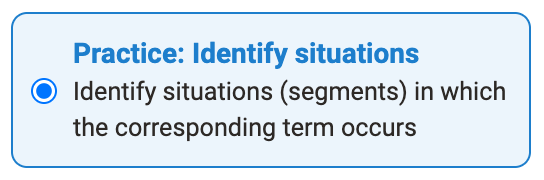{ width="272" class="shadow lightbox" title="Mode Practice: Identify situations in the Configuration tab · 2026.11.02" }

In this mode, the segments (video sections) in the video are **not marked**.

**Example:**

* The video shows a counselling session.
* No segments (video sections) are marked in the lower area of the video.
* While the video is playing, the student has to identify which phase of the conversation it is.
* Participants receive the feedback directly after selecting a term.
* There is no manual assessment by coaches, so that participants practise without control.

---

### Test: Identify situations [:octicons-tag-16:{ title="from Release 17.2 (OO-6686)" }](https://track.frentix.com/issue/OO-6686)

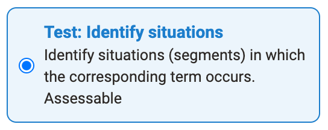{ width="272" class="shadow lightbox" title="Mode Test: Identify situations in the Configuration tab · 2026.11.02" }

In this mode, the segments (video sections) in the video are **not marked**.  Unlike the exercise, the test is **assessable**.

**Example:**

* The video shows a counselling session.
* No segments (video sections) are marked in the lower part of the video.
* While the video is playing, the learner has to identify which phase of the conversation it is.
* During a test, the participants do not receive any feedback.
* At the end, the performance summary shows the status "Assessed" and, depending on the settings in the "Assessment" tab, also the score and the success status. Only owners and coaches see the detailed evaluation result.

!!! info "Important"

    In addition to the three tasks with segments, the video can also show quiz questions at different times. The evaluation does not take them into account.

[To the top of the page ^](#video_task)

---

## Practice mode - Test mode

When practicing, the results should remain anonymous. Coaches therefore only see anonymously presented results. In the test, owners and coaches see the results of each person.

With "Limit the number of attempts" you limit the number of attempts to 1 to 9999.

In the practice "Assign terms" you can additionally limit the "Number of answer attempts per segment" to 1 to 5.

---

## Required Learning Resource

Each course element "Video task" needs a learning resource "Video".

This is an MP4 file that you upload in the authoring area, or a link to a video on the internet, for example on YouTube.

In OpenOlat you add the elements in the table to the MP4 file. The file together with these elements forms the learning resource "Video", which is listed in the authoring area.

In order to assign segments (video sections), the video task needs a learning resource "Video" in which segments have been created.

| Elements of the Learning resource:                  |                                    |
| ----------------- | ---------------------------------- |
| Chapter           | optional                           |
| Notes       | optional                           |
| Segments          | Required for a video task |
| Comments        | optional                           |
| Quiz              | optional (not assessed)       | 

!!! tip "Tip"

    If the learning resource "Video" refers to a link, for example on YouTube, the video task becomes unusable as soon as the link is no longer valid. Upload an MP4 file to OpenOlat if possible.

[To the top of the page ^](#video_task)

---

## Create Video task

### Step 1

Create a learning resource "Video" in the authoring area. Open the video editor and add segments and terms. [Find out more >](../../manual_user/learningresources/Learning_resource_Video.md#video_segments)

### Step 2

Add a course element "Video task" to the course.

### Step 3

In the tab "Configuration" of the course element:

1. Select the learning resource "Video" with the prepared segments.
2. Select the desired task under "Modes".

### Step 4

Check in the tab "Configuration":

* Under "Terms used" the correct terms are selected.
* Under "Order of terms in the video task" the order is correct.

Under "Display video elements", "Segments" is always selected and cannot be deselected.

!!! tip "Tip"

    With "Edit learning resource" you open the video editor and continue editing the segments.

### Tab "Assessment" [:octicons-tag-16:{ title="from Release 21.1 (OO-9647)" }](https://track.frentix.com/issue/OO-9647){:target="_blank"} {: #tab_assessment}

You can only open the tab "Assessment" in the mode "Test: Identify situations", because only the test is assessed. The tab is divided into two areas:

* **Grading configuration**: Here you define how OpenOlat assesses the test. With "Score granted", "Minimum score", "Maximum score", "Digits after comma" and "Weighting wrong answer" appear. "Minimum score" is always 0 and cannot be changed. In addition there are "Levels/Grading", "Display passed / not passed" with "Display success status" and "Passed cut value" as well as, in learning path courses, "Include in course assessment".
* **Assessment form**: With "Individual comment" and "Individual assessment documents", coaches provide participants with comments or documents during the assessment.

If assessments already exist for the video task, OpenOlat displays all settings under "Grading configuration" as read-only. The area "Assessment form" remains editable. With "Enable edit mode" you make the settings editable again, see [Read-only assessment configuration](Course_Elements/index.md#assessment_config_read_only).

[To the top of the page ^](#video_task)

---

## Assessment

### Principles

* OpenOlat assesses exercises automatically. Coaches cannot change this assessment.
* OpenOlat also assesses tests automatically. Coaches see all solution attempts in the assessment tool and decide on the release of the assessment.
* Quiz questions of the learning resource "Video" do not count towards the evaluation. In the course element "Video task" the evaluation refers exclusively to the segments.
* In exercises, the results should remain anonymous. Coaches therefore only see anonymously presented results.
* OpenOlat weights incorrect answers using this formula: 
    t = number of segments with the terms used 
    c = number of correctly identified segments 
    w = number of wrong clicks 
    g = "Weighting wrong answer" 
    Result in % = (c / t) - (w / t * g) 
    Score = "Maximum score" * result, at least 0 points

### Result for participants

In exercises, participants receive feedback directly while solving the task.

At the end of the exercise, OpenOlat shows a summary, and with "Show solution" participants see the solution.

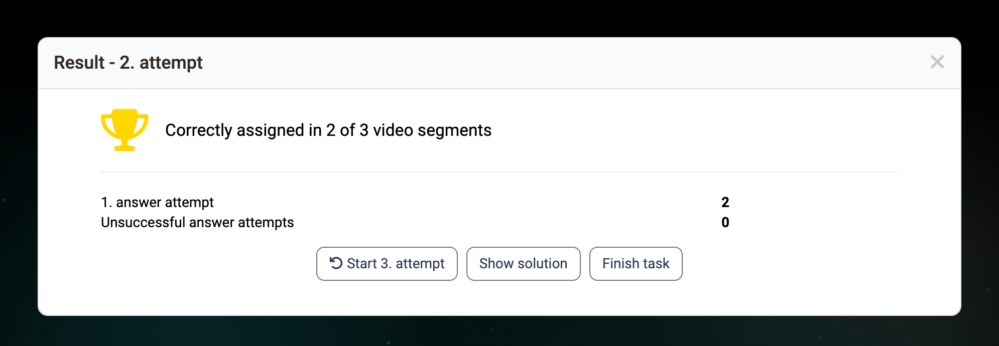{ class="shadow lightbox" title="Result of a practice attempt · 2026.11.02" }

During a **test**, on the other hand, the participants do not receive any feedback. At the end, the performance summary shows the number of attempts and, depending on the settings in the "Assessment" tab, also the score and the success status. (If further attempts are allowed, the task definition and the button for starting the video task will also appear again.)

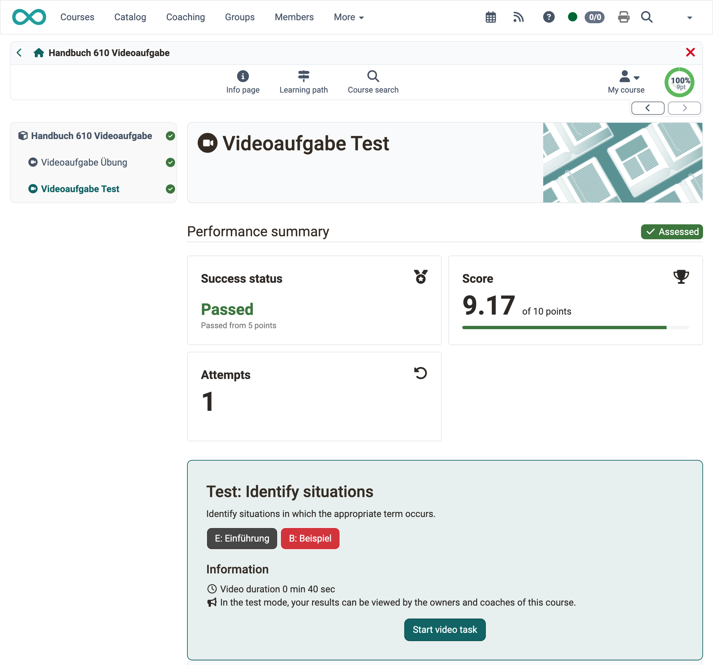{ class="shadow lightbox" title="Final view of the video task in test mode · 2026.11.02" }

### Results for coaches in exercises

If coaches open the course element of an exercise in the course, they see the tabs "Participants" and "Preview".

* **Participants**: A list shows the processing status of the coached participants.
* **Preview**: The video appears as participants see it.

In the menu with three dots in the row of a participant, coaches find these entries, depending on the status of the assessment and on the course settings:

* **Show details / assess** opens the assessment of the person.
* **Finalize assessment** or **Reopen assessment** changes the status of the assessment.
* **Release** or **Withdraw release** defines whether the person sees their result.
* **Reset number of attempts** resets the attempts of the person.

You delete the data of all participants with the entry "Delete all data", see below.

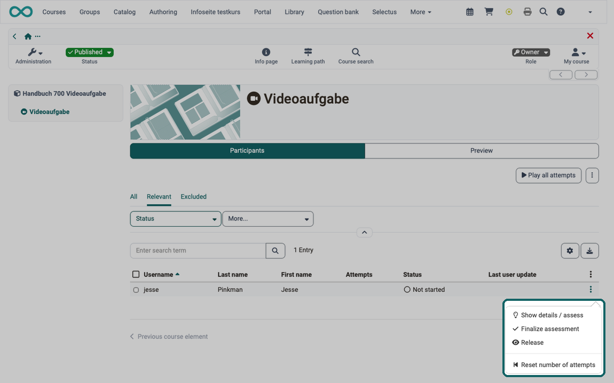{ class="shadow lightbox" title="Participants tab of the coach view · 2026.10.07" }

### "Play all attempts" button

So that the attempts in exercises remain anonymous, coaches do not see any results that can be attributed to specific persons. Instead, a common display shows the attempts of all participants as strokes.

To do this, click the button "Play all attempts".

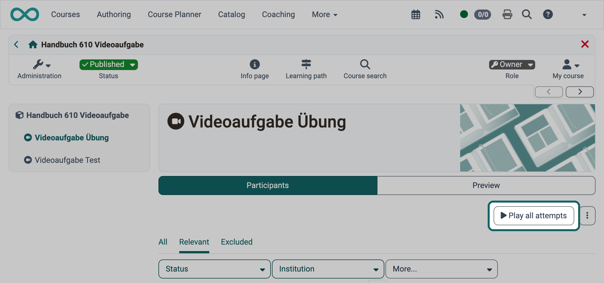{ class="shadow lightbox" title="Participants tab of the coach view of a video task · 2026.11.02" }

In the timeline of the video, correct answers appear as green lines, wrong answers as red lines. In this way coaches recognise, for example, knowledge gaps that many participants share, or a task that should be adapted.

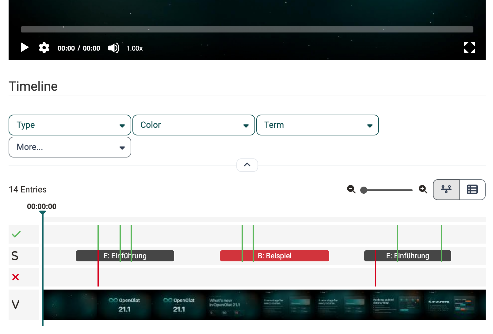{ class="shadow lightbox" title="Play all attempts view of a video task · 2026.11.02" }

### "Delete all data"

You find the entry "Delete all data" in the menu with three dots next to the buttons of the "Participants" tab.

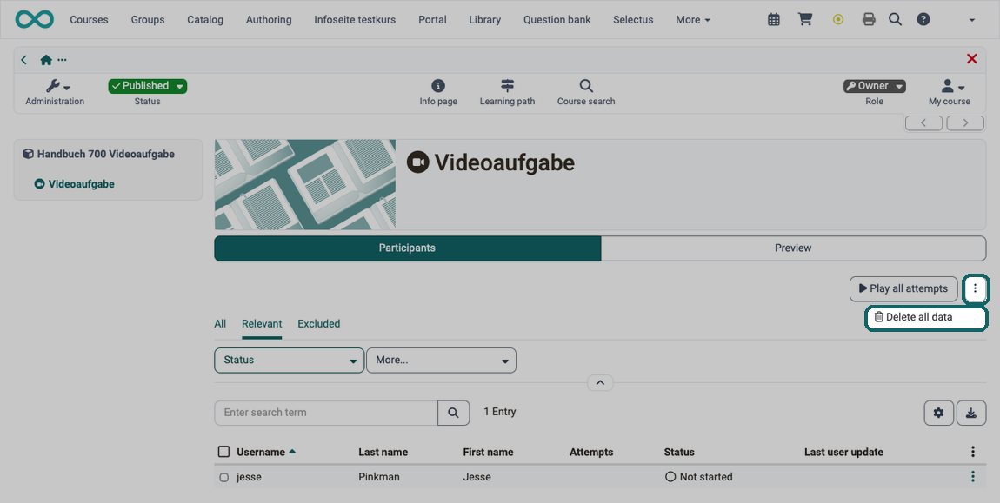{ class="shadow lightbox" title="Participants tab of the coach view of a video task · 2026.10.07" }

After clicking on the entry, the dialog "Delete data of video task" appears. It names the number of persons whose results are permanently deleted. You confirm the checkbox "I understand that the data will be definitely deleted." and click "Delete all data". Before deleting, OpenOlat creates an archive file with the previous data.

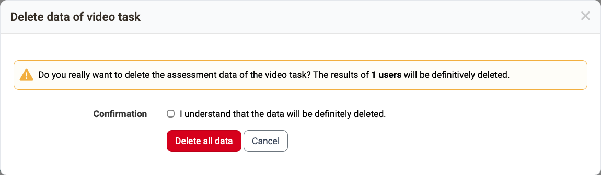{ class="shadow lightbox" title="Confirmation prompt before deleting all data of a video task · 2026.10.07" }

### Results for test coaches

If the mode "Test: Identify situations" is selected for the video task, the tabs "Overview" and "Reminders" appear in addition to the tabs "Participants" and "Preview". In the tab "Reminders", coaches set up automatic emails to course members. OpenOlat sends them as soon as the configured rules apply, for example one day before a test that has not yet been completed.

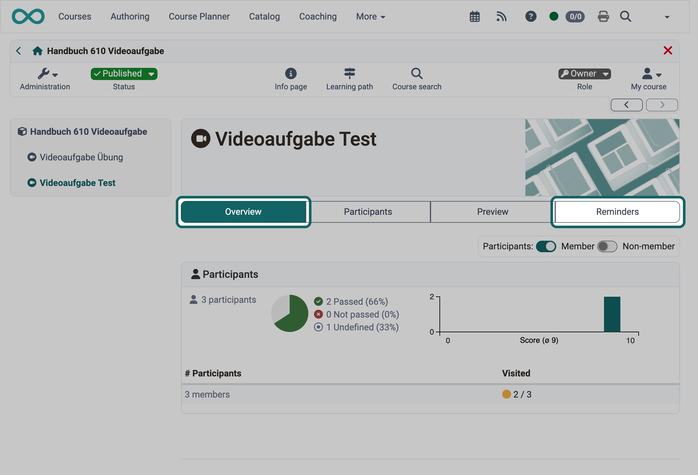{ class="shadow lightbox" title="Coach view of a video task in test mode · 2026.11.02" }

In the tab "Participants", owners and coaches of the course see the results of each person in detail. Instead of the button "Play all attempts", the test mode shows two other buttons above the list:

* **Export results** downloads an Excel file with all attempts in this video task.
* **Video task statistics** opens the evaluation of the test: the area "Key figures" with, among other things, the number of participants, passed and not passed, arithmetic average, median, standard deviation and average completion time, below it the area "Attempts".

[To the top of the page ^](#video_task)

---

## Further information {: #further_information}

[Learning resource: Video >](../../manual_user/learningresources/Learning_resource_Video.md) 
[Course elements at a glance >](Course_Elements/index.md) 
[Course Element "Video" >](../../manual_user/learningresources/Course_Element_Video.md) 
[Assessment tool - overview >](Assessment_tool_overview/index.md)

[To the top of the page ^](#video_task)

