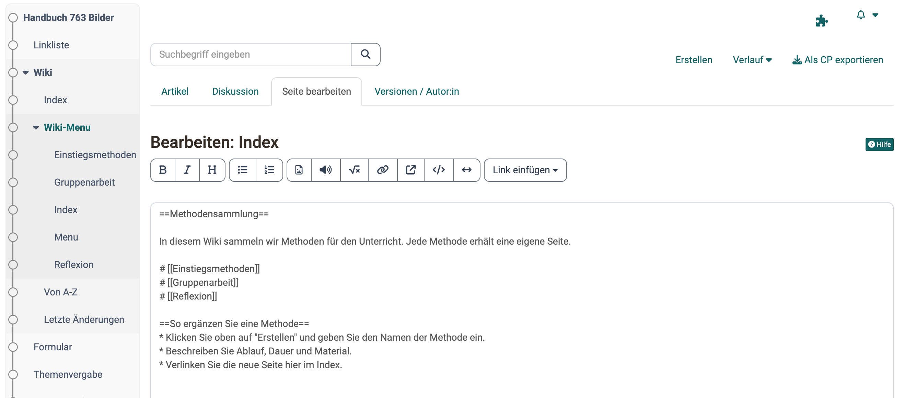

# Kursbaustein "Wiki" {: #wiki}

## Steckbrief

Name | Wiki
---------|----------
Icon | :o_icon_o_wiki_icon:
Verfügbar seit | Release 7.1 oder früher
Funktionsgruppe | Kommunikation und Kollaboration
Verwendungszweck | Gemeinsames Erstellen von Inhalten
Bewertbar | nein
Spezialität / Hinweis |

Verwenden Sie ein Wiki, um auf einfache Weise mit Teilnehmenden gemeinsam Inhalte zu erstellen. Ein Wiki eignet sich für Gruppenarbeiten, als Dokumentationswerkzeug und generell für das gemeinsame Schreiben von Texten. Die einzelnen Seiten sind als Hypertext miteinander verlinkt.

## Im Kurseditor

Mit dem Kursbaustein "Wiki" binden Sie eine Lernressource Wiki in Ihren Kurs ein. Die Einstellungen dazu finden Sie unter:<br>
`Kurs > Administration > Kurseditor > Kursbaustein "Wiki" > Tab "Wiki-Lerninhalt"`

Solange kein Wiki zugeordnet ist, bietet der Tab "Wiki-Lerninhalt" drei Wege an: Mit "Auswählen" ordnen Sie ein bestehendes Wiki zu, mit "Erstellen" legen Sie ein neues an, und mit "Import" importieren Sie ein Wiki aus einer Datei.

Ist schon eine Lernressource Wiki zugeordnet, erscheint deren Name. Um die Zuordnung nachträglich zu ändern, klicken Sie im Tab "Wiki-Lerninhalt" auf "Ersetzen" und wählen ein anderes Wiki. Über den Pfeil neben "Ersetzen" erstellen oder importieren Sie stattdessen ein neues.

Im Tab "Wiki-Lerninhalt" legen Sie auch fest, wer das Wiki bearbeiten darf. Unter "Artikel bearbeiten" erlauben Sie neben den Besitzer:innen auch Betreuer:innen und Teilnehmenden, Wiki-Artikel zu bearbeiten. Standardmässig haben alle Teilnehmenden Lese- und Schreibrechte in einem Wiki. Eine Wiki-Seite löschen dürfen die Person, die sie erstellt hat, die Besitzer:innen des Kurses und die Besitzer:innen der Lernressource Wiki. [:octicons-tag-16:{ title="ab Release 15.0 (OO-4551)" }](https://track.frentix.com/issue/OO-4551)

!!! info "Wichtig"

    Finden Sie in Ihrer OpenOlat-Instanz keinen Kursbaustein "Wiki", ist die Wikiressource systemweit ausgeschaltet. Systemadministrator:innen schalten sie in der System-Administration ein: `Administration > Module > Wiki`, Option "Wikiressource einschalten".

## Arbeiten mit Wiki (geschlossener Kurseditor)

{ class="shadow lightbox" title="Tab Seite bearbeiten im Kursbaustein Wiki · 2026.11.03" }

Ist ein Wiki in einem Kurs eingebunden, erscheinen in der linken Kursnavigation das "Wiki-Menu" und weitere Wiki-Links. Über den Link "Von A-Z" rufen Sie das Inhaltsverzeichnis mit allen Wiki-Seiten auf. So sehen Sie auf einen Blick, welche Seiten es bereits gibt.

Im Hauptbereich lesen Sie die Wiki-Beiträge (Tab "Artikel"), bearbeiten die Wiki-Seiten (Tab "Seite bearbeiten"), führen Diskussionen zu den einzelnen Wiki-Seiten (Tab "Diskussion") und sehen die Bearbeitungshistorie (Tab "Versionen / Autor:in"). Sie können das Wiki auch als Content Package (CP) exportieren und sich über Änderungen informieren lassen.

### Neue Wiki-Seiten erstellen

Eine neue Wiki-Seite legen Sie über den Button "Erstellen" an und füllen sie anschliessend mit Inhalten. Die so erstellte Seite ist zunächst mit keiner anderen Seite des Wikis verbunden. Damit Lesende sie finden, verlinken Sie die Seite im "Wiki-Menu" oder auf der Seite "Index" des Wikis.

Alternativ legen Sie auf der Seite, auf der der Link zur neuen Wiki-Seite erscheinen soll, einen internen Link an. Verwenden Sie dafür den Button "Interner link" des Wiki-Editors oder tragen Sie die Syntax direkt ein: zwei öffnende eckige Klammern, der Seitenname und zwei schliessende eckige Klammern, zum Beispiel `[[Linkname]]`.

Beim ersten Aufruf des Links legt OpenOlat die Seite automatisch an.

![Button "Interner link" in der Werkzeugleiste markiert, im Editor darunter der eingefügte Platzhalter [[Linktext]], den Sie durch den Namen der neuen Seite ersetzen](assets/course_element_wiki_internal_link_v1_de.png){ class="shadow lightbox" title="Werkzeugleiste im Tab Seite bearbeiten · 2026.11.03" }

### Inhalte einer Wiki-Seite ändern

Um Inhalte einer Wiki-Seite zu bearbeiten, wählen Sie den Tab "Seite bearbeiten" der gewünschten Wiki-Seite:<br>
`Kurs > Kursbaustein "Wiki" > "Seitenname" > Tab "Seite bearbeiten"`

Es erscheint der Wiki-Editor mit verschiedenen Formatierungsmöglichkeiten. Hier binden Sie auch Bilder, Medienlinks, mathematische Formeln sowie interne und externe Links in Ihr Wiki ein. Neben den Buttons im Editor gibt es weitere Formatierungen, die Sie direkt im Text als Syntaxelemente einfügen. Der folgende Abschnitt erklärt die Wiki-Syntax.

## Wiki Syntax

Ihre Eingaben können Sie mit der folgenden Wiki-Syntax formatieren.

!!! warning "Achtung"

    Es empfiehlt sich, Sonderzeichen in Wikiwords zurückhaltend einzusetzen. Nicht erlaubt ist der Doppelpunkt (:). Beachten Sie auch, dass ein Leerzeichen am Anfang einer Zeile als ein Formatierungsbefehl interpretiert wird (Preformatted Text).

### Textgestaltung

Syntax | Ergebnis (Formatierung)
---|---
'''Fetter Text''' | **Fetter Text**
''Kursiver Text'' | _Kursiver Text_
==Level 2 Überschrift== | <h2>Level 2 Überschrift</h2>
* Liste | <li>Liste</li>
# Nummerierte Liste | 1. Nummerierte Liste

### Links

Syntax | Ergebnis (Formatierung)
---|---
[[Interner link]] | Interner link
[[Link `|` Text]] | [Text](Course_Element_Wiki.de.md)
Externer Link [[http://www.openolat.org](http://www.openolat.org/)] | [http://www.openolat.org](http://www.openolat.org/)
[[http://www.openolat.org](http://www.openolat.org/) Die Website von OpenOlat] | [Die Website von OpenOlat](http://www.openolat.org/)

OpenOlat wandelt externe Adressen automatisch in einen Link um, wenn Sie die volle Adresse angeben: [https://www.openolat.org](http://www.openolat.org/). Möchten Sie statt des Links einen anderen Begriff angeben, setzen Sie die URL und den Begriff gemeinsam in eckige Klammern, getrennt durch ein Leerzeichen.

### Tabellen

#### Einzeilig

=== "Syntax"

    ```markdown
    {|
    |Zelle 1
    |Zelle 2
    |}| Zelle 1 Zelle 2
    ```

=== "Ergebnis"

    Zelle 1 Zelle 2

#### Mehrzeilig

=== "Syntax"

    ```markdown
    {|
    |Zelle 1
    |Zelle 2
    |-
    |Zelle 3
    |Zelle 4
    |}|
    ```

=== "Ergebnis"

    Zelle 1 Zelle 2<br>
    Zelle 3 Zelle 4

#### Mit Rahmen

=== "Syntax"

    ```markdown
    {| border="1"
    |Zelle 1
    |Zelle 2
    |-
    |Zelle 3
    |Zelle 4
    |}
    ```

=== "Ergebnis"

    Zelle 1| Zelle 2
    ---|---
    Zelle 3| Zelle 4

### Bilder und andere Dateien

Um zum Beispiel Bilder ins Wiki einzufügen, laden Sie diese zuerst mit dem Button "Datei hochladen" in OpenOlat hoch. Sobald das Wiki mindestens eine Datei enthält, erscheint das Drop-down-Menü "Datei einfügen", mit dem Sie Bilder und andere Dateien einfügen.

=== "Syntax"

    [[Image:openolat_logo_72.png]]

=== "Ergebnis"

    

Beim Einfügen des Bildes bestehen folgende optionale Formatierungsmöglichkeiten:

#### Bildlegende

=== "Syntax"

    [[Image:openolat_logo_72.png | Das ist das OpenOlat-Logo.]]|

=== "Ergebnis"

    <br>
    Das ist das OpenOlat-Logo.

#### Ausrichtung

Mit dem Zusatz "left" oder "right" geben Sie an, wie das Bild ausgerichtet werden soll.

=== "Syntax"

    [[Image:openolat_logo_72.png|right]]

=== "Ergebnis"

    { align=right }

#### Bildgrösse

Geben Sie in Pixeln an, wie gross das Bild angezeigt werden soll.

=== "Syntax"

    [[Image:openolat_logo_72.png|120px]]|

=== "Ergebnis"

    { width=120px }

#### Miniaturbild

Wenn Sie den Zusatz "thumb" und eine kleine Bildgrösse wählen, wird das Bild als Miniaturbild eingefügt. Mit Klick auf das Bild wird es in voller Grösse angezeigt.

=== "Syntax"

    [[Image:openolat_logo_72.png|thumb|24px]]

=== "Ergebnis"

    { width=24px }

#### Kombinierte Formatierungen

Mehrere Formatierungsmöglichkeiten können auch gleichzeitig verwendet werden.

=== "Syntax"

    [[Image:olat_logo.png|center|150px|thumb|Das ist das OpenOlat-Logo.]]

=== "Ergebnis"

    { class="lightbox" width=150px title="Das ist das OpenOlat-Logo." }

### Andere Dateien: PDF

=== "Syntax"

    [[Media:any.pdf]]

=== "Ergebnis"

    Link auf die Datei any.pdf

### Mathematische Formeln (LaTeX)

OpenOlat stellt die Formeln im Browser mit MathJax dar.

Die Syntax der in OpenOlat verwendeten mathematischen Notation finden Sie unter: [http://meta.wikimedia.org/wiki/Help:Formula](http://meta.wikimedia.org/wiki/Help:Formula)

#### Syntax

```html
<math>Formel hier eingeben</math>
```

#### Inline Modus

=== "Syntax"

    \\(x^2\\)

=== "Ergebnis"

    x<sup>2</sup>

### Unformatierter Text

=== "Syntax"

    ```html
    <nowiki>Hier den unformatierten Text eingeben</nowiki>
    ```

=== "Ergebnis"

    Hier den unformatierten Text eingeben

!!! note "Hinweis"

    Weitere Informationen zur Wiki-Syntax von MediaWiki finden Sie hier: [https://www.mediawiki.org/wiki/Help:Formatting](https://www.mediawiki.org/wiki/Help:Formatting)

## Anhänge, Links auf Dateien, Export

Um eine Datei anzuhängen, laden Sie diese zuerst über "Datei hochladen" hoch. Navigieren Sie an die Stelle auf der Wiki-Seite, an der die Datei erscheinen soll. Anschliessend wählen Sie die Datei über "Datei einfügen" aus und bestätigen mit "Speichern". Links zu anderen Wiki-Seiten erstellen Sie mit "Link einfügen". Weitere Formatierungen bietet die Werkzeugleiste des Editors.

Links auf Dateien im Kursbaustein "Ordner" erstellen Sie, indem Sie auf das Metadaten-Icon { class=size16 } klicken und dann den Link unter "Externer Link zu dieser Ressource" kopieren. Verlinken lassen sich nur Dateien, die in einem Unterordner eines Kursbausteins "Ordner" liegen.

Mit dem Link "Als CP exportieren" exportieren alle Beteiligten das Wiki als IMS-Content-Package und speichern es. Autor:innen können ein exportiertes CP als CP-Lernressource in OpenOlat importieren, nicht aber als Wiki.

!!! info "Wichtig"

    Soll ein Wiki direkt als Wiki exportiert werden, ist dies nur den Besitzer:innen des Wikis direkt in der Lernressource möglich: `Wiki > Administration > Kopieren` bzw. `Wiki > Administration > Inhalt exportieren`. Teilnehmende haben diese Option nicht.

!!! danger "Achtung"

    Löschen Sie eine Seite, löscht OpenOlat auch alle ihre Versionen. Gelöschte Seiten lassen sich nicht wiederherstellen.

## Weiterführende Informationen {: #further_information}

**Auf dieser Seite erwähnt**<br>
[MediaWiki: Hilfe zu Formeln](http://meta.wikimedia.org/wiki/Help:Formula)<br>
[MediaWiki: Hilfe zur Formatierung](https://www.mediawiki.org/wiki/Help:Formatting)

**Weiterführend**<br>
[Wiki erstellen >](Wiki.de.md)<br>
[Kursbausteine im Überblick >](Course_Elements.de.md)<br>
[Gruppenwerkzeuge nutzen >](../groups/Using_Group_Tools.de.md)

[Zum Seitenanfang ^](#wiki)
