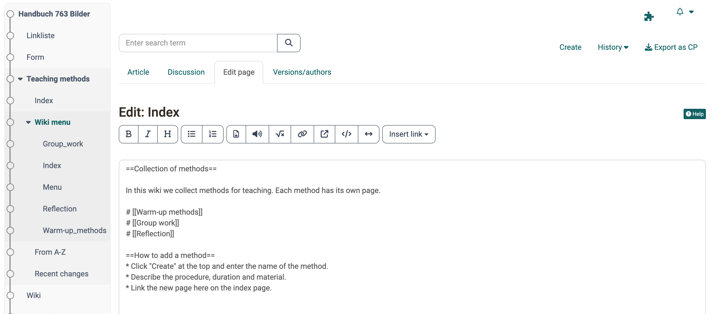

# Course Element "Wiki" {: #wiki}

## Profile

Name | Wiki
---------|----------
Icon | :o_icon_o_wiki_icon:
Available since | Release 7.1 or earlier
Functional group | Communication and collaboration
Purpose | Collaborative content creation
Assessable | no
Specialty / Note |

Use a Wiki to easily create content together with participants. A wiki is suitable for group work, as a documentation tool and generally for writing texts together. The individual pages are linked to each other as hypertext.

## In the course editor

With the "Wiki" course element, you integrate a wiki learning resource into your course. You will find the settings under:<br>
`Course > Administration > Course editor > Course element "Wiki" > Tab "Wiki learning content"`

As long as no wiki is assigned, the tab "Wiki learning content" offers three ways: With "Select" you assign an existing wiki, with "Create" you create a new one, and with "Import" you import a wiki from a file.

If a wiki learning resource is already assigned, its name appears. To change the assignment later, click on "Replace" in the tab "Wiki learning content" and select another wiki. With the arrow next to "Replace" you create or import a new one instead.

In the "Wiki learning content" tab, you also define who may edit the wiki. Under "Edit Material" you allow coaches and participants, in addition to the owners, to edit wiki articles. By default all participants have read and write permission in a Wiki. A wiki page can be deleted by the person who created it, by the owners of the course and by the owners of the wiki learning resource. [:octicons-tag-16:{ title="from Release 15.0 (OO-4551)" }](https://track.frentix.com/issue/OO-4551)

!!! info "Important"

    If you can't find the "Wiki" course element in your OpenOlat instance, the wiki resource is disabled system-wide. System administrators enable it in the system administration: `Administration > Modules > Wiki`, option "Enable wiki resource".

## Working with Wiki (closed course editor)

{ class="shadow lightbox" title="Edit page tab in the Wiki course element · 2026.11.03" }

If a Wiki is embedded in a course, the "Wiki menu" and other Wiki links appear in the left course navigation. Use the "From A-Z" link to call up the table of contents with all Wiki pages. This way you see at a glance which pages already exist.

In the main area, you read the Wiki contributions (tab "Article"), edit the wiki pages (tab "Edit page"), hold discussions on the individual Wiki pages (tab "Discussion") and view the editing history (tab "Versions/authors"). You can also export the Wiki as a content package (CP) and be informed about changes.

### Creating new Wiki pages

You create a new Wiki page with the "Create" button and then fill it with content. The page created in this way is not yet connected to any other page of the Wiki. So that readers find it, link the page in the "Wiki menu" or on the "Index" page of the Wiki.

Alternatively, create an internal link on the page where the link to the new Wiki page should appear. Use the "Internal link" button of the Wiki editor or enter the syntax directly: two opening square brackets, the page name and two closing square brackets, for example `[[link name]]`.

OpenOlat creates the page automatically the first time the link is called.

![Button "Internal link" in the toolbar marked, in the editor below the inserted placeholder [[Link text]], which you replace with the name of the new page](assets/course_element_wiki_internal_link_v1_en.png){ class="shadow lightbox" title="Toolbar in the Edit page tab · 2026.11.03" }

### Change contents of a wiki page

To edit the content of a wiki page, select the "Edit page" tab of the desired wiki page:<br>
`Course > Course element "Wiki" > "Page name" > Tab "Edit page"`

The Wiki editor appears with various formatting options. Here you also include images, media links, mathematical formulas as well as internal and external links in your wiki. In addition to the buttons in the editor, there are other formatting options that you insert directly in the text as syntax elements. The following section explains the wiki syntax.

## Wiki Syntax

You can format your input using the following wiki syntax.

!!! warning "Attention"

    It is recommended to use special characters in Wikiwords with restraint. The colon (:) is not allowed. Also note that a space at the beginning of a line is interpreted as a formatting command (Preformatted Text).

### Text design

Syntax | Result (Formatting)
---|---
'''Bold text''' | **Bold text**
''Italic text'' | _Italic text_
==Level 2 Headline== | <h2>Level 2 Headline</h2>
* List | <li>List</li>
# Numbered list| 1. Numbered list

### Links

Syntax | Result (Formatting)
---|---
[[Internal link]] | Internal link
[[Link `|` Text]] | [Text](Course_Element_Wiki.md)
External link [[http://www.openolat.org](http://www.openolat.org/)] | [http://www.openolat.org](http://www.openolat.org/)
[[http://www.openolat.org](http://www.openolat.org/) The Website of OpenOlat] | [The website of OpenOlat](http://www.openolat.org/)

OpenOlat automatically converts external addresses to a link if you provide the full address: [http://www.openolat.org](http://www.openolat.org/). If you want to specify a different term instead of the link, put the URL and the term together in square brackets, separated by a space.

### Tables

#### Single Row

=== "Syntax"

    ```markdown
    {|
    |Cell 1
    |Cell 2
    |}| Cell 1 Cell 2
    ```

=== "Result"

    Cell 1 Cell 2

#### Multiple Rows

=== "Syntax"

    ```markdown
    {|
    |Cell 1
    |Cell 2
    |-
    |Cell 3
    |Cell 4
    |}|
    ```

=== "Result"

    Cell 1 Cell 2<br>
    Cell 3 Cell 4

#### With frame

=== "Syntax"

    ```markdown
    {| border="1"
    |Cell 1
    |Cell 2
    |-
    |Cell 3
    |Cell 4
    |}
    ```

=== "Result"

    Cell 1| Cell 2
    ---|---
    Cell 3| Cell 4

### Pictures and other files

For example, to add images to the wiki, first upload them to OpenOlat with the "Upload file" button. As soon as the wiki contains at least one file, the drop-down menu "Insert file" appears, with which you insert images and other files.

=== "Syntax"

    [[Image:openolat_logo_72.png]]

=== "Result"

    

When inserting the image, the following optional formatting options are available:

#### Caption

=== "Syntax"

    [[Image:openolat_logo_72.png | This is the OpenOlat logo.]]|

=== "Result"

    <br>
    This is the OpenOlat logo.

#### Alignment

Use the "left" or "right" addition to specify how the image should be aligned.

=== "Syntax"

    [[Image:openolat_logo_72.png|right]]

=== "Result"

    { align=right }

#### Picture size

Specify in pixels how large the image should be displayed.

=== "Syntax"

    [[Image:openolat_logo_72.png|120px]]|

=== "Result"

    { width=120px }

#### Miniature picture

If you select the "thumb" addition and a small image size, the image will be inserted as a thumbnail. Clicking on the image will display it in full size.

=== "Syntax"

    [[Image:openolat_logo_72.png|thumb|24px]]

=== "Result"

    { width=24px }

#### Combined formatting

Multiple formatting options can also be used simultaneously.

=== "Syntax"

    [[Image:olat_logo.png|center|150px|thumb|Das ist das OpenOlat-Logo.]]

=== "Result"

    { class="lightbox" width=150px title="Das ist das OpenOlat-Logo." }

### Other files: PDF

=== "Syntax"

    [[Media:any.pdf]]

=== "Result"

    Link to the file any.pdf

### Mathematical formulas (LaTeX)

OpenOlat displays the formulas in the browser with MathJax.

The syntax of the mathematical notation used in OpenOlat can be found at: [http://meta.wikimedia.org/wiki/Help:Formula](http://meta.wikimedia.org/wiki/Help:Formula)

#### Syntax

```html
<math>Insert formula here</math>
```

#### Inline Mode

=== "Syntax"

    \\(x^2\\)

=== "Result"

    x<sup>2</sup>

### Unformatted Text

=== "Syntax"

    ```html
    <nowiki>Insert the unformatted text here</nowiki>
    ```

=== "Result"

    Insert the unformatted text here

!!! note "Note"

    Further information on the wiki syntax of MediaWiki can be found here: [https://www.mediawiki.org/wiki/Help:Formatting](https://www.mediawiki.org/wiki/Help:Formatting)

## Attachments, links to files, export

To attach a file, first upload it via "Upload file". Navigate to the location on the wiki page where you want the file to appear. Then select the file via "Insert file" and confirm with "Save". You create links to other wiki pages with "Insert link". The toolbar of the editor offers further formatting options.

You create links to files in the "Folder" course element by clicking on the metadata icon { class=size16 } and then copying the link under "External link to this resource". You can only link to files that are in a subfolder of a "Folder" course element.

With the link "Export as CP", all participants export the wiki as an IMS content package and save it. Authors can import an exported CP into OpenOlat as a CP learning resource, but not as a wiki.

!!! info "Important"

    If a wiki is to be exported directly as a wiki, this is only possible for the owners of the wiki directly in the learning resource: `Wiki > Administration > Copy` or `Wiki > Administration > Export content`. Participants do not have this option.

!!! danger "Attention"

    If you delete a page, OpenOlat also deletes all its versions. Deleted pages cannot be restored.

## Further information {: #further_information}

**Mentioned on this page**<br>
[MediaWiki: Help on formulas](http://meta.wikimedia.org/wiki/Help:Formula)<br>
[MediaWiki: Help on formatting](https://www.mediawiki.org/wiki/Help:Formatting)

**Further reading**<br>
[Creating Wikis >](Wiki.md)<br>
[Types of Course Elements >](Course_Elements.md)<br>
[Using Group Tools >](../groups/Using_Group_Tools.md)

[To the top of the page ^](#wiki)
