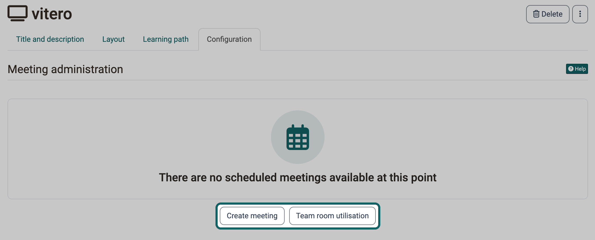
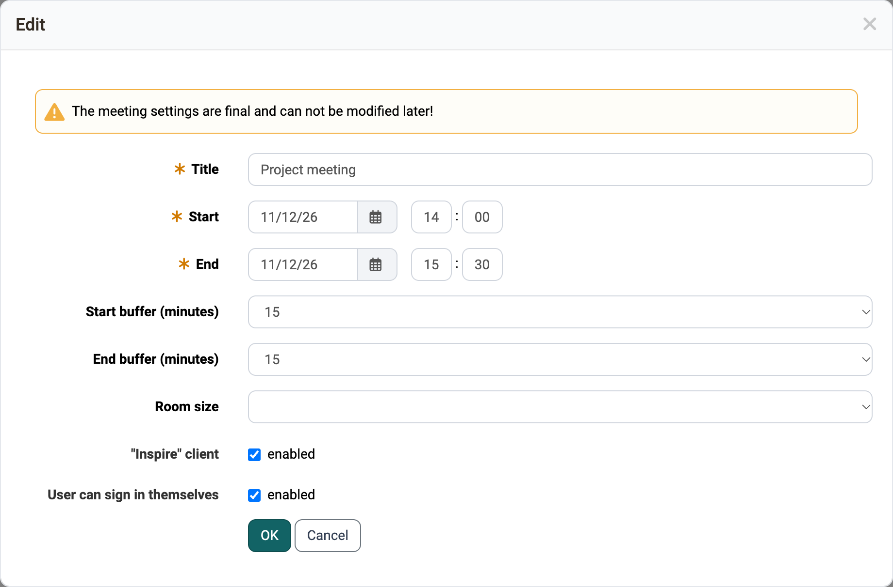

# Course Element "vitero" {: #vitero}

## Profile

Name | vitero
---------|----------
Icon | :o_icon_o_vitero_icon:
Available since | Release 8.0
Functional group | Communication and collaboration
Purpose | Integration of the vitero web conferencing software
Assessable | no
Specialty / Note | Commercial software, licence and server hosting required

## Tool-specific

With the course element "vitero", you integrate the vitero system for web conferencing, e-collaboration, live e-learning and language learning into your course. vitero (virtual team room) provides virtual team rooms for which you create meetings in the course. The licence of the connected vitero server determines which room sizes are available.

In the virtual meeting room, participants communicate via text chat, audio and video and share documents and the desktop. The vitero system is suitable for virtual team sessions, but also, for example, for frontal lectures. Owners and coaches of the course whom you enter in a meeting receive the role "Team leader" in vitero. You can find out more about the functions of the vitero system on the [homepage of vitero GmbH](http://www.vitero.de/).

## Configuration in the course editor

{ class="shadow lightbox" title="Configuration tab in the course editor · 2026.11.03" }

You create your vitero meetings in the course editor in the tab "Configuration" or in the course view. With "Team room utilisation", you first see how busy the available team rooms are and thus find a free slot. Then click on "Create meeting".

## Create meeting {: #configuration-in-the-course-run-closed-editor}

{ class="shadow lightbox" title="Edit dialog in the course element vitero · 2026.11.03" }

Under "Title", enter the name of the meeting. Under "Start" and "End", enter the start and end date of the meeting and select the "Room size". Under "Start buffer (minutes)", you define how many minutes before the start the room can be entered. Under "End buffer (minutes)", you define how many minutes after the end vitero closes the meeting definitively.

With the option "Inspire" client you define that the meeting takes place in the vitero client "Inspire". The option only appears if it is switched on in the system administration under `Administration > External tools > vitero`.

With the option "User can sign in themselves", all participants with access to the course element enter themselves in the meeting, as long as places are available. If the option is switched off, only owners of the course enter participants in the meetings.

!!! info "Important"

    For participants, meetings are only visible if they are entered in this meeting or if the meeting carries the option "User can sign in themselves".

!!! warning "Attention"

    Check the details before you save. As the notice "The meeting settings are final and can not be modified later!" in the dialog says, you cannot change them afterwards. Only the option "User can sign in themselves" can still be switched on or off later.

## Further information {: #further_information}

[vitero GmbH](http://www.vitero.de/) 
[Course elements at a glance >](Course_Elements/index.md) 
[Course Element "BigBlueButton" >](bigbluebutton/index.md)

[To the top of the page ^](#vitero)

