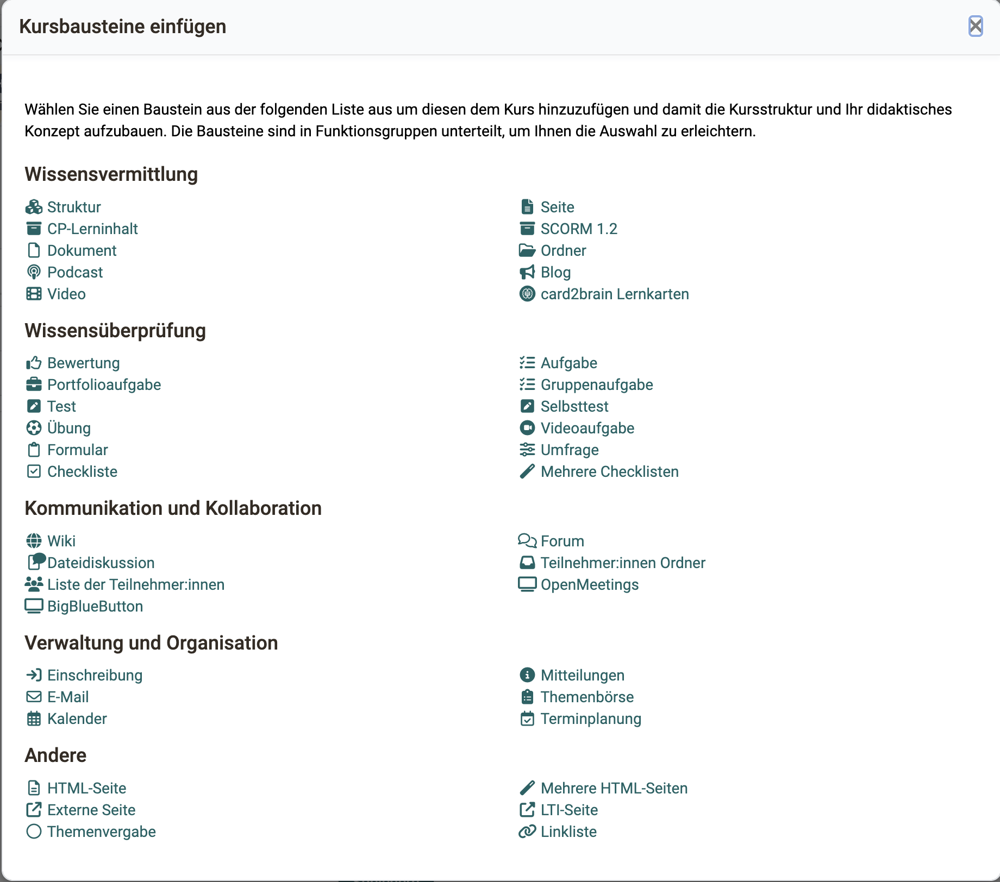
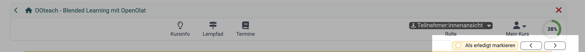
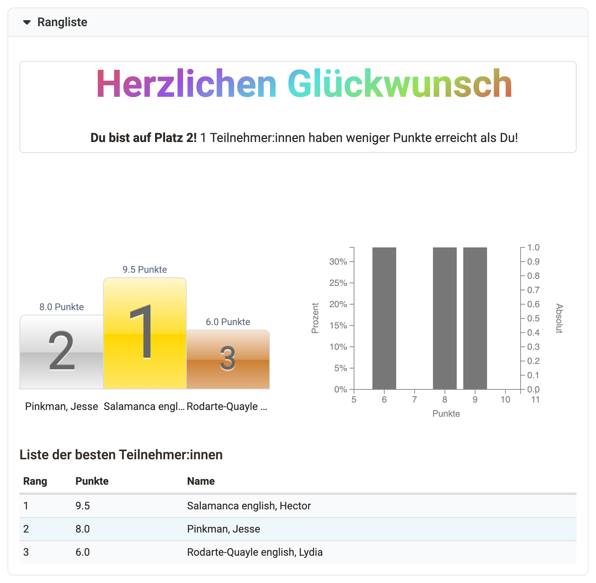
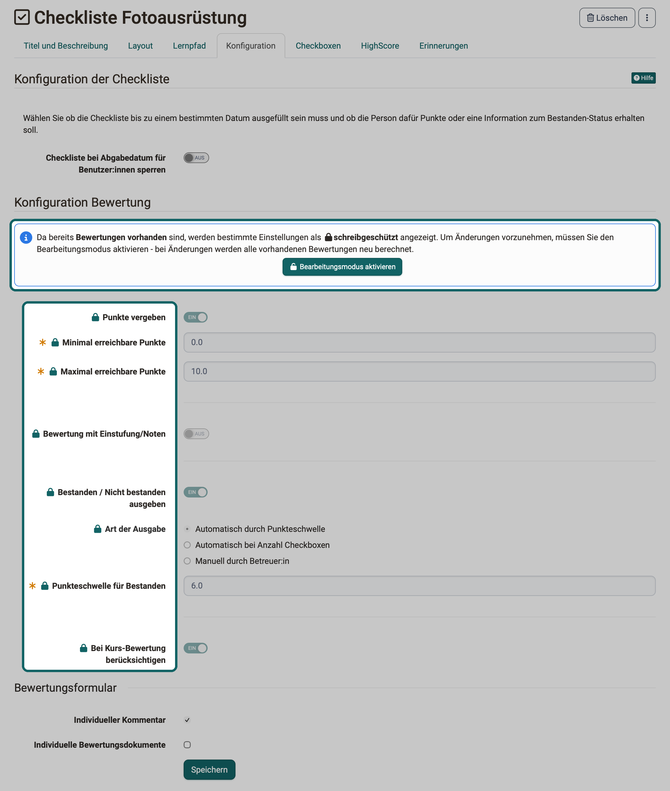
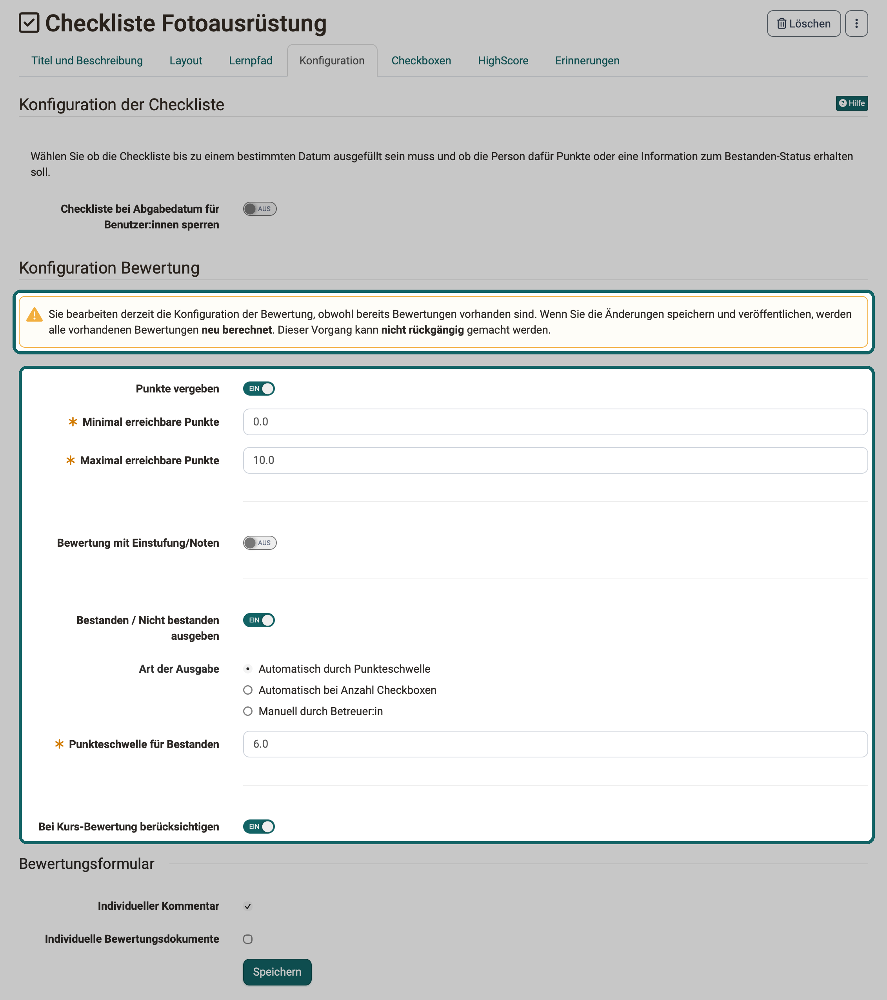

# Kursbausteine im Überblick {: #course_elements}

:octicons-device-camera-video-24: **Video-Einführung**: [Was sind Kursbausteine?](<https://www.youtube.com/embed/JM6iSrfkHog>){:target="_blank"}

:octicons-device-camera-video-24: **Video-Einführung**: [Kursbausteine konfigurieren](<https://www.youtube.com/embed/SAkzzoOQEoQ>){:target="_blank"}

Aus Kursbausteinen bauen Sie Ihren Kurs auf. Mit ihnen stellen Sie Inhalte bereit und strukturieren sie, fördern Zusammenarbeit und Austausch, prüfen den Wissensstand der Teilnehmenden und regeln Organisatorisches.

Die nachfolgende Auflistung ordnet die Kursbausteine in dieselben Gruppen wie der Dialog im Kurseditor:
{ class="shadow lightbox" }

## Wissensvermittlung

Die folgenden Kursbausteine dienen insbesondere der Bereitstellung und Strukturierung von Kursinhalten. Je nach Baustein können auch bestimmte, extern erstellte Inhalte eingebunden werden.

* [:o_icon_o_st_icon: Struktur](../Course_Element_Structure.de.md)
* [:o_icon_o_page_icon: Seite](../Course_Element_Page.de.md)
* [:o_icon_o_cp_icon: CP-Lerninhalt](../Course_Element_CP_Learning_Content.de.md)
* [:o_icon_o_scorm_icon: SCORM 1.2](../Course_Element_SCORM_Learning_Content.de.md)
* [:o_icon_o_filetype_file: Dokument](../Course_Element_Document.de.md)
* [:o_icon_o_bc_icon: Ordner](../Course_Element_Folder.de.md)
* [:o_icon_o_podcast_icon: Podcast](../Course_Element_Podcast.de.md)
* [:o_icon_o_blog_icon: Blog](../Course_Element_Blog.de.md)
* [:o_icon_o_icon_video: Video](../Course_Element_Video.de.md)
* [:o_icon_o_livestream_icon: Video Livestream](../Course_Element_Video_Livestream.de.md)
* [:o_icon_o_opencast_icon: Opencast](../Course_Element_Opencast.de.md)
* [:o_icon_o_edusharing_icon: edu-sharing](../Course_Element_edu_Sharing.de.md)
* [:o_icon_o_card2brain_icon: card2brain Lernkarten](../Course_Element_card2brain_Flashcards.de.md)
* [:o_icon_o_mediasite_icon: Mediasite](../Course_Element_Mediasite.de.md)
* [:o_icon_o_edubase_icon: Edubase](../Course_Element_Edubase.de.md)
* [:o_icon_o_jupyter_icon: JupyterHub](../Course_Element_JupyterHub.de.md)

## Wissensüberprüfung

Folgende Kursbausteine können insbesondere zur Wissensüberprüfung eingesetzt werden.

* [:o_icon_o_ms_icon: Bewertung](../Course_Element_Assessment.de.md)
* [:o_icon_o_gta_icon: Aufgabe](../Course_Element_Task/index.de.md)
* [:o_icon_o_gta_icon: Gruppenaufgabe](../Course_Element_Grouptask.de.md)
* [:o_icon_o_ep_icon: Portfolioaufgabe](../Course_Element_Portfolio_Task.de.md)
* [:o_icon_o_iqtest_icon: Test](../Course_Element_Test/index.de.md)
* [:o_icon_o_iqself_icon: Selbsttest](../Course_Element_Self_Test.de.md)
* [:o_icon_o_practice_icon: Übung](../Course_Element_Practice.de.md)
* [:o_icon_o_icon_videotask: Videoaufgabe](../Course_Element_Video_Task.de.md)
* [:o_icon_o_icon_form: Formular](../Course_Element_Form.de.md)
* [:o_icon_o_survey_icon: Umfrage](../Course_Element_Survey.de.md)
* [:o_icon_o_cl_icon: Checkliste](../Course_Element_Checklist.de.md)

Direkt nach "Checkliste" steht im Dialog der Eintrag "Mehrere Checklisten". Damit legen Sie [mehrere Checklisten in einem Schritt](../Course_Element_Checklist.de.md#multi) an.

In den meisten Kursbausteinen dieser Gruppe können Sie Punkte vergeben. Dann können Sie im Tab "HighScore" eine [Rangliste](#highscore) einrichten. Die Punkte mehrerer Kursbausteine lassen sich zusammenzählen, und das Bestehen eines Kurses kann von den Bewertungen verschiedener Kursbausteine abhängen. In herkömmlichen Kursen übernimmt das ein Kursbaustein [Struktur](../Course_Element_Structure.de.md).

Alle Kursbausteine dieser Gruppe ausser Selbsttest, Übung und Umfrage haben den Tab "Erinnerungen", bei Aufgabe und Gruppenaufgabe in Lernpfadkursen heisst er "Erinnerungen & To-dos". Dort richten Sie E-Mails ein, die OpenOlat abhängig vom Bearbeitungsstand des Kursbausteins verschickt, zum Beispiel wenn eine Aufgabe oder ein Test zu einem bestimmten Datum noch nicht bearbeitet ist. Die Möglichkeiten gleichen denen im Menü "Erinnerung" des Kurses: `Kurs > Administration > Erinnerung`. Mehr dazu: [Erinnerungen](../Course_Reminders.de.md)

Zur Gruppe gehören auch die Kursbausteine "Umfrage" und "Formular". Mit ihnen binden Sie OpenOlat [Formulare](../Form_Editor/index.de.md) für Befragungen und ähnliche Zwecke in einen Kurs ein.

## Kommunikation und Kollaboration

Kursbausteine dieser Gruppe werden vor allem für kollaboratives Arbeiten und den Austausch untereinander eingesetzt. Zur selben Gruppe gehören die Kursbausteine für [virtuelle Klassenzimmer](#virtual_classrooms).

* [:o_icon_o_wiki_icon: Wiki](../Course_Element_Wiki.de.md)
* [:o_icon_o_fo_icon: Forum](../Course_Element_Forum.de.md)
* [:o_icon_o_dialog_icon: Dateidiskussion](../Course_Element_File_Dialog.de.md)
* [:o_icon_o_pf_icon: Teilnehmer:innen Ordner](../Course_Element_Participant_Folder.de.md)
* [:o_icon_o_cmembers_icon: Liste der Teilnehmer:innen](../Course_Element_Participant_List.de.md)

### Virtuelle Klassenzimmer {: #virtual_classrooms}

Mit den folgenden Kursbausteinen setzen Sie in OpenOlat [virtuelle Klassenzimmer](../../basic_concepts/Virtual_classrooms.de.md) für synchrone Meetings, Videokonferenzen oder Webinare ein.

* [:o_icon_o_vc_icon: Adobe Connect](../Course_Element_Adobe_Connect.de.md)
* [:o_icon_o_vc_icon: BigBlueButton](../bigbluebutton/index.de.md)
* [:o_icon_o_gotomeeting_icon: GoToMeeting](../Course_Element_GoToMeeting.de.md)
* [:o_icon_o_vc_icon: Microsoft Teams](../Course_Element_Microsoft_Teams.de.md)
* [:o_icon_o_openmeetings_icon: OpenMeetings](../Course_Element_OpenMeetings.de.md)
* [:o_icon_o_vitero_icon: vitero](../Course_Element_vitero.de.md)
* [:o_icon_o_vc_icon: Zoom](../zoom/index.de.md)

Welche Kursbausteine für diese Zwecke verfügbar sind und welche Funktionalitäten jeweils zur Verfügung stehen, hängt von der Konfiguration Ihres OpenOlat-Systems ab.

Ein virtuelles Klassenzimmer ermöglicht es, gleichzeitig (synchron) online mit mehreren Personen zusammenzuarbeiten, die geographisch an unterschiedlichen Orten sind. Funktionen von virtuellen Klassenzimmern sind unter anderem Live-Chat, Audio und Video, Desktop- und Dokumentsharing. Betreten Sie ein virtuelles Klassenzimmer über einen Kursbaustein, öffnet sich ein neues Browserfenster, in dem die virtuelle Sitzung stattfindet.

Damit Sie alle Funktionalitäten benutzen können, benötigen Sie ein Headset und eine angeschlossene Kamera. Je nach eingesetztem System laden Sie zusätzlich Software für die Sitzung herunter.

## Verwaltung und Organisation

Für organisatorische Belange und zur Verteilung von Informationen eignen sich besonders die nachfolgenden Kursbausteine.

* [:o_icon_o_en_icon: Einschreibung](../Course_Element_Enrolment.de.md)
* [:o_icon_o_infomsg_icon: Mitteilungen](../Course_Element_Notifications.de.md)
* [:o_icon_o_co_icon: E-Mail](../Course_Element_EMail.de.md)
* [:o_icon_o_icon_topicbroker: Themenbörse](../Course_Element_Topic_Broker.de.md)
* [:o_icon_o_cal_icon: Kalender](../Course_Element_Calendar.de.md)
* [:o_icon_o_appointment_icon: Terminplanung](../Course_Element_Appointment_Scheduling.de.md)

## Andere

Zusätzliche Kursbausteine finden Sie in der Gruppe "Andere".

* [:o_icon_o_lti_icon: LTI-Seite](../Course_Element_LTI_Page.de.md)
* [:o_icon_o_sp_icon: HTML-Seite](../Course_Element_HTML_Page.de.md)
* [:o_icon_o_tu_icon: Externe Seite](../Course_Element_External_Page.de.md)
* [:o_icon_o_projectbroker_icon: Themenvergabe](../Course_Element_Topic_Assignment.de.md)
* [:o_icon_o_ll_icon: Linkliste](../Course_Element_Link_List.de.md)
* [:o_icon_o_icon_cns: Auswahl](../Course_Element_Selection.de.md)

Direkt nach "HTML-Seite" steht im Dialog der Eintrag "Mehrere HTML-Seiten". Damit legen Sie aus den Dateien des Ablageordners [mehrere HTML-Seiten in einem Schritt](../Course_Element_HTML_Page.de.md#multi) an.

## Allgemeines zu Kursbausteinen

Alle Kursbausteine haben die Tabs "Titel und Beschreibung" und "Layout". Weitere Tabs hängen vom Kurstyp ab: Den Tab "Lernpfad" haben die Kursbausteine in Lernpfadkursen, die Tabs "Sichtbarkeit" und "Zugang" die Kursbausteine in herkömmlichen Kursen.

Neben den Kursbausteinen gestalten Sie Kurse mit weiteren Werkzeugen und Lernressourcen. Sie sind in den jeweiligen Kapiteln beschrieben.

## Leistungsbewertung

Viele Kursbausteine können Sie zur summativen oder formativen Bewertung nutzen oder zur Fortschrittskontrolle. Die Bewertungen der bewertbaren Kursbausteine sehen und bearbeiten Sie im [Bewertungswerkzeug](../Assessment_tool_overview/index.de.md). Alle Einstellungen beschreibt die Seite des jeweiligen Kursbausteins:

* [Aufgabe](../Course_Element_Task/index.de.md) (manuelle Bewertung)
* [Gruppenaufgabe](../Course_Element_Grouptask.de.md) (manuelle Bewertung)
* [Portfolioaufgabe](../Course_Element_Portfolio_Task.de.md) (manuelle Bewertung)
* [Checkliste](../Course_Element_Checklist.de.md) (manuelle & automatische Bewertung)
* [Bewertung](../Course_Element_Assessment.de.md) (manuelle Bewertung)
* [LTI](../Course_Element_LTI_Page.de.md) (automatische Bewertung, wird von LTI-Seite übertragen)
* [SCORM](../Course_Element_SCORM_Learning_Content.de.md) (automatische Bewertung, wird durch SCORM-Modul übertragen)
* [Test](../Course_Element_Test/index.de.md) (automatische & manuelle Bewertung)
* [Videoaufgabe](../Course_Element_Video_Task.de.md#tab_assessment) (automatische & manuelle Bewertung, nur im Modus "Test: Situationen erkennen")

Die Fortschrittskontrolle steuern [Lernpfadkurse](../Learning_path_course/index.de.md) über das Erledigungskriterium, das Sie im Kurseditor pro Kursbaustein im Tab "Lernpfad" festlegen. Mit dem Kriterium "Bestätigung durch Benutzer:in" bestätigen die Teilnehmenden die Bearbeitung selbst über den Toggle-Button "Als erledigt markieren".

{ class="shadow lightbox" title="Kurs-Toolbar in der Teilnehmer:innenansicht eines Lernpfadkurses" }

Eine Übersicht aller Kriterien finden Sie auf der Seite [Lernpfadkurs - Kurseditor](../Learning_path_course_Course_editor.de.md#completion_criterion).

### Rangliste [:octicons-tag-16:{ title="ab Release 11.3 (OO-2133)" }](https://track.frentix.com/issue/OO-2133) {: #highscore}

Vergeben Sie in einem Kursbaustein Punkte, können Sie den Teilnehmenden eine Rangliste anzeigen. Die Rangliste ermöglicht einen spielerischen Vergleich und kann die Teilnehmenden motivieren.

Die Rangliste richten Sie im Tab "HighScore" ein. Den Tab haben alle bewertbaren Kursbausteine ausser Übung und Videoaufgabe, dazu der Kursbaustein "Struktur". Voraussetzung ist, dass der Kursbaustein Punkte vergibt, zum Beispiel ein Test, eine Aufgabe oder eine Bewertung.

Schalten Sie zuerst "Highscore anzeigen" ein. Unter "Anfangsdatum (optional)" legen Sie fest, ab wann OpenOlat die Rangliste zeigt. Ohne Anfangsdatum zeigt OpenOlat die Rangliste, sobald die Bewertung der Person freigegeben ist: beim Test direkt nach dem Beenden, beim Kursbaustein "Bewertung" erst, wenn Betreuer:innen die Bewertung abschliessen und freigeben. Zwischengespeicherte Punkte genügen nicht. Mit "Daten der Benutzer:innen anonymisieren" zeigt die Rangliste die Personen anonymisiert statt mit Vor- und Nachnamen.

Danach wählen Sie, welche Elemente die Rangliste zeigt: "Gratulationstitel", "Siegertreppchen", "Histogramm" und "Liste der besten Teilnehmer:innen". Bei der Liste legen Sie fest, ob sie alle Teilnehmenden oder nur eine bestimmte Anzahl der besten zeigt. Mindestens eine dieser Optionen muss gewählt sein.

{ class="shadow lightbox" title="Rangliste eines Kursbausteins aus Sicht der Teilnehmenden · 2026.11.02" }

## Schreibschutz der Bewertungskonfiguration [:octicons-tag-16:{ title="ab Release 21.1 (OO-9647)" }](https://track.frentix.com/issue/OO-9647){:target="_blank"} {: #assessment_config_read_only}

Sobald für einen bewertbaren Kursbaustein Bewertungen vorhanden sind, zeigt OpenOlat im Kurseditor die Einstellungen schreibgeschützt an, die das Bewertungsergebnis verändern. Ein Schloss-Symbol vor der Beschriftung zeigt, welche Einstellungen das sind. Die übrigen Einstellungen im selben Tab bleiben bearbeitbar.

Der Grund: Jede Änderung an den Bewertungsregeln löst beim Publizieren eine Neuberechnung aller bestehenden Bewertungen aus. Die Neuberechnung lässt sich nicht rückgängig machen. Der Schreibschutz stellt sicher, dass Sie diesen Eingriff bewusst auslösen.

Als vorhanden gilt eine Bewertung, sobald mindestens eine Person für diesen Kursbaustein eine Punktzahl, einen Bestanden-Status oder eine Note hat. Ein Status allein genügt nicht: Hat eine Person den Kursbaustein nur gestartet, bleibt die Konfiguration bearbeitbar. Die Prüfung gilt je Kursbaustein. Bewertungen in einem anderen Kursbaustein des Kurses lösen den Schreibschutz nicht aus.

Der Schreibschutz gilt in Lernpfadkursen und in herkömmlichen Kursen. Die Kursbausteine "Selbsttest" und "Fragebogen" kennen ihn nicht.

### Schreibgeschützte Einstellungen bearbeiten {: #enable_edit_mode}

Im schreibgeschützten Zustand steht unter der Legende "Konfiguration Bewertung" der Hinweis: "Da bereits **Bewertungen vorhanden** sind, werden bestimmte Einstellungen als **schreibgeschützt** angezeigt. Um Änderungen vorzunehmen, müssen Sie den Bearbeitungsmodus aktivieren - bei Änderungen werden alle vorhandenen Bewertungen neu berechnet."

{ class="shadow lightbox" title="Tab Konfiguration einer Checkliste mit vorhandenen Bewertungen · 2026.11.02" }

Im Hinweis steht die Schaltfläche "Bearbeitungsmodus aktivieren" mit dem Symbol eines offenen Schlosses. Nach dem Klick sind die schreibgeschützten Einstellungen bearbeitbar, und an der Stelle des Hinweises steht die Warnung: "Sie bearbeiten derzeit die Konfiguration der Bewertung, obwohl bereits Bewertungen vorhanden sind. Wenn Sie die Änderungen speichern und veröffentlichen, werden alle vorhandenen Bewertungen **neu berechnet**. Dieser Vorgang kann **nicht rückgängig** gemacht werden."

{ class="shadow lightbox" title="Tab Konfiguration einer Checkliste im Bearbeitungsmodus · 2026.11.02" }

Sind noch keine Bewertungen vorhanden, erscheinen weder Hinweis noch Warnung. Der Tab ist dann direkt bearbeitbar.

Der Bearbeitungsmodus gilt nur, solange Sie den Kursbaustein im Kurseditor bearbeiten. Öffnen Sie den Kursbaustein später wieder im Kurseditor, ist der Schreibschutz wieder aktiv. Eine Einstellung, die den Schreibschutz dauerhaft aufhebt, gibt es nicht.

### Betroffene Kursbausteine {: #read_only_course_elements}

Die bewertbaren Kursbausteine gliedern ihre Bewertungsregeln gleich: Oben stehen unter der Legende "Konfiguration Bewertung" der Hinweis und die Einstellungen, die der Schreibschutz erfasst. Darunter stehen unter "Bewertungsformular" die Einstellungen "Individueller Kommentar" und "Individuelle Bewertungsdokumente", die bearbeitbar bleiben. Die Tabelle zeigt, in welchem Tab Sie den Schreibschutz antreffen und was er erfasst.

Kursbaustein | Tab | Schreibgeschützt | Bleibt bearbeitbar
---------|----------|----------|----------
[Test](../Course_Element_Test/Test_Setup.de.md#tab_configuration) | "Test-Konfiguration" | "Bewertung mit Einstufung/Noten" samt Bewertungsskala, "Bei Kurs-Bewertung berücksichtigen" | alle übrigen Einstellungen, zum Beispiel "Testzeitraum festlegen", "Korrektur" und "Report"
[SCORM 1.2](../Course_Element_SCORM_Learning_Content.de.md#editor_tab_learning_content) | "Lerninhalt" | die Einstellungen unter "Konfiguration Bewertung", zum Beispiel "Resultat aus SCORM übertragen", "Maximal erreichbare Punkte", "Notwendige Punktzahl für 'bestanden'" und "Bei Kurs-Bewertung berücksichtigen" | "Reduzieren von Punkten bei erneutem Versuch verhindern", "Lösungsversuche nur zählen, wenn Punkte übertragen werden", "Maximale Anzahl Lösungsversuche", die Bereiche "SCORM" und "Einstellungen"
[Aufgabe](../Course_Element_Task/Task_Setup.de.md#grading) | "Bewertung" | "Rubrik-Bewertung", Punkte, Einstufung/Noten, Bestanden/Nicht bestanden, "Bei Kurs-Bewertung berücksichtigen" | "Bewertungsformular"
[Gruppenaufgabe](../Course_Element_Grouptask.de.md#tab_assessment) | "Bewertung" | Punkte, Einstufung/Noten, Bestanden/Nicht bestanden, "Bei Kurs-Bewertung berücksichtigen" | "Bewertungsformular"
[Videoaufgabe](../Course_Element_Video_Task.de.md#tab_assessment) | "Bewertung" | alle Einstellungen unter "Konfiguration Bewertung", darunter Punkte, Einstufung/Noten, Bestanden/Nicht bestanden, "Bei Kurs-Bewertung berücksichtigen" | "Bewertungsformular"
[Portfolioaufgabe](../Course_Element_Portfolio_Task.de.md#tab_assessment) | "Bewertung" | Punkte, Einstufung/Noten, Bestanden/Nicht bestanden, "Bei Kurs-Bewertung berücksichtigen" | "Bewertungsformular"
[Bewertung](../Course_Element_Assessment.de.md#tab_assessment) | "Bewertung" | "Rubrik-Bewertung", "Punkte vergeben", "Bewertung mit Einstufung/Noten", "Bestanden/Nicht bestanden ausgeben", "Bei Kurs-Bewertung berücksichtigen" | "Status "Korrigieren" setzen, wenn Zugriff gewährt", "Bewertungsformular"
[Checkliste](../Course_Element_Checklist.de.md#tab_configuration) | "Konfiguration" | Punkte, Einstufung/Noten, Bestanden/Nicht bestanden samt "Art der Ausgabe" und Schwellen, "Bei Kurs-Bewertung berücksichtigen" | "Konfiguration der Checkliste" mit dem Abgabedatum, "Bewertungsformular"
[Struktur](../Course_Element_Structure.de.md#score), nur im herkömmlichen Kurs | "Punkte" | die ganze Legende "Zusammengefasste Bewertung" | keine

Einstellungen, die ohnehin nicht bearbeitbar sind, bleiben es auch im Bearbeitungsmodus, zum Beispiel "Minimal erreichbare Punkte" bei der Videoaufgabe.

## Weiterführende Informationen {: #further_information}

**Weiterführend** 
[Kursbausteine im Kurseditor >](../General_Configuration_of_Course_Elements.de.md) 
[Löschen, Verschieben und Kopieren von Kursbausteinen >](../Deleting_Moving_and_Copying_Course_Elements.de.md) 
[Kurseditorwerkzeuge >](../Using_additional_Course_Editor_Tools.de.md)

**youtube** 
[Was sind Kursbausteine?](<https://www.youtube.com/embed/JM6iSrfkHog>) 
[Kursbausteine konfigurieren](<https://www.youtube.com/embed/SAkzzoOQEoQ>)

[Zum Seitenanfang ^](#course_elements)
