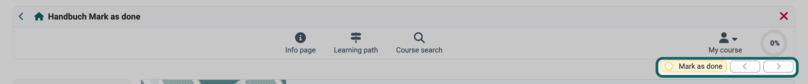
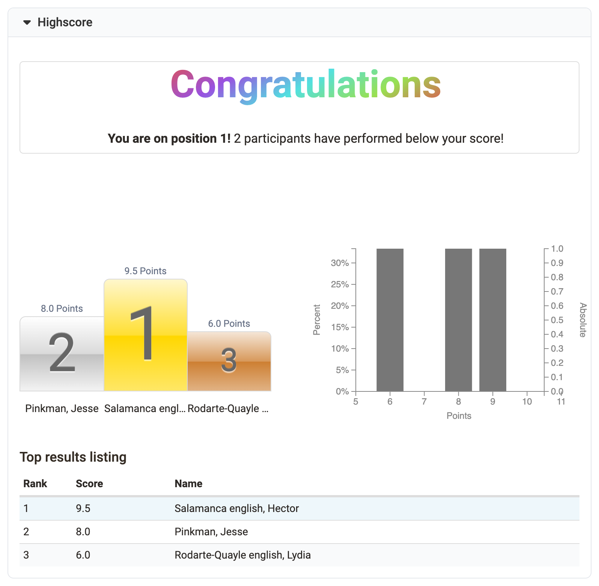
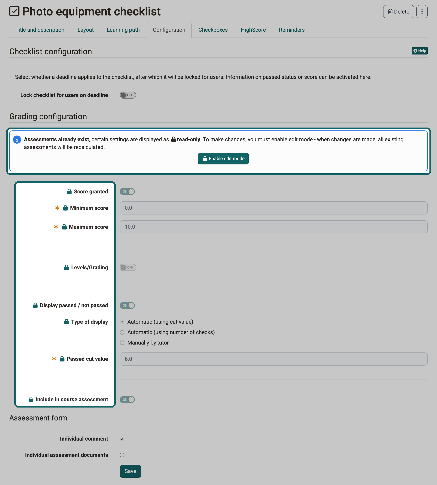
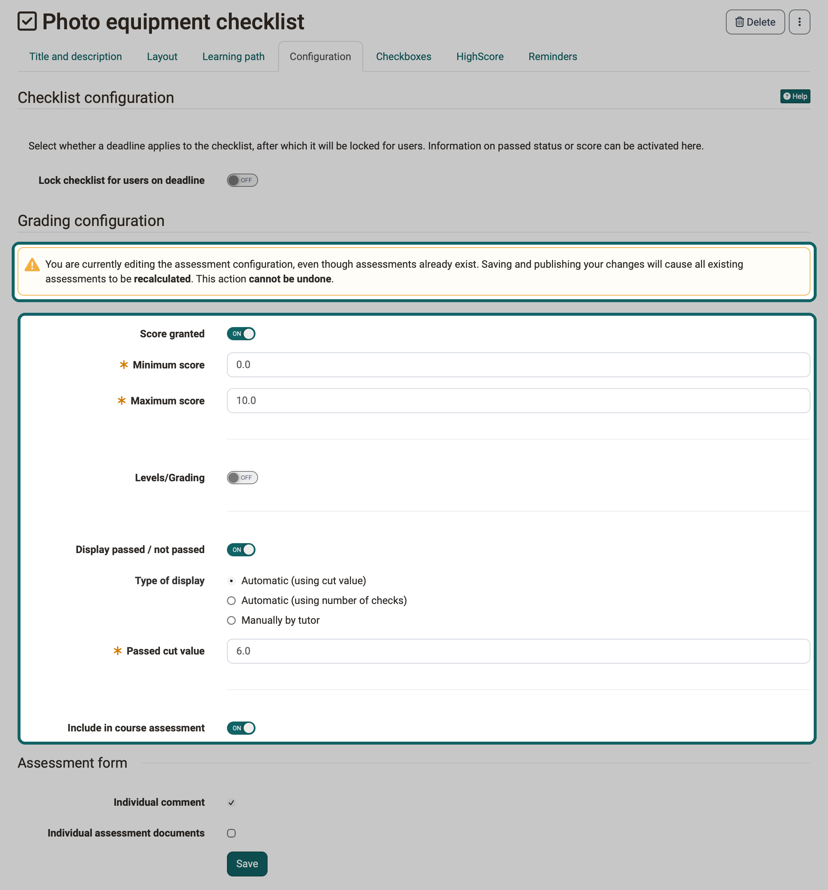

# Course elements at a glance {: #course_elements}

:octicons-device-camera-video-24: **Video Introduction (German)**: [What are course elements?](<https://www.youtube.com/embed/JM6iSrfkHog>){:target="_blank"}

:octicons-device-camera-video-24: **Video Introduction (German)**: [Configuring course elements](<https://www.youtube.com/embed/SAkzzoOQEoQ>){:target="_blank"}

You build your course from course elements. With them, you provide and structure content, promote collaboration and exchange, check the participants' level of knowledge and handle organizational matters.

This overview sorts the course elements into the same groups as the dialog "Insert course elements" in the course editor.

## Knowledge transfer

The following course elements serve in particular to provide and structure course content. Depending on the module, certain externally created content can also be integrated.

* [:o_icon_o_st_icon: Structure](../Course_Element_Structure.md)
* [:o_icon_o_page_icon: Page](../Course_Element_Page.md)
* [:o_icon_o_cp_icon: CP Learning Content](../Course_Element_CP_Learning_Content.md)
* [:o_icon_o_scorm_icon: SCORM 1.2](../Course_Element_SCORM_Learning_Content.md)
* [:o_icon_o_filetype_file: Document](../Course_Element_Document.md)
* [:o_icon_o_bc_icon: Folder](../Course_Element_Folder.md)
* [:o_icon_o_podcast_icon: Podcast](../Course_Element_Podcast.md)
* [:o_icon_o_blog_icon: Blog](../Course_Element_Blog.md)
* [:o_icon_o_icon_video: Video](../Course_Element_Video.md)
* [:o_icon_o_livestream_icon: Video Livestream](../Course_Element_Video_Livestream.md)
* [:o_icon_o_opencast_icon: Opencast](../Course_Element_Opencast.md)
* [:o_icon_o_edusharing_icon: edu-sharing](../Course_Element_edu_Sharing.md)
* [:o_icon_o_card2brain_icon: card2brain flashcards](../Course_Element_card2brain_Flashcards.md)
* [:o_icon_o_mediasite_icon: Mediasite](../Course_Element_Mediasite.md)
* [:o_icon_o_edubase_icon: Edubase](../Course_Element_Edubase.md)
* [:o_icon_o_jupyter_icon: JupyterHub](../Course_Element_JupyterHub.md)

## Assessment

The following course elements can be used in particular to test knowledge.

* [:o_icon_o_ms_icon: Assessment](../Course_Element_Assessment.md)
* [:o_icon_o_gta_icon: Task](../Course_Element_Task/index.md)
* [:o_icon_o_gta_icon: Group Task](../Course_Element_Grouptask.md)
* [:o_icon_o_ep_icon: Portfolio Task](../Course_Element_Portfolio_Task.md)
* [:o_icon_o_iqtest_icon: Test](../Course_Element_Test/index.md)
* [:o_icon_o_iqself_icon: Self-test](../Course_Element_Self_Test.md)
* [:o_icon_o_practice_icon: Practice](../Course_Element_Practice.md)
* [:o_icon_o_icon_videotask: Video task](../Course_Element_Video_Task.md)
* [:o_icon_o_icon_form: Form](../Course_Element_Form.md)
* [:o_icon_o_survey_icon: Survey](../Course_Element_Survey.md)
* [:o_icon_o_cl_icon: Checklist](../Course_Element_Checklist.md)

Directly after "Checklist", the dialog shows the entry "Multiple checklists". With it, you create [multiple checklists in one step](../Course_Element_Checklist.md#multi).

In most course elements of this group you can award points. You can then set up a [highscore](#highscore) in the tab "HighScore". The points of several course elements can be added up, and passing a course can depend on the assessments of different course elements. In conventional courses, a course element [Structure](../Course_Element_Structure.md) takes care of this.

All course elements of this group except Self-test, Practice and Survey have the tab "Reminders"; for Task and Group task in learning path courses it is called "Reminders & to-dos". There you set up emails that OpenOlat sends depending on the progress of the course element, for example if a task or a test has not been worked on by a certain date. The options are similar to those in the menu "Reminders" of the course: `Course > Administration > Reminders`. More about this: [Course Reminders](../Course_Reminders.md)

The group also includes the course elements "Survey" and "Form". With them, you build OpenOlat [forms](../Form_Editor/index.md) for surveys and similar purposes into a course.

## Communication and collaboration

Course elements in this group are mainly used for collaborative work and exchange among each other. The course elements for [virtual classrooms](#virtual_classrooms) belong to the same group.

* [:o_icon_o_wiki_icon: Wiki](../Course_Element_Wiki.md)
* [:o_icon_o_fo_icon: Forum](../Course_Element_Forum.md)
* [:o_icon_o_dialog_icon: File Dialog](../Course_Element_File_Dialog.md)
* [:o_icon_o_pf_icon: Participant Folder](../Course_Element_Participant_Folder.md)
* [:o_icon_o_cmembers_icon: Participant list](../Course_Element_Participant_List.md)

### Virtual Classrooms {: #virtual_classrooms}

With the following course elements you use [virtual classrooms](../../basic_concepts/Virtual_classrooms.md) in OpenOlat for synchronous meetings, video conferences or webinars.

* [:o_icon_o_vc_icon: Adobe Connect](../Course_Element_Adobe_Connect.md)
* [:o_icon_o_vc_icon: BigBlueButton](../bigbluebutton/index.md)
* [:o_icon_o_gotomeeting_icon: GoToMeeting](../Course_Element_GoToMeeting.md)
* [:o_icon_o_vc_icon: Microsoft Teams](../Course_Element_Microsoft_Teams.md)
* [:o_icon_o_openmeetings_icon: OpenMeetings](../Course_Element_OpenMeetings.md)
* [:o_icon_o_vitero_icon: vitero](../Course_Element_vitero.md)
* [:o_icon_o_vc_icon: Zoom](../zoom/index.md)

Which course elements are available for these purposes and which functionalities each of them offers depends on the configuration of your OpenOlat system.

A virtual classroom allows you to work online (synchronously) with several people who are geographically separated from you. Functions of virtual classrooms include live chat, audio and video, desktop and document sharing. If you enter a virtual classroom through a course element, a new browser window opens in which the virtual session takes place.

To be able to use all functionalities you will need a headset and a connected camera. Depending on the system used, you download additional software for the session.

## Administration and Organisation

The following course elements are particularly suitable for organizational matters and for the distribution of information.

* [:o_icon_o_en_icon: Enrolment](../Course_Element_Enrolment.md)
* [:o_icon_o_infomsg_icon: Info messages](../Course_Element_Notifications.md)
* [:o_icon_o_co_icon: E-Mail](../Course_Element_EMail.md)
* [:o_icon_o_icon_topicbroker: Topic Broker](../Course_Element_Topic_Broker.md)
* [:o_icon_o_cal_icon: Calendar](../Course_Element_Calendar.md)
* [:o_icon_o_appointment_icon: Appointment scheduling](../Course_Element_Appointment_Scheduling.md)

## Other

Additional course elements can be found in the group "Other".

* [:o_icon_o_lti_icon: LTI Page](../Course_Element_LTI_Page.md)
* [:o_icon_o_sp_icon: HTML page](../Course_Element_HTML_Page.md)
* [:o_icon_o_tu_icon: External page](../Course_Element_External_Page.md)
* [:o_icon_o_projectbroker_icon: Topic Assignment](../Course_Element_Topic_Assignment.md)
* [:o_icon_o_ll_icon: Link list](../Course_Element_Link_List.md)
* [:o_icon_o_icon_cns: Selection](../Course_Element_Selection.md)

Directly after "HTML page", the dialog shows the entry "Multiple HTML pages". With it, you create [multiple HTML pages in one step](../Course_Element_HTML_Page.md#multi) from the files of the storage folder.

## General information on course elements

All course elements have the tabs "Title and description" and "Layout". Further tabs depend on the course type: course elements in learning path courses have the tab "Learning path", course elements in conventional courses the tabs "Visibility" and "Access".

In addition to the course elements, you design courses with further tools and learning resources. They are described in the respective chapters.

## Performance assessment

You can use many course elements for summative or formative assessment or for progress control. You view and edit the assessments of the assessable course elements in the [assessment tool](../Assessment_tool_overview/index.md). The page of the respective course element describes all settings:

* [Task](../Course_Element_Task/index.md) (manual assessment)
* [Group task](../Course_Element_Grouptask.md) (manual assessment)
* [Portfolio task](../Course_Element_Portfolio_Task.md) (manual assessment)
* [Check list](../Course_Element_Checklist.md) (manual & automatic assessment)
* [Assessment](../Course_Element_Assessment.md) (manual assessment)
* [LTI](../Course_Element_LTI_Page.md) (automatic assessment, transferred from LTI page)
* [SCORM](../Course_Element_SCORM_Learning_Content.md) (automatic assessment, transferred from SCORM module)
* [Test](../Course_Element_Test/index.md) (automatic & manual assessment)
* [Video task](../Course_Element_Video_Task.md#tab_assessment) (automatic & manual assessment, only in the mode "Test: Identify situations")

[Learning path courses](../Learning_path_course/index.md) control the progress with the completion criterion, which you set in the course editor for each course element in the tab "Learning path". With the criterion "Confirmation by participant", the participants confirm the completion themselves with the toggle button "Mark as done".

{ class="shadow lightbox" title="Course toolbar in the participant view of a learning path course · 2026.11.03" }

An overview of all criteria can be found on the page [Learning path course - Course editor](../Learning_path_course_Course_editor.md#completion_criterion).

### Highscore [:octicons-tag-16:{ title="from Release 11.3 (OO-2133)" }](https://track.frentix.com/issue/OO-2133) {: #highscore}

If you award points in a course element, you can show the participants a highscore. The highscore makes a playful comparison possible and can motivate the participants.

You set up the highscore in the tab "HighScore". All assessable course elements have this tab except Practice and Video task, and in addition the course element "Structure". The prerequisite is that the course element awards points, for example a test, a task or an assessment.

First switch on "Show Highscore". Under "Starting Date (optional)" you define from when OpenOlat shows the highscore. Without a starting date, OpenOlat shows the highscore as soon as the assessment of the person is released: for a test directly after finishing it, for the course element "Assessment" only when coaches complete and release the assessment. Points that are only saved temporarily are not enough. With "Anonymize usernames" the highscore shows the persons anonymised instead of with first and last name.

Then you choose which elements the highscore shows: "Congratulations title", "Podium", "Histogram" and "Top results listing". For the listing you define whether it shows all participants or only a certain number of the top participants. At least one of these options must be selected.

{ class="shadow lightbox" title="Highscore of a course element from the participants' view · 2026.11.02" }

## Read-only assessment configuration [:octicons-tag-16:{ title="from Release 21.1 (OO-9647)" }](https://track.frentix.com/issue/OO-9647){:target="_blank"} {: #assessment_config_read_only}

As soon as assessments exist for an assessable course element, OpenOlat displays the settings that change the assessment result as read-only in the course editor. A lock symbol in front of the label shows which settings these are. The other settings in the same tab remain editable.

The reason: every change to the assessment rules triggers a recalculation of all existing assessments when you publish. The recalculation cannot be undone. The read-only mode makes sure that you trigger this intervention deliberately.

An assessment counts as existing as soon as at least one person has a score, a passed status or a grade for this course element. A status alone is not enough: if a person has only started the course element, the configuration remains editable. The check applies per course element. Assessments in another course element of the course do not trigger the read-only mode.

The read-only mode applies in learning path courses and in conventional courses. The course elements "Self-test" and "Questionnaire" do not have it.

### Editing read-only settings {: #enable_edit_mode}

In the read-only state, the message below the legend "Grading configuration" reads: "**Assessments already exist**, certain settings are displayed as **read-only**. To make changes, you must enable edit mode - when changes are made, all existing assessments will be recalculated."

{ class="shadow lightbox" title="Tab Configuration of a checklist with existing assessments · 2026.11.02" }

The message contains the button "Enable edit mode" with the symbol of an open lock. After the click, the read-only settings are editable, and in place of the message the warning appears: "You are currently editing the assessment configuration, even though assessments already exist. Saving and publishing your changes will cause all existing assessments to be **recalculated**. This action **cannot be undone**."

{ class="shadow lightbox" title="Tab Configuration of a checklist in edit mode · 2026.11.02" }

If no assessments exist yet, neither message nor warning appears. The tab is then directly editable.

The edit mode only applies while you are editing the course element in the course editor. If you open the course element in the course editor again later, the read-only mode is active again. There is no setting that lifts the read-only mode permanently.

### Affected course elements {: #read_only_course_elements}

The assessable course elements structure their assessment rules in the same way: at the top, below the legend "Grading configuration", are the message and the settings covered by the read-only mode. Below that, under "Assessment form", are the settings "Individual comment" and "Individual assessment documents", which remain editable. The table shows in which tab you encounter the read-only mode and what it covers.

Course element | Tab | Read-only | Remains editable
---------|----------|----------|----------
[Test](../Course_Element_Test/Test_Setup.md#tab_configuration) | "Test configuration" | "Levels/Grading" including the grading scale, "Include in course assessment" | all other settings, for example "Set assessment period", "Correction" and "Report"
[SCORM 1.2](../Course_Element_SCORM_Learning_Content.md#editor_tab_learning_content) | "Learning content" | the settings under "Grading configuration", for example "Transfer score from SCORM", "Maximum score", "Score needed to pass" and "Include in course assessment" | "Prevent the score from decreasing on subsequent attempts", "Count attempts only if score is transferred", "Maximum number of attempts", the areas "SCORM" and "Settings"
[Task](../Course_Element_Task/Task_Setup.md#grading) | "Grading" | "Rubric assessment", score, levels/grading, passed/failed, "Include in course assessment" | "Assessment form"
[Group task](../Course_Element_Grouptask.md#tab_assessment) | "Grading" | score, levels/grading, passed/failed, "Include in course assessment" | "Assessment form"
[Video task](../Course_Element_Video_Task.md#tab_assessment) | "Assessment" | all settings under "Grading configuration", among them score, levels/grading, passed/failed, "Include in course assessment" | "Assessment form"
[Portfolio task](../Course_Element_Portfolio_Task.md#tab_assessment) | "Assessment" | score, levels/grading, passed/failed, "Include in course assessment" | "Assessment form"
[Assessment](../Course_Element_Assessment.md#tab_assessment) | "Assessment" | "Rubric assessment", "Score granted", "Levels/Grading", "Display passed / not passed", "Include in course assessment" | "Set status "To review" if accessible", "Assessment form"
[Check list](../Course_Element_Checklist.md#tab_configuration) | "Configuration" | score, levels/grading, passed/failed including "Type of display" and thresholds, "Include in course assessment" | "Checklist configuration" with the deadline, "Assessment form"
[Structure](../Course_Element_Structure.md#score), only in the conventional course | "Score" | the whole legend "Combined assessment" | none

Settings that are not editable anyway remain so in the edit mode, for example "Minimum score" for the video task.

## Further information {: #further_information}

**Further reading** 
[Course elements in the Course editor >](../General_Configuration_of_Course_Elements.md) 
[Deleting, Moving and Copying Course Elements >](../Deleting_Moving_and_Copying_Course_Elements.md) 
[Course editor tools >](../Using_additional_Course_Editor_Tools.md)

**youtube** 
[What are course elements?](<https://www.youtube.com/embed/JM6iSrfkHog>) 
[Configuring course elements](<https://www.youtube.com/embed/SAkzzoOQEoQ>)

[To the top of the page ^](#course_elements)
