# Erinnerungen {: #course_reminders}

Mit Erinnerungen versendet OpenOlat automatisch E-Mails an Kursmitglieder, sobald die von Ihnen festgelegten Bedingungen zutreffen, zum Beispiel einen Tag vor einem Abgabetermin. So müssen Sie niemanden von Hand an Fristen, offene Aufgaben oder den nächsten Schritt erinnern. An verschiedenen Stellen im Kurs erstellen, bearbeiten und kontrollieren Sie die Erinnerungen und ihren Versand.

Erinnerungen sind eine Funktion des Kurses. Für Gruppen und einzelne Werkzeuge wie das Forum gibt es keine Erinnerungen. Eine Gruppe kann nur als Empfängerkreis einer Kurserinnerung gewählt werden. Wer über Änderungen in einer Gruppe oder in einem Forum informiert werden will, abonniert das Werkzeug: [Gruppenwerkzeuge](../groups/Using_Group_Tools.de.md), [Foren abonnieren](Course_Element_Forum.de.md#abo), [Abonnements](../personal_menu/Subscriptions.de.md).

## Wo werden Erinnerungen erstellt? {: #access}

### Kursadministration

Unter `Kurs > Administration > Erinnerung` werden alle Erinnerungen eines Kurses angezeigt und können dort auch erstellt werden.

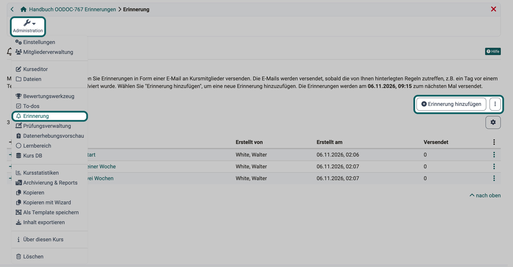{ class="shadow lightbox" title="Menü Administration eines Kurses · 2026.11.06" }

### Kursbausteine mit Erinnerungsfunktion [:octicons-tag-16:{ title="ab Release 16.0 (OO-5447)" }](https://track.frentix.com/issue/OO-5447)

Zusätzlich gibt es Kursbausteine, die mit der Erinnerungsfunktion verknüpft werden können. Sie haben einen eigenen Tab "Erinnerungen" direkt am Baustein.

**Aufruf im Kurseditor:**

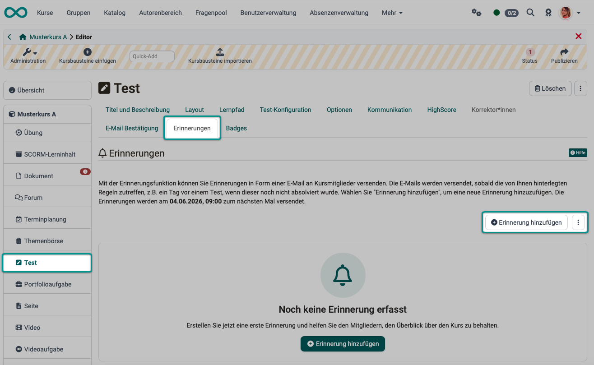{ class="shadow lightbox" title="Kursbaustein im Kurseditor" }

**Aufruf ausserhalb des Kurseditors, nur für Kursbesitzer:innen:**

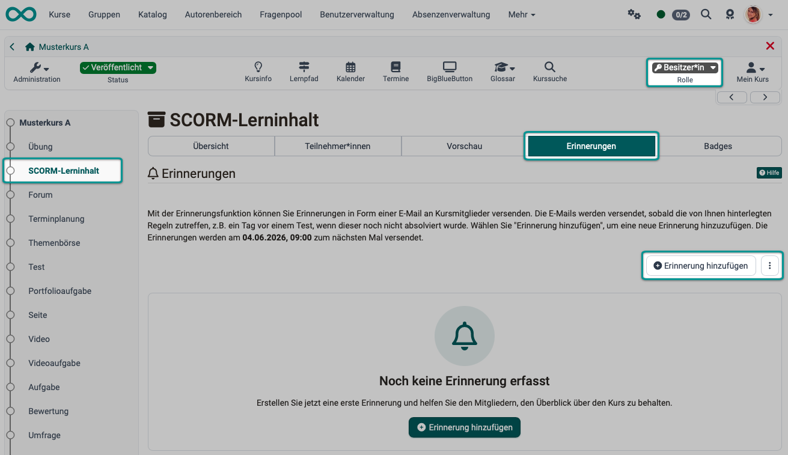{ class="shadow lightbox" title="Kursbaustein ausserhalb des Kurseditors" }

### Kurstitel (Oberster Kursknoten)

Erinnerungen, die nicht an einen bestimmten Kursbaustein gebunden sind, finden Sie im Kurseditor auch beim obersten Kursbaustein/Kurstitel: ebenfalls im Tab "Erinnerungen".

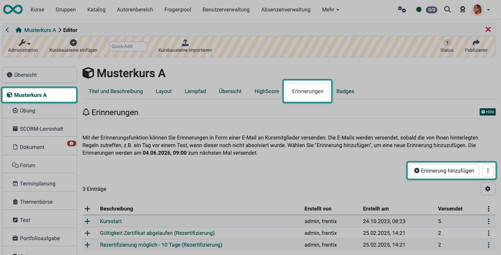{ class="shadow lightbox" title="Oberster Kursknoten im Kurseditor" }

[Zum Seitenanfang ^](#course_reminders)

---

## Erinnerung erstellen {: #create}

Als Kursbesitzer:in definieren Sie 

* unter welchen **Bedingungen** die Erinnerung verschickt werden soll 
* den **Mailtext**
* an **wen** die Erinnerung verschickt werden soll

Um eine Erinnerung zu erstellen, klicken Sie auf den Button "Erinnerung hinzufügen". Es erscheint ein Wizard, der Sie Schritt für Schritt durch den Erstellungsprozess führt.

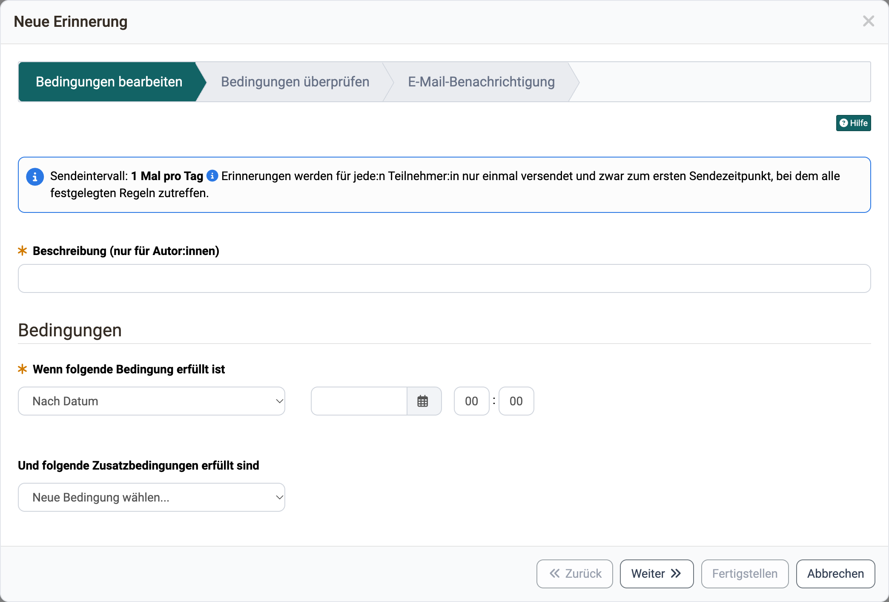{ class="shadow lightbox" title="Dialog Neue Erinnerung · 2026.11.06" }

**Schritt 1: Bedingungen bearbeiten**

Oben im Dialog zeigt der Hinweis "Sendeintervall", wie oft OpenOlat Erinnerungen versendet, zum Beispiel "1 Mal pro Tag". Das Info-Symbol daneben listet die Sendezeiten des Tages. Jede Person erhält eine Erinnerung nur einmal, zur ersten Sendezeit, an der alle Bedingungen auf sie zutreffen.

Geben Sie als Erstes die Beschreibung für die Erinnerung ein. Diese Beschreibung ist nur für die Autor:innen sichtbar und dient der übersichtlichen und informativen Darstellung der Erinnerungen eines Kurses. Wählen Sie dann die Bedingungen für den Versand aus. Mehr dazu weiter unten.

**Schritt 2: Bedingungen überprüfen**

Im zweiten Schritt des Wizards werden die Bedingungen überprüft und es wird noch einmal angezeigt, an wen gemäss der Konfiguration die Erinnerung versandt würde.

**Schritt 3: E-Mail-Benachrichtigung**

Im letzten Schritt geben Sie den zu versendenden E-Mail-Text ein. Unter "An" wählen Sie "Gemäss den Regeln", wenn die Erinnerung an alle Personen des Kurses gehen soll, auf die die Bedingungen zutreffen. Optional geht eine Kopie an Kursbesitzer:innen, Betreuende oder Personen mit einer externen E-Mail-Adresse.

Mit "Nur an bestimmte Empfänger" geht die Erinnerung nur an die Besitzer:innen, die zuständigen Betreuer:innen oder an externe E-Mail-Adressen. Diese Option bietet sich vor allem für Test-Erinnerungen oder spezifische Erinnerungen für Lehrpersonen an.

Sobald die Bedingungen für eine Erinnerung erfüllt sind, werden die Mails automatisch zum Versand freigegeben. Sendeintervall und Sendezeiten legen Systemadministrator:innen für alle Kurse im [Modul Kurserinnerungen](../../manual_admin/administration/Modules_Course_Reminders.de.md) fest.

[Zum Seitenanfang ^](#course_reminders)

---

## Bedingungen für den Versand von Erinnerungen {: #conditions}

Die Bedingungen legen fest, wann eine Erinnerung an wen geht. Sie wählen jede Bedingung aus einem Dropdown-Menü. Je nach Bedingung erscheint rechts daneben ein weiteres Eingabefeld für genauere Angaben. Nicht jede Bedingung steht in jedem Kurs zur Wahl: "Fortschritt" gibt es nur in Lernpfadkursen, "Ausstellungsdatum Zertifikat" und "Ablaufdatum Zertifikat" nur, wenn der Kurs Zertifikate ausstellt.

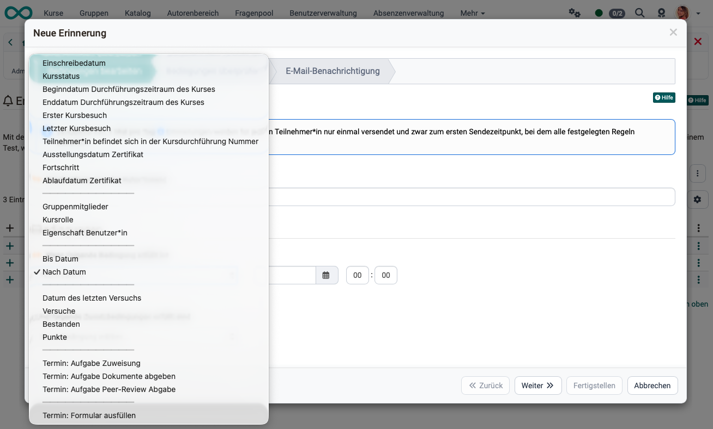{ class="shadow lightbox" title="Schritt Bedingungen bearbeiten" }

Mehrere Bedingungen können nach Wunsch kombiniert werden. Dadurch können auf den individuellen Bedarf zugeschnittene Erinnerungen ausgelöst werden. Es muss aber mindestens ein Kriterium gewählt werden, damit ein Versand ausgelöst wird.

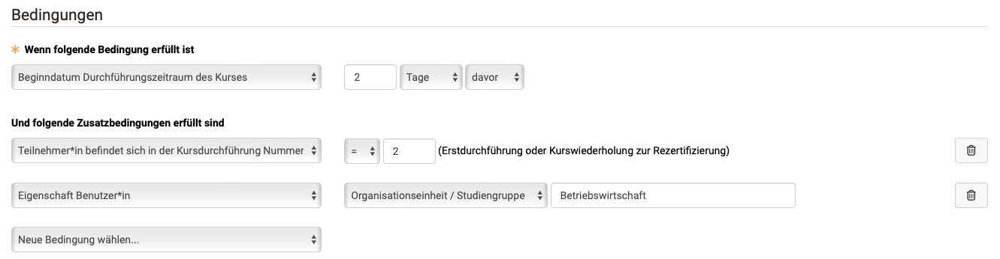{ class="shadow lightbox" title="Schritt Bedingungen bearbeiten" }

!!! info "Wichtig"

    Die Bedingungen sind mit "und" verknüpft. OpenOlat löst die Erinnerung nur aus, wenn alle Bedingungen erfüllt sind.

Es können folgende Kriterien als Bedingung konfiguriert werden:

* **Einschreibedatum** 
Versand x Tage, Wochen, Monate oder Jahre danach 
_Beispiel_: Benutzer:innen erhalten 2 Tage nach der Einschreibung zusätzliche Informationen zum Kurs. 

* **Kursstatus** 
Wählen Sie, welchen Status der Kurs haben muss, damit eine Erinnerung verschickt wird.

    * Vorbereitung
    * Review
    * Freigabe Betreuer:innen
    * Veröffentlicht
    * Nicht Vorbereitung
    * Nicht Review
    * Nicht Freigabe Betreuer:innen
    * Nicht Veröffentlicht

    _Beispiel_: Nur wenn der Kurs den Status "Freigabe Betreuer:innen" hat, erhalten alle Betreuer:innen eine Info-Mail über ihre Betreuungsaufgabe.

* **Beginndatum Durchführungszeitraum des Kurses** 
x Tage, Wochen, Monate oder Jahre davor oder danach

* **Enddatum Durchführungszeitraum des Kurses** 
x Tage, Wochen, Monate oder Jahre davor oder danach

* **Erster Kursbesuch** 
x Tage, Wochen, Monate oder Jahre danach

* **Letzter Kursbesuch** 
x Tage, Wochen, Monate oder Jahre danach

* **Teilnehmer:in befindet sich in der Kursdurchführung Nummer** 
Hier geht es um die Erstdurchführung oder Kurswiederholung zur Rezertifizierung. 

    _Beispiel_: Teilnehmende, die den Kurs das zweite Mal durchlaufen, erhalten eine Erinnerungsmail.

* **Ausstellungsdatum Zertifikat** 
Diese Option wird nur angezeigt, wenn im Kurs "Zertifikat ausstellen" eingeschaltet ist: `Kurs > Administration > Einstellungen > Tab "Bewertung"`. 
_Beispiel_: Die Mail wird versandt 1 Tag nachdem ein Zertifikat ausgestellt wurde.

* **Fortschritt** 
Diese Option gibt es nur bei [Lernpfadkursen](Learning_path_course/index.de.md).
OpenOlat versendet die Erinnerung abhängig vom prozentualen Kursfortschritt der Teilnehmenden, wie er in den Einstellungen der Kurs-Administration konfiguriert wurde. 
_Beispiel_: Teilnehmende, die mindestens 80% eines Kurses erfolgreich erledigt haben, erhalten eine Motivationsmail, um noch bald die letzten 20% zu erledigen.

* **Ablaufdatum Zertifikat** 
Diese Option wird nur angezeigt, wenn im Kurs "Zertifikat ausstellen" eingeschaltet ist: `Kurs > Administration > Einstellungen > Tab "Bewertung"`. 
_Beispiel_: Die Mail wird versandt 2 Wochen bevor das Zertifikat abläuft, so dass die Teilnehmenden daran erinnert werden die für das Zertifikat notwendigen Aktivitäten durchzuführen bevor das Zertifikat abläuft.

 

* **Gruppenmitglieder** 
Auswahl einer bestimmten Gruppe. Nur deren Gruppenmitglieder erhalten die Mail. 

* **Kursrolle** 
Die Erinnerungsempfänger:innen müssen eine der folgenden Rollen innehaben:

    * Besitzer:innen
    * Betreuer:innen
    * Teilnehmer:innen
    * Betreuer:innen und Teilnehmer:innen
    * Besitzer:innen und Betreuer:innen
    * Mitglieder

    _Beispiel_: Nur Besitzer:innen und Betreuer:innen erhalten eine Erinnerung.  

* **Eigenschaft Benutzer:in** 
Die Erinnerungsempfänger:innen müssen einen bestimmten Wert zu einem der folgenden Merkmale aufweisen:

    * Postleitzahl
    * Region / Kanton
    * Stadt
    * Land
    * Institution
    * Institutionsnummer (Matrikelnummer)
    * Institutions E-Mail
    * Organisationseinheit / Studiengruppe
    * Studienfach

    _Beispiel_: Erinnerungsempfänger:innen aus der Stadt Zürich.  

    Voraussetzung ist, dass die Angaben auch eingetragen bzw. übertragen wurden.

* **Bis Datum** 
Eingabefelder für Datum und Uhrzeit, als Eingabehilfe Button zur Anzeige des Kalenders. Diese Bedingung eignet sich häufig für die Kombination mit anderen Bedingungen.

* **Nach Datum** 
Eingabefelder für Datum und Uhrzeit, als Eingabehilfe Button zur Anzeige des Kalenders. Diese Bedingung eignet sich häufig für die Kombination mit anderen Bedingungen, z.B. wenn bis zu einem bestimmten Termin ein bestimmter Kursfortschritt nicht erreicht wurde.

* **Datum des letzten Versuchs** 
Diese Option bezieht sich auf bewertbare Kursbausteine.
    * In der Dropdown-Liste werden die möglichen Kursbausteine, die berücksichtigt werden können, angezeigt. 
    * x Tage, Wochen, Monate oder Jahre danach 
    _Beispiel_: Die Erinnerung wird verschickt 1 Woche nachdem ein bestimmter Test ausgefüllt wurde.

* **Versuche** 
Diese Option betrifft nur bewertbare Kursbausteine. Hier wird die Anzahl der Lösungsversuche für den Mailversand berücksichtigt. 
_Beispiel_: Ein Test wurde noch kein Mal (0) durchgeführt.

* **Bestanden** 
Diese Option betrifft nur bewertbare Kursbausteine, für die ein Bestanden-Status im Editor konfiguriert wurde. Dieser kann hier als Bedingung ausgewählt werden. 
_Beispiel_: Ein Test-Kursbaustein wurde mit "Bestanden" bewertet.

    !!! warning "Achtung: Option "Keine Angabe""

        "Keine Angabe" ist der initiale Wert für den Bestanden-Status (Erfolgsstatus) für alle bewertbaren Bausteine. Die Aktivierung dieser Option als Bedingung ist nur in Kombination mit der zweiten Bedingung "Nach Datum" sinnvoll. Andernfalls wird die Erinnerung direkt beim nächstmöglichen Versandzeitpunkt ausgelöst.

        _Beispiel "Erinnerung an Betreuer:in"_: Ein Kursbaustein Aufgabe wurde zum Zeitpunkt x noch nicht bewertet oder mit "Keine Angabe" abgeschlossen.

        _Beispiel "Erinnerung an Teilnehmer:in"_: Ein Kursbaustein Checkliste wurde zum Zeitpunkt x noch nicht bearbeitet oder von der Betreuer:in mit "Keine Angabe" abgeschlossen.

* **Punkte** 
Diese Option betrifft nur bewertbare Kursbausteine, für die eine Punktezahl definiert wurde. OpenOlat versendet die Erinnerung dann abhängig von der erreichten Punktzahl. 
_Beispiel_: In einer Checkliste wurden weniger als 3 Punkte erreicht.

* **Termin: Aufgabe Zuweisung** 
Diese Option betrifft nur Kursbausteine vom Typ "Aufgabe", bei denen auch die Aufgabenstellung im Kursbaustein abgelegt wurde und ein Termin für die Zuweisung zugeordnet wurde. Der Versand der Erinnerungsmail bezieht sich dann auf den im Kurseditor hinterlegten Termin, z.B. x Tage, Wochen, Monate davor. 

* **Termin: Aufgabe Dokumente abgeben** 
Diese Option betrifft nur Kursbausteine vom Typ "Aufgabe", bei denen die "Abgabe" in der Workflow-Konfiguration aktiviert wurde. Eine Erinnerungsmail kann dann x Tage, Wochen, Monate vor dem Abgabetermin verschickt werden. 

* **Termin: Aufgabe Peer-Review Abgabe** 
Diese Option betrifft nur Kursbausteine vom Typ "Aufgabe", bei denen im Workflow die Peer-Review Funktion aktiviert wurde und ein "bis" Datum mit dem Review verknüpft wurde. 
_Beispiel_: Eine Erinnerung wird 3 Tage vor dem finalen Peer-Review Endtermin verschickt.

 

* **Termin: Formular ausfüllen** 
Diese Option betrifft nur Kursbausteine vom Typ "Formular", bei denen im Kurseditor ein Endtermin für das Ausfüllen hinterlegt wurde. 
_Beispiel_: Eine Erinnerung wird 2 Tage vor der Ausfülldeadline für das Formular verschickt.

[Zum Seitenanfang ^](#course_reminders)

---

## Hinweise zur Konfiguration der Erinnerungen {: #notes}

!!! info "Wann wird die Mail verschickt, wenn ich hier ein Datum angebe?"

    Der Versand der Kurserinnerungen findet nicht sofort statt. Alle Erinnerungsmails werden gemeinsam z.B. täglich um 9.00 Uhr verschickt. Dies ist eine Voreinstellung und kann von Systemadministrator:innen in der System-Administration geändert und bis auf "Jede Stunde" angepasst werden: `Administration > Module > Kurserinnerungen`.
    Zum Versandzeitpunkt prüft OpenOlat jeweils, welche Bedingungen erfüllt sind und verschickt entsprechend die Mails. Es werden dann alle Kurserinnerungen verschickt, die z.B. um 9.00 die Bedingungen erfüllen ("im Ausgangskorb liegen").

    Mit "Bis Datum" kann die Bedingung schon beim Erstellen der Erinnerung erfüllt sein, und OpenOlat verschickt die Mails. Sinnvoll ist diese Bedingung vor allem in Verbindung mit einer weiteren Bedingung, z.B.: Wenn "bis Datum" "der Test bestanden wurde", wird eine Mail verschickt "Sie haben sich termingerecht qualifiziert und erhalten dafür ...".

    Wenn "Nach Datum" mit einem Datum nach dem Erstellen der Erinnerung verwendet wird, werden die Mails im "Ausgangskorb" zum erstmöglichen Versandtermin verschickt, wenn das "Nach Datum" erreicht wurde.

    Beachten Sie:  
    Ein Durchführungszeitraum beginnt am Beginndatum um 0:00 Uhr und endet am Enddatum um 23:59 Uhr.  
    Das bedeutet: Ist das Ende der Durchführung erreicht (nächster Tag), werden keine Erinnerungen mehr gesendet.

!!! info "Option davor/danach"

    Für Bedingungen, welche zu einem Datum eine Angabe "davor" oder "danach" benötigen, wird dies als Auswahlliste zur Verfügung gestellt.
    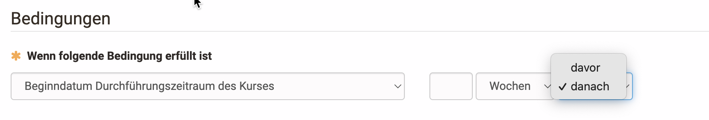{ class="shadow lightbox" title="Schritt Bedingungen bearbeiten" }

!!! info "Datum"

    Zum eingetragenen Datum (inkl. Uhrzeit) wird die Erinnerung zur nächstmöglichen Sendezeit verschickt. Wird das "bis Datum" verwendet, so wird die Erinnerung zum nächstmöglichen Sendezeitpunkt gesendet, bis das Datum (und die Uhrzeit) erreicht ist. 
    _Beispiel_: 24.06.2021 16:30  

!!! info "Zeitspanne"

    Diese Bedingungen bauen darauf auf, wie lange etwas schon her ist, oder wie lange ein bestimmter Zeitpunkt noch entfernt ist.

    _Beispiel_: 5 Wochen bevor die Zuweisung für die Gruppenaufgabe schliesst.

    _Beispiel_: 5 Tage nachdem die Person den Kurs zum ersten Mal aufgerufen hat.

!!! info "Operatoren"

    Für die Bedingungen "Teilnehmer:in befindet sich in der Kursdurchführung Nummer", "Versuche" und "Punkte" werden Operatoren benötigt um die verschiedenen Zustände "mehr als, weniger als, weniger oder gleich, mehr oder gleich, gleich" und "ungleich" korrekt darzustellen. Sie dienen dazu Ausdrücke miteinander zu vergleichen, und in Abhängigkeit davon einen logischen Rückgabewert zu erzeugen.

    Operator | Bezeichnung | Erklärung
    ---------|----------|---------
    `<` | kleiner | korrekt wenn a kleiner b ist
    `<=`| kleiner gleich| korrekt, wenn a kleiner oder gleich b ist
    `=`| gleich| korrekt, wenn a gleich b ist
    `=>`| grösser gleich| korrekt, wenn a grösser oder gleich b ist
    `>`| grösser| korrekt, wenn a grösser b ist
    `!=`| ungleich| korrekt, wenn a ungleich b ist

    In unseren Bedingungen wird in diesem Fall z.B. das Ergebnis eines Testes (a) mit dem eingegebenen Wert in der Bedingungsregel (b) verglichen. Ist der logische Rückgabewert "True", also trifft die Bedingung zu, dann wird die Erinnerung ausgelöst.  

    _Beispiel:_ Eine Erinnerung soll verschickt werden, wenn Teilnehmende in einem Test maximal 5 Punkte erreicht haben. In OpenOlat sieht die Bedingung dann folgendermassen aus:
    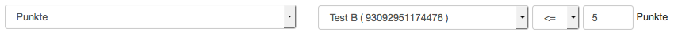{ class="shadow lightbox" title="Schritt Bedingungen bearbeiten" }

[Zum Seitenanfang ^](#course_reminders)

---

## E-Mail-Text {: #text}

Mit Hilfe des E-Mail-Textes, der nach Bedarf angepasst werden kann, erstellen Sie ganz spezifische, auf die Situation angepasste E-Mail-Erinnerungen.

!!! tip "Tipp"

    Zeigen Sie mit dem Mauszeiger auf das Fragezeichensymbol neben "E-Mail-Betreff" oder "E-Mail". OpenOlat listet dann die Variablen, die in diesem Feld verfügbar sind.

    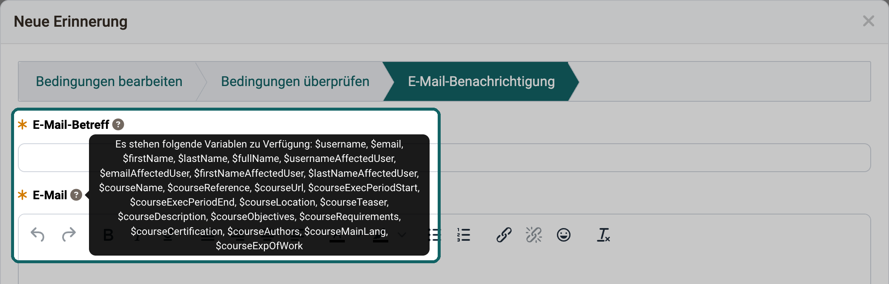{ class="shadow lightbox" title="Schritt E-Mail-Benachrichtigung im Dialog Neue Erinnerung · 2026.11.06" }

### Im Betreff verfügbare Variablen

* **$courseName**: Der Name des Kurses wie auf der Infoseite.
* **$courseAuthors**: Die Namen, die in den Kurseinstellungen, Tab "Metadaten" unter "Autor:innen/Durchführung mit" eingegeben wurden.
* **$courseExecPeriodStart**: Das Datum, das in den Kurseinstellungen, Tab "Durchführung" als Beginn des Durchführungszeitraums angegeben wurde.
* **$courseExecPeriodEnd**: Das Datum, das in den Kurseinstellungen, Tab "Durchführung" als Ende des Durchführungszeitraums angegeben wurde.
* **$courseLocation**: Der Text, der in den Kurseinstellungen, Tab "Durchführung" als Durchführungsort eingegeben wurde.

### Im Mailtext verfügbare Variablen

* **$firstName**: Der Vorname der Empfänger:in.
* **$lastName**: Der Nachname der Empfänger:in.
* **$fullName**: Der vollständige Name je nach Systemkonfiguration. Der Standardwert ist "Nachname, Vorname".
* **$email**: Die E-Mail-Adresse der Empfänger:in.
* **$username**: Der Benutzername.
* **$courseUrl**: Die Internetadresse des Kurses.
* **$courseName**: Der Name des Kurses wie auf der Infoseite.
* **$courseDescription**: Die Beschreibung des Kurses wie auf der Infoseite.
* **$courseAuthors**: Die Namen, die in den Kurseinstellungen, Tab "Metadaten" unter "Autor:innen/Durchführung mit" eingegeben wurden.
* **$courseCertification**: Die Beschreibung der Bescheinigung, wie sie in den Kurseinstellungen, Tab "Info" angegeben wurde.
* **$courseExecPeriodStart**: Das Datum, das in den Kurseinstellungen, Tab "Durchführung" als Beginn des Durchführungszeitraums angegeben wurde.
* **$courseExecPeriodEnd**: Das Datum, das in den Kurseinstellungen, Tab "Durchführung" als Ende des Durchführungszeitraums angegeben wurde.
* **$courseExpOfWork**: Der geschätzte Zeitaufwand, der in den Kurseinstellungen, Tab "Metadaten" unter "Zeitaufwand" als Text eingegeben wurde.
* **$courseLocation**: Der Text, der in den Kurseinstellungen, Tab "Durchführung" als Durchführungsort eingegeben wurde.
* **$courseMainLang**: Die Sprache, die in den Kurseinstellungen, Tab "Metadaten" unter "Hauptsprache" eingegeben wurde.
* **$courseObjectives**: Der Text, der in den Kurseinstellungen, Tab "Info" als Lernzielbeschreibung eingegeben wurde.
* **$courseReference**: Der Text, der in den Kurseinstellungen im Tab "Info" unter "Kennzeichen" eingegeben wurde.
* **$courseRequirements**: Der Text, der in den Kurseinstellungen im Tab "Info" unter "Voraussetzungen" eingegeben wurde.
* **$courseTeaser**: Der Teaser-Text, der in den Kurseinstellungen im Tab "Info" eingegeben wurde.
* **$firstNameAffectedUser**: Der Vorname der betroffenen Person.
* **$lastNameAffectedUser**: Der Nachname der betroffenen Person.
* **$emailAffectedUser**: Die E-Mail-Adresse der betroffenen Person.
* **$usernameAffectedUser**: Der Benutzername der betroffenen Person.

Die betroffene Person ist die Person, für die alle Bedingungen der Erinnerung erfüllt sind. Ist unter "An" die Option "Nur an bestimmte Empfänger" gewählt, nennen diese Variablen die Teilnehmer:in, um die es geht, während `$firstName` die Empfänger:in der Mail nennt, also die Besitzer:in oder die zuständige Betreuer:in. Bei externen E-Mail-Adressen bleiben `$firstName`, `$lastName`, `$fullName`, `$email` und `$username` leer. Ist "Gemäss den Regeln" gewählt, enthalten beide Variablengruppen dieselben Werte, auch in den Kopien. Ein Beispiel zeigt die Anleitung zum Lernfortschritt im Abschnitt [Automatische Erinnerungen](../../manual_how-to/progress_information/progress_information.de.md#by_reminders).

Bestehende Erinnerungen mit `$recipientFirstName` und `$recipientLastName` funktionieren weiterhin. Die beiden Variablen liefern dieselben Werte wie `$firstNameAffectedUser` und `$lastNameAffectedUser`.

Hier ein Beispiel:

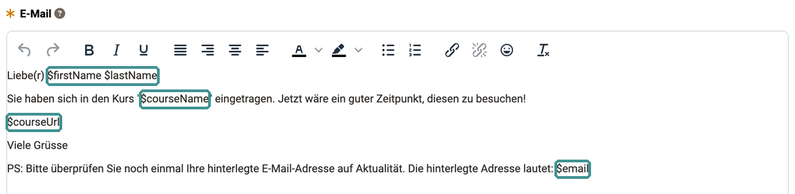{ class="shadow lightbox" title="Schritt E-Mail-Benachrichtigung im Dialog Neue Erinnerung" }

[Zum Seitenanfang ^](#course_reminders)

---

## Empfänger:innen {: #recipients}

Erinnerungen sind gut geeignet, um **Teilnehmende** daran zu erinnern, was sie als nächstes erledigen sollten.
Eine **Kopie an die Betreuer:innen und/oder Kursbesitzer:innen** informiert auch diese, dass Teilnehmende etwas zu erledigen haben.

In manchen Fällen sollen Erinnerungen **ausschliesslich an Betreuer:innen** geschickt werden.

**Beispiel:** 
Teilnehmende zeigen keinen Fortschritt. Die Betreuer:in sollte dann Kontakt mit diesen Teilnehmenden aufnehmen und Hilfestellung leisten. Die Erinnerung dazu sollte nur an die Betreuer:in gehen. Sie könnten als Bedingungen z.B. eingeben, dass der Fortschritt noch unter x% ist und gleichzeitig ein bestimmter Punktewert in einem Eingangstest nicht erreicht wurde.

Ebenso können Erinnerungen auch **ausschliesslich an die Kursbesitzer:innen** versandt werden.

**Beispiel:** 
Manchmal vergessen Autor:innen ihren Kurs zu publizieren, weil noch Dinge unklar waren als sie das letzte Mal an der Kurserstellung gearbeitet haben. In diesem Fall kann der Kursstatus in Kombination mit der Rolle als Versandkriterium verwendet werden.

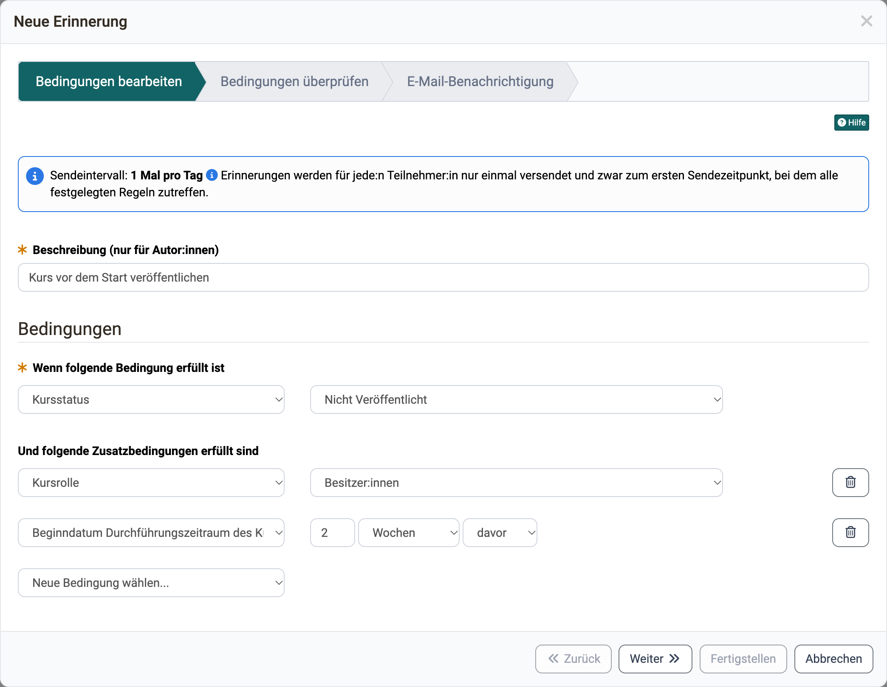{ class="shadow lightbox" title="Schritt Bedingungen bearbeiten · 2026.11.06" }

Für besondere Fälle können Erinnerungen auch **ausschliesslich an bestimmte externe Mailadressen** versandt werden.

[Zum Seitenanfang ^](#course_reminders)

---

## Erinnerungen kontrollieren und bearbeiten {: #check_and_edit}

Wurden bereits Erinnerungen erstellt, sind diese unter `Kurs > Administration > Erinnerung` aufgelistet. Der Text über der Liste nennt, wann OpenOlat die Erinnerungen zum nächsten Mal versendet.

Über die drei Punkte am Zeilenende öffnen Sie das Aktionsmenü einer Erinnerung mit "Bearbeiten", "Duplizieren", "Erinnerung jetzt senden", "Versendete Erinnerungen zeigen" und "Löschen". Die drei Punkte neben "Erinnerung hinzufügen" bieten "Vorschau anzeigen" und "Versendete Erinnerungen zeigen" für alle Erinnerungen des Kurses. Die Vorschau listet je Erinnerung die Personen, auf die ihre Bedingungen derzeit zutreffen, und das Datum, an dem sie die Erinnerung schon erhalten haben.

Die Liste der bereits versendeten Erinnerungen enthält Informationen zu den Empfänger:innen sowie die Sendezeit. Einzelne Erinnerungen aus dieser Liste können über den Link "Erneut versenden" einfach verschickt werden.

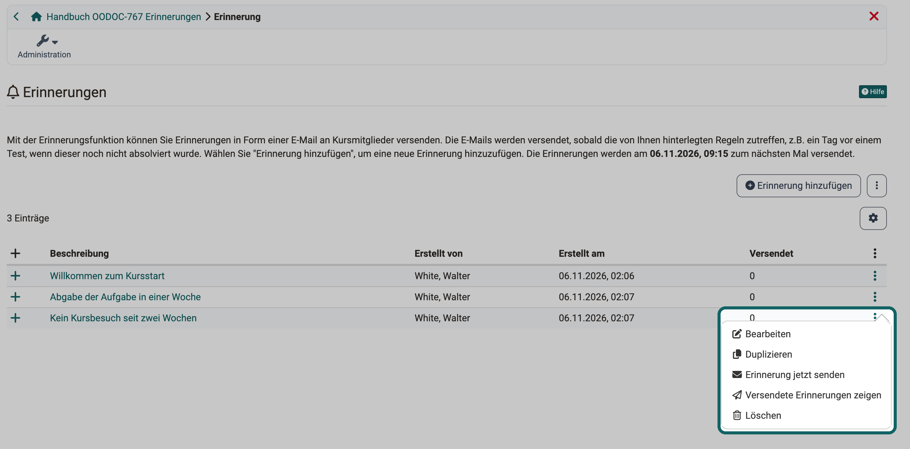{ class="shadow lightbox" title="Liste der Erinnerungen eines Kurses · 2026.11.06" }

Neue Erinnerungen können jederzeit erstellt werden.

Soll z.B. eine einzelne Bedingung für den Versand entfernt werden, finden Sie im Bearbeitungsmodus die Buttons zum Löschen einer einzelnen Bedingung rechts neben der jeweiligen Bedingung. 

Mit "Erinnerung jetzt senden" lösen Sie eine Erinnerung sofort aus, ohne auf die nächste Sendezeit zu warten. Der Dialog nennt, für wie viele Kursmitglieder die Erinnerung erstmalig versendet wird. "Erstmalig versenden" schickt sie nur an diese Personen, "An alle senden" auch an Personen, die sie schon erhalten haben. In beiden Fällen geht die Erinnerung nur an Personen, auf die alle Bedingungen zutreffen.

[Zum Seitenanfang ^](#course_reminders)

---

## Weiterführende Informationen {: #further_information}

**Auf dieser Seite erwähnt** 
[Gruppenwerkzeuge nutzen >](../groups/Using_Group_Tools.de.md) 
[Kursbaustein "Forum" >](Course_Element_Forum.de.md) 
[Persönliche Werkzeuge: Abonnements >](../personal_menu/Subscriptions.de.md) 
[Lernpfadkurs - Überblick >](Learning_path_course/index.de.md) 
[Wie können Betreuer:innen über den Lernfortschritt der Kursteilnehmer:innen informiert werden? >](../../manual_how-to/progress_information/progress_information.de.md) 
[Modul Kurserinnerungen >](../../manual_admin/administration/Modules_Course_Reminders.de.md)

**Weiterführend** 
[Persönliche Werkzeuge: E-Mail >](../personal_menu/E-Mail.de.md) 
[Kursbaustein "Mitteilungen" >](../learningresources/Course_Element_Notifications.de.md) 
[Toolbar >](Course_Settings_Toolbar.de.md)

[Zum Seitenanfang ^](#course_reminders)

