# Course Reminders {: #course_reminders}

With reminders, OpenOlat automatically sends e-mails to course members as soon as the conditions you defined apply, for example one day before a submission deadline. You no longer have to remind anyone of deadlines, open tasks or the next step by hand. You create, edit and check reminders and their dispatch in several places in the course.

Reminders are a feature of the course. Groups and individual tools such as the forum have no reminders. A group can only be selected as a recipient group of a course reminder. Anyone who wants to be informed about changes in a group or in a forum subscribes to the tool: [Group tools](../groups/Using_Group_Tools.md), [Subscribe to forums](Course_Element_Forum.md#abo), [Subscriptions](../personal_menu/Subscriptions.md).

## Where are reminders created? {: #access}

### Course administration

Under `Course > Administration > Reminders`, all reminders of a course are displayed, and you can also create new ones there.

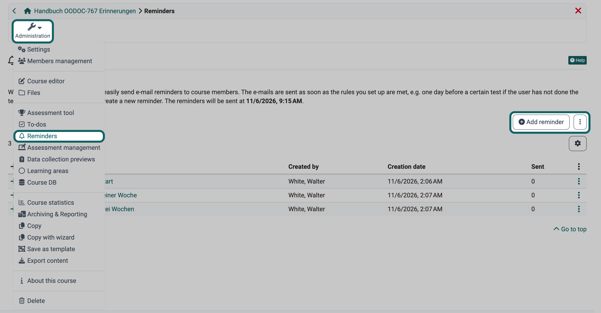{ class="shadow lightbox" title="Administration menu of a course · 2026.11.06" }

### Course elements with reminder function [:octicons-tag-16:{ title="from Release 16.0 (OO-5447)" }](https://track.frentix.com/issue/OO-5447)

In addition, there are course elements that can be linked to the reminder function. They have their own "Reminders" tab right on the element.

**Call in the course editor:**

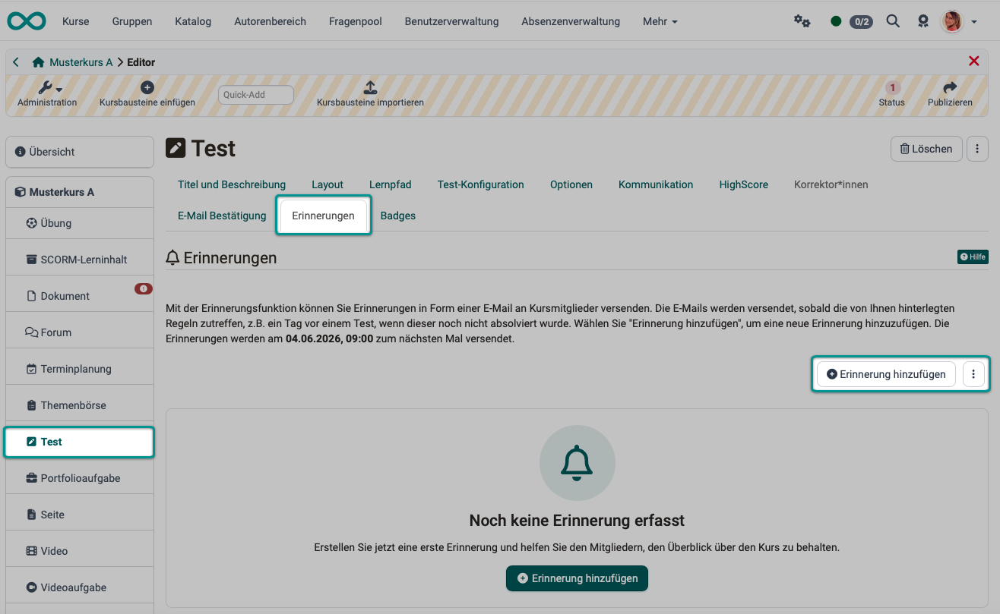{ class="shadow lightbox" title="Course element in the course editor" }

**Call outside the course editor, for course owners only:**

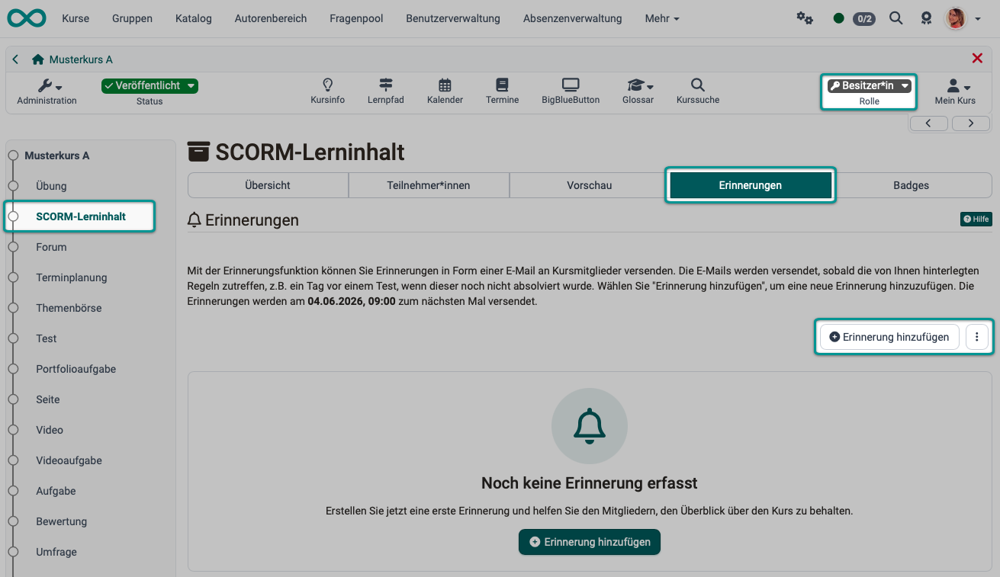{ class="shadow lightbox" title="Course element outside the course editor" }

### Course title (top-level course node)

Reminders that are not linked to a specific course element can also be found in the course editor at the top-level course element/course title: also in the "Reminders" tab.

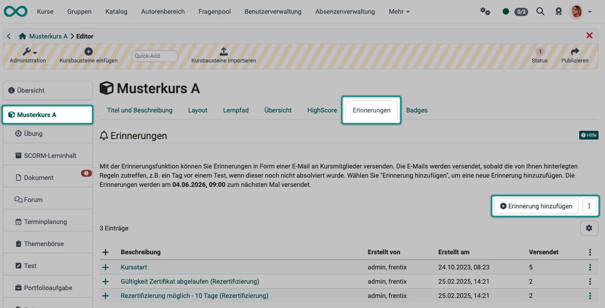{ class="shadow lightbox" title="Top course node in the course editor" }

[To the top of the page ^](#course_reminders)

---

## Create reminder {: #create}

As the course owner, you define

* under which **conditions** the reminder should be sent
* the **mail text**
* to **whom** the reminder should be sent

To create a reminder, click the "Add reminder" button. A wizard appears that guides you step by step through the creation process.

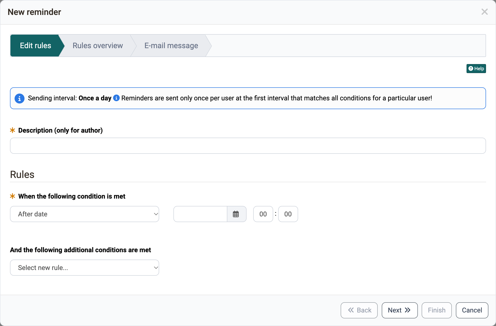{ class="shadow lightbox" title="New reminder dialog · 2026.11.06" }

**Step 1: Edit rules**

At the top of the dialog, the "Sending interval" hint shows how often OpenOlat sends reminders, for example "Once a day". The info icon next to it lists the sending times of the day. Each person receives a reminder only once, at the first sending time at which all conditions apply to them.

First enter the description for the reminder. This description is only visible to the authors and is used for the clear and informative presentation of the reminders of a course. Then select the conditions for the dispatch. More on this below.

**Step 2: Rules overview**

In the second step of the wizard, the conditions are checked and it is shown again to whom the reminder would be sent according to the configuration.

**Step 3: E-mail message**

In the last step, you enter the e-mail text to be sent. Under "To", select "According to the rules" if the reminder is to go to all persons in the course to whom the conditions apply. Optionally, a copy goes to course owners, coaches or persons with an external e-mail address.

With "Only to specific recipients", the reminder goes only to the owners, the responsible coaches or to external e-mail addresses. This option is particularly suitable for test reminders or specific reminders for teachers.

As soon as the conditions for a reminder are met, the e-mails are automatically released for dispatch. System administrators set the sending interval and the sending times for all courses in the [Course Reminders module](../../manual_admin/administration/Modules_Course_Reminders.md).

[To the top of the page ^](#course_reminders)

---

## Conditions for sending reminders {: #conditions}

The conditions determine when a reminder goes to whom. You select each condition from a drop-down menu. Depending on the condition, a further input field appears to the right for more detailed information. Not every condition is available in every course: "Progress" exists only in learning path courses, "Issue date certificate" and "Expiration date certificate" only if the course issues certificates.

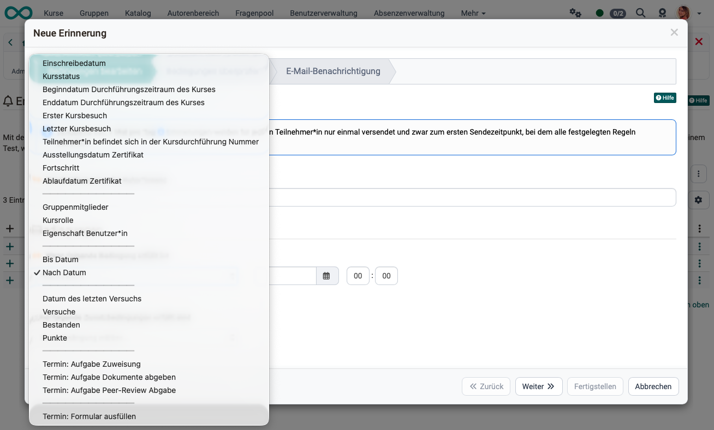{ class="shadow lightbox" title="Edit rules step" }

Several conditions can be combined as required. This allows reminders to be triggered that are tailored to individual requirements. However, at least one criterion must be selected for a dispatch to be triggered.

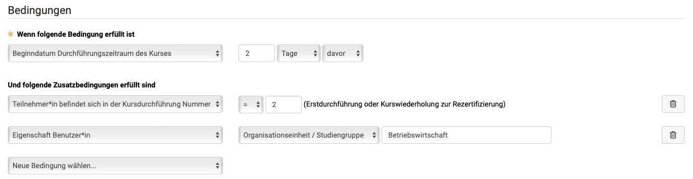{ class="shadow lightbox" title="Edit rules step" }

!!! info "Important"

    The conditions are linked with "and". OpenOlat triggers the reminder only if all conditions are met.

The following criteria can be configured as a condition:

* **Enrollment date** 
Dispatch x days, weeks, months or years later 
_Example_: Participants receive additional information about the course 2 days after enrolment.

* **Course status** 
Select the status the course must have for a reminder to be sent.

    * Preparation
    * Review
    * Access for coach
    * Published
    * Not preparation
    * Not review
    * Not access for coach
    * Not published

    _Example_: Only if the course has the status "Access for coach" will all coaches receive an info e-mail about their coaching task.

* **Begin date execution period of course** 
x days, weeks, months or years before or after

* **End date execution period of course** 
x days, weeks, months or years before or after

* **Initial course launch date** 
x days, weeks, months or years after

* **Recent course launch date** 
x days, weeks, months or years after

* **Participant is in the course execution number** 
This concerns the initial run or course repetition for recertification.

    _Example_: Participants who complete the course for the second time receive a reminder e-mail.

* **Issue date certificate** 
This option is only displayed if "Issue certificate" is switched on in the course: `Course > Administration > Settings > Tab "Assessment"`. 
_Example_: The mail is sent 1 day after a certificate has been issued.

* **Progress** 
This option is only available for [learning path courses](Learning_path_course/index.md).
OpenOlat sends the reminder depending on the percentage course progress of the participants, as configured in the settings of the course administration. 
_Example_: Participants who have successfully completed at least 80% of a course will receive a motivational e-mail to complete the last 20% soon.

* **Expiration date certificate** 
This option is only displayed if "Issue certificate" is switched on in the course: `Course > Administration > Settings > Tab "Assessment"`. 
_Example_: The e-mail is sent 2 weeks before the certificate expires, so that participants are reminded to carry out the activities required for the certificate before it expires.

 

* **Group member** 
Selection of a specific group. Only the members of this group will receive the e-mail.

* **Course role** 
The reminder recipients must have one of the following roles:

    * Owners
    * Coaches
    * Participants
    * Coaches and participants
    * Owners and coaches
    * Members

    _Example_: Only owners and coaches will receive a reminder.

* **User property** 
The reminder recipients must have a certain value for one of the following characteristics:

    * Zip code
    * Region/canton
    * City
    * Country
    * Institution
    * Institution identifier (registration number)
    * Institutional e-mail
    * Organizational unit/study group
    * Field of studies

    _Example_: Reminder recipients from the city of Zurich.

    The prerequisite is that the details have also been entered or transferred.

* **Until date** 
Input fields for date and time, with a button as input aid for displaying the calendar. This condition is often suitable for combination with other conditions.

* **After date** 
Input fields for date and time, with a button as input aid for displaying the calendar. This condition is often suitable for combining with other conditions, e.g. if a certain course progress has not been reached by a certain date.

* **Date of last attempt** 
This option relates to assessable course elements.
    * The drop-down list shows the possible course elements that can be taken into account.
    * x days, weeks, months or years after 
    _Example_: The reminder will be sent 1 week after a specific test has been completed.

* **Attempts** 
This option only affects assessable course elements. The number of attempts is taken into account for the mail dispatch. 
_Example_: A test has not yet been carried out (0 times).

* **Passed** 
This option only affects assessable course elements for which a pass status has been configured in the editor. This can be selected here as a condition. 
_Example_: A test course element was assessed as "Passed".

    !!! warning "Attention: Option "Undefined""

        "Undefined" is the initial value for the passed status (success status) for all assessable elements. Activating this option as a condition only makes sense in combination with the second condition "After date". Otherwise, the reminder will be triggered directly at the next possible dispatch time.

        _Example "Reminder to coach"_: A course element task has not yet been assessed or has been completed with "Undefined" at time x.

        _Example "Reminder to participant"_: A course element checklist has not yet been processed at time x or has been completed by the coach with "Undefined".

* **Score** 
This option only affects assessable course elements for which a number of points has been defined. OpenOlat then sends the reminder depending on the score achieved. 
_Example_: Less than 3 points were achieved in a checklist.

* **Deadline: Task assignment** 
This option only affects course elements of the type "Task" for which the task has also been stored in the course element and a date has been assigned for the assignment. The reminder e-mail is then sent based on the date stored in the course editor, e.g. x days, weeks, months before.

* **Deadline: Task documents submission** 
This option only affects course elements of the type "Task" for which "Submission" has been activated in the workflow configuration. A reminder e-mail can then be sent x days, weeks or months before the submission deadline.

* **Deadline: Task peer review submission** 
This option only affects course elements of the type "Task" for which the peer review function has been activated in the workflow and an "until" date has been linked to the review. 
_Example_: A reminder is sent 3 days before the final peer review deadline.

 

* **Deadline: Form completion** 
This option only affects course elements of the type "Form" for which an end date for completion has been defined in the course editor. 
_Example_: A reminder is sent 2 days before the deadline for completing the form.

[To the top of the page ^](#course_reminders)

---

## Notes on configuring reminders {: #notes}

!!! info "When is the e-mail sent, if I enter a date here?"

    Course reminders are not sent immediately. All reminder e-mails are sent together, e.g. daily at 9.00 a.m. This is a default setting and can be changed by system administrators in the system administration and adjusted up to "Every hour": `Administration > Modules > Course reminders`.
    At the time of sending, OpenOlat checks which conditions are met and sends the e-mails accordingly. All course reminders that meet the conditions at, for example, 9.00 a.m. ("are in the outbox") are then sent.

    With "Until date", the condition may already be met when the reminder is created, and OpenOlat sends the e-mails. This condition is particularly useful in combination with another condition, e.g. if "until date" is "the test has been passed", an e-mail is sent: "You have qualified on time and will receive ...".

    If "After date" is used with a date after the time the reminder was created, the e-mails in the "outbox" are sent at the first possible sending date once the "after date" has been reached.

    Please note: 
    An execution period begins at 0:00 a.m. on the start date and ends at 11:59 p.m. on the end date. 
    This means that once the end of the execution period has been reached (the next day), no more reminders will be sent.

!!! info "Option before/after"

    For conditions that require a "before" or "after" specification for a date, this is provided as a selection list.
    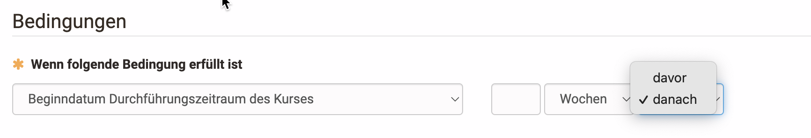{ class="shadow lightbox" title="Edit rules step" }

!!! info "Date"

    The reminder is sent at the next possible sending time on the date (incl. time) entered. If "until date" is used, the reminder is sent at the next possible sending time until the date (and time) is reached. 
    _Example_: 24.06.2021 16:30

!!! info "Time span"

    These conditions are based on how long ago something happened or how far away a certain point in time is.

    _Example_: 5 weeks before the assignment for the group task closes.

    _Example_: 5 days after the participant has accessed the course for the first time.

!!! info "Operators"

    Operators are required for the conditions "Participant is in the course execution number", "Attempts" and "Score" to correctly represent the different states "more than, less than, less or equal, more or equal, equal" and "not equal". They are used to compare expressions with each other and to generate a logical return value depending on this.

    Operator | Description | Explanation
    ---------|----------|---------
    `<` | less than | correct if a is less than b
    `<=`| less or equal | correct if a is less than or equal to b
    `=`| equal | correct if a is equal to b
    `=>`| more or equal | correct if a is greater than or equal to b
    `>`| more | correct if a is greater than b
    `!=`| not equal | correct if a is not equal to b

    In our conditions, in this case for example, the result of a test (a) is compared with the value entered in the condition rule (b). If the logical return value is "True", i.e. the condition is met, the reminder is triggered.

    _Example_: A reminder should be sent when participants have achieved a maximum of 5 points in a test. In OpenOlat, the condition looks like this:
    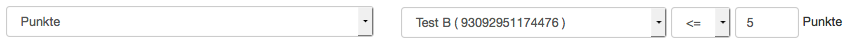{ class="shadow lightbox" title="Edit rules step" }

[To the top of the page ^](#course_reminders)

---

## E-mail text {: #text}

With the help of the e-mail text, which can be customized as needed, you create very specific e-mail reminders tailored to the situation.

!!! tip "Tip"

    Point the mouse at the question mark icon next to "E-mail subject" or "E-mail". OpenOlat then lists the variables that are available in this field.

    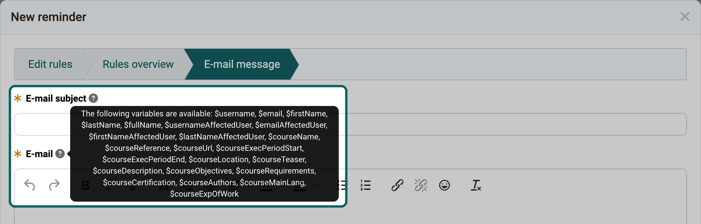{ class="shadow lightbox" title="E-mail message step in the New reminder dialog · 2026.11.06" }

### Variables available in the subject

* **$courseName**: The name of the course as on the info page.
* **$courseAuthors**: The names entered in the course settings, tab "Metadata" under "Authors/Conducted with".
* **$courseExecPeriodStart**: The date specified in the course settings, tab "Execution" as the start of the execution period.
* **$courseExecPeriodEnd**: The date specified in the course settings, tab "Execution" as the end of the execution period.
* **$courseLocation**: The text entered in the course settings, tab "Execution" as the execution location.

### Variables available in the mail text

* **$firstName**: The first name of the recipient.
* **$lastName**: The last name of the recipient.
* **$fullName**: The full name depending on the system configuration. The default value is "last name, first name".
* **$email**: The e-mail address of the recipient.
* **$username**: The username.
* **$courseUrl**: The internet address of the course.
* **$courseName**: The name of the course as on the info page.
* **$courseDescription**: The description of the course as on the info page.
* **$courseAuthors**: The names entered in the course settings, tab "Metadata" under "Authors/Conducted with".
* **$courseCertification**: The description of the certification as specified in the course settings, tab "Info".
* **$courseExecPeriodStart**: The date specified in the course settings, tab "Execution" as the start of the execution period.
* **$courseExecPeriodEnd**: The date specified in the course settings, tab "Execution" as the end of the execution period.
* **$courseExpOfWork**: The estimated amount of time entered as text in the course settings, tab "Metadata" under "Time required".
* **$courseLocation**: The text entered in the course settings, tab "Execution" as the execution location.
* **$courseMainLang**: The language entered in the course settings, tab "Metadata" under "Main language".
* **$courseObjectives**: The text entered as the learning objective description in the course settings, tab "Info".
* **$courseReference**: The text entered in the course settings, tab "Info" under "Identifier".
* **$courseRequirements**: The text entered in the course settings, tab "Info" under "Requirements".
* **$courseTeaser**: The teaser text entered in the course settings, tab "Info".
* **$firstNameAffectedUser**: The first name of the affected person.
* **$lastNameAffectedUser**: The last name of the affected person.
* **$emailAffectedUser**: The e-mail address of the affected person.
* **$usernameAffectedUser**: The username of the affected person.

The affected person is the person for whom all conditions of the reminder are met. If the option "Only to specific recipients" is selected under "To", these variables name the participant concerned, while `$firstName` names the recipient of the e-mail, that is, the owner or the assigned coach. For external e-mail addresses, `$firstName`, `$lastName`, `$fullName`, `$email` and `$username` remain empty. If "According to the rules" is selected, both groups of variables contain the same values, in the copies as well. An example is given in the guide on learning progress, section [Automatic reminders](../../manual_how-to/progress_information/progress_information.md#by_reminders).

Existing reminders with `$recipientFirstName` and `$recipientLastName` continue to work. The two variables return the same values as `$firstNameAffectedUser` and `$lastNameAffectedUser`.

Here is an example:

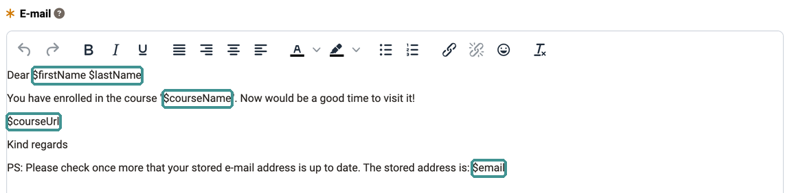{ class="shadow lightbox" title="E-mail message step in the New reminder dialog" }

[To the top of the page ^](#course_reminders)

---

## Recipients {: #recipients}

Reminders are good for reminding **participants** of what they should do next.
A **copy to the coaches and/or course owners** also informs them that participants have something to do.

In some cases, reminders should be sent **exclusively to coaches**.

**Example:** 
Participants show no progress. The coach should then contact these participants and provide assistance. This reminder should only go to the coach. You could, for example, enter as conditions that progress is still below x% and, at the same time, a certain score has not been reached in an entrance test.

Reminders can also be sent **exclusively to course owners**.

**Example:** 
Sometimes authors forget to publish their course because things were still unclear when they last worked on the course creation. In this case, the course status can be used in combination with the role as a dispatch criterion.

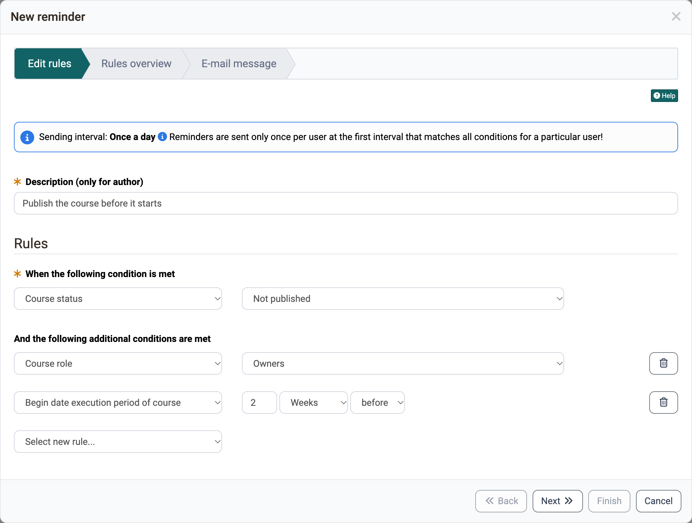{ class="shadow lightbox" title="Edit rules step · 2026.11.06" }

For special cases, reminders can also be sent **exclusively to certain external e-mail addresses**.

[To the top of the page ^](#course_reminders)

---

## Check and edit reminders {: #check_and_edit}

If reminders have already been created, they are listed under `Course > Administration > Reminders`. The text above the list states when OpenOlat will send the reminders next.

The three dots at the end of a row open the action menu of a reminder with "Edit", "Duplicate", "Send reminders now", "Show sent reminders" and "Delete". The three dots next to "Add reminder" offer "Show preview" and "Show sent reminders" for all reminders of the course. For each reminder, the preview lists the persons to whom its conditions currently apply, and the date on which they have already received the reminder.

The list of reminders already sent contains information about the recipients and the sending time. Individual reminders from this list can easily be sent again via the "Resend" link.

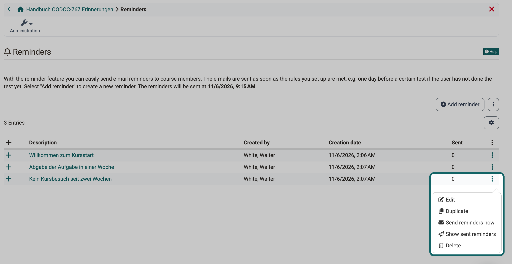{ class="shadow lightbox" title="List of reminders of a course · 2026.11.06" }

New reminders can be created at any time.

If, for example, an individual condition for dispatch is to be removed, you will find the buttons for deleting an individual condition to the right of the respective condition in edit mode.

With "Send reminders now", you trigger a reminder immediately, without waiting for the next sending time. The dialog states for how many course members the reminder will be sent for the first time. "Send first time" sends it only to these persons, "Send to all" also to persons who have already received it. In both cases, the reminder only goes to persons to whom all conditions apply.

[To the top of the page ^](#course_reminders)

---

## Further information {: #further_information}

**Mentioned on this page** 
[Using Group Tools >](../groups/Using_Group_Tools.md) 
[Course Element "Forum" >](Course_Element_Forum.md) 
[User tools: Subscriptions >](../personal_menu/Subscriptions.md) 
[Learning path course - Overview >](Learning_path_course/index.md) 
[How can coaches be informed about the learning progress of course participants? >](../../manual_how-to/progress_information/progress_information.md) 
[Module Course Reminders >](../../manual_admin/administration/Modules_Course_Reminders.md)

**Further reading** 
[User tools: E-Mail >](../personal_menu/E-Mail.md) 
[Course Element "Info messages" >](../learningresources/Course_Element_Notifications.md) 
[Toolbar >](Course_Settings_Toolbar.md)

[To the top of the page ^](#course_reminders)
