# Kurseinstellungen {: #course_settings}

Einstellungen, die den Kurs als Ganzes betreffen, legen Sie fest unter: 
`Kurs > Administration > Einstellungen`

Das Menü "Einstellungen" steht Besitzer:innen des Kurses, Lernressourcenverwalter:innen und Administrator:innen zur Verfügung, ausserdem Personen, denen in der [Mitgliederverwaltung](../Members_management.de.md) das Recht "Kurseditor" erteilt wurde.

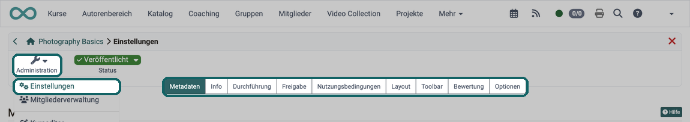{ class="shadow lightbox" title="Menü Administration im Kurs · 2026.10.02" }

:octicons-device-camera-video-24: **Video-Einführung**: [Kursbausteine konfigurieren](<https://www.youtube.com/embed/SAkzzoOQEoQ>){:target="_blank"}

!!! info "Wichtig"

    Jede [Lernressource](../index.de.md) verfügt über ein Menü "Einstellungen", nicht nur Kurse.

    Die Einstellungen von herkömmlichen und [Lernpfadkursen](../Learning_path_course/index.de.md) variieren leicht.

    Über die Tabs "Metadaten", "Info", "Durchführung" und "Freigabe" können Sie Informationen angeben, die auf der [Infoseite des Kurses](../Info_page.de.md) sichtbar werden.

## Steckbrief

Name | Kurseinstellungen
---------|----------
Verfügbar seit | Release 13.0 (OO-3706)

## Tab Metadaten {: #metadata}

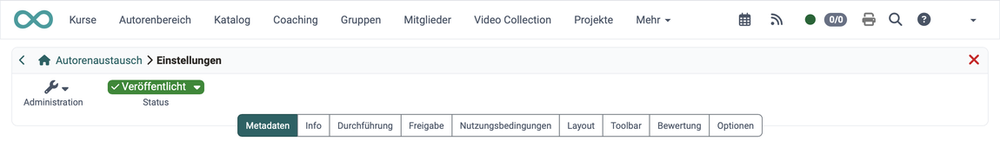{ class="shadow lightbox" title="Tab Metadaten in den Kurseinstellungen · 2026.10.02" }

Metadaten benennen den Kurs und ordnen ihn ein. Anhand der Metadaten kann Ihr Kurs z.B. besser gefunden werden. Pflicht ist nur der Titel.

Nach dem Erstellen, Kopieren oder Importieren einer Lernressource öffnet OpenOlat die Einstellungen auf diesem Tab. So prüfen Sie Titel und Kennzeichen gleich zu Beginn [:octicons-tag-16:{ title="ab Release 21.1 (OO-9775)" }](https://track.frentix.com/issue/OO-9775){:target="_blank"}.

Metadaten eines Kurses sind

* Titel
* Kennzeichen (Eine externe Kennung, die in der Kursübersicht angezeigt wird. Z.B. die Bezeichnung aus dem Vorlesungsverzeichnis oder einem gedruckten Kurskatalog.)
* Typ der Lernressource (in diesem Fall: Kurs)
* Durchführungsformat (Blended Learning, Selbststudium, ...)
* Fachbereiche (aus der Taxonomie)
* Lizenz

[Zu den Details >](../Course_Settings_Metadata.de.md) 
[Mehr über Metadaten >](../../basic_concepts/Search_General/index.de.md#metadata) 
[Zum Seitenanfang ^](#course_settings)

## Tab Info {: #info}

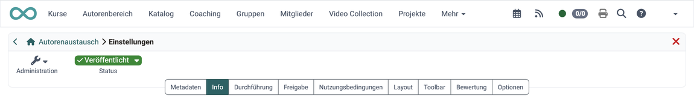{ class="shadow lightbox" title="Tab Info in den Kurseinstellungen · 2026.10.02" }

Hier definieren Sie Informationen über den Kurs bzw. die Lernressource. Dazu zählen: 

* Titelbild und Teaser-Film
* Teaser (Textzeile/Begriff)
* Beschreibung
* Fakten: Autor:innen / Durchführung mit, Hauptsprache und Zeitaufwand
* Anzeigeeinstellungen: welche Abschnitte die Infoseite zeigt
* Erweiterte Informationen: Lernziele, Voraussetzungen und Bescheinigung

Diese Infos sind für Interessierte auch ohne Kurszugang auf der Infoseite sichtbar.

[Mehr über das Einrichten der Infoseite >](../Course_Settings_Info.de.md) 
[Mehr über die Inhalte der Infoseite >](../Info_page.de.md) 
[Zum Seitenanfang ^](#course_settings)

## Tab Durchführung {: #execution}

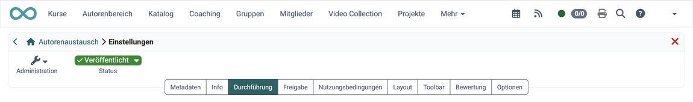{ class="shadow lightbox" title="Tab Durchführung in den Kurseinstellungen · 2026.10.02" }

Hier können Sie

* den Durchführungszeitraum des Kurses festlegen,
* das "[Absenzmanagement](../../area_modules/Absence_Management.de.md)" einschalten und konfigurieren, sofern es in der System-Administration unter `Administration > Module > Termine / Absenzen` eingeschaltet ist,
* einen herkömmlichen Kurs mit "Als Lernpfad duplizieren" als Lernpfadkurs kopieren
* und bei [Lernpfadkursen](../Learning_path_course/index.de.md) festlegen, wie der Lernfortschritt berechnet wird: anhand der Anzahl der Kursbausteine oder anhand der Bearbeitungsdauer der Kursbausteine.

[Zu den Details >](../Course_Settings_Execution.de.md) 
[Zum Seitenanfang ^](#course_settings)

## Tab Freigabe {: #share}

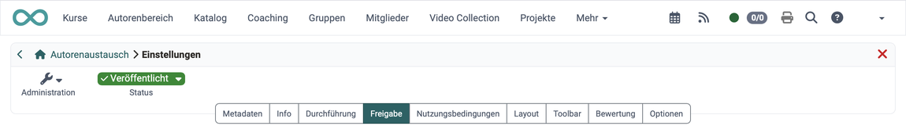{ class="shadow lightbox" title="Tab Freigabe in den Kurseinstellungen · 2026.10.02" }

Im Tab "Freigabe" definieren Sie, wie und für wen ein Kurs oder eine Lernressource freigegeben wird. 

* Ob der Zugang nur für ausgewählte Mitglieder möglich ist, der Kurs selbst gewählt und gebucht werden kann oder der Zugang ganz offen steht 
* Wann Teilnehmer:innen aus dem Kurs austreten können
* Ob ggf. nur administrative Rollen einer bestimmten Organisationseinheit Zugriff erhalten
* Ob und wie andere Autor:innen auf den Kurs zugreifen können
* Ob externe OER-Kataloge und Suchmaschinen Informationen erhalten
* Ob ein Angebot im Katalog zum Kurs gemacht wird und wenn ja, welches
* Ob der Kurs auch von einem anderen LMS aus via LTI genutzt werden kann

[Details zum Tab Freigabe >](../Course_Settings_Share/index.de.md) 
[Mehr zur Freigabe >](../Access_configuration.de.md) 
[Zum Seitenanfang ^](#course_settings)

## Tab Katalog {: #catalog}

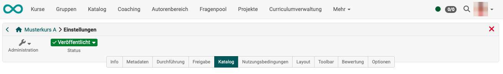{ class="shadow lightbox" title="Tab Katalog in den Kurseinstellungen · 2026.10.02" }

Hier tragen Sie den Kurs in eine oder mehrere Kategorien des Katalogs 1.0 ein. Den Tab sehen Sie nur, wenn der Kurs den Verwendungszweck "Eigenständig" hat und in der System-Administration unter `Administration > Module > Katalog > Tab "Einstellungen"` die Option "Katalog V1" gewählt ist.

[Zu den Details >](../Course_Settings_Catalog.de.md) 
[Zum Seitenanfang ^](#course_settings)

## Tab Nutzungsbedingungen [:octicons-tag-16:{ title="ab Release 15.0 (OO-4455)" }](https://track.frentix.com/issue/OO-4455){:target="_blank"} {: #disclaimer}

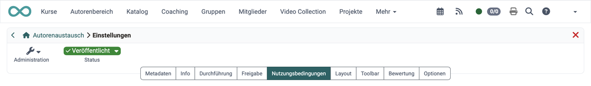{ class="shadow lightbox" title="Tab Nutzungsbedingungen in den Kurseinstellungen · 2026.10.02" }

Hier hinterlegen Sie kursbezogene Nutzungsbedingungen und eine kursbezogene Datenschutzerklärung, denen Personen zustimmen, bevor der Kurs öffnet. Den Tab sehen Sie nur, wenn in der System-Administration unter `Administration > Module > Kurs` die Option "Kursbezogene Nutzungsbedingungen und Datenschutzerklärung" eingeschaltet ist.

[Zu den Details >](../Course_Settings_Disclaimer.de.md) 
[Zum Seitenanfang ^](#course_settings)

## Tab Layout {: #layout}

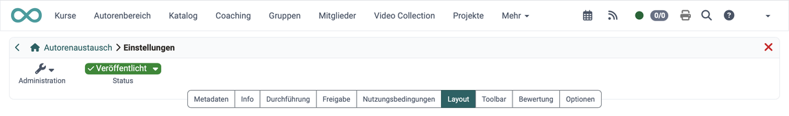{ class="shadow lightbox" title="Tab Layout in den Kurseinstellungen · 2026.10.02" }

Im Tab Layout bestimmen Sie, wie der Kurs aussieht und wie sich Teilnehmende darin bewegen. Hier

* wählen Sie eine Layoutvorlage für den Kurs,
* legen die Kursnavigation fest
* und bestimmen den Stil der Kursbausteine.

Welche Layoutvorlagen zur Auswahl stehen, bestimmt das Systemlayout (Theme), das für Ihre ganze OpenOlat-Instanz gilt. Die Vorlage "Standard" ist immer vorhanden. Ein einheitliches Erscheinungsbild für alle Kurse (Farben, Schriften, Logo) wird deshalb zentral über ein individuelles Systemlayout umgesetzt, siehe [Darstellung](../../../manual_admin/administration/Customizing.de.md#layout). Für einen einzelnen Kurs wählen Sie die Option "Eigene Konfiguration festlegen": Dort legen Sie Schriftart und Farben für Text, Überschriften, Links, Menü und Toolbox fest und laden ein Logo hoch. Darüber hinaus können Sie im [Ablageordner](../Storage_folder.de.md) des Kurses im Ordner "courseCSS" eigene CSS-Dateien hinterlegen, die dann in der Auswahl als "Aus Kursablageordner" erscheinen. Den Ablageordner öffnen Sie unter: 
`Kurs > Administration > Dateien > Ablageordner`

Im Bereich "Navigation" kann die Sichtbarkeit des Menüs und der Krümelnavigation eingestellt werden. In Lernpfadkursen legen Sie zusätzlich fest, ob im Menü die Icons und der Pfad angezeigt werden ("Icons im Menu anzeigen", "Pfad im Menu anzeigen"). Je nach linearem oder flexiblem Szenario bietet sich die eine oder andere Variante an.

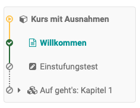{ class="shadow lightbox" title="Kursmenü mit Pfad und Icons" }
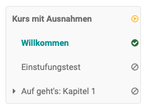{ class="shadow lightbox" title="Kursmenü ohne Pfad und Icons" }

Im Bereich "Standard Stil Kursbausteine" können Sie die Basisdarstellung der Kursbausteine definieren und z.B. ein eigenes Hintergrundbild hochladen oder ein Hintergrundbild aus der Bibliothek wählen, den Stil des Bildes definieren, sowie bei Bedarf eine Farbkategorie zuordnen. In der Vorschau sehen Sie die Auswirkungen.

[Zum Seitenanfang ^](#course_settings)

## Tab Toolbar {: #toolbar}

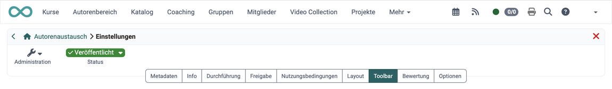{ class="shadow lightbox" title="Tab Toolbar in den Kurseinstellungen · 2026.10.02" }

Hier schalten Sie die Toolbar in der Kopfzeile des Kurses ein oder aus und definieren, welche konkreten einzelnen Werkzeuge in der Toolbar den Kursteilnehmer:innen angezeigt werden.

[Zu den Details >](../Course_Settings_Toolbar.de.md) 
[Zum Seitenanfang ^](#course_settings)

## Tab Bewertung {: #assessment}

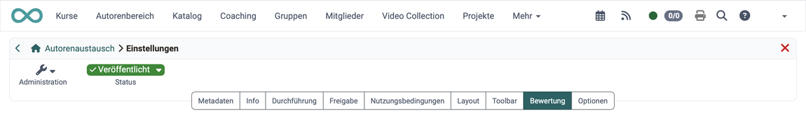{ class="shadow lightbox" title="Tab Bewertung in den Kurseinstellungen · 2026.10.02" }

Im Tab Bewertung können Sie folgende Aspekte aktivieren bzw. konfigurieren:

* Kurs-Bewertung mit Punkten: Summe, Durchschnitt, gewichtet
* Anforderungen für das Bestehen des Kurses 
* die Rolle der Betreuenden im Bewertungsprozess
* Leistungsnachweise aktivieren und konfigurieren
* Kreditpunkte aktivieren und konfigurieren
* Kurs-Zertifikate aktivieren, konfigurieren und auch eine Rezertifizierung einrichten
* die Vergabe von Badges aktivieren

!!! info "Wichtig"

    Bei herkömmlichen Kursen sind im Tab "Bewertung" nur die Einstellungen für Leistungsnachweise, Zertifikate und Badges verfügbar. Die Anforderungen für das Bestehen legen Sie im Kurseditor auf dem obersten Kursbaustein im Tab "Punkte" fest: 
    `Kurs > Administration > Kurseditor > oberster Kursbaustein > Tab "Punkte"`

    Einen Fortschritt gibt es bei herkömmlichen Kursen nicht.

[Zu den Details >](../Course_Settings_Assessment/index.de.md) 
[Zu den Details der Zertifikate >](../Course_Settings_Assessment_Certificate.de.md#certificate) 
[Zu den Details der Rezertifizierung >](../Course_Settings_Assessment_Certificate.de.md#recertification) 
[Zum Seitenanfang ^](#course_settings)

## Tab Optionen {: #options}

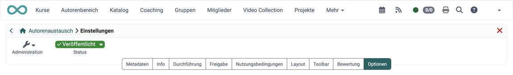{ class="shadow lightbox" title="Tab Optionen in den Kurseinstellungen · 2026.10.02" }

Hier aktivieren Sie je nach Bedarf

* ein kursspezifisches [Glossar](../Glossary_create.de.md#integrate) 
* einen [Ressourcenordner](../index.de.md) zu Ihrem Kurs
* einen speziellen Ordner für Betreuer:innen
* To-dos für Betreuer:innen

Haben Sie eine administrative Rolle (Lernressourcenverwalter:in, Administrator:in), zeigt OpenOlat Ihnen hier weitere Optionen, sofern die zugehörigen Module eingeschaltet sind:

* die Einladung externer Benutzer:innen für Kursbesitzer:innen mit Autorenrecht aktivieren
* die "LTI 1.3"-Freigabe für Kursbesitzer:innen mit Autorenrecht aktivieren

[Details zum Tab Optionen >](../Course_Settings_Options.de.md) 
[Zum Seitenanfang ^](#course_settings)

## Weiterführende Informationen {: #further_information}

[Kurs-Administration: Übersicht >](../Administration/index.de.md) 
[Kurs erstellen >](../Creating_Course.de.md)

[Zum Seitenanfang ^](#course_settings)
