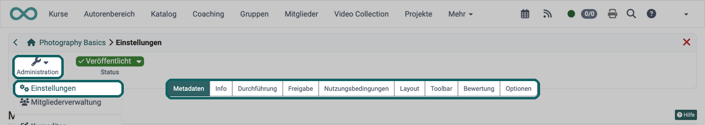

# Kurseinstellungen {: #course_settings}

Einstellungen, die den Kurs als Ganzes betreffen, legen Sie fest unter: 
`Kurs > Administration > Einstellungen`

Das Menü "Einstellungen" steht Besitzer:innen des Kurses, Lernressourcenverwalter:innen und Administrator:innen zur Verfügung, ausserdem Personen, denen in der [Mitgliederverwaltung](../Members_management.de.md) das Recht "Kurseditor" erteilt wurde.

{ class="shadow lightbox" title="Menü Administration im Kurs · 2026.10.02" }

:octicons-device-camera-video-24: **Video-Einführung**: [Kursbausteine konfigurieren](<https://www.youtube.com/embed/SAkzzoOQEoQ>){:target="_blank"}

!!! info "Wichtig"

    Jede [Lernressource](../index.de.md) verfügt über ein Menü "Einstellungen", nicht nur Kurse.

    Die Einstellungen von herkömmlichen und [Lernpfadkursen](../Learning_path_course/index.de.md) variieren leicht.

    Über die Tabs "Metadaten", "Info", "Durchführung" und "Freigabe" können Sie Informationen angeben, die auf der [Infoseite des Kurses](../Info_page.de.md) sichtbar werden.

## Steckbrief

Name | Kurseinstellungen
---------|----------
Verfügbar seit | Release 13.0 (OO-3706)

## Tabs {: #tabs}

Suchen Sie eine Einstellung, sagt Ihnen die Übersicht, in welchem Tab sie liegt, und führt Sie mit dem Link zu seiner Beschreibung. Die Tabelle folgt der Reihenfolge der Tabs. Welche Tabs Sie sehen, hängt von der Art des Kurses und von Einstellungen der System-Administration ab.

| Tab | Wozu |
|---|---|
| [Metadaten](../Course_Settings_Metadata.de.md) | Den Kurs benennen und einordnen, damit er sich finden lässt: Titel, Kennzeichen, Durchführungsformat, Fachbereiche und Lizenz. Pflicht ist nur der Titel. Nach dem Erstellen, Kopieren oder Importieren öffnet OpenOlat die Einstellungen auf diesem Tab. |
| [Info](../Course_Settings_Info.de.md) | Die Angaben für die Infoseite festlegen, die Interessierte auch ohne Kurszugang sehen: Titelbild, Teaser, Beschreibung, Fakten, Lernziele, Voraussetzungen und Bescheinigung. |
| [Durchführung](../Course_Settings_Execution.de.md) | Den Durchführungszeitraum festlegen und das Absenzmanagement einschalten. In Lernpfadkursen legen Sie fest, wie der Lernfortschritt berechnet wird; einen herkömmlichen Kurs kopieren Sie hier als Lernpfadkurs. |
| [Freigabe](../Course_Settings_Share/index.de.md) | Festlegen, wer den Kurs nutzen oder buchen kann, wann Teilnehmende austreten können, ob andere Autor:innen zugreifen und ob ein anderes LMS den Kurs über LTI nutzt. Hier erstellen Sie auch die Angebote für den Katalog. |
| [Katalog](../Course_Settings_Catalog.de.md) | Den Kurs in Kategorien des Katalogs 1.0 eintragen. Den Tab sehen Sie nur in Kursen mit dem Verwendungszweck "Eigenständig" und wenn in der System-Administration die Option "Katalog V1" gewählt ist. |
| [Nutzungsbedingungen](../Course_Settings_Disclaimer.de.md) | Nutzungsbedingungen und eine Datenschutzerklärung hinterlegen, denen Personen zustimmen, bevor der Kurs öffnet. Den Tab sehen Sie nur, wenn in der System-Administration die Option "Kursbezogene Nutzungsbedingungen und Datenschutzerklärung" eingeschaltet ist. |
| [Layout](../Design_possibilities_of_courses_and_course_elements.de.md) | Bestimmen, wie der Kurs aussieht und wie sich Teilnehmende darin bewegen: Layoutvorlage, Kursnavigation und Stil der Kursbausteine. |
| [Toolbar](../Course_Settings_Toolbar.de.md) | Die Toolbar in der Kopfzeile des Kurses ein- oder ausschalten und festlegen, welche Werkzeuge Teilnehmende darin sehen. |
| [Bewertung](../Course_Settings_Assessment/index.de.md) | Punkte, Bestehen, Leistungsnachweise, Kreditpunkte, [Zertifikate und Rezertifizierung](../Course_Settings_Assessment_Certificate.de.md) und die Vergabe von Badges konfigurieren. In herkömmlichen Kursen stehen hier nur Leistungsnachweise, Zertifikate und Badges. |
| [Optionen](../Course_Settings_Options.de.md) | Ein Glossar oder einen Ressourcenordner einbinden und den Ordner "Unterlagen Betreuer:innen" sowie To-dos für Betreuer:innen einschalten. Lernressourcenverwalter:innen und Administrator:innen sehen hier weitere Optionen. |

[Zum Seitenanfang ^](#course_settings)

## Weiterführende Informationen {: #further_information}

[Kurs-Administration: Übersicht >](../Administration/index.de.md) 
[Kurs erstellen >](../Creating_Course.de.md)

[Zum Seitenanfang ^](#course_settings)
