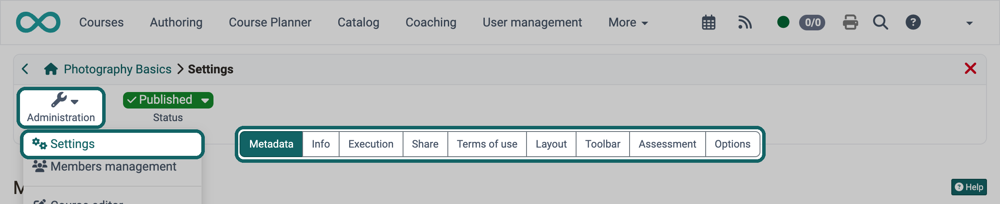

# Course Settings {: #course_settings}

You define the settings that affect the course as a whole under: 
`Course > Administration > Settings`

The "Settings" menu is available to owners of the course, learning resource managers and administrators, and also to persons who have been granted the "Course editor" right in the [Members management](../Members_management.md).

{ class="shadow lightbox" title="Administration menu in the course · 2026.10.29" }

:octicons-device-camera-video-24: **Video introduction (German)**: [Configuring course elements](<https://www.youtube.com/embed/SAkzzoOQEoQ>){:target="_blank"}

!!! info "Important"

    Every [learning resource](../index.md) has a "Settings" menu, not just courses.

    The settings of conventional and [learning path courses](../Learning_path_course/index.md) vary slightly.

    You can use the "Metadata", "Info", "Execution" and "Share" tabs to specify information that will be visible on the [info page of the course](../Info_page.md).

## Profile

Name | Course settings
---------|----------
Available since | Release 13.0 (OO-3706)

## Tabs {: #tabs}

If you are looking for a setting, the overview tells you which tab it is in, and the link takes you to its description. The table follows the order of the tabs. Which tabs you see depends on the type of course and on settings of the system administration.

| Tab | Purpose |
|---|---|
| [Metadata](../Course_Settings_Metadata.md) | Name and classify the course so that it can be found: title, reference, implementation format, subjects and license. Only the title is mandatory. After creating, copying or importing, OpenOlat opens the settings on this tab. |
| [Info](../Course_Settings_Info.md) | Define the information for the info page, which interested parties see even without course access: cover image, teaser, description, facts, objectives, requirements and certification. |
| [Execution](../Course_Settings_Execution.md) | Set the implementation period and switch on absence management. In learning path courses you define how the learning progress is calculated; here you also copy a conventional course as a learning path course. |
| [Share](../Course_Settings_Share/index.md) | Define who can use or book the course, when participants can withdraw, whether other authors have access and whether another LMS uses the course via LTI. Here you also create the offers for the catalog. |
| [Catalog](../Course_Settings_Catalog.md) | Add the course to categories of catalog 1.0. You only see the tab in courses with the usage "Standalone" and if the option "Catalog V1" is selected in the system administration. |
| [Terms of use](../Course_Settings_Disclaimer.md) | Store terms of use and a privacy policy that persons agree to before the course opens. You only see the tab if the option "Course related terms of use and data protection" is switched on in the system administration. |
| [Layout](../Design_possibilities_of_courses_and_course_elements.md) | Determine how the course looks and how participants move through it: layout template, course navigation and style of the course elements. |
| [Toolbar](../Course_Settings_Toolbar.md) | Switch the toolbar in the course header on or off and define which tools participants see in it. |
| [Assessment](../Course_Settings_Assessment/index.md) | Configure points, passing, evidence of achievement, credit points, [certificates and recertification](../Course_Settings_Assessment_Certificate.md) and the award of badges. In conventional courses, only evidence of achievement, certificates and badges are available here. |
| [Options](../Course_Settings_Options.md) | Integrate a glossary or a resource folder and switch on the "Coach files" folder and to-dos for coaches. Learning resource managers and administrators see further options here. |

[To the top of the page ^](#course_settings)

## Further information {: #further_information}

[Course Administration: Overview >](../Administration/index.md) 
[Creating Courses >](../Creating_Course.md)

[To the top of the page ^](#course_settings)
