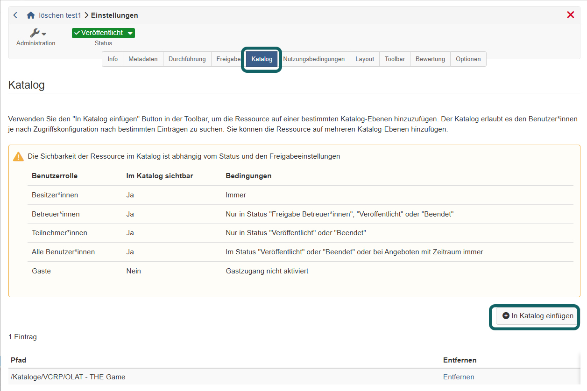

# Kurseinstellungen - Tab Katalog {: #tab_catalog}

Soll Ihr Kurs im Katalog 1.0 erscheinen, tragen Sie ihn im Tab "Katalog" in eine oder mehrere Kategorien ein. Benutzer:innen finden ihn dann in der Struktur, die Katalogverwalter:innen im Katalog angelegt haben, und öffnen von dort seine Infoseite. Den Tab finden Sie unter: 
`Kurs > Administration > Einstellungen > Tab "Katalog"`

Den Tab gibt es nicht nur bei Kursen, sondern bei jeder Lernressource mit dem Menü "Einstellungen", zum Beispiel bei Podcast, Blog oder SCORM 1.2.

{ class="shadow lightbox" title="Tab Katalog in den Kurseinstellungen" }

## Wann der Tab erscheint {: #requirements}

Den Tab "Katalog" sehen Sie, wenn beide Bedingungen erfüllt sind:

* **Katalog 1.0 eingeschaltet:** In der System-Administration ist unter `Administration > Module > Katalog > Tab "Einstellungen"` die Option "Katalog V1" gewählt. Welche Katalogversion gilt, legt die Administration Ihrer OpenOlat-Instanz fest.
* **Verwendungszweck "Eigenständig":** Die Lernressource hat im [Tab "Freigabe"](Course_Settings_Share/index.de.md#section_usage) den Verwendungszweck "Eigenständig". Bei einem anderen Verwendungszweck fehlt der Tab.

Ist der Katalog 2.0 eingeschaltet, gibt es diesen Tab nicht. Ein Kurs erscheint dort, sobald er im Tab "Freigabe" ein [Angebot](Course_Settings_Share/index.de.md#section_offer) hat.

[Zum Seitenanfang ^](#tab_catalog)

## Kurs in den Katalog eintragen {: #add_to_catalog}

Mit dem Button "In Katalog einfügen" wählen Sie eine Kategorie des Katalogs. Für jede weitere Kategorie wiederholen Sie diesen Schritt. Alle Einträge stehen danach in der Tabelle mit ihrem "Pfad" im Katalog. Mit "Entfernen" nehmen Sie den Kurs aus einer Kategorie wieder heraus.

Über der Tabelle zeigt ein Hinweis, welche Rolle den Kurs im Katalog sieht. Das hängt vom Status des Kurses und von den Einstellungen im Tab "Freigabe" ab. Die Übersicht dazu steht auf der Seite [Katalog 1.0](../area_modules/catalog1.0.de.md).

Tragen Sie den Kurs erst ein, wenn er fertig ist und Benutzer:innen ihn sehen sollen.

[Zum Seitenanfang ^](#tab_catalog)

## Weiterführende Informationen {: #further_information}

**Auf dieser Seite erwähnt** 
[Kurseinstellungen - Tab Freigabe >](Course_Settings_Share/index.de.md) 
[Katalog 1.0 >](../area_modules/catalog1.0.de.md)

**Weiterführend** 
[Kurseinstellungen >](Course_Settings/index.de.md) 
[Katalog 2.0: Übersicht >](../area_modules/catalog2.0/index.de.md) 
[Modul Katalog >](../../manual_admin/administration/Modules_Catalog_2.0.de.md)

[Zum Seitenanfang ^](#tab_catalog)
