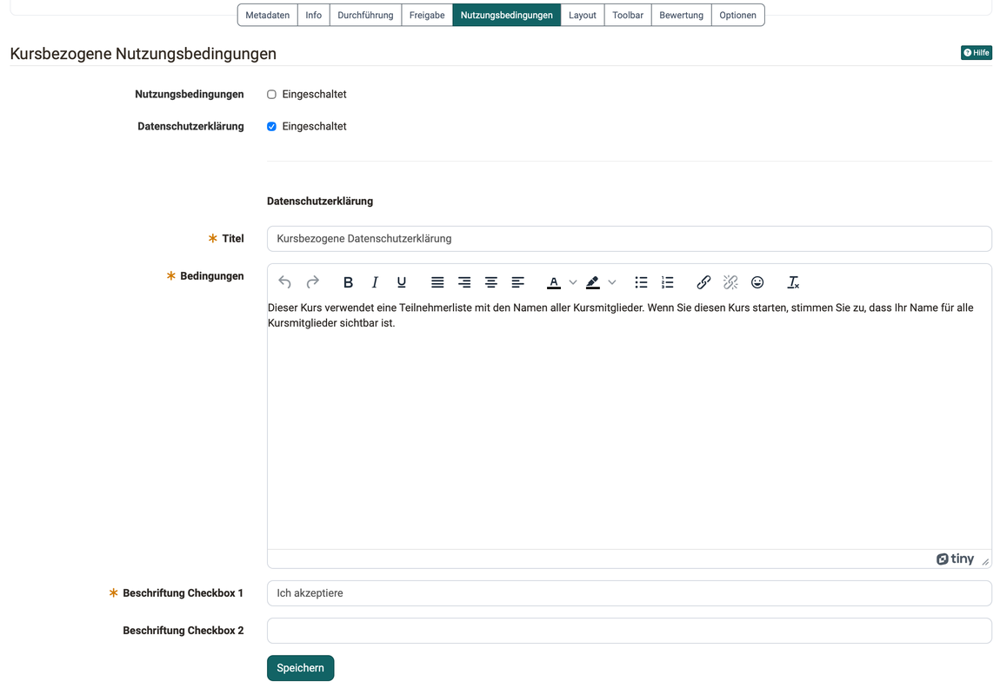

# Kurseinstellungen - Tab Nutzungsbedingungen {: #tab_disclaimer}

Müssen Personen vor dem ersten Kursbesuch Regeln zustimmen, etwa zur Nutzung der Inhalte oder zur Sichtbarkeit ihres Namens, hinterlegen Sie diese im Tab "Nutzungsbedingungen". Wer den Kurs startet, liest die Texte und bestätigt sie, bevor der Kurs öffnet. In der Mitgliederverwaltung sehen Sie, wer eingewilligt hat. Den Tab finden Sie unter: 
`Kurs > Administration > Einstellungen > Tab "Nutzungsbedingungen"`

## Wann der Tab erscheint {: #requirements}

Den Tab gibt es nur bei Kursen. Sie sehen ihn, wenn in der System-Administration die Option "Kursbezogene Nutzungsbedingungen und Datenschutzerklärung" eingeschaltet ist, unter `Administration > Module > Kurs` ([Modul Kurs](../../manual_admin/administration/Modules_Course.de.md#enable_course_option)). Fehlt der Tab, wenden Sie sich an die Administration Ihrer OpenOlat-Instanz.

[Zum Seitenanfang ^](#tab_disclaimer)

## Nutzungsbedingungen und Datenschutzerklärung einrichten [:octicons-tag-16:{ title="ab Release 15.0 (OO-4455)" }](https://track.frentix.com/issue/OO-4455){:target="_blank"} {: #setup}

Im Tab schalten Sie zwei Texte unabhängig voneinander ein: "Nutzungsbedingungen" und "Datenschutzerklärung". Für jeden eingeschalteten Text erfassen Sie:

* **Titel:** die Überschrift, unter der Teilnehmende den Text lesen.
* **Bedingungen:** den Text selbst.
* **Beschriftung Checkbox 1:** den Satz, den Teilnehmende ankreuzen, zum Beispiel "Ich akzeptiere".
* **Beschriftung Checkbox 2:** optional einen zweiten Satz, den Teilnehmende ebenfalls ankreuzen.

{ class="shadow lightbox" title="Formular Kursbezogene Nutzungsbedingungen · 2026.10.02" }

Startet eine Person den Kurs, zeigt OpenOlat zuerst die eingeschalteten Texte. Mit "Akzeptieren" öffnet sich der Kurs. Mit "Ablehnen" bleibt der Kurs geschlossen.

Nach der Zustimmung lesen Teilnehmende die Texte jederzeit wieder im Menü "Mein Kurs" unter "Einwilligung". Dort widerrufen sie ihre Einwilligung auch.

[Zum Seitenanfang ^](#tab_disclaimer)

## Texte ändern oder ausschalten {: #change}

Ändern Sie einen Text, nachdem schon Personen eingewilligt haben, fragt OpenOlat im Dialog "Veränderte Konfiguration", ob alle bestehenden Einwilligungen widerrufen werden. So stimmen alle der neuen Fassung erneut zu, bevor sie den Kurs wieder betreten.

Schalten Sie beide Texte aus, fragt OpenOlat, ob die bestehenden Einwilligungen gelöscht werden.

[Zum Seitenanfang ^](#tab_disclaimer)

## Einwilligungen einsehen {: #consents}

Welche Personen die Bedingungen akzeptiert haben, sehen Sie in der Mitgliederverwaltung im Bereich "Einwilligungen": 
`Kurs > Administration > Mitgliederverwaltung > Einwilligungen`

Dort widerrufen oder löschen Sie einzelne Einwilligungen, siehe [Mitgliederverwaltung](Members_management.de.md#consent).

[Zum Seitenanfang ^](#tab_disclaimer)

## Weiterführende Informationen {: #further_information}

**Auf dieser Seite erwähnt** 
[Modul Kurs >](../../manual_admin/administration/Modules_Course.de.md) 
[Mitgliederverwaltung >](Members_management.de.md)

**Weiterführend** 
[Kurseinstellungen >](Course_Settings/index.de.md) 
[Nutzungsbedingungen >](../basic_concepts/Terms_Of_Use.de.md)

[Zum Seitenanfang ^](#tab_disclaimer)
