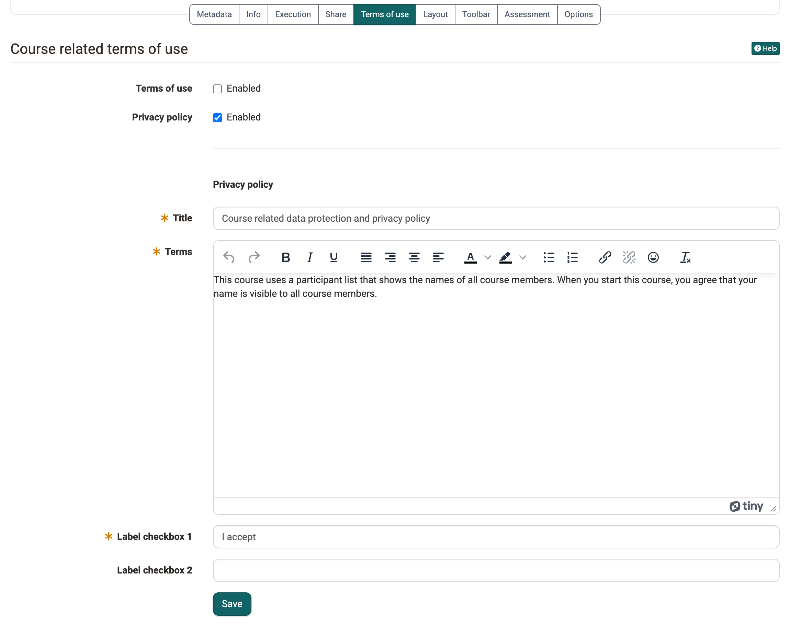

# Course Settings - Tab Terms of use {: #tab_disclaimer}

If persons have to agree to rules before their first visit to the course, for example on the use of the content or on the visibility of their name, you store these rules in the "Terms of use" tab. Whoever starts the course reads the texts and confirms them before the course opens. In the members management you see who has consented. You find the tab under: 
`Course > Administration > Settings > Tab "Terms of use"`

## When the tab appears {: #requirements}

The tab only exists for courses. You see it if the option "Course related terms of use and data protection" is switched on in the system administration, under `Administration > Modules > Course` ([Module Course](../../manual_admin/administration/Modules_Course.md#enable_course_option)). If the tab is missing, contact the administration of your OpenOlat instance.

[To the top of the page ^](#tab_disclaimer)

## Set up terms of use and privacy policy [:octicons-tag-16:{ title="from Release 15.0 (OO-4455)" }](https://track.frentix.com/issue/OO-4455){:target="_blank"} {: #setup}

In the tab you switch on two texts independently of each other: "Terms of use" and "Privacy policy". For each text you switch on, you enter:

* **Title:** the heading under which participants read the text.
* **Terms:** the text itself.
* **Label checkbox 1:** the sentence that participants tick, for example "I accept".
* **Label checkbox 2:** optionally a second sentence that participants also tick.

{ class="shadow lightbox" title="Form Course related terms of use · 2026.10.29" }

When a person starts the course, OpenOlat first shows the texts that are switched on. With "Accept" the course opens. With "Deny" the course stays closed.

After consenting, participants can read the texts again at any time in the "My course" menu under "Consent". There they also withdraw their consent.

[To the top of the page ^](#tab_disclaimer)

## Change or switch off the texts {: #change}

If you change a text after persons have already consented, OpenOlat asks in the dialog "Updated configuration" whether all existing consents are revoked. This way, everyone agrees to the new version again before entering the course again.

If you switch off both texts, OpenOlat asks whether the existing consents are deleted.

[To the top of the page ^](#tab_disclaimer)

## View consents {: #consents}

You see which persons have accepted the conditions in the members management in the "Consents" area: 
`Course > Administration > Members management > Consents`

There you revoke or delete individual consents, see [Members management](Members_management.md#consent).

[To the top of the page ^](#tab_disclaimer)

## Further information {: #further_information}

**Mentioned on this page** 
[Module Course >](../../manual_admin/administration/Modules_Course.md) 
[Members management >](Members_management.md)

**Further reading** 
[Course Settings >](Course_Settings/index.md) 
[Terms of Use >](../basic_concepts/Terms_Of_Use.md)

[To the top of the page ^](#tab_disclaimer)
