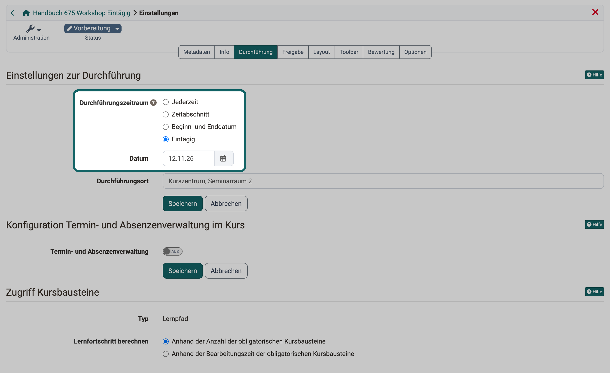

# Kurseinstellungen - Tab Durchführung {: #tab_execution}

Im Tab "Durchführung" legen Sie fest, wann und wo ein Kurs stattfindet, ob er Termine und Absenzen verwaltet und wie OpenOlat den Lernfortschritt berechnet. Den Tab gibt es nur bei Kursen, nicht bei anderen Lernressourcen. Sie finden ihn unter: 
`Kurs > Administration > Einstellungen > Tab "Durchführung"`

{ class="shadow lightbox" title="Tab Durchführung in den Einstellungen eines Kurses · 2026.10.21" }

## Einstellungen zur Durchführung {: #config_execution}

#### Durchführungszeitraum {: #execution_period }

Mit dem Durchführungszeitraum legen Sie fest, wann der Kurs stattfindet. Teilnehmende sehen ihn auf der Infoseite, und zeitabhängige Funktionen wie Erinnerungen rechnen mit seinen Daten. Für den Durchführungszeitraum stehen vier Optionen zur Wahl:

* **Jederzeit**: Der Kurs ist an keinen Zeitraum gebunden. Die Infoseite zeigt keinen Durchführungszeitraum, und zeitabhängige Funktionen haben keinen Bezugspunkt.

* **Zeitabschnitt**: Sie wählen einen vordefinierten Zeitabschnitt, zum Beispiel ein Semester, siehe den Abschnitt [Zeitabschnitt](#lifecycle). Die Option erscheint nur, wenn die Administration das Modul "Zeitabschnitte" eingeschaltet hat.

* **Beginn- und Enddatum**: Im Feld "Zeitraum" tragen Sie das Beginn- und das Enddatum des Kurses ein. Der Endtag gehört zum Zeitraum. Bleibt eines der beiden Daten leer, zeigt die Infoseite "Ab" mit dem Beginndatum oder "Bis" mit dem Enddatum.

* **Eintägig** [:octicons-tag-16:{ title="ab Release 21.1.0 (OO-9807)" }](https://track.frentix.com/issue/OO-9807){:target="_blank"}: Für Kurse, die an einem einzigen Tag stattfinden. Im Feld "Datum" tragen Sie nur diesen Tag ein. OpenOlat setzt Beginn und Ende auf diesen Tag, damit Erinnerungen und der Kurs-Lebenszyklus ein Enddatum haben. Die Infoseite zeigt nur dieses Datum. Fallen Beginn und Ende eines Kurses auf denselben Tag, ist beim nächsten Öffnen der Einstellungen "Eintägig" gewählt.

Der gewählte Durchführungszeitraum erscheint auf der Infoseite des Kurses unter "Fakten". 

Dieselben Optionen bietet OpenOlat beim [Erstellen eines Kurses](Creating_Course.de.md) an, auch beim Erstellen aus einem Template, ausserdem im Assistenten ["Kopieren mit Wizard"](Course_Copy_Wizard.de.md) und für mehrere Kurse gleichzeitig in der Sammelaktion ["Metadaten und Einstellungen"](../area_modules/Authoring_BulkActions.de.md#metadata_settings) des Autorenbereichs. Welche Option beim Erstellen eines Kurses vorgewählt ist, legt die Administration fest, siehe [Modul Kurs](../../manual_admin/administration/Modules_Course.de.md#execution_period).

!!! info "Wichtig"

    Diese Einstellung ist nicht zu verwechseln mit dem Kursstatus und hat auch keine Auswirkungen auf die Sichtbarkeit oder den Zugang der Kursmitglieder. 

Auf andere Funktionen im Kurs wirkt der Durchführungszeitraum dagegen:

Wird "Beginn- und Enddatum" oder "Eintägig" gewählt, gelten die hier eingetragenen Daten auch für verschiedene zeitabhängige Funktionen im Kurs, zum Beispiel für Erinnerungen oder im Aufgabenbaustein beim automatischen Einziehen von Aufgaben. Bei "Eintägig" ist der Kurstag zugleich Beginn und Ende. 

Das Enddatum des Durchführungszeitraums steuert auch den Kurs-Lebenszyklus. Was nach dem Enddatum geschieht, legen die OpenOlat-Administrator:innen fest. Zum Beispiel kann OpenOlat den Kurs 2 Tage nach dem Enddatum auf "Beendet" setzen oder ihn 4 Wochen danach löschen. Erkundigen Sie sich am besten, welche Einstellungen in Ihrer OpenOlat-Instanz für den Kurs-Lebenszyklus gelten. Die Konfiguration beschreibt das Administrationshandbuch unter [Automatischer Kurs-Lebenszyklus](../../manual_admin/administration/Automatic_Course_Lifecycle.de.md).

In herkömmlichen Kursen wird bei der Berechnung von "Bestanden" berücksichtigt, ob das Ergebnis innerhalb des Durchführungszeitraums erreicht wurde. Wird bis zum Ende des Endtags (23:59 Uhr) kein "Bestanden" erzielt, erscheint automatisch "Nicht bestanden".

!!! note "Hinweis"

    Beim Einsatz des Kurs-Lebenszyklus wird der Kursstatus durch das Enddatum gesteuert.

#### Zeitabschnitt {: #lifecycle }

Plant Ihre Organisation in festen Zeitabschnitten wie Semestern, ordnen Sie den Kurs einem dieser Zeitabschnitte zu, statt Daten einzutragen. Wählen Sie dazu beim Durchführungszeitraum "Zeitabschnitt" und darunter im Feld "Zeitabschnitt" einen Eintrag. Zur Wahl stehen laufende und künftige Zeitabschnitte, die Administrator:innen in der System-Administration angelegt haben: `Administration > Module > Zeitabschnitte`, beschrieben unter [Modul Zeitabschnitte](../../manual_admin/administration/Modules_Time_Period.de.md).

Der Zeitabschnitt erscheint auf der Infoseite des Kurses unter "Fakten". Er ist unabhängig vom Kursstatus und von der [Zugangskonfiguration](../learningresources/Access_configuration.de.md) und hat keine Auswirkung auf die Sichtbarkeit und den Zugang für die Kursmitglieder.

#### Durchführungsort {: #execution_location }

Findet der Kurs ganz oder teilweise vor Ort statt, etwa bei einem Blended-Learning-Angebot, tragen Sie im Feld "Durchführungsort" ein, wo das ist. So wissen die Teilnehmenden, wohin sie kommen. Bei einem reinen Online-Kurs bleibt das Feld leer, oder Sie tragen "online" ein. Der Eintrag erscheint auf der Infoseite unter "Fakten" als "Ort".

[Zum Seitenanfang ^](#tab_execution)

---

## Konfiguration Termin- und Absenzenverwaltung im Kurs {: #config_event_and_absence_management} [:octicons-tag-16:{ title="ab Release 12.0 (OO-2636)" }](https://track.frentix.com/issue/OO-2636)

Wollen Sie im Kurs Termine planen und Anwesenheiten erfassen, schalten Sie hier die Termin- und Absenzenverwaltung ein und legen fest, wie OpenOlat Anwesenheit und Absenzen zählt. Diesen Abschnitt bearbeiten **Kursbesitzer:innen**. Betreuer:innen erreichen ihn nicht; sie finden das Werkzeug "Termine" in der Kurs-Werkzeugleiste.

#### Termin- und Absenzenverwaltung {: #lecture_enabled }

Dieser Schalter steht zur Verfügung, wenn das Modul "Termine und Absenzen" [systemweit aktiviert](../../manual_admin/administration/Modules_Events_and_Absences.de.md) ist. Ohne aktiviertes Modul fehlt der ganze Abschnitt "Konfiguration Termin- und Absenzenverwaltung im Kurs" im Tab "Durchführung".

Den Schalter müssen Sie nicht in jedem Fall selbst setzen. In drei Fällen schaltet OpenOlat die Termin- und Absenzenverwaltung ein, falls sie noch ausgeschaltet ist:

- ein Termin wird mit "Termin hinzufügen" für diesen Kurs erstellt, zum Beispiel im Course Planner,
- ein Termin dieses Kurses wird im Course Planner im Tab "Termine" eines Produkts bearbeitet und gespeichert,
- ein Element im Course Planner erhält diesen Kurs als ersten Kurs, und seine bestehenden Termine werden dabei dem Kurs zugeordnet.

In den folgenden Fällen bleibt der Schalter unverändert:

- Termine werden über "Termine importieren" oder über den [Import-Assistenten des Course Planners](../area_modules/Course_Planner_Import_Export.de.md#import_wizard) angelegt,
- ein Termin wird im Tab "Termine" einer Durchführung bearbeitet und gespeichert oder kopiert.

Schalten Sie die Termin- und Absenzenverwaltung in diesen Fällen von Hand ein.

Eingeschaltet wird nur der Schalter selbst; die übrigen Einstellungen dieses Abschnitts behalten ihre Vorgabewerte. Ausgeschaltet wird die Termin- und Absenzenverwaltung nur von Hand, auch dann, wenn alle Termine des Kurses gelöscht sind. Verwaltet ein externes System die Konfiguration der Termine und Absenzen dieses Kurses, ist der Schalter ausgegraut und OpenOlat ändert ihn nicht. [:octicons-tag-16:{ title="ab Release 21.1.0 (OO-9711)" }](https://track.frentix.com/issue/OO-9711){:target="_blank"}

Ist die Termin- und Absenzenverwaltung für den aktuellen Kurs eingeschaltet, erscheinen die übrigen Einstellungen dieses Abschnitts. Die Felder "Vorlaufzeit", "Nachlaufzeit" und "Erlaubte IP-Adressen" kommen erst dazu, wenn "Termin kann als Prüfung markiert werden" eingeschaltet ist. Das Feld "Safe Exam Browser Key" erscheint zusätzlich nur bei der Safe-Exam-Browser-Art "Mit manuellen Keys" (siehe [Safe Exam Browser Key](#seb_key)).

Ausserdem erscheint in der Kurs-Administration das Menü "Termine und Absenzen". Dort erfassen Sie als Kursbesitzer:in Termine und Absenzen, sobald die Konfiguration fertig ist: 
`Kurs > Administration > Termine und Absenzen`

!!! note "Hinweis"

    Im Unterschied zu Besitzer:innen finden **Betreuer:innen** das Tool zum Erfassen in der Werkzeugleiste. 
    **Teilnehmer:innen** finden ihre Absenzen im [persönlichen Menü](../personal_menu/Absences.de.md).

#### Standardkonfiguration überschreiben {: #config_override }

Soll dieser Kurs anders arbeiten als die Vorgabe der Administration, setzen Sie "Standardkonfiguration überschreiben" auf "Ja". Die Checkboxen und Eingabefelder darunter werden dann bearbeitbar, und Sie konfigurieren die Termin- und Absenzenverwaltung für diesen Kurs.

Steht die Option auf "Nein", gilt die Voreinstellung der Administration. Die Checkboxen und Eingabefelder darunter bleiben inaktiv und zeigen den voreingestellten Wert. Die voreingestellten Funktionen wirken im Kurs trotzdem.

Ob Sie das Überschreiben überhaupt einschalten können, legen Administrator:innen in der System-Administration mit der Einstellung "Standardkonfiguration" fest: `Administration > Module > Termine / Absenzen`, Tab "Konfiguration", Abschnitt "Konfiguration auf Kursebene". Bei der Auswahlkarte "Überschreibbar" können Sie diesen Punkt frei wählen. Bei "Schreibgeschützt" bleibt er auf "Nein" und ist ausgegraut, sofern das Überschreiben in diesem Kurs nicht schon vorher eingeschaltet war.

!!! note "Sie können die Einstellungen in Ihrem Kurs nicht bearbeiten?"

    Ausgegraute Felder haben zwei mögliche Ursachen. Schauen Sie auf das Feld "Standardkonfiguration überschreiben" selbst:

    - **Es ist anklickbar und steht auf "Nein"**: Setzen Sie es auf "Ja", dann werden die Felder darunter editierbar.
    - **Es ist selbst ausgegraut**: Die Administration hat "Standardkonfiguration" auf "Schreibgeschützt" gesetzt. Für eine Freigabe wenden Sie sich an die OpenOlat-Administration.

    In beiden Fällen sind die angezeigten Vorgabewerte der Administration im Kurs wirksam.

#### Anwesenheitskontrolle einschalten {: #roll_call_enabled }

Wollen Sie bei den Terminen festhalten, wer anwesend war, schalten Sie die Anwesenheitskontrolle ein. Danach erscheinen zusätzlich "Anwesenheitsquote berechnen" und "Absenzenquote global in %".

#### Anwesenheitsquote berechnen {: #attendance_rate_calculation }

Die Anwesenheitsquote wird berechnet aus Terminen mit mehreren Einheiten und den Absenzen.

**Beispiel:** 
Ein Termin besteht aus 10 Einheiten. An einer der Einheiten war der/die Teilnehmer:in abwesend. 
=> Es ergibt sich eine Anwesenheitsquote von 90%.

#### Absenzenquote global in % {: #global_absence_rate }

Über alle Termine des Kurses berechnet OpenOlat für alle Teilnehmer:innen je eine globale Anwesenheitsquote und zeigt sie im persönlichen Menü unter "Absenzen". Die hier eingetragene Absenzenquote ist der Massstab, an dem OpenOlat diese Anwesenheitsquote beurteilt.

#### Dozentenkalender synchronisieren {: #teacher_calendar_sync }

Ist die Option gewählt, trägt OpenOlat die Termine des Kurses in den persönlichen Kalender der Dozent:innen ein. Gemeint sind die Termine, bei denen Absenzen erfasst werden.

#### Kurs Kalender synchronisieren {: #course_calendar_sync }

Ist die Option gewählt, trägt OpenOlat die Termine, bei denen Absenzen erfasst werden, in den Kurskalender ein. Ohne die Option fehlen sie dort, die übrigen Einträge des Kurskalenders bleiben.

#### Termin kann als Prüfung markiert werden {: #event_as_exam }

Das Hilfe-Symbol neben der Option zeigt den Text "Wenn diese Option aktiviert ist, kann der Termin als 'Prüfung' markiert werden. Ein markierter Termin wird im Prüfungsmodus durchgeführt, optional mit SEB."

Ist die Option eingeschaltet, steht bei Terminen im 3-Punkte-Menü "Als Prüfung markieren" zur Wahl. Wer einen Termin so markiert, erstellt dazu einen Prüfungsmodus. Ausserdem erscheinen die nachfolgenden Felder "Vorlaufzeit", "Nachlaufzeit", "Erlaubte IP-Adressen" und "Safe Exam Browser Key" mit den kursweiten Vorgabewerten für diese Prüfungsmodi. Die Vorgabewerte werden beim Markieren übernommen; bereits erstellte Prüfungsmodi bleiben bei späteren Änderungen unverändert.

Die Option erscheint nur, wenn der Prüfungsmodus systemweit eingeschaltet ist. Zum Ändern der Option im Kurs ist "Standardkonfiguration überschreiben" auf "Ja" nötig. Steht das Überschreiben auf "Nein" und ist die Option in der System-Administration eingeschaltet, erscheint dieses Feld angehakt und inaktiv, und "Als Prüfung markieren" arbeitet mit den Vorgabewerten der Administration.

#### Vorlaufzeit {: #lead_time }

Die Vorlaufzeit bezieht sich auf "Termin kann als Prüfung markiert werden". 
Wenn Betreuer:innen oder Besitzer:innen einen Termin "als Prüfung markieren", wird ein Prüfungsmodus mit dieser Vorgabe erstellt. (Alle so erstellten Prüfungsmodi des Kurses haben die gleiche Vorlaufzeit.)

#### Nachlaufzeit {: #followup_time }

Die Nachlaufzeit bezieht sich auf "Termin kann als Prüfung markiert werden". 
Wenn Betreuer:innen oder Besitzer:innen einen Termin "als Prüfung markieren", wird ein Prüfungsmodus mit dieser Vorgabe erstellt. (Alle so erstellten Prüfungsmodi des Kurses haben die gleiche Nachlaufzeit.)

#### Erlaubte IP-Adressen {: #admissible_ips }

Auch diese Angabe bezieht sich auf "Termin kann als Prüfung markiert werden". 
Die hier erfassten IP-Adressen werden in den Prüfungsmodus übernommen, wenn ein Termin "als Prüfung markiert" wird.

#### Safe Exam Browser Key {: #seb_key }

Dieses Feld ist der kursweite Vorgabewert für die Art "Mit manuellen Keys". Der hinterlegte Key wird übernommen, wenn ein Termin "als Prüfung markiert" wird und im Prüfungsmodus des Termins der Schalter "Safe Exam Browser verwenden" eingeschaltet ist. Dort wird der Key zur Information angezeigt und nicht bearbeitet.

Das Feld erscheint nur, wenn die Administration bei "Safe Exam Browser - Art der Benutzung" die Art "Mit manuellen Keys" gewählt hat. Diese Art gilt für alle Kurse und lässt sich im Kurs nicht überschreiben. Sie finden die Einstellung in der System-Administration unter: 
`Administration > Module > Termine / Absenzen`, Tab "Konfiguration".

Bleibt das Feld bei zugelassenem Überschreiben leer, erhalten die Prüfungsmodi dieses Kurses keinen Key; der Key aus der Administration wird in diesem Fall nicht verwendet.

Ist "Aus Vorlage (empfohlen)" aktiv, wird der Safe Exam Browser pro Prüfung über [Konfigurationsvorlagen](../learningresources/Assessment_mode.de.md) konfiguriert und dieses Feld wird nicht angezeigt. Beim Markieren als Prüfung steht im Prüfungsmodus des Termins das Feld "Konfiguration" mit den aktiven Vorlagen zur Verfügung, wobei die Standardvorlage vorausgewählt ist. Ob die Konfigurationsdatei heruntergeladen werden kann, legt in diesem Fall die Administration fest.

Prüfungsmodi, die direkt über die [Prüfungsverwaltung](../learningresources/Assessment_mode.de.md) erstellt werden, verwenden diesen kursweiten Key nicht. Dort wird die Art pro Prüfungsmodus im Feld "SEB-Konfiguration" gewählt.

[Zum Seitenanfang ^](#tab_execution)

---

## Zugriff Kursbausteine {: #access_course_elements}

#### Typ {: #course_type }

Hier sehen Sie, ob der Kurs ein Lernpfadkurs oder ein herkömmlicher (klassischer) Kurs ist.

Wollen Sie einen herkömmlichen Kurs als Lernpfadkurs weiterführen, klicken Sie hier auf "Als Lernpfad duplizieren". OpenOlat erstellt dann eine Kopie als Lernpfadkurs, der ursprüngliche Kurs bleibt als herkömmlicher Kurs erhalten.

#### Lernfortschritt berechnen {: #learning_progress }

Der Lernfortschritt zeigt Teilnehmenden, wie weit sie im Lernpfadkurs sind. Sie wählen, worauf er beruht: "Anhand der Anzahl der obligatorischen Kursbausteine" oder "Anhand der Bearbeitungszeit der obligatorischen Kursbausteine". Freiwillige Kursbausteine zählen in beiden Fällen nicht.

Wählen Sie die Bearbeitungszeit, braucht jeder obligatorische Kursbaustein eine Bearbeitungszeit. OpenOlat fragt deshalb nach einem Anfangswert und trägt ihn bei allen Kursbausteinen ein, die noch keine Bearbeitungszeit haben. Die einzelnen Werte passen Sie danach im Kurseditor an.

Herkömmliche Kurse haben die Option "Lernfortschritt berechnen" nicht.

[Zum Seitenanfang ^](#tab_execution)

---

## Weiterführende Informationen {: #further_information}

**Auf dieser Seite erwähnt** 
[Kurs erstellen >](Creating_Course.de.md) 
[Kopieren eines Kurses mit Wizard >](Course_Copy_Wizard.de.md) 
[Autorenbereich - Sammelaktionen >](../area_modules/Authoring_BulkActions.de.md) 
[Modul Kurs >](../../manual_admin/administration/Modules_Course.de.md) 
[Automatischer Kurs-Lebenszyklus >](../../manual_admin/administration/Automatic_Course_Lifecycle.de.md) 
[Modul Zeitabschnitte >](../../manual_admin/administration/Modules_Time_Period.de.md) 
[Zugangskonfiguration / Freigabe >](../learningresources/Access_configuration.de.md) 
[Modul Termine und Absenzen >](../../manual_admin/administration/Modules_Events_and_Absences.de.md) 
[Course Planner: Import / Export >](../area_modules/Course_Planner_Import_Export.de.md) 
[Persönliche Werkzeuge: Absenzen >](../personal_menu/Absences.de.md) 
[Prüfungsverwaltung: Prüfungsmodus >](../learningresources/Assessment_mode.de.md)

**Weiterführend** 
[Basiskonzept Termine und Absenzen >](../basic_concepts/Events_and_Absences.de.md) 
[Termine und Absenzen >](../learningresources/Events_and_absences.de.md) 
[Toolbar: Termine >](../learningresources/Toolbar_Events.de.md) 
[Coaching - Übersicht >](../area_modules/Coaching.de.md) 
[Absenzenverwaltung >](../area_modules/Absence_Management.de.md)

[Zum Seitenanfang ^](#tab_execution)

