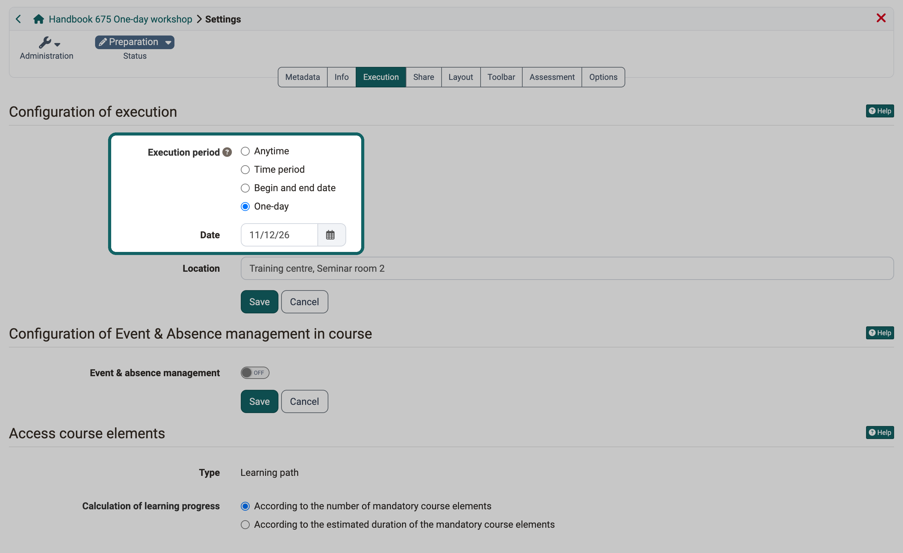

# Course Settings - Tab Execution {: #tab_execution}

In the "Execution" tab, you specify when and where a course takes place, whether it manages events and absences, and how OpenOlat calculates the learning progress. Only courses have this tab, other learning resources do not. You find it under: 
`Course > Administration > Settings > Tab "Execution"`

{ class="shadow lightbox" title="Tab Execution in the settings of a course · 2026.10.21" }

## Configuration of execution {: #config_execution}

#### Execution period {: #execution_period }

With the execution period, you specify when the course takes place. Participants see it on the info page, and time-dependent functions such as reminders calculate with its dates. Four options are available for the execution period:

* **Anytime**: The course is not bound to a period. The info page shows no execution period, and time-dependent functions have no reference point.

* **Time period**: You select a predefined time period, for example a semester, see the section [Time period](#lifecycle). The option only appears if the administration has switched on the module "Time periods".

* **Begin and end date**: In the field "Dates", you enter the begin date and the end date of the course. The end day belongs to the period. If one of the two dates stays empty, the info page shows "From" with the begin date or "Until" with the end date.

* **One-day** [:octicons-tag-16:{ title="from Release 21.1.0 (OO-9807)" }](https://track.frentix.com/issue/OO-9807){:target="_blank"}: For courses that take place on a single day. In the field "Date", you only enter this day. OpenOlat sets the begin and the end to this day, so that reminders and the course life cycle have an end date. The info page only shows this date. If the begin and the end of a course fall on the same day, "One-day" is selected the next time the settings are opened.

The selected execution period appears on the info page of the course under "Facts". 

OpenOlat offers the same options when you [create a course](Creating_Course.md), also when you create it from a template, in the wizard ["Copy with wizard"](Course_Copy_Wizard.md), and for several courses at once in the bulk action ["Metadata and settings"](../area_modules/Authoring_BulkActions.md#metadata_settings) in Authoring. Which option is preselected when a course is created is set by the administration, see [Module Course](../../manual_admin/administration/Modules_Course.md#execution_period).

!!! info "Important"

    This setting should not be confused with the course status and does not affect the visibility or access of course members. 

On other functions in the course, however, the execution period does have an effect:

If "Begin and end date" or "One-day" is selected, the dates entered here will also apply to various time-dependent functions in the course, such as reminders or the automatic submission of assignments in the assignment module. With "One-day", the course day is both the begin and the end. 

The end date of the execution period also controls the course life cycle. What happens after the end date is determined by the OpenOlat administrators. For example, OpenOlat can set the course to "Finished" two days after the end date or delete it four weeks later. It is best to check which settings apply to the course lifecycle in your OpenOlat instance. The configuration is described in the administration manual under [Automatic Course Life Cycle](../../manual_admin/administration/Automatic_Course_Lifecycle.md).

In traditional courses, the "Pass" status is determined based on whether the result was achieved within the course period. If a "Pass" is not achieved by the end of the end day (11:59 p.m.), "Fail" is automatically displayed.

!!! note "Note"

    When the course life cycle is used, the course status is determined by the end date.

#### Time period {: #lifecycle }

If your organisation plans in fixed time periods such as semesters, assign the course to one of these time periods instead of entering dates. To do so, select "Time period" for the execution period and then choose an entry in the field "Time period" below. Current and upcoming time periods are available that administrators have created in the system administration: `Administration > Modules > Time periods`, described under [Module Time periods](../../manual_admin/administration/Modules_Time_Period.md).

The time period appears on the info page of the course under "Facts". It is independent of the course status and of the [access configuration](../learningresources/Access_configuration.md) and has no effect on visibility or access for course members.

#### Location {: #execution_location }

If the course takes place on site in whole or in part, for example in a blended learning offering, enter the place in the field "Location". Participants then know where to go. For a course that is entirely online, the field stays empty, or you enter "online". The entry appears on the info page under "Facts" as "Location".

[To the top of the page ^](#tab_execution)

---

## Configuration of Event & Absence management in course {: #config_event_and_absence_management} [:octicons-tag-16:{ title="from Release 12.0 (OO-2636)" }](https://track.frentix.com/issue/OO-2636)

If you want to plan events and record attendance in the course, switch on the Event & absence management here and specify how OpenOlat counts attendance and absences. This section is edited by **course owners**. Coaches do not reach it; they find the "Events" tool in the course toolbar.

#### Event & absence management {: #lecture_enabled }

This switch is available if the module "Events and Absences" is [activated system-wide](../../manual_admin/administration/Modules_Events_and_Absences.md). Without the activated module, the whole section "Configuration of Event & Absence management in course" is missing in the "Execution" tab.

You do not have to set the switch yourself in every case. In three cases, OpenOlat switches on the Event & absence management if it is still switched off:

- an event is created for this course with "Add event", for example in the Course Planner,
- an event of this course is edited and saved in the Course Planner in the "Events" tab of a product,
- an element in the Course Planner receives this course as its first course, and its existing events are assigned to the course in the process.

In the following cases, the switch stays unchanged:

- events are created via "Import events" or via the [import wizard of the Course Planner](../area_modules/Course_Planner_Import_Export.md#import_wizard),
- an event is edited and saved or copied in the "Events" tab of an implementation.

In these cases, switch on the Event & absence management manually.

Only the switch itself is switched on; the other settings of this section keep their default values. The Event & absence management is switched off only manually, even if all events of the course have been deleted. If an external system manages the configuration of the events and absences of this course, the switch is greyed out and OpenOlat does not change it. [:octicons-tag-16:{ title="from Release 21.1.0 (OO-9711)" }](https://track.frentix.com/issue/OO-9711){:target="_blank"}

If the Event & absence management is switched on for the current course, the remaining settings of this section appear. The fields "Prep time", "Follow-up" and "Admissible IP addresses" are only added once "Event can be marked as an exam" is switched on. The field "Safe Exam Browser Keys" additionally only appears with the Safe Exam Browser type "With manual keys" (see [Safe Exam Browser Keys](#seb_key)).

In addition, the menu "Events and Absences" appears in the course administration. There, as a course owner, you enter events and absences once the configuration is complete: 
`Course > Administration > Events and Absences`

!!! note "Note"

    Unlike owners, **coaches** can find the capture tool in the toolbar. 
    **Participants** find their absences in the [personal menu](../personal_menu/Absences.md).

#### Override default configuration {: #config_override }

If this course is to work differently from the default of the administration, set "Override default configuration" to "Yes". The checkboxes and input fields below then become editable, and you configure the event and absence management for this course.

If the option is set to "No", the default setting of the administration applies. The checkboxes and input fields below remain inactive and show the default value. The preset functions are nevertheless effective in the course.

Whether you can switch on overwriting at all is set by administrators in the system administration with the setting "Default configuration": `Administration > Modules > Events / Absences`, tab "Configuration", section "Course-level configuration". With the selection card "Overridable" you can choose this option freely. With "Read-only" it stays on "No" and is greyed out, unless overwriting was already switched on in this course before.

!!! note "You cannot edit the settings in your course?"

    Greyed-out fields have two possible causes. Look at the field "Override default configuration" itself:

    - **It is clickable and set to "No"**: Set it to "Yes", then the fields below become editable.
    - **It is greyed out itself**: The administration has set "Default configuration" to "Read-only". Please contact the OpenOlat administration for a release.

    In both cases the default values shown are effective in the course.

#### Roll call enabled {: #roll_call_enabled }

If you want to record who attended the events, enable the roll call. Then "Calculate attendance rate" and "Attendance quota global in %" appear in addition.

#### Calculate attendance rate {: #attendance_rate_calculation }

The attendance rate is calculated based on events with multiple units and absences.

**Example:** 
An event consists of 10 sessions. The participant was absent from one of the sessions. 
=> This results in an attendance rate of 90%.

#### Attendance quota global in % {: #global_absence_rate }

Across all events of the course, OpenOlat calculates a global attendance rate for each participant and shows it in the personal menu under "Absences". The quota entered here is the benchmark against which OpenOlat assesses this attendance rate.

#### Synchronize teacher calendar {: #teacher_calendar_sync }

If this option is selected, OpenOlat enters the events of the course in the personal calendar of the teachers. This applies to the events for which absences are recorded.

#### Synchronize course calendar {: #course_calendar_sync }

If this option is selected, OpenOlat enters the events for which absences are recorded in the course calendar. Without the option, they are missing there; the other entries of the course calendar remain.

#### Event can be marked as an exam {: #event_as_exam }

The help icon next to the option shows the text "If this option is enabled, the event can be marked as an 'Exam'. A marked event is executed in assessment mode, optionally with SEB."

If the option is switched on, "Mark as exam" is available for events in the 3-dot menu. Marking an event in this way creates an assessment mode for it. In addition, the following fields "Prep time", "Follow-up", "Admissible IP addresses" and "Safe Exam Browser Keys" appear with the course-wide default values for these assessment modes. The default values are applied when marking; assessment modes already created remain unchanged by later modifications.

The option only appears if the assessment mode is enabled system-wide. To change the option in the course, "Override default configuration" must be set to "Yes". If overwriting is set to "No" and the option is switched on in the system administration, this field appears checked and inactive, and "Mark as exam" works with the default values from the administration.

#### Prep time {: #lead_time }

The prep time refers to "Event can be marked as an exam". 
When coaches or owners "mark an event as an exam", an assessment mode is created with this setting. (All assessment modes created in this way for the course have the same prep time.)

#### Follow-up {: #followup_time }

The follow-up refers to "Event can be marked as an exam". 
When coaches or owners "mark an event as an exam", an assessment mode is created with this setting. (All assessment modes created in this way for the course have the same follow-up.)

#### Admissible IP addresses {: #admissible_ips }

This setting also refers to "Event can be marked as an exam". 
The IP addresses entered here are applied to the assessment mode when an event is "marked as exam".

#### Safe Exam Browser Keys {: #seb_key }

This field is the course-wide default value for the type "With manual keys". The stored key is applied when an event is "marked as exam" and the switch "Use Safe Exam Browser" is enabled in the assessment mode of the event. There, the key is displayed for information and cannot be edited.

The field only appears if the administration has selected the type "With manual keys" for "Safe Exam Browser - Type of use". This type applies to all courses and cannot be overridden in the course. You find the setting in the system administration under: 
`Administration > Modules > Events / Absences`, tab "Configuration".

If the field is left empty while overwriting is permitted, the assessment modes of this course receive no key; the key from the administration is not used in that case.

If "From template (recommended)" is active, the Safe Exam Browser is configured per exam via [configuration templates](../learningresources/Assessment_mode.md) and this field is not shown. When marking an event as an exam, the field "Configuration" with the active templates is available in the assessment mode of the event, with the default template preselected. Whether the configuration file can be downloaded is determined by the administration in this case.

Assessment modes created directly via the [assessment management](../learningresources/Assessment_mode.md) do not use this course-wide key. There, the type is chosen per assessment mode in the field "SEB configuration".

[To the top of the page ^](#tab_execution)

---

## Access course elements {: #access_course_elements}

#### Type {: #course_type }

Here you see whether the course is a learning path course or a traditional (classic) course.

If you want to continue a traditional course as a learning path course, click "Duplicate as learning path" here. OpenOlat then creates a copy as a learning path course, and the original course remains a traditional course.

#### Calculation of learning progress {: #learning_progress }

The learning progress shows participants how far they have got in the learning path course. You choose what it is based on: "According to the number of mandatory course elements" or "According to the estimated duration of the mandatory course elements". Optional course elements do not count in either case.

If you choose the duration, every mandatory course element needs an estimated duration. OpenOlat therefore asks for an initial value and enters it for all course elements that do not have a duration yet. You then adjust the individual values in the course editor.

Traditional courses do not have the option "Calculation of learning progress".

[To the top of the page ^](#tab_execution)

---

## Further information {: #further_information}

**Mentioned on this page** 
[Creating Courses >](Creating_Course.md) 
[Copy a course with wizard >](Course_Copy_Wizard.md) 
[Authoring - Bulk Actions >](../area_modules/Authoring_BulkActions.md) 
[Module Course >](../../manual_admin/administration/Modules_Course.md) 
[Automatic Course Life Cycle >](../../manual_admin/administration/Automatic_Course_Lifecycle.md) 
[Module Time periods >](../../manual_admin/administration/Modules_Time_Period.md) 
[Access configuration >](../learningresources/Access_configuration.md) 
[Module Events and Absences >](../../manual_admin/administration/Modules_Events_and_Absences.md) 
[Course Planner: Import / Export >](../area_modules/Course_Planner_Import_Export.md) 
[User tools: Absences >](../personal_menu/Absences.md) 
[Assessment management: Assessment mode >](../learningresources/Assessment_mode.md)

**Further reading** 
[Basic concept events and absences >](../basic_concepts/Events_and_Absences.md) 
[Events and absences >](../learningresources/Events_and_absences.md) 
[Toolbar: Events >](../learningresources/Toolbar_Events.md) 
[Coaching - Overview >](../area_modules/Coaching.md) 
[Absence management >](../area_modules/Absence_Management.md)

[To the top of the page ^](#tab_execution)
