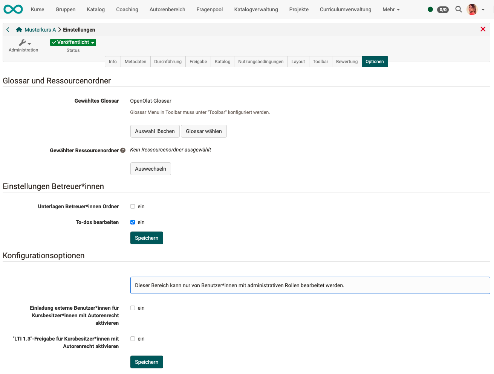
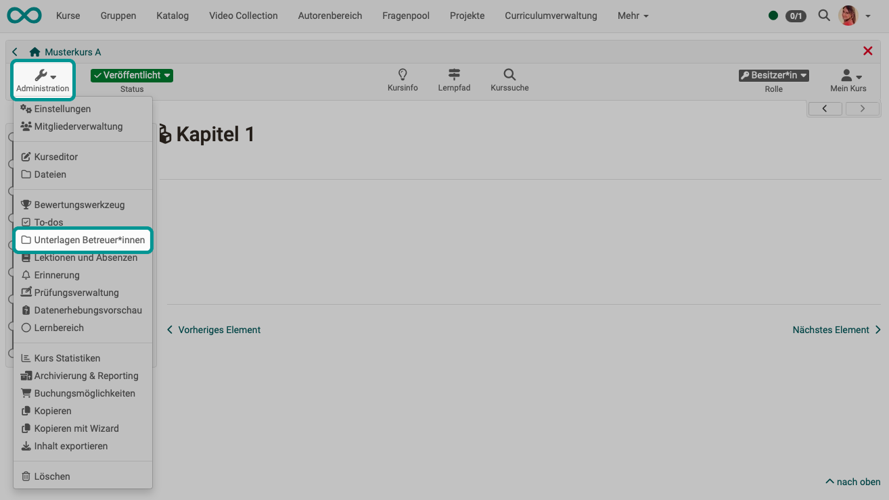
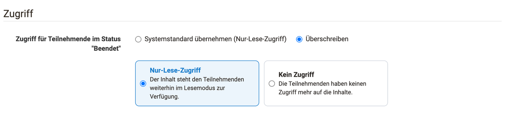

# Kurseinstellungen - Tab Optionen {: #course_settings_options}

Im Tab "Optionen" binden Sie Material in den Kurs ein, das Sie ausserhalb des Kurses pflegen, und geben den Betreuer:innen eigene Arbeitsmittel. Sie finden den Tab unter `Kurs > Administration > Einstellungen > Optionen`. Hier können Sie

* ein kursspezifisches [Glossar](../learningresources/Glossary_create.de.md#integrate) einbinden,
* einen [Ressourcenordner](../learningresources/Resource_Folder.de.md) einbinden,
* den Ordner "Unterlagen Betreuer:innen" einschalten und Betreuer:innen To-dos bearbeiten lassen,
* festlegen, welchen Zugriff Teilnehmende auf den beendeten Kurs haben.

Den Tab bearbeiten Besitzer:innen des Kurses, Lernressourcenverwalter:innen, Administrator:innen und Personen mit dem Recht "Kurseditor" aus der [Mitgliederverwaltung](Members_management.de.md#section_rights). Lernressourcenverwalter:innen und Administrator:innen finden hier je nach Konfiguration zusätzlich die [Konfigurationsoptionen](#weitere-konfigurationsoptionen).

{ class="shadow lightbox" title="Tab Optionen der Kurseinstellungen" }

## Glossar einbinden

Mit "Glossar wählen" öffnen Sie eine Auswahl, in der Sie ein bestehendes Glossar wählen oder ein neues erstellen. Das gewählte Glossar steht danach unter "Gewähltes Glossar". Mit "Auswahl löschen" lösen Sie die Verbindung wieder.

Damit Teilnehmende das Glossar im Kurs nutzen, schalten Sie es anschliessend im Tab [Toolbar](Course_Settings_Toolbar.de.md#glossary) mit "Glossar verwenden" ein. Diese Option steht dort nur zur Wahl, wenn "Toolbar sichtbar für Teilnehmer:innen" eingeschaltet ist.

[Zum Seitenanfang ^](#course_settings_options)

## Ressourcenordner einbinden

Ein Ressourcenordner stellt dieselben Dateien in mehreren Kursen zur Verfügung. Mit "Auswechseln" öffnen Sie eine Auswahl, in der Sie eine bestehende Lernressource "Ressourcenordner" wählen oder eine neue erstellen. Die Dateien des Ressourcenordners erscheinen danach im [Ablageordner](Storage_folder.de.md) des Kurses im automatisch erstellten Unterordner "_sharedfolder".

Sobald Sie einen Ressourcenordner wählen, ist "Schreibgeschützt" eingeschaltet. Die Dateien lassen sich dann nur in der Lernressource selbst bearbeiten, nicht im Ablageordner des Kurses und nicht beim Einbinden über Einzelseiten im Kurseditor. Sollen sie auch im Kurs bearbeitbar sein, entfernen Sie das Häkchen bei "Schreibgeschützt". Das Häkchen entfernen können nur Besitzer:innen des Kurses, Lernressourcenverwalter:innen und Administrator:innen.

Eine Schritt-für-Schritt-Anleitung zum Einbinden eines Ressourcenordners finden Sie im How-to [Wie kann ich dieselben Dateien in mehreren Kursen einsetzen?](../../manual_how-to/multiple_use/multiple_use.de.md)

**Beachten Sie:**  Sie können lediglich _einen_ Ressourcenordner pro Kurs einbinden. Überlegen Sie deshalb im Vorfeld genau, welche Dateien Sie über einen kursübergreifenden Ressourcenordner statt des kursbezogenen Ablageordners organisieren möchten.

[Zum Seitenanfang ^](#course_settings_options)

## Einstellungen Betreuer:innen

Im Abschnitt "Einstellungen Betreuer:innen" geben Sie den Betreuer:innen einen gemeinsamen Ordner für ihre Unterlagen und lassen sie To-dos im Kurs bearbeiten.

Mit "Unterlagen Betreuer:innen Ordner" schalten Sie einen kursweiten Ordner für die Betreuer:innen ein. Darin legen alle Betreuer:innen des Kurses Dokumente ab, sehen sie an, bearbeiten oder löschen sie und erstellen Unterordner. Unter "Ablageort" wählen Sie, wo der Ordner liegt:

* **"Automatisch generierter Ordner":** OpenOlat legt im Ablageordner des Kurses den Ordner "_coachdocuments" an. Betreuer:innen sehen nur diesen Ordner, nicht die übrigen Dateien des Ablageordners. Besitzer:innen des Kurses und Personen mit Zugriff auf den Kurseditor sehen die Dateien der Betreuer:innen im Ablageordner und können sie zum Beispiel in einer Einzelseite verknüpfen.
* **"Ordner aus Ablageordner des Kurses verwenden":** Mit "Ordner wählen" bestimmen Sie einen bestehenden Ordner im Ablageordner des Kurses.

In beiden Fällen öffnen Betreuer:innen über den Menüeintrag nur diesen Ordner. Die Dateien in Kursbausteinen verknüpfen, etwa in einer Einzelseite, können nur Personen mit Zugriff auf den Kurseditor.

Ist der Ordner eingeschaltet, erscheint im Menü "Administration" des Kurses für Betreuer:innen und Besitzer:innen der Eintrag "Unterlagen Betreuer:innen". Mehr dazu auf der Seite [Unterlagen Betreuer:innen](Coach_Files.de.md).

{ class="shadow lightbox" title="Menü Administration eines Kurses" }

Schalten Sie "To-dos bearbeiten" ein, bearbeiten Betreuer:innen die [To-dos im Kurs](Course_todos.de.md) unter `Kurs > Administration > To-dos`. Ohne diese Option sehen sie die To-dos nur an.

[Zum Seitenanfang ^](#course_settings_options)

## Zugriff bei Status "Beendet" [:octicons-tag-16:{ title="ab Release 21.0 (OO-9298)" }](https://track.frentix.com/issue/OO-9298)

Im Abschnitt "Zugriff" legen Sie fest, welchen Zugriff Teilnehmende auf diesen Kurs haben, sobald er den Status "Beendet" erreicht. Wie ein Kurs in diesen Status kommt, beschreibt die Seite [Zugangskonfiguration / Freigabe](Access_configuration.de.md).

Mit "Systemstandard übernehmen" gilt die Voreinstellung, die die System-Administration unter `Administration > Module > Lernressource > Zugang` festlegt ([Modul Lernressource](../../manual_admin/administration/Modules_Learning_Resource.de.md#tab_accesss)); der aktuell gültige Standard wird in Klammern angezeigt. Wählen Sie "Überschreiben", um für diesen Kurs abweichend festzulegen:

* **Nur-Lese-Zugriff:** Der Kursinhalt steht den Teilnehmenden weiterhin im Lesemodus zur Verfügung.
* **Kein Zugriff:** Die Teilnehmenden haben keinen Zugriff mehr auf die Inhalte. Beim Öffnen zeigt die Infoseite den Hinweis "Kurs beendet": "Der Zugriff auf die Inhalte ist abgelaufen. Bei Fragen wenden Sie sich bitte an Ihre Ansprechperson." Eine bestimmte Person nennt der Hinweis nicht.

{ class="shadow lightbox" title="Tab Optionen der Kurseinstellungen" }

[Zum Seitenanfang ^](#course_settings_options)

## Weitere Konfigurationsoptionen 

Im Abschnitt "Konfigurationsoptionen" erlauben Lernressourcenverwalter:innen und Administrator:innen den Besitzer:innen des Kurses mit Autorenrecht zwei Aufgaben, die sonst administrativen Rollen vorbehalten sind. Autorenrecht hat, wer in OpenOlat zusätzlich die Rolle Autor:in hat.

Ob eine Option erscheint, bestimmt die System-Administration. Sie wählt für jede der beiden Funktionen, ob sie für alle Kurse gilt oder "Muss pro Kurs aktiviert werden". Nur im zweiten Fall erscheint die Option hier. Die Einstellung für die Einladung steht bei den [externen Benutzer:innen](../../manual_admin/administration/Guest_and_invitation.de.md#externals), die für die LTI-Freigabe bei den [LTI 1.3 Integrationen](../../manual_admin/administration/LTI_Integrations/index.de.md). LTI (Learning Tools Interoperability) ist ein Standard, über den andere Lernplattformen Inhalte aus OpenOlat einbinden.

* **"Einladung externe Benutzer:innen für Kursbesitzer:innen mit Autorenrecht aktivieren"** 
    Mit einer Einladung nehmen auch Personen ohne OpenOlat-Konto am Kurs teil, die externen Benutzer:innen. Ist die Option eingeschaltet, lädt auch eine Kursbesitzer:in mit Autorenrecht sie in der [Mitgliederverwaltung](Members_management.de.md#section_invitations) ein: Neben dem Button "Mitglied hinzufügen" steht dann im Aufklappmenü "Externe Mitglieder einladen".

* **"LTI 1.3-Freigabe für Kursbesitzer:innen mit Autorenrecht aktivieren"** 
    Mit der [LTI-Freigabe](LTI_Share_courses.de.md) im Tab "Freigabe" der Kurseinstellungen greifen Personen von anderen Lernplattformen aus auf einen OpenOlat-Kurs zu. Ist die Option eingeschaltet, richtet auch eine Kursbesitzer:in mit Autorenrecht die LTI-Freigabe ein.

## Weiterführende Informationen {: #further_information}

**Auf dieser Seite erwähnt** 
[Glossar erstellen >](../learningresources/Glossary_create.de.md) 
[Ressourcenordner >](../learningresources/Resource_Folder.de.md) 
[Mitgliederverwaltung >](Members_management.de.md) 
[Toolbar >](Course_Settings_Toolbar.de.md) 
[Ablageordner >](Storage_folder.de.md) 
[Wie kann ich dieselben Dateien in mehreren Kursen einsetzen? >](../../manual_how-to/multiple_use/multiple_use.de.md) 
[Unterlagen Betreuer:innen >](Coach_Files.de.md) 
[To-dos im Kurs >](Course_todos.de.md) 
[Zugangskonfiguration / Freigabe >](Access_configuration.de.md) 
[Modul Lernressource >](../../manual_admin/administration/Modules_Learning_Resource.de.md) 
[Anonyme Gäste und externe Benutzer:innen >](../../manual_admin/administration/Guest_and_invitation.de.md) 
[LTI 1.3 Integrationen >](../../manual_admin/administration/LTI_Integrations/index.de.md) 
[Kurseinstellungen - Tab Freigabe: LTI-Zugang zu einem Kurs konfigurieren >](LTI_Share_courses.de.md)

**Weiterführend** 
[Kurseinstellungen >](Course_Settings/index.de.md) 
[Kurseinstellungen - Tab Bewertung >](Course_Settings_Assessment/index.de.md)

[Zum Seitenanfang ^](#course_settings_options)
