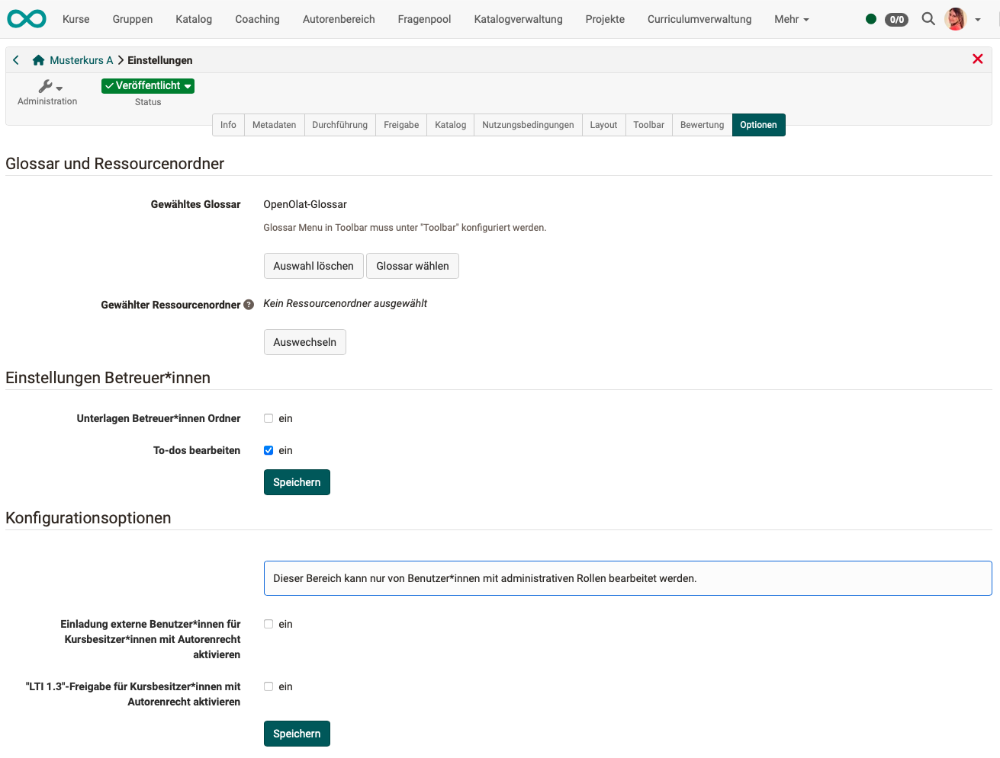
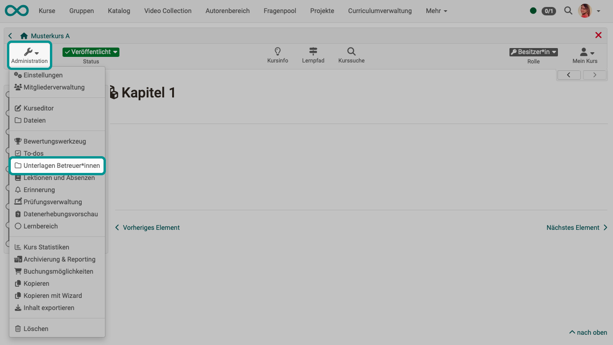
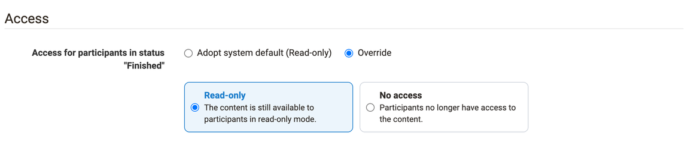

# Course Settings - Tab Options {: #course_settings_options}

In the "Options" tab, you integrate material into the course that you maintain outside the course, and you give the coaches their own working tools. You find the tab under `Course > Administration > Settings > Options`. Here you can

* integrate a course-specific [glossary](../learningresources/Glossary_create.md#integrate),
* integrate a [resource folder](../learningresources/Resource_Folder.md),
* switch on the "Coach files" folder and let coaches edit to-dos,
* define what access participants have to the finished course.

The tab is edited by owners of the course, learning resource managers, administrators and persons with the right "Course editor" from the [members management](Members_management.md#section_rights). Depending on the configuration, learning resource managers and administrators also find the [configuration options](#further-configuration-options) here.

{ class="shadow lightbox" title="Options tab of the course settings" }

## Include glossary

With "Select glossary", you open a selection in which you choose an existing glossary or create a new one. The selected glossary then appears under "Selected glossary". With "Delete selection", you remove the connection again.

So that participants can use the glossary in the course, you then switch it on in the [Toolbar](Course_Settings_Toolbar.md#glossary) tab with "Use glossary". This option is only available there if "Toolbar visible for participants" is switched on.

[To the top of the page ^](#course_settings_options)

## Include resource folder

A resource folder provides the same files in several courses. With "Replace", you open a selection in which you choose an existing "Resource folder" learning resource or create a new one. The files of the resource folder then appear in the course's [storage folder](Storage_folder.md), in the automatically created subfolder "_sharedfolder".

As soon as you select a resource folder, "Read only" is switched on. The files can then only be edited in the learning resource itself, not in the course's storage folder and not when embedding them via single pages in the course editor. If they should also be editable in the course, clear the checkbox at "Read only". Only owners of the course, learning resource managers and administrators can clear this checkbox.

A step-by-step guide to including a resource folder can be found in the how-to [How can I use the same files in several courses?](../../manual_how-to/multiple_use/multiple_use.md)

**Please note:**  You can only include _one_ resource folder per course. Consider in advance which files you want to organize through a cross-course resource folder instead of the course-specific storage folder.

[To the top of the page ^](#course_settings_options)

## Coach settings

In the "Coach settings" section, you give the coaches a shared folder for their documents and let them edit to-dos in the course.

With "Coach files folder", you switch on a course-wide folder for the coaches. In it, all coaches of the course store, view, edit or delete documents and create subfolders. Under "File destination", you choose where the folder is located:

* **"Automatically generated folder":** OpenOlat creates the folder "_coachdocuments" in the course's storage folder. Coaches only see this folder, not the other files of the storage folder. Owners of the course and persons with access to the course editor see the coaches' files in the storage folder and can link them, for example, in a single page.
* **"Choose folder from course storage":** With "Choose folder", you select an existing folder in the course's storage folder.

In both cases, coaches only open this folder via the menu entry. Only persons with access to the course editor can link the files in course elements, for example in a single page.

If the folder is switched on, the entry "Coach files" appears in the "Administration" menu of the course for coaches and owners. More on this on the page [Coach files](Coach_Files.md).

{ class="shadow lightbox" title="Administration menu of a course" }

If you switch on "Edit to-dos", coaches edit the [to-dos in the course](Course_todos.md) under `Course > Administration > To-dos`. Without this option, they only view the to-dos.

[To the top of the page ^](#course_settings_options)

## Access in status "Finished" [:octicons-tag-16:{ title="from Release 21.0 (OO-9298)" }](https://track.frentix.com/issue/OO-9298)

In the "Access" section, you define what access participants have to this course once it reaches the status "Finished". How a course reaches this status is described on the page [Access configuration](Access_configuration.md).

With "Adopt system default", the default applies that the system administration sets under `Administration > Modules > Learning resource > Access` ([Module Learning resource](../../manual_admin/administration/Modules_Learning_Resource.md#tab_accesss)); the currently valid default is shown in brackets. Select "Override" to set a different value for this course:

* **Read-only:** The course content remains available to participants in read mode.
* **No access:** Participants no longer have access to the content. When they open it, the info page shows the notice "Course finished": "Access to the content has expired. If you have any questions, please contact your designated contact person." The notice does not name a specific person.

{ class="shadow lightbox" title="Options tab of the course settings" }

[To the top of the page ^](#course_settings_options)

## Further configuration options

In the "Configuration options" section, learning resource managers and administrators allow the course owners with author rights two tasks that are otherwise reserved for administrative roles. Author rights are held by those who additionally have the role author in OpenOlat.

Whether an option appears is determined by the system administration. For each of the two functions, it selects whether it applies to all courses or "Must be activated per course". Only in the second case does the option appear here. The setting for the invitation is located under [external users](../../manual_admin/administration/Guest_and_invitation.md#externals), the one for the LTI sharing under [LTI 1.3 Integrations](../../manual_admin/administration/LTI_Integrations/index.md). LTI (Learning Tools Interoperability) is a standard through which other learning platforms integrate content from OpenOlat.

* **"Activate invitation of external users for course owners with author rights"** 
    With an invitation, persons without an OpenOlat account can also take part in the course, the external users. If the option is switched on, a course owner with author rights can also invite them in the [members management](Members_management.md#section_invitations): next to the "Add member" button, the drop-down menu then contains "Invite external members".

* **"Activate LTI 1.3 sharing for course owners with author rights"** 
    With the [LTI sharing](LTI_Share_courses.md) in the "Share" tab of the course settings, people access an OpenOlat course from other learning platforms. If the option is switched on, a course owner with author rights can also set up the LTI sharing.

## Further information {: #further_information}

**Mentioned on this page** 
[Glossary - create >](../learningresources/Glossary_create.md) 
[Resource folder >](../learningresources/Resource_Folder.md) 
[Members management >](Members_management.md) 
[Toolbar >](Course_Settings_Toolbar.md) 
[Storage folder >](Storage_folder.md) 
[How can I use the same files in several courses? >](../../manual_how-to/multiple_use/multiple_use.md) 
[Coach files >](Coach_Files.md) 
[To-dos in the course >](Course_todos.md) 
[Access configuration >](Access_configuration.md) 
[Module Learning resource >](../../manual_admin/administration/Modules_Learning_Resource.md) 
[Anonymous guests and external users >](../../manual_admin/administration/Guest_and_invitation.md) 
[LTI 1.3 Integrations >](../../manual_admin/administration/LTI_Integrations/index.md) 
[Course Settings - Tab Share: Configure LTI access to a course >](LTI_Share_courses.md)

**Further reading** 
[Course Settings >](Course_Settings/index.md) 
[Course Settings - Tab Assessment >](Course_Settings_Assessment/index.md)

[To the top of the page ^](#course_settings_options)
