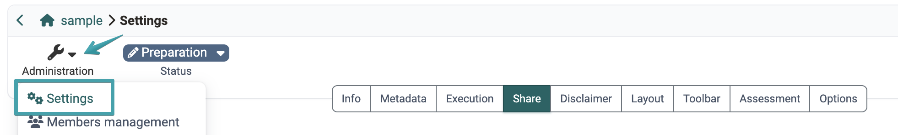
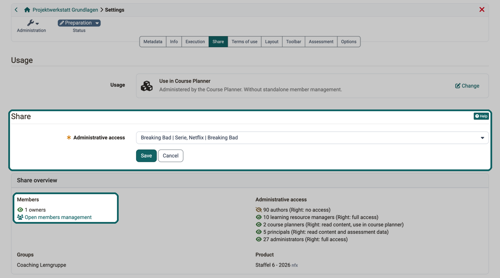
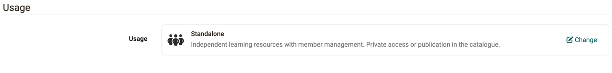
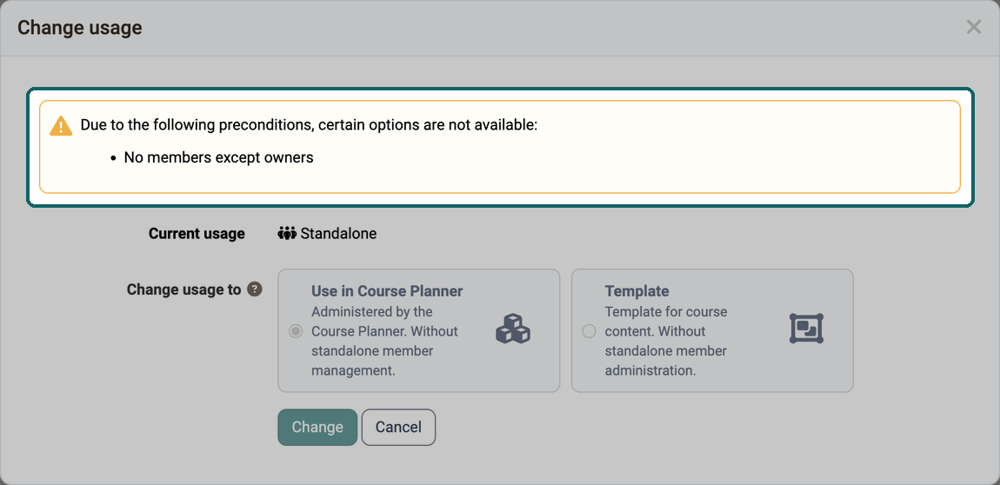
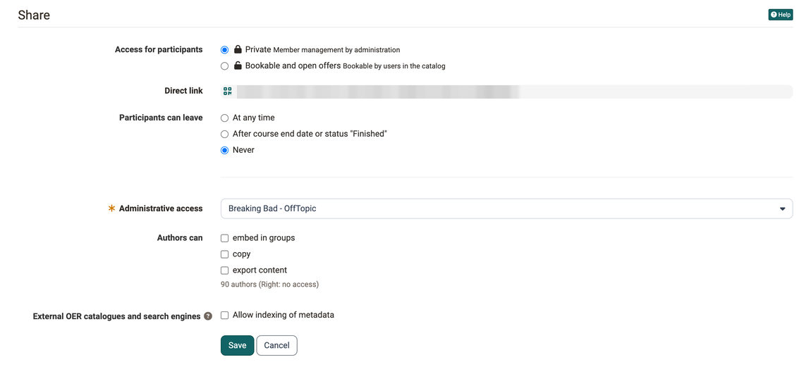
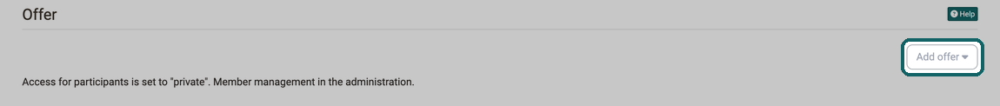
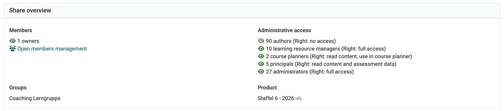

# Course settings - Tab Share {: #tab_share}

You open the Share tab in the course via `Course > Administration > Settings > Tab "Share"`.

{ class="shadow lightbox" title="Administration menu of a course" }

In the Share tab, you will find these sections. Which of them a course actually shows depends on its usage: see [Which sections appear?](#sections_by_usage)

[Usage](#section_usage) 
[Share](#section_share) 
[Offer](#section_offer) 
[LTI 1.3 access configuration](#section_LTI) 
[Share overview](#section_share_overview)

---

## Which sections appear? {: #sections_by_usage}

The Share tab does not look the same for every course. What matters is the usage set in the [Usage section](#section_usage). A standalone course controls access, booking and leaving on its own and therefore shows all sections. For a course in the Course Planner, the Course Planner takes over these tasks, and the corresponding settings are dropped from the course. A template has no participants, so everything that concerns participant access is dropped there.

| Section or setting | Standalone | Use in Course Planner | Template |
|---|---|---|---|
| Usage | yes | yes | yes |
| Share: Access for participants | yes | no | no |
| Share: Direct link | yes | no | yes |
| Share: Participants can leave | yes | no | no |
| Share: Administrative access | yes | yes | yes |
| Share: Authors can | yes | no | yes, without "embed in groups" |
| Share: External OER catalogues and search engines | yes | no | no |
| Offer | yes | no | no |
| LTI 1.3 access configuration | yes | no | no |
| Share overview | yes | yes | yes |

For a course in the Course Planner, only the administrative access therefore remains in the Share section. Membership, booking and leaving are handled in the implementation in the Course Planner. The share overview is shorter too: it counts only the owners, because the course itself manages no coaches and no participants.

{ class="shadow lightbox" title="Share tab of a course in the Course Planner · 2026.10.09" }

!!! info "Important"

    The External OER catalogues and search engines section additionally appears only if the OAI-PMH module is activated, and the administrative access only if the Organisations module is activated. The usage "Use in Course Planner" exists only if the Course Planner module is activated.

The descriptions of the following sections assume the usage "Standalone".

[To the top of the page ^](#tab_share)

---

## Section usage [:octicons-tag-16:{ title="from Release 18.2.0 (OO-7277)" }](https://track.frentix.com/issue/OO-7277) [:octicons-tag-16:{ title="from Release 21.1.0 (OO-9805)" }](https://track.frentix.com/issue/OO-9805){:target="_blank"} {: #section_usage}

The usage defines where the members of a learning resource come from: from its own member management, from the Course Planner or from the place where it is embedded. New courses are standalone as long as the Course Planner module is not activated.

{ class="shadow lightbox" title="Usage section in the Share tab · 2026.10.09" }

**Standalone** 
Standalone learning resources have their own member management. To add new members, open `Course > Administration > Member management`. 
Participants get access via "Private", for example when course owners enter them as members, or via "Bookable and open offers", for instance with an access code or via an offer in the catalog.

**Use in Course Planner** 
If the course is integrated into a product of the Course Planner, memberships are assigned and managed by the Course Planner. The course then does not require a second, separate membership management system.

**Template** 
These courses are also managed by the Course Planner and do not require separate member management. The difference to the "Use in Course Planner" option is that a template is used for instantiation. The course in a run is only created (instantiated) from this template at a specific point in time.

**Embedding** 
This usage exists only for learning resources that are not courses, for example a test or a form. The learning resource is reusable and has no standalone member management: it is embedded elsewhere, for instance in a course element, and the members come from there. More on this under [Provide for the usage of a learning resource](General_Functions_Concept.md#usage).

Clicking "Change" opens the "Change usage" dialog. It shows the current usage at the top under "Current usage" and below it, under "Change usage to", the usages you can switch to. The current usage is therefore not in the selection. The help icon next to "Change usage to" shows a help text when you hover over it and opens this section of the manual when you click it.

Except for "Standalone", a course does not manage its members itself. OpenOlat therefore blocks a switch as soon as the course does not meet a precondition. A blocked usage appears in the dialog but cannot be selected. The dialog names the reasons above the selection, under the sentence "Due to the following preconditions, certain options are not available:":

- **No members except owners:** The course has coaches or participants. Blocks the switch to "Use in Course Planner" and to "Template".
- **No groups that are also referenced by other courses:** A group of the course is also embedded in another course. Blocks the switch to "Use in Course Planner" and to "Template".
- **"Access for participants" must be set to "Private":** In the Share section, "Bookable and open offers" is selected. Blocks the switch to "Use in Course Planner" and to "Template".
- **Not used by the Course Planner:** The course or the template is assigned to an implementation. Blocks every switch except the one from "Standalone" to "Use in Course Planner".

{ class="shadow lightbox" title="Change usage dialog for a course with members · 2026.10.09" }

If a course already has members, a copy is the simplest way into the Course Planner: it is created without coaches and participants and can be switched. The steps are described here: 
[If the usage cannot be changed >](../../manual_how-to/course_planner_courses/course_planner_courses.md#embedding_locked)

!!! tip "Tip"

    When creating new courses, pay attention to the default usage setting. Administrators set the usage for new courses in the system administration, in the field "Usage for new courses" under: 
    `Administration > Modules > Course Planner > Tab "Settings"`

[To the top of the page ^](#tab_share)

---

## Section Share {: #section_share}

{ class="shadow lightbox" title="Share section in the Share tab · 2026.10.09" }

#### Access for participants {: #section_share_access}

With "Private", course owners or persons with the right to manage members add the participants, under `Course > Administration > Member management`. This is like a personal invitation to the course. 
With "Bookable and open offers", the participants book the course themselves, depending on the offer with an access code. A booking via an offer in the catalog also requires this option.

#### Direct link {: #section_share_direct_link}

Whoever receives this link opens the course directly with it. If the person is not registered in OpenOlat or not logged in, the login screen appears first.

#### Participants can leave [:octicons-tag-16:{ title="from Release 20.3.0 (OO-9272)" }](https://track.frentix.com/issue/OO-9272) {: #section_share_leave}

**At any time**: If participants wish to terminate their membership in the course themselves, they can do so at any time. 
**After course end date or status "Finished"**: Participants can only leave once the execution period has ended or the course has the status "Finished". If no execution period is set in the ["Execution" tab](Course_Settings_Execution.md#execution_period), they can only leave with the status "Finished". 
**Never**: Attendance at the course is compulsory, so participants cannot withdraw themselves.

!!! info "Important"

    This setting exists only for courses with the usage "Standalone". If the Course Planner manages the course instead (usage "Use in Course Planner"), it does not appear in the Share tab, and the "Leave course" function is not available to the participants. If participants have booked an implementation, they cancel the booking themselves: They open the info page of the implementation in the catalog and select the action "Cancel booking" there. If a cancellation fee applies, the action is called "Cancel booking for a fee", and the confirmation dialog states the amount. The action appears only for an implementation with a begin date, until the day before it begins, and only if the offer is cancelable (see [Cancellation policy](../basic_concepts/Offer_Concepts.md#offer_invoice_cancellation)). After that, the administration of your organisation can help. [:octicons-tag-16:{ title="from Release 20.0 (OO-8397)" }](https://track.frentix.com/issue/OO-8397)

#### Administrative access {: #section_share_admin_access}

People with certain higher-level roles (e.g., administrators, learning resource managers) can also access this course from the organisations selected here. Because these roles exist per organisation (e.g., admin for department xy), you can determine here which organisations have administrative access to your course. The field only appears if the Organisations module is activated. 
You can see how many people have administrative access in the [share overview >](#section_share_overview).

#### Authors can {: #section_share_authors}

Allow here what other authors may do with your course: "embed in groups", "copy" and "export content". For learning resources other than courses, the first option is called "embed".

#### External OER catalogues and search engines {: #section_share_oer}

To let external OER catalogues and search engines find your course, select the checkbox "Allow indexing of metadata": `Course > Administration > Settings > Tab "Share"`. OpenOlat then passes the metadata of the course on to portals and catalogues outside OpenOlat via OAI-PMH. (OER = Open Educational Resources)

This requires the OAI-PMH module, which your administration switches on. OpenOlat only passes the course on once it has the status "Published". If your administration requires specific licences, the course must also carry one of them. If the course is not published or lacks the required licence, a warning below the checkbox names the reason.

Find out more about OER here: 
How-to: [Release courses for indexing >](../../manual_how-to/oai_pmh/oai_pmh.md#wie-sehe-ich-im-autorenbereich-welche-kurselernressourcen-zur-indexierung-freigegeben-sind) 
Admin Manual: [Modul OAI PMH >](../../manual_admin/administration/Modules_OAI.md)

[To the top of the page ^](#tab_share)

---

## Section offer [:octicons-tag-16:{ title="from Release 17.0.0 (OO-6141)" }](https://track.frentix.com/issue/OO-6141) {: #section_offer}

{ class="shadow lightbox" title="Offer section in the Share tab · 2026.10.09" }

In order for a course to be listed in the catalog, an offer must be created. Multiple offers can also be created if the same course is to be offered under different conditions (e.g., free of charge for a specific target group, subject to a fee for others).

In order to create an offer for the catalog, the option "Bookable and open offers" must be selected in the "Share" section under "Access for participants".

You can find more information about offers and the catalog here: 
[Catalog >](../area_modules/catalog2.0.md) 
[Offer types >](../learningresources/Offer_Types.md) 
[Create offers >](../area_modules/catalog2.0_angebote.md) 
[Offering implementations in the catalog >](../area_modules/Course_Planner_Implementations.md#tab_catalog)

[To the top of the page ^](#tab_share)

---

## Section LTI 1.3 access configuration [:octicons-tag-16:{ title="from Release 18.2.3 (OO-7664)" }](https://track.frentix.com/issue/OO-7664) {: #section_LTI}

OpenOlat courses can also be accessed from another LMS via LTI 1.3. However, this external access requires security measures and precisely defined permissions. 
In this section, you can set up a deployment to make the course accessible for another LMS.

You can find more information about sharing a course via LTI here: 
[Configuring LTI access to a course >](../learningresources/LTI_Share_courses.md)

[To the top of the page ^](#tab_share)

---

## Section Share Overview {: #section_share_overview}

{ class="shadow lightbox" title="Share overview in the Share tab · 2026.10.09" }

In the "Members" block, you will find the number of course members, broken down by owners, coaches, and participants. With "Open members management", you switch directly to the member management of the course.

The "Administrative access" block shows per role how many persons can also access this course due to this role, and with which right, for example "full access" for learning resource managers and administrators.

If the course is assigned to groups, the "Groups" block shows these groups.

If the course is assigned to a product in the Course Planner, the "Product" block shows the uses.

[To the top of the page ^](#tab_share)

---

## Further information {: #further_information}

**Mentioned on this page** 
[Function concept courses and learning resources >](../learningresources/General_Functions_Concept.md) 
[How do I plan and run courses with the Course Planner? >](../../manual_how-to/course_planner_courses/course_planner_courses.md) 
[Course Settings - Tab Execution >](../learningresources/Course_Settings_Execution.md) 
[Offer concepts: Cancellation policy for invoice offers >](../basic_concepts/Offer_Concepts.md) 
[How can I have my courses found by search engines? >](../../manual_how-to/oai_pmh/oai_pmh.md) 
[Module OAI-PMH >](../../manual_admin/administration/Modules_OAI.md) 
[Catalog 2.0 - Overview >](../area_modules/catalog2.0.md) 
[Offer types >](../learningresources/Offer_Types.md) 
[Catalog 2.0 - Offers >](../area_modules/catalog2.0_angebote.md) 
[Course Planner: Implementations >](../area_modules/Course_Planner_Implementations.md) 
[Course Settings - Tab Share: Configure LTI access to a course >](../learningresources/LTI_Share_courses.md)

**Further reading** 
[Access configuration >](../learningresources/Access_configuration.md) 
[Course Settings >](../learningresources/Course_Settings.md) 
[Copy (a course) >](../learningresources/Course_Copy.md)

[To the top of the page ^](#tab_share)
