# Toolbar {: #tab_toolbar}

Die Toolbar (Werkzeugleiste) steht im Kopf der Seite direkt unter der Hauptnavigation und zeigt die Icons der Werkzeuge. So erreichen Teilnehmende die Werkzeuge, die sie während des ganzen Kurses brauchen, an einer zentralen Stelle. Im Tab "Toolbar" legen Sie fest, ob die Teilnehmer:innen im Kurs die Toolbar sehen und welche Werkzeuge darin erscheinen: 
`Kurs > Administration > Einstellungen > Tab "Toolbar"`

Diese Seite beschreibt zuerst die Einstellungen im Tab "Toolbar" und danach, was Teilnehmende in der Toolbar sehen.

## Steckbrief

Name | Toolbar
---------|----------
Verfügbar seit | Release 10.0 (2014)

---

## Werkzeuge in Toolbar aktivieren {: #activate_tools}

Ist die Checkbox "Toolbar sichtbar für Teilnehmer:innen" eingeschaltet, wählen Sie darunter die Werkzeuge aus. Den Tab bearbeiten Besitzer:innen des Kurses, Lernressourcenverwalter:innen, Administrator:innen und Personen mit dem Recht "Kurseditor".

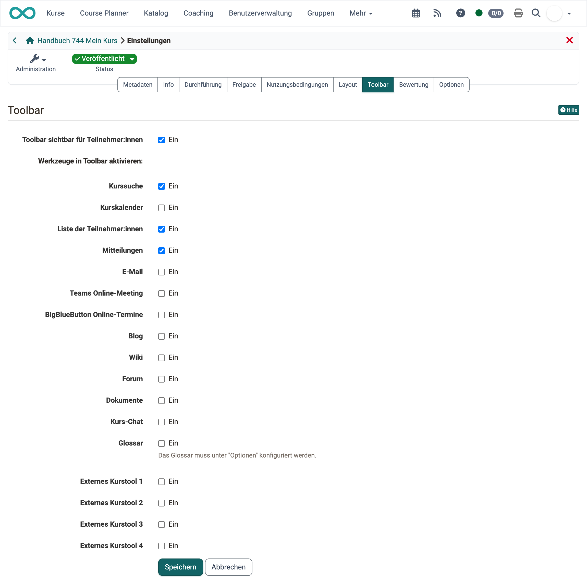{ class="shadow lightbox" title="Tab Toolbar der Kurseinstellungen · 2026.10.29" }

Ob die Toolbar für die Kursteilnehmer:innen sichtbar ist, entscheidet die Kursbesitzer:in. Für Betreuer:innen und Besitzer:innen ist sie immer sichtbar. Wird die Toolbar für die Teilnehmer:innen angezeigt, können Kursbesitzer:innen entscheiden, welche Icons dort angezeigt werden und sie kursspezifisch nach Bedarf ein- und ausschalten. Die Tools erscheinen dann entweder in der Toolbar oder unter "Mein Kurs". 
[Mehr dazu >](#show_icons)

Zu den [Werkzeugen](#available_icons) der Toolbar zählen neben der Kurssuche, dem Glossar und dem Kurs-Chat Werkzeuge, die es auch als Kursbausteine gibt, z.B. Kurskalender, Liste der Teilnehmer:innen, E-Mail, Blog, Wiki, Forum und Dokumente. Bei [Wiki](../learningresources/Wiki.de.md) und [Blog](Blog/index.de.md) können Sie auch auf bereits erstellte Lernressourcen zurückgreifen. Die übrigen Werkzeuge ähneln den entsprechenden Kursbausteinen, bieten aber nicht alle Konfigurationsmöglichkeiten, die die Kursbausteine im Kurseditor haben.

Besonders in linear aufgebauten [Lernpfadkursen](Learning_path_course/index.de.md) stellt die Toolbar wichtige Werkzeuge bereit, unabhängig von der Reihenfolge der Lernschritte.

[Zum Seitenanfang ^](#tab_toolbar)

---

## Externe Kurstools [:octicons-tag-16:{ title="ab Release 21.0 (OO-9488)" }](https://track.frentix.com/issue/OO-9488) {: #external_tools}

Arbeiten Ihre Teilnehmer:innen neben dem Kurs mit weiteren Webanwendungen, etwa einem Stundenplan oder einem Schulportal, legen Sie die Links dorthin als externe Kurstools direkt in die Toolbar des Kurses. Externe Kurstools führen zum Beispiel zu einem Absenzmanagementsystem, einer Schulinfoseite, einem Partnerportal, einem Raumbuchungstool oder einem externen Mail- oder Kalendersystem. Pro Kurs stehen vier externe Kurstools zur Verfügung.

Eingerichtet werden sie unter `Kurs > Administration > Einstellungen > Tab "Toolbar"`. Die Zeilen "Externes Kurstool 1" bis "Externes Kurstool 4" stehen unter den Werkzeugen der Toolbar. Sie erscheinen nur, wenn bei "Toolbar sichtbar für Teilnehmer:innen" die Checkbox "Ein" aktiviert ist. Aktivieren Sie bei einem Tool die Checkbox "Ein", erscheinen darunter die Felder "Name", "URL", "Icon" und "Sichtbar für".

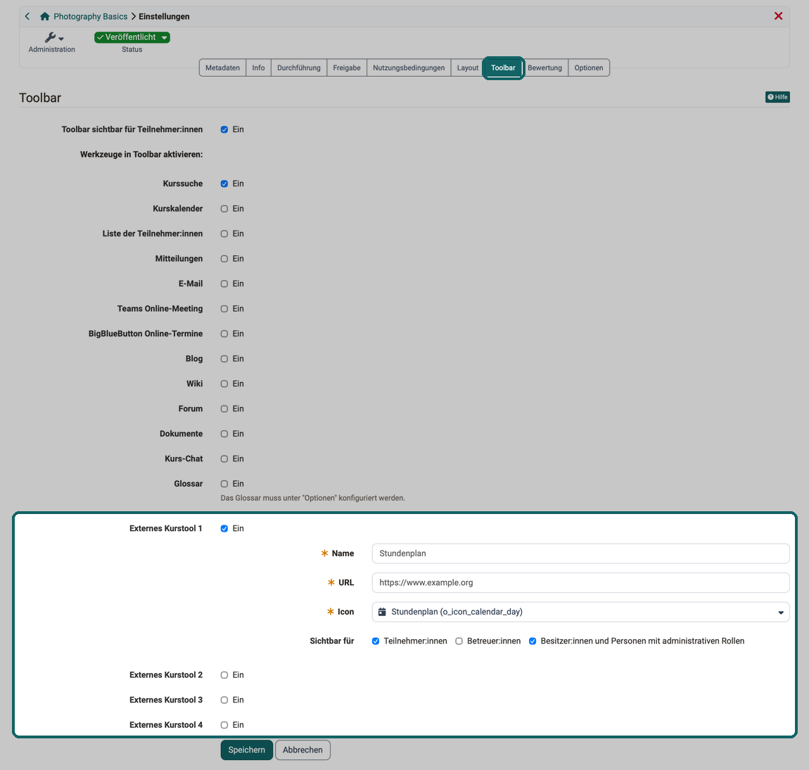{ class="shadow lightbox" title="Externe Kurstools im Tab Toolbar der Kurseinstellungen · 2026.10.02" }

| Feld | Beschreibung |
|---|---|
| **Name** | Bezeichnung in der Toolbar, max. 64 Zeichen. Pflichtfeld. |
| **URL** | Absolute URL beginnend mit `http://` oder `https://`. Relative URLs, Anker, `javascript:`, `data:`, `mailto:`, `tel:` und protokollrelative Links werden abgelehnt. Pflichtfeld. |
| **Icon** | Auswahl aus dem Icon-Katalog (rund 30 Einträge, z.B. Link, E-Mail, Kalender, Stundenplan, Absenzen-Management, Schulportal, Buchungen, Videos, Dateien). Pflichtfeld. |
| **Sichtbar für** | Separate Checkboxen für "Teilnehmer:innen", "Betreuer:innen" sowie "Besitzer:innen und Personen mit administrativen Rollen". Jede Option gilt nur für ihre Rolle: Ein Tool, das nur für Teilnehmer:innen sichtbar ist, sehen Betreuer:innen nicht. Administrator:innen, Lernressourcenverwalter:innen, Principals und Kursplaner:innen sehen das Tool, wenn die Option für Besitzer:innen ausgewählt ist. Bei einem neu eingeschalteten Tool ist diese Option vorausgewählt. Ist keine Option gewählt, zeigt das Formular die Warnung "Das Tool ist aktiviert, aber für niemanden sichtbar. Wählen Sie mindestens eine Option." Gespeichert wird das Tool trotzdem, in der Toolbar sieht es dann niemand. |

In der Toolbar sehen die Rollen, die unter "Sichtbar für" ausgewählt sind, das Tool mit seinem Namen und Icon.

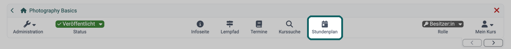{ class="shadow lightbox" title="Externes Kurstool in der Toolbar des Kurses · 2026.10.02" }

!!! warning "Achtung"
    Entfernen Sie bei einem Tool die Checkbox "Ein" oder schalten Sie "Toolbar sichtbar für Teilnehmer:innen" aus, löscht OpenOlat beim Speichern Name, URL und Icon der betroffenen Tools, die Auswahl unter "Sichtbar für" wird zurückgesetzt. Beim erneuten Einschalten erfassen Sie die Angaben neu.

**Kurs kopieren / importieren**

- Die Konfiguration aller vier externen Kurstools wird beim Kopieren eines Kurses mitübernommen.
- Beim Importieren eines Kurses sind alle vier Tools ausgeschaltet. Name, URL und Icon werden nicht übernommen und müssen im importierten Kurs neu erfasst werden.

!!! info "Wichtig"
    Externe Kurstools öffnen immer in einem neuen Browserfenster. Es werden keine Nutzerdaten (Name, E-Mail usw.) an das Zielsystem übertragen. Teilen OpenOlat und das Zielsystem denselben Identity Provider, funktioniert Single Sign-on automatisch.

[Zum Seitenanfang ^](#tab_toolbar)

---

## Verfügbare Icons {: #available_icons}

Welche Icons eine Person in der Toolbar sieht, hängt von den eingeschalteten Werkzeugen und von ihrer Rolle im Kurs ab.

**Beispiel Teilnehmer:in**:

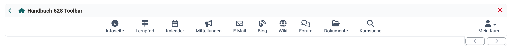{ class="shadow lightbox" title="Toolbar eines Kurses, Sicht Teilnehmer:in · 2026.10.27" }

**Beispiel Kursbesitzer:in/Betreuer:in**:

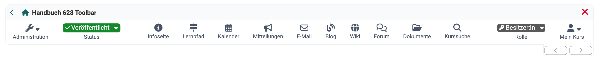{ class="shadow lightbox" title="Toolbar eines Kurses, Sicht Kursbesitzer:in · 2026.10.27" }

### Administration {: #admin}

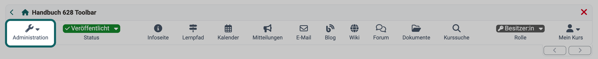{ class="shadow lightbox" title="Toolbar eines Kurses · 2026.10.27" }

Die Kurs-Administration wird nur den zur Bearbeitung Berechtigten angezeigt, nicht den Teilnehmer:innen. Dort sind viele Menüoptionen zur Verwaltung und Bearbeitung aufrufbar. 
[Mehr dazu >](Administration/index.de.md)

---

### Status [:octicons-tag-16:{ title="ab Release 13.0 (OO-3584)" }](https://track.frentix.com/issue/OO-3584) {: #status}

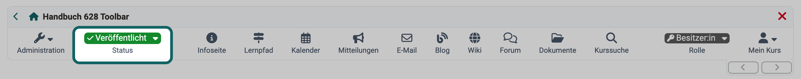{ class="shadow lightbox" title="Toolbar eines Kurses · 2026.10.27" }

Der Status wird nur den zur Bearbeitung Berechtigten angezeigt, nicht den Teilnehmer:innen. Der Status des Kurses kann hier gewechselt werden. 
[Mehr dazu >](../learningresources/Access_configuration.de.md)

---

### Infoseite [:octicons-tag-16:{ title="ab Release 21.1 (OO-9758)" }](https://track.frentix.com/issue/OO-9758){:target="_blank"} {: #info_page}

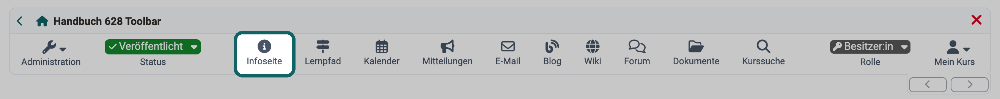{ class="shadow lightbox" title="Toolbar eines Kurses · 2026.10.27" }

Wer wissen möchte, worum es in einem Kurs geht, öffnet über das Werkzeug "Infoseite" mit dem Info-Symbol die Beschreibung des Kurses, etwa mit Durchführungszeitraum und Ort. Dieselben Angaben sehen Interessierte schon, bevor sie den Kurs betreten. 
[Mehr dazu >](../learningresources/Info_page.de.md)

---

### Lernpfad [:octicons-tag-16:{ title="ab Release 15.0 (OO-4300)" }](https://track.frentix.com/issue/OO-4300) {: #learning_path}

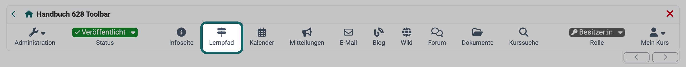{ class="shadow lightbox" title="Toolbar eines Kurses · 2026.10.27" }

Das Werkzeug "Lernpfad" erscheint in Lernpfadkursen.

**Aufruf durch Teilnehmer:innen** 
Über das Lernpfad-Icon in der Toolbar erhalten Lernende einen Überblick über ihren Fortschritt in allen Kursbausteinen. Je nach gewählten Spalten können ausserdem zusätzliche Informationen wie die Art der Durchführung und Termine angezeigt werden. So behalten Lernende ihre Aktivitäten im Kurs einfach im Blick.

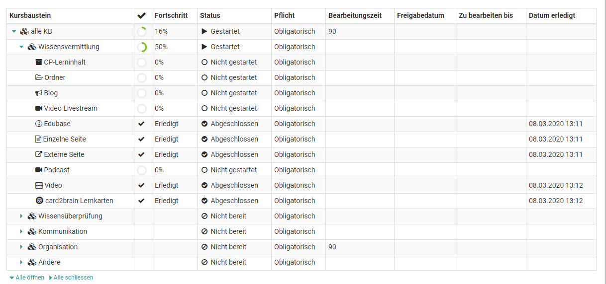{ class="shadow lightbox" title="Lernpfad aus Sicht der Teilnehmer:in" }

**Aufruf durch Kursbesitzer:innen und Betreuer:innen** 
Kursbesitzer:innen und Betreuer:innen erhalten über den Link "Lernpfad" zunächst eine Übersicht über alle Teilnehmenden und können dann im nächsten Schritt eine Person auswählen, um sich ihren Lernfortschritt anzeigen zu lassen. 
[Mehr dazu >](Learning_path_course/index.de.md)

---

### Kalender {: #calendar}

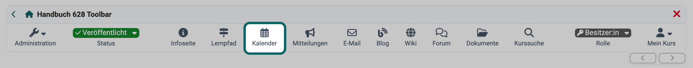{ class="shadow lightbox" title="Toolbar eines Kurses · 2026.10.27" }

Pro Kurs kann *ein* Kalender aktiviert werden. Für die Einbindung gibt es zwei Optionen. Der Kalender kann entweder als [Kalender-Kursbaustein](../learningresources/Course_Element_Calendar.de.md) oder an zentraler Position oben in der Kurstoolbar angezeigt werden.

Neben dem Kurskalender gibt es in OpenOlat noch weitere Kalender:

- [Persönlicher Kalender >](../personal_menu/Calendar.de.md)
- [Gruppenkalender >](../groups/Using_Group_Tools.de.md)

Neue Termine werden einfach mit Klick auf das gewünschte Datum erstellt. Anschliessend können Titel, Beschreibung, Beginn und Ende sowie eventuell ein Ort, mögliche Wiederholungen sowie die Sichtbarkeit eingestellt werden. Anschliessend erscheint der Termin im Kalender bzw. in allen Instanzen des Kurskalenders und kann mit Klick auf das Datum und der Option "Editieren" überarbeitet werden.

Mit dem "Editieren" erhält man auch Zugriff auf weitere Kalendertabs und kann Verlinkungen zu im Kurs verwendeten Kursbausteinen oder externen Webseiten setzen. Möchten Sie alle Termine eines Kurskalenders löschen, klicken Sie einfach auf das Zahnradsymbol im Kalenderbereich und wählen Sie "Kalender zurücksetzen".

Kurskalender werden ferner automatisch in den persönlichen Kalender der Kursmitglieder übertragen. So können alle Termine auch direkt über den persönlichen OpenOlat-Kalender aufgerufen werden. Gleiches gilt für Gruppenkalender. Bei Gruppenkalendern kann in der Gruppenadministration eingestellt werden, welche Schreib- bzw. Leserechte die Mitglieder erhalten.

Standardmässig haben nur Besitzer:innen eines Kurses Schreibrechte im Kalender. Kursteilnehmer:innen haben lediglich Leserechte, können also keine neuen Termine verfassen oder bestehende Termine editieren. Fügt man den Kalender allerdings als Kursbaustein ein, kann man die Berechtigung im Kurseditor im Tab "Zugang" konfigurieren.

---

### Liste der Teilnehmer:innen [:octicons-tag-16:{ title="ab Release 15.0 (OO-4168)" }](https://track.frentix.com/issue/OO-4168) {: #participant_list}

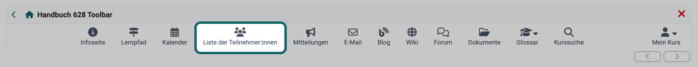{ class="shadow lightbox" title="Toolbar eines Kurses, Sicht Teilnehmer:in · 2026.10.27" }

Mit dem Werkzeug "Liste der Teilnehmer:innen" sehen die Kursmitglieder, wer im Kurs Besitzer:in, Betreuer:in oder Teilnehmer:in ist, und schreiben diesen Personen über "E-Mail versenden" direkt eine Nachricht. Anders als der gleichnamige Kursbaustein lässt sich das Werkzeug nicht konfigurieren: Es zeigt immer alle drei Rollen. 
[Mehr dazu >](../learningresources/Course_Element_Participant_List.de.md)

---

### Mitteilungen {: #notifications}

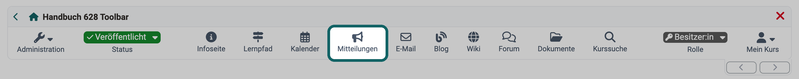{ class="shadow lightbox" title="Toolbar eines Kurses · 2026.10.27" }

Mit dem Werkzeug "Mitteilungen" richten Sie eine Ankündigung an den ganzen Kurs, ohne dafür einen Kursbaustein ins Kursmenü zu setzen. Besitzer:innen und Betreuer:innen verfassen die Mitteilungen. Teilnehmende abonnieren das Werkzeug bei Bedarf selbst und werden dann benachrichtigt, wenn eine neue Mitteilung erscheint.

Anders als der Kursbaustein "Mitteilungen" lässt sich das Werkzeug nicht konfigurieren. Anzeige, Berechtigungen, automatisches Abonnieren und Zugang legen Sie nur im Kursbaustein fest. Den Kursbaustein nehmen Sie deshalb, wenn die Mitteilungen an einer bestimmten Stelle im Kursmenü stehen sollen oder wenn Sie diese Einstellungen brauchen. 
[Mehr dazu >](../learningresources/Course_Element_Notifications.de.md)

---

### E-Mail {: #email}

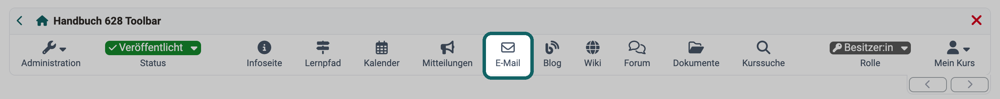{ class="shadow lightbox" title="Toolbar eines Kurses · 2026.10.27" }

E-Mails können an diversen Stellen versandt werden. Neben dem [persönlichen Menü](../personal_menu/E-Mail.de.md) ist das Icon in der Toolbar eine gute Möglichkeit, den Kursmitgliedern eine Kontaktmöglichkeit mit schnellem Zugriff anzubieten. 
[Mehr dazu >](../learningresources/Course_Element_EMail.de.md)

---

### BigBlueButton (oder andere virtuelle Klassenzimmer) [:octicons-tag-16:{ title="ab Release 15.4 (OO-5151)" }](https://track.frentix.com/issue/OO-5151) {: #BBB}

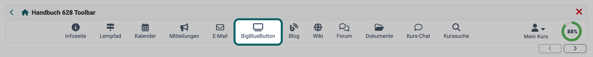{ class="shadow lightbox" title="Toolbar eines Kurses, Sicht Teilnehmer:in · 2026.10.27" }

Alternativ zu einem Kursbaustein kann der Zugriff auf ein Videokonferenz-Tool auch via Icon in der Toolbar ermöglicht werden. Neben BigBlueButton können auch andere installierte Videokonferenz-Tools in der Toolbar angezeigt werden (z. B. Microsoft Teams oder Zoom). 
[Mehr dazu >](../learningresources/bigbluebutton/index.de.md)

---

### Blog {: #blog}

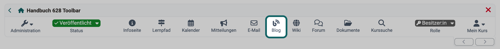{ class="shadow lightbox" title="Toolbar eines Kurses · 2026.10.27" }

In OpenOlat können mehrere Blogs eingebunden werden. Ein Aufruf durch das Icon in der Toolbar bietet sich an, wenn sich der Blog-Inhalt auf den gesamten Kurs bezieht. 
[Mehr dazu >](../learningresources/Course_Element_Blog.de.md)

---

### Wiki {: #wiki}

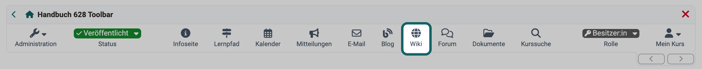{ class="shadow lightbox" title="Toolbar eines Kurses · 2026.10.27" }

In der Toolbar kann der Zugriff auf ein zentrales Wiki für den Gesamtkurs eingerichtet werden. 
[Mehr zum Erstellen eines Wikis >](../learningresources/Wiki.de.md) 
[Mehr zum Kursbaustein Wiki >](../learningresources/Course_Element_Wiki.de.md)

---

### Forum {: #forum}

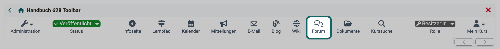{ class="shadow lightbox" title="Toolbar eines Kurses · 2026.10.27" }

Neben dem Kursbaustein "Forum" gibt es auch die Möglichkeit, ein zentrales Forum für den gesamten Kurs in der Kurstoolbar anzeigen zu lassen. Das bietet sich an, wenn der Kurs nur *ein* Forum umfasst, das permanent zur Verfügung stehen soll. Einstellungen wie Pseudonymisierung oder Moderationsrechte lassen sich hier jedoch nicht festlegen. 
[Mehr dazu >](../learningresources/Course_Element_Forum.de.md)

---

### Dokumente {: #documents}

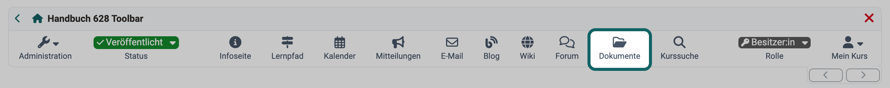{ class="shadow lightbox" title="Toolbar eines Kurses · 2026.10.27" }

Über diesen Link kann die Lehrkraft wichtige Dokumente des Kurses zentral zum Download bereitstellen. Die Lernenden können die Dokumente herunterladen, sich benachrichtigen lassen, wenn neue Dokumente bereitstehen (abonnieren) und bei Bedarf die Dateien per Mail versenden. Die Konfigurationsmöglichkeiten sind aber nicht so umfangreich wie beim Kursbaustein "Ordner". 
[Mehr dazu >](../learningresources/Storage_folder.de.md)

---

### Termine {: #events}

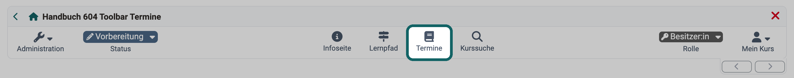{ class="shadow lightbox" title="Toolbar eines Kurses · 2026.10.27" }

Ist das Termin- und Absenzenmanagement eingeschaltet, kann es hier zur Ansicht bzw. Erfassung von Terminen und Absenzen aufgerufen werden. 
[Mehr dazu >](../learningresources/Toolbar_Events.de.md)

---

### Glossar {: #glossary}

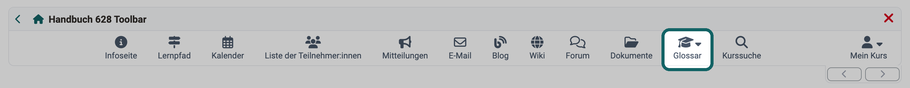{ class="shadow lightbox" title="Toolbar eines Kurses, Sicht Teilnehmer:in · 2026.10.27" }

Sofern ein Glossar mit dem Kurs verbunden wurde, kann es auch in der Toolbar aufgerufen werden. In einem Glossar können die Begriffe eines Kurses, eines Fachs bzw. einer Veranstaltung erklärt werden. Die Begriffe werden automatisch alphabetisch sortiert und können mit Klick auf den entsprechenden Startbuchstaben aufgerufen werden. 
[Mehr dazu >](Glossary/index.de.md)

---

### Kurs-Chat {: #chat}

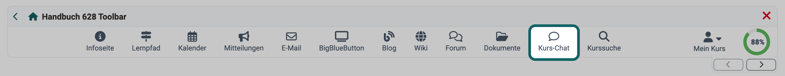{ class="shadow lightbox" title="Toolbar eines Kurses, Sicht Teilnehmer:in · 2026.10.27" }

Der Chat ermöglicht den synchronen Austausch unter den Kurs-Mitgliedern. 
[Mehr dazu >](../basic_concepts/Chat.de.md)

---

### Kurssuche [:octicons-tag-16:{ title="ab Release 11.3 (OO-2581)" }](https://track.frentix.com/issue/OO-2581) {: #course_search}

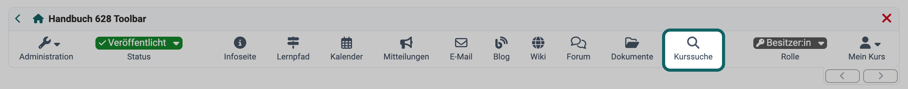{ class="shadow lightbox" title="Toolbar eines Kurses · 2026.10.27" }

Je nachdem, von wo die Suche gestartet wird, werden andere Bereiche durchsucht. Mit dem Icon in der Toolbar wird die Kurssuche ausgeführt. 
[Mehr dazu >](../basic_concepts/Search_in_Course.de.md)

Rechts neben der Kurssuche stehen die [externen Kurstools](#external_tools), sofern sie eingerichtet sind.

---

### Rolle {: #role}

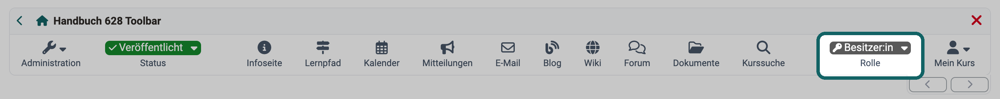{ class="shadow lightbox" title="Toolbar eines Kurses · 2026.10.27" }

Besitzt eine Person in diesem Kurs mehrere Rollen, kann die Rolle hier gewechselt werden. 
[Mehr dazu >](../basic_concepts/Roles/index.de.md#course)

---

### Mein Kurs {: #my_course}

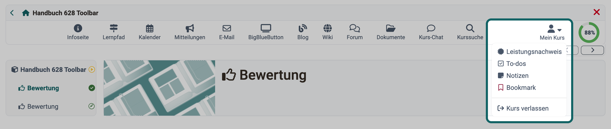{ class="shadow lightbox" title="Menü Mein Kurs in der Toolbar, Sicht Teilnehmer:in · 2026.10.27" }

Das Dropdown-Menü "Mein Kurs" der Toolbar bietet Zugriff auf personalisierte Bestandteile des Kurses. 
[Mehr dazu >](../learningresources/Toolbar_My_Course.de.md)

---

### Fortschrittsanzeige {: #progress}

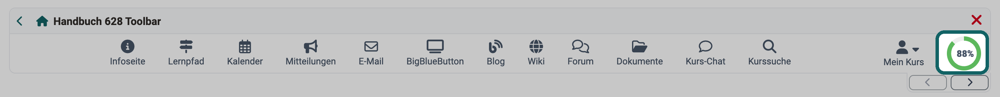{ class="shadow lightbox" title="Toolbar eines Kurses, Sicht Teilnehmer:in · 2026.10.27" }

Kursteilnehmer:innen sehen in Lernpfadkursen hier ihren Bearbeitungsstand in Form eines Kreisdiagramms. Für andere Rollen ist die Fortschrittsanzeige nicht relevant und wird deshalb nicht angezeigt. In herkömmlichen Kursen gibt es keinen Lernpfad, deshalb kann dort auch kein Lernfortschritt berechnet werden. Sie sehen die Fortschrittsanzeige nur, wenn Sie Teilnehmer:in des Kurses sind und der Kurs mindestens einen Kursbaustein enthält, bei dem unter "Durchführung" die Option "Obligatorisch" gewählt ist. 
[Mehr dazu >](../learningresources/Creating_learning_path_courses.de.md#konfiguration-zur-berechnung-des-lernfortschritts)

[Zum Seitenanfang ^](#tab_toolbar)

---

## Icons (Tools) anzeigen {: #show_icons}

### Anzeige durch Kursbesitzer:innen [:octicons-tag-16:{ title="ab Release 10.5 (OO-1967)" }](https://track.frentix.com/issue/OO-1967) {: #show_icons_by_owners}

Als Kursbesitzer:in legen Sie unter `Kurs > Administration > Einstellungen > Tab "Toolbar"` fest, ob die Teilnehmer:innen eine Toolbar angezeigt bekommen und, wenn ja, welche Icons (Werkzeuge) in der Toolbar angezeigt werden. Die Checkboxen dafür beschreibt der Abschnitt [Werkzeuge in Toolbar aktivieren](#activate_tools).

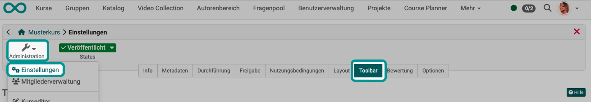{ class="shadow lightbox" title="Menü Administration eines Kurses" }

### Ständig angezeigte Tool-Icons {: #show_icons_permanently}

Einige Icons werden nicht im Tab "Toolbar" geschaltet, sondern in jedem Kurs angezeigt, sobald die Toolbar angezeigt wird. Welche davon eine Person sieht, hängt von ihrer Rolle ab. Dazu gehören:

- [Administration](#admin)
- [Status](#status)
- [Infoseite](#info_page)
- [Lernpfad](#learning_path) (wenn Lernpfadkurs)
- [Rolle](#role)
- [Mein Kurs](#my_course)
- [Fortschrittsanzeige](#progress) (wenn Lernpfadkurs)

### Automatisch angezeigte Tool-Icons {: #show_icons_automatically}

Die Anzeige des Icons "Termine" kann nicht direkt manuell veranlasst werden. Es erscheint automatisch in der Toolbar, wenn das Termin- und Absenzenmanagement aktiviert wurde. 
[Mehr dazu >](../learningresources/Toolbar_Events.de.md)

[Zum Seitenanfang ^](#tab_toolbar)

---

## Weiterführende Informationen {: #further_information}

**Auf dieser Seite erwähnt** 
[Wiki erstellen >](Wiki.de.md) 
[Blog: Übersicht >](Blog/index.de.md) 
[Lernpfadkurs - Überblick >](Learning_path_course/index.de.md) 
[Kurs-Administration: Übersicht >](Administration/index.de.md) 
[Zugangskonfiguration / Freigabe >](Access_configuration.de.md) 
[Toolbar: Infoseite >](Info_page.de.md) 
[Kursbaustein "Kalender" >](Course_Element_Calendar.de.md) 
[Persönliche Werkzeuge: Kalender >](../personal_menu/Calendar.de.md) 
[Gruppenwerkzeuge nutzen >](../groups/Using_Group_Tools.de.md) 
[Kursbaustein "Liste der Teilnehmer:innen" >](Course_Element_Participant_List.de.md) 
[Kursbaustein "Mitteilungen" >](Course_Element_Notifications.de.md) 
[Persönliche Werkzeuge: E-Mail >](../personal_menu/E-Mail.de.md) 
[Kursbaustein "E-Mail" >](Course_Element_EMail.de.md) 
[Kursbaustein "BigBlueButton" >](bigbluebutton/index.de.md) 
[Kursbaustein "Blog" >](Course_Element_Blog.de.md) 
[Kursbaustein "Wiki" >](Course_Element_Wiki.de.md) 
[Kursbaustein "Forum" >](Course_Element_Forum.de.md) 
[Ablageordner >](Storage_folder.de.md) 
[Toolbar: Termine >](Toolbar_Events.de.md) 
[Glossar >](Glossary/index.de.md) 
[Chat >](../basic_concepts/Chat.de.md) 
[Suche in einem Kurs >](../basic_concepts/Search_in_Course.de.md) 
[Rollen und Rechte: Welche Rollen gibt es? >](../basic_concepts/Roles/index.de.md) 
[Toolbar: Mein Kurs >](Toolbar_My_Course.de.md) 
[Lernpfadkurse erstellen >](Creating_learning_path_courses.de.md)

**Weiterführend** 
[Kurseinstellungen >](Course_Settings/index.de.md) 
[Kurseinstellungen - Tab Optionen >](Course_Settings_Options.de.md)

[Zum Seitenanfang ^](#tab_toolbar)
