# Toolbar {: #tab_toolbar}

The toolbar sits at the top of the page directly below the main navigation and shows the icons of the tools. This way participants reach the tools they need throughout the course from one central place. In the "Toolbar" tab you define whether participants see the toolbar in the course and which tools appear in it: 
`Course > Administration > Settings > Tab "Toolbar"`

This page first describes the settings in the "Toolbar" tab and then what participants see in the toolbar.

## Profile

Name | Toolbar
---------|----------
Available since | Release 10.0 (2014)

---

## Activate tools in toolbar {: #activate_tools}

If the checkbox "Toolbar visible for participants" is switched on, you select the tools below it. The tab can be edited by owners of the course, learning resource managers, administrators and persons with the "Course editor" right.

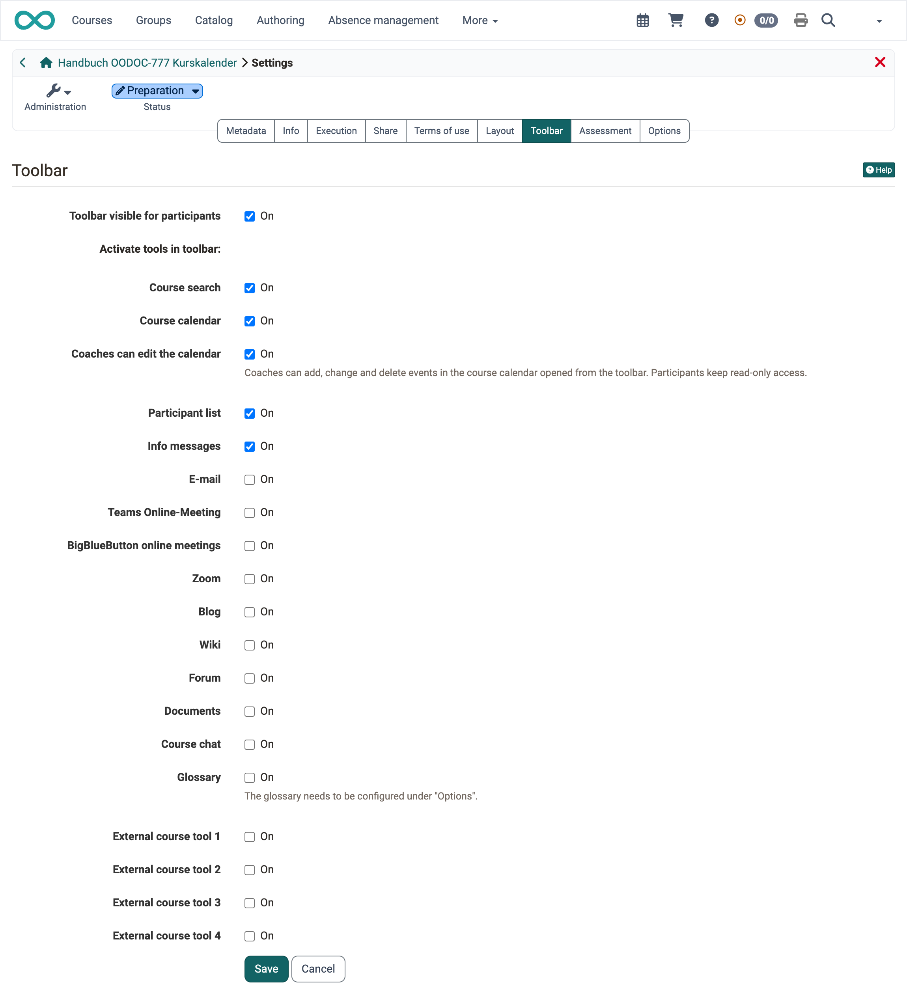{ class="shadow lightbox" title="Toolbar tab of the course settings · 2026.11.10" }

Coaches and owners always see the toolbar. Every tool you switch on for the course appears with its icon in the toolbar. 
[More >](#show_icons)

In addition to course search, glossary and course chat, the [tools](#available_icons) of the toolbar include tools that also exist as course elements, e.g. course calendar, participant list, e-mail, blog, wiki, forum and documents. For [Wiki](../learningresources/Wiki.md) and [Blog](Blog/index.md), you can also use learning resources that have already been created. The other tools are similar to the corresponding course elements, but do not offer all the configuration options that the course elements have in the course editor.

If coaches plan the events of the course, the checkbox "Coaches can edit the calendar" allows them to add, change and delete events in the course calendar. The checkbox appears directly below "Course calendar" as soon as you switch on the course calendar. Participants read the events. If you switch off the course calendar or the toolbar, OpenOlat also saves this option as switched off. 
[More about the rights in the course calendar >](#calendar)

Especially in linear [learning path courses](Learning_path_course/index.md), the toolbar provides important tools regardless of the order of the learning steps.

[To the top of the page ^](#tab_toolbar)

---

## External course tools [:octicons-tag-16:{ title="from Release 21.0 (OO-9488)" }](https://track.frentix.com/issue/OO-9488) {: #external_tools}

If your participants work with other web applications alongside the course, such as a timetable or a school portal, you place the links to them as external course tools directly in the course toolbar. External course tools lead, for example, to an absence management system, a school information page, a partner portal, a room booking tool or an external mail or calendar system. Four external course tools are available per course.

They are set up under `Course > Administration > Settings > Tab "Toolbar"`. The rows "External course tool 1" to "External course tool 4" are located below the toolbar tools. They only appear if the checkbox "On" is activated for "Toolbar visible for participants". If you activate the checkbox "On" for a tool, the fields "Name", "URL", "Icon" and "Visible to" appear below it.

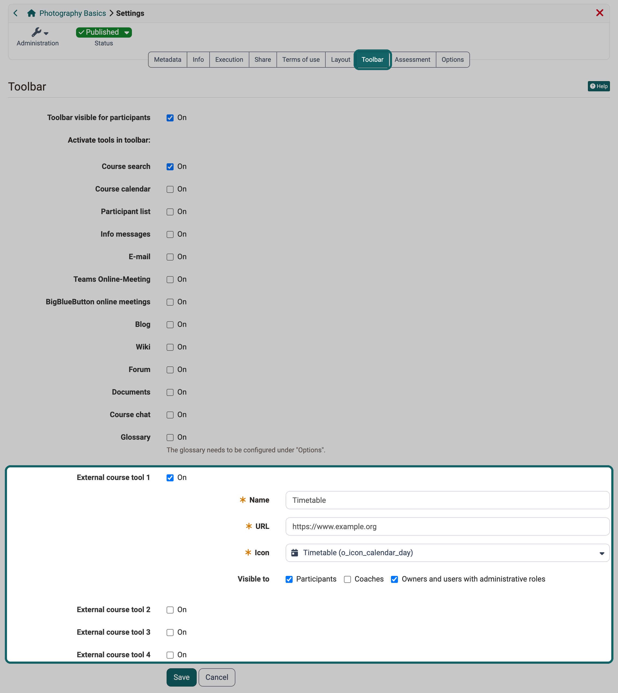{ class="shadow lightbox" title="External course tools in the Toolbar tab of the course settings · 2026.10.29" }

| Field | Description |
|---|---|
| **Name** | Label shown in the toolbar, max. 64 characters. Mandatory field. |
| **URL** | Absolute URL starting with `http://` or `https://`. Relative URLs, anchors, `javascript:`, `data:`, `mailto:`, `tel:` and protocol-relative links are rejected. Mandatory field. |
| **Icon** | Selection from the icon catalog (around 30 entries, e.g. Link, E-mail, Calendar, Timetable, Absence management, School portal, Booking, Videos, Files). Mandatory field. |
| **Visible to** | Separate checkboxes for "Participants", "Coaches" and "Owners and users with administrative roles". Each option applies to its own role only: a tool that is visible to participants only is not seen by coaches. Administrators, learning resource managers, principals and course planners see the tool when the option for owners is selected. For a newly switched on tool, this option is preselected. If no option is selected, the form displays the warning "The tool is enabled but not visible to anyone. Select at least one option." The tool is saved anyway, and then nobody sees it in the toolbar. |

In the toolbar, the roles selected under "Visible to" see the tool with its name and icon.

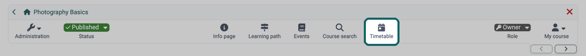{ class="shadow lightbox" title="External course tool in the course toolbar · 2026.10.02" }

!!! warning "Attention"
    If you remove the checkbox "On" for a tool or switch off "Toolbar visible for participants", OpenOlat deletes the name, URL and icon of the affected tools when saving, and the selection under "Visible to" is reset. When you switch them on again, you enter the details again.

**Course copy / import**

- The configuration of all four external course tools is included when a course is copied.
- On course import, all four tools are switched off. Name, URL and icon are not taken over and must be entered again in the imported course.

!!! info "Important"
    External course tools always open in a new browser window. No user data (name, e-mail etc.) is passed to the target system. If OpenOlat and the target system share the same identity provider, single sign-on works automatically.

[To the top of the page ^](#tab_toolbar)

---

## Available icons {: #available_icons}

Which icons a person sees in the toolbar depends on the tools switched on and on their role in the course.

**Example participant**:

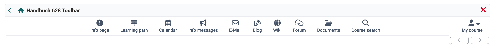{ class="shadow lightbox" title="Toolbar of a course, participant view · 2026.10.27" }

**Example course owner/coach**:

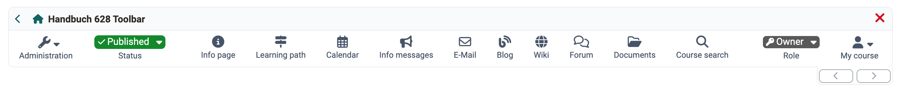{ class="shadow lightbox" title="Toolbar of a course, course owner view · 2026.10.27" }

### Administration {: #admin}

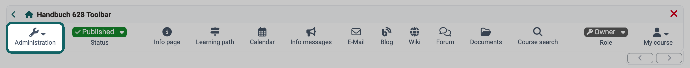{ class="shadow lightbox" title="Toolbar of a course · 2026.10.27" }

Only persons who manage the course see the menu "Administration", participants do not see it. There they open, among other things, the settings and the course editor. 
[More >](Administration/index.md)

---

### Status [:octicons-tag-16:{ title="from Release 13.0 (OO-3584)" }](https://track.frentix.com/issue/OO-3584) {: #status}

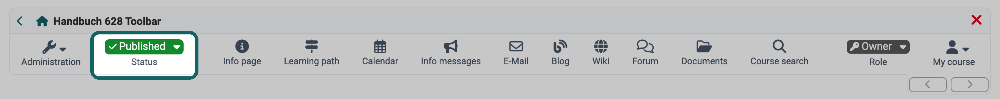{ class="shadow lightbox" title="Toolbar of a course · 2026.10.27" }

Only persons who manage the course see the status, participants do not see it. Here they change the status of the course. 
[More >](../learningresources/Access_configuration.md)

---

### Info page [:octicons-tag-16:{ title="from Release 21.1 (OO-9758)" }](https://track.frentix.com/issue/OO-9758){:target="_blank"} {: #info_page}

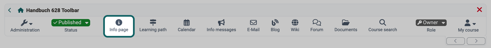{ class="shadow lightbox" title="Toolbar of a course · 2026.10.27" }

Anyone who wants to know what a course is about opens the description of the course with the tool "Info page" and its info icon, for example with the execution period and location. Interested people see the same details before they enter the course. 
[More >](../learningresources/Info_page.md)

---

### Learning path [:octicons-tag-16:{ title="from Release 15.0 (OO-4300)" }](https://track.frentix.com/issue/OO-4300) {: #learning_path}

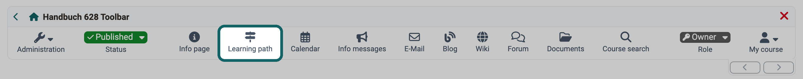{ class="shadow lightbox" title="Toolbar of a course · 2026.10.27" }

The tool "Learning path" appears in learning path courses.

**Access by participants** 
The learning path icon in the toolbar gives learners an overview of their progress in all course elements. Depending on the columns selected, additional information such as the type of execution and dates can also be displayed. This way learners keep track of their activities in the course.

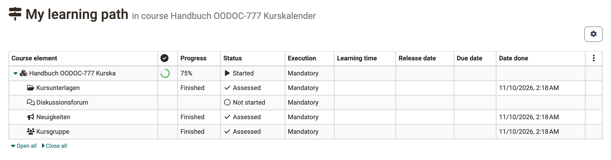{ class="shadow lightbox" title="Learning path from the participant's view · 2026.11.10" }

**Access by course owners and coaches** 
Course owners and coaches can use the "Learning path" link to first get an overview of all participants and then, in the next step, select a person to display their learning progress. 
[More >](Learning_path_course/index.md)

---

### Calendar {: #calendar}

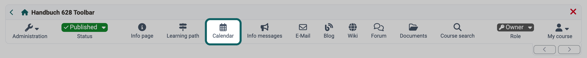{ class="shadow lightbox" title="Toolbar of a course · 2026.10.27" }

With the tool "Calendar", the course members see all events of the course in one central place. The calendar opens in a window of its own. Every course has exactly one course calendar. You show it in the toolbar, as [course element "Calendar"](../learningresources/Course_Element_Calendar.md) in the course structure, or in both places. Both show the same events.

In addition to the course calendar, OpenOlat offers other calendars:

- [Personal calendar >](../personal_menu/Calendar.md)
- [Group calendar >](../groups/Using_Group_Tools.md)

You create a new event by clicking on the desired date. Then you set the subject, description, beginning and end, and if needed also the location, recurrence and visibility. The event appears in the course calendar and therefore everywhere the course shows the calendar. To revise the event, click on it and select "Edit".

Via "Edit" you reach further tabs of the event and link it to course elements of the course or to external websites. If you want to delete all events of a course calendar, click on the gear icon in the calendar area and select "Reset calendar".

The course members automatically also see the course calendar in their personal OpenOlat calendar. The same applies to group calendars. For group calendars, you define in the group administration which write and read permissions the members receive.

In the calendar of the toolbar, owners of the course create and edit events. Coaches edit events if the option "Coaches can edit the calendar" is switched on in the "Toolbar" tab, see [Activate tools in toolbar](#activate_tools). This way the coaches who plan the events enter them themselves, without you inserting a course element "Calendar" for this. Participants read the events. The option also applies to the events of the course calendar in the [course element "Video live stream"](../learningresources/Course_Element_Video_Livestream.md#events). [:octicons-tag-16:{ title="from Release 21.2 (OO-9968)" }](https://track.frentix.com/issue/OO-9968)

In the course element "Calendar" you set the rights separately: in the course editor, in the tab "Calendar configuration", you define under "Edit events" whether coaches and participants may also edit events there. This is the way for a course without a toolbar. 
[More >](../learningresources/Course_Element_Calendar.md)

The checkbox "Course calendar" and with it the option for coaches appear if system administrators have switched on the calendar and the checkbox "Enable course tool" in the [Core functions](../../manual_admin/administration/Core_functions.md#calendar_administration). If an external system manages the calendar of the course, the option cannot be changed. When a course is copied or imported, OpenOlat takes over the setting.

---

### Participant list [:octicons-tag-16:{ title="from Release 15.0 (OO-4168)" }](https://track.frentix.com/issue/OO-4168) {: #participant_list}

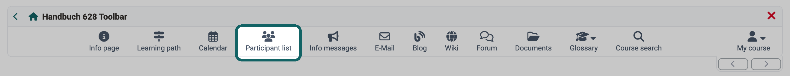{ class="shadow lightbox" title="Toolbar of a course, participant view · 2026.10.27" }

With the tool "Participant list", the course members see who is owner, coach or participant in the course, and they write to these persons directly via "Send e-mail". In contrast to the course element of the same name, the tool cannot be configured: it always shows all three roles. 
[More >](../learningresources/Course_Element_Participant_List.md)

---

### Info messages {: #notifications}

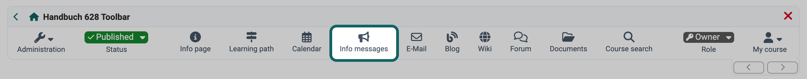{ class="shadow lightbox" title="Toolbar of a course · 2026.10.27" }

With the tool "Info messages", you address an announcement to the entire course without placing a course element in the course menu. Owners and coaches create the info messages. Participants subscribe to the tool themselves if needed and are then notified when a new info message appears.

In contrast to the course element "Info messages", the tool cannot be configured. Display, user rights, automatic subscription and access are defined in the course element only. Use the course element if the info messages should appear at a specific place in the course menu or if you need these settings. 
[More >](../learningresources/Course_Element_Notifications.md)

---

### E-Mail {: #email}

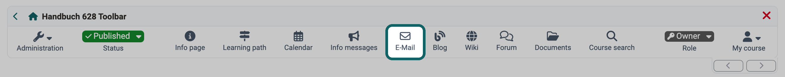{ class="shadow lightbox" title="Toolbar of a course · 2026.10.27" }

With the tool "E-Mail", the course members reach the e-mail function of the course with one click. You also send e-mails via the [personal menu](../personal_menu/E-Mail.md). 
[More >](../learningresources/Course_Element_EMail.md)

---

### BigBlueButton (or other virtual classrooms) [:octicons-tag-16:{ title="from Release 15.4 (OO-5151)" }](https://track.frentix.com/issue/OO-5151) {: #BBB}

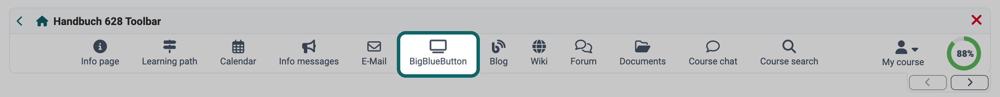{ class="shadow lightbox" title="Toolbar of a course, participant view · 2026.10.27" }

Instead of using a course element, the course members also open a virtual classroom via an icon in the toolbar. In addition to BigBlueButton, the toolbar also shows other video conferencing tools that are set up, such as Microsoft Teams or Zoom. 
[More >](../learningresources/bigbluebutton/index.md)

---

### Blog {: #blog}

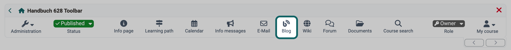{ class="shadow lightbox" title="Toolbar of a course · 2026.10.27" }

If a blog relates to the entire course, the course members open it via the icon in the toolbar. You integrate further blogs as course elements. 
[More >](../learningresources/Course_Element_Blog.md)

---

### Wiki {: #wiki}

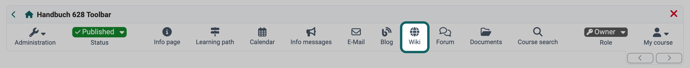{ class="shadow lightbox" title="Toolbar of a course · 2026.10.27" }

If a wiki applies to the entire course, you set it up as a central wiki in the toolbar. 
[More about creating a wiki >](../learningresources/Wiki.md) 
[More about the course element Wiki >](../learningresources/Course_Element_Wiki.md)

---

### Forum {: #forum}

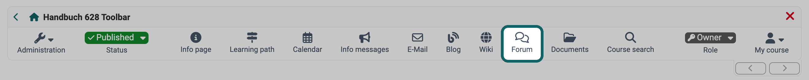{ class="shadow lightbox" title="Toolbar of a course · 2026.10.27" }

In addition to the "Forum" course element, you can show a central forum for the entire course in the toolbar. This is useful if the course only includes *one* forum that is to be permanently available. However, settings such as pseudonymization or moderation rights cannot be set here. 
[More >](../learningresources/Course_Element_Forum.md)

---

### Documents {: #documents}

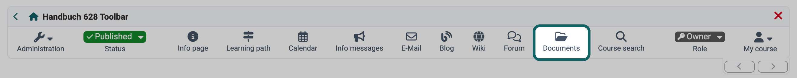{ class="shadow lightbox" title="Toolbar of a course · 2026.10.27" }

With the tool "Documents", you make important course documents available for download in one central location. Learners can download the documents, receive notifications when new documents are available (subscribe), and send the files by e-mail if necessary. However, the configuration options are not as extensive as those of the "Folder" course element. 
[More >](../learningresources/Storage_folder.md)

---

### Events {: #events}

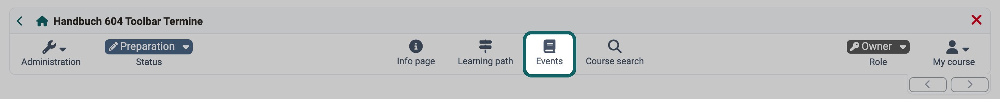{ class="shadow lightbox" title="Toolbar of a course · 2026.10.27" }

If the appointment and absence management is enabled, the course members open the events and absences of the course here. 
[More >](../learningresources/Toolbar_Events.md)

---

### Glossary {: #glossary}

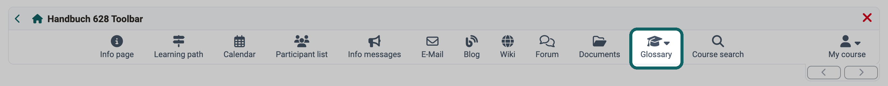{ class="shadow lightbox" title="Toolbar of a course, participant view · 2026.10.27" }

If a glossary is linked to the course, the course members also open it from the toolbar. A glossary explains the terms of a course, a subject or an event. OpenOlat sorts the terms alphabetically, and a click on an initial letter takes you to the matching terms. 
[More >](Glossary/index.md)

---

### Course chat {: #chat}

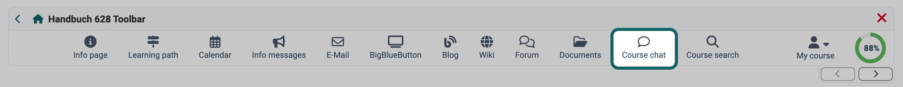{ class="shadow lightbox" title="Toolbar of a course, participant view · 2026.10.27" }

The chat enables synchronous exchange between the course members. 
[More >](../basic_concepts/Chat.md)

---

### Course search [:octicons-tag-16:{ title="from Release 11.3 (OO-2581)" }](https://track.frentix.com/issue/OO-2581) {: #course_search}

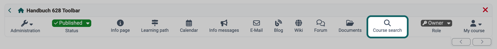{ class="shadow lightbox" title="Toolbar of a course · 2026.10.27" }

With the icon in the toolbar, you search the contents of this course. A search that you start elsewhere in OpenOlat searches other areas. 
[More >](../basic_concepts/Search_in_Course.md)

To the right of the course search are the [external course tools](#external_tools), if they are set up.

---

### Role {: #role}

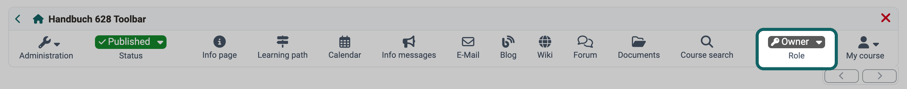{ class="shadow lightbox" title="Toolbar of a course · 2026.10.27" }

If a person has multiple roles in this course, they change the role here. 
[More >](../basic_concepts/Roles/index.md#course)

---

### My course {: #my_course}

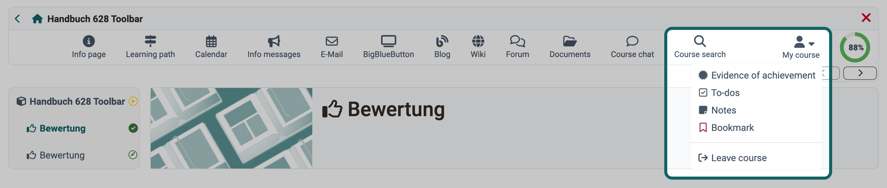{ class="shadow lightbox" title="Menu My course in the toolbar, participant view · 2026.10.27" }

The "My course" drop-down menu in the toolbar provides access to personalized components of the course. 
[More >](../learningresources/Toolbar_My_Course.md)

---

### Progress {: #progress}

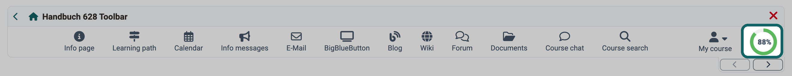{ class="shadow lightbox" title="Toolbar of a course, participant view · 2026.10.27" }

In learning path courses, course participants see their processing status here in the form of a pie chart. For other roles, the progress indicator is not relevant and is therefore not displayed. There is no learning path in conventional courses, so no learning progress can be calculated there. You only see the progress indicator if you are a participant of the course and the course contains at least one course element with the option "Mandatory" selected under "Execution". 
[More >](../learningresources/Creating_learning_path_courses.md#configuration-for-calculating-the-learning-progress)

[To the top of the page ^](#tab_toolbar)

---

## Show icons (tools) {: #show_icons}

### Display by course owners [:octicons-tag-16:{ title="from Release 10.5 (OO-1967)" }](https://track.frentix.com/issue/OO-1967) {: #show_icons_by_owners}

As course owner you define under `Course > Administration > Settings > Tab "Toolbar"` whether participants see a toolbar and, if so, which icons (tools) are displayed in the toolbar. The checkboxes for this are described in the section [Activate tools in toolbar](#activate_tools).

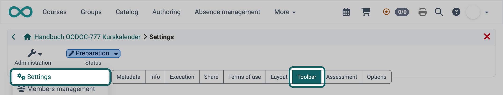{ class="shadow lightbox" title="Administration menu of a course · 2026.11.10" }

### Permanently displayed tool icons {: #show_icons_permanently}

Some icons are not switched in the "Toolbar" tab, but are displayed in every course as soon as the toolbar is displayed. Which of them a person sees depends on their role. These include:

- [Administration](#admin)
- [Status](#status)
- [Info page](#info_page)
- [Learning path](#learning_path) (if learning path course)
- [Role](#role)
- [My course](#my_course)
- [Progress](#progress) (if learning path course)

### Automatically displayed tool icons {: #show_icons_automatically}

The "Events" icon appears automatically in the toolbar as soon as the appointment and absence management is switched on for the course. 
[More >](../learningresources/Toolbar_Events.md)

[To the top of the page ^](#tab_toolbar)

---

## Further information {: #further_information}

**Mentioned on this page** 
[Creating Wikis >](Wiki.md) 
[Blog: Overview >](Blog/index.md) 
[Learning path course - Overview >](Learning_path_course/index.md) 
[Course Administration: Overview >](Administration/index.md) 
[Access configuration >](Access_configuration.md) 
[Toolbar: Info page >](Info_page.md) 
[Course Element "Calendar" >](Course_Element_Calendar.md) 
[User tools: Calendar >](../personal_menu/Calendar.md) 
[Using Group Tools >](../groups/Using_Group_Tools.md) 
[Course Element "Video live stream" >](Course_Element_Video_Livestream.md) 
[Core functions: Overview >](../../manual_admin/administration/Core_functions.md) 
[Course Element "Participant list" >](Course_Element_Participant_List.md) 
[Course Element "Info messages" >](Course_Element_Notifications.md) 
[User tools: E-Mail >](../personal_menu/E-Mail.md) 
[Course Element "E-Mail" >](Course_Element_EMail.md) 
[Course Element "BigBlueButton" >](bigbluebutton/index.md) 
[Course Element "Blog" >](Course_Element_Blog.md) 
[Course Element "Wiki" >](Course_Element_Wiki.md) 
[Course Element "Forum" >](Course_Element_Forum.md) 
[Storage folder >](Storage_folder.md) 
[Toolbar: Events >](Toolbar_Events.md) 
[Glossary >](Glossary/index.md) 
[Chat >](../basic_concepts/Chat.md) 
[Search in a course >](../basic_concepts/Search_in_Course.md) 
[Roles and Rights: Which roles are available? >](../basic_concepts/Roles/index.md) 
[Toolbar: My Course >](Toolbar_My_Course.md) 
[Creating learning path courses >](Creating_learning_path_courses.md)

**Further reading** 
[Course Settings >](Course_Settings/index.md) 
[Course Settings - Tab Options >](Course_Settings_Options.md)

[To the top of the page ^](#tab_toolbar)
