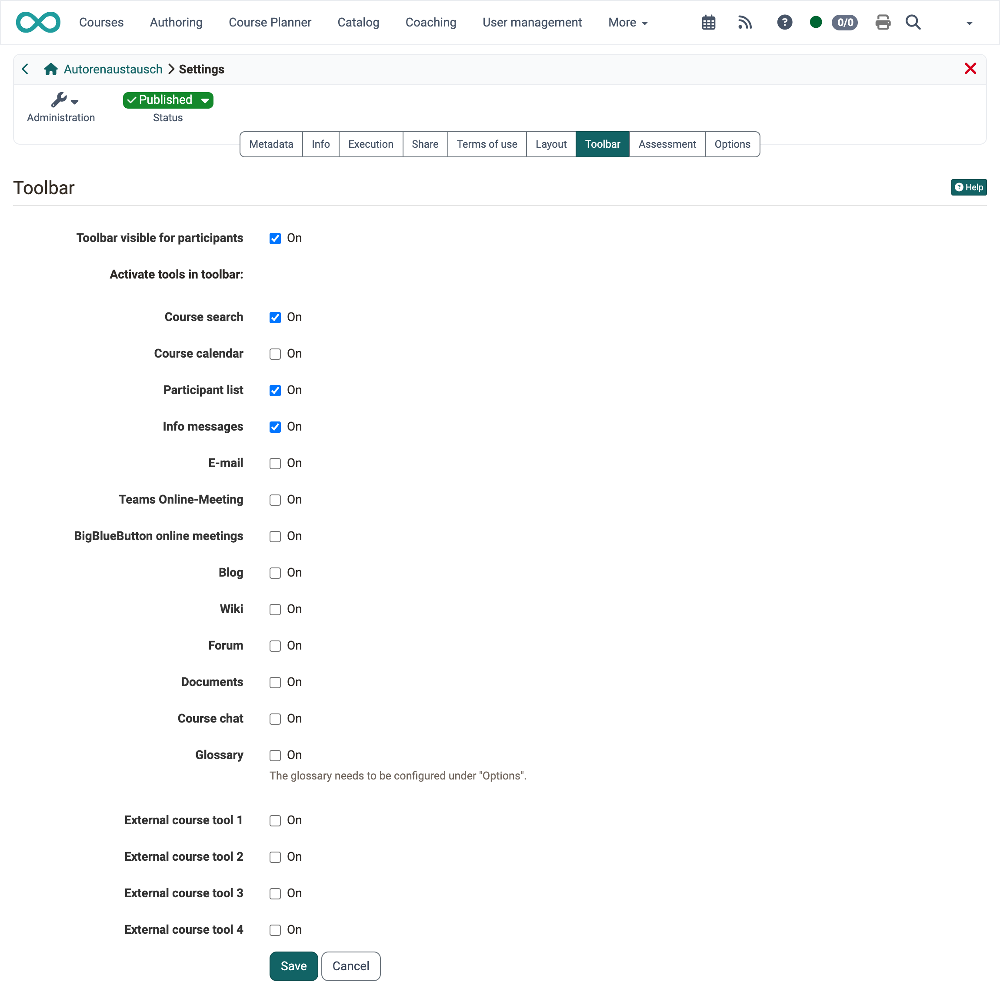
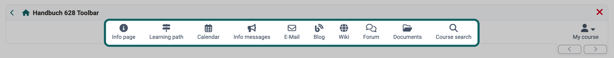
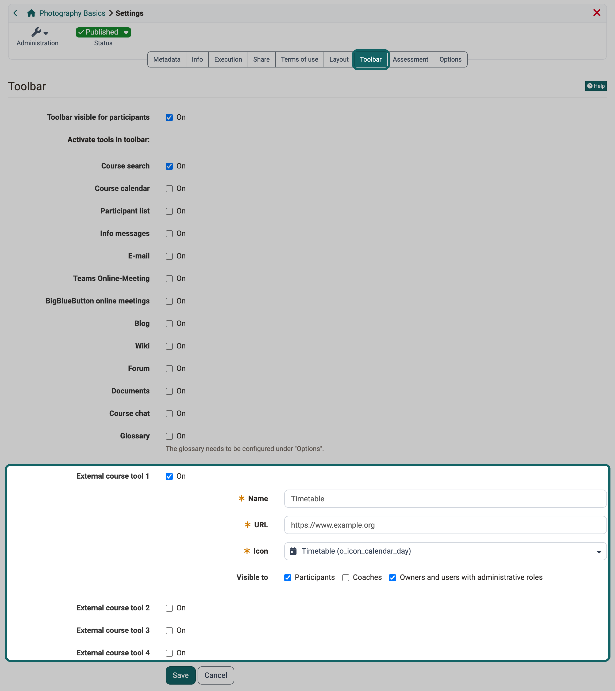

# Course Settings - Tab Toolbar {: #tab_toolbar}

In the "Toolbar" tab you define whether participants see the toolbar in the course and which tools appear in it: 
`Course > Administration > Settings > Tab "Toolbar"`

If the checkbox "Toolbar visible for participants" is switched on, you select the tools below it. The tab can be edited by owners of the course, learning resource managers, administrators and persons with the "Course editor" right.

{ class="shadow lightbox" title="Toolbar tab of the course settings · 2026.10.29" }

This way participants reach the tools they need throughout the course from one central place.

**Example:**

{ class="shadow lightbox" title="Toolbar of a course as participants see it · 2026.10.27" }

In addition to course search, glossary and course chat, the [tools](../learningresources/Using_Additional_Course_Features.md) of the toolbar include tools that also exist as course elements, e.g. course calendar, participant list, e-mail, blog, wiki, forum and documents. For [Wiki](../learningresources/Wiki.md) and [Blog](../learningresources/Blog.md), you can also use learning resources that have already been created. The other tools are similar to the corresponding course elements, but do not offer all the configuration options that the course elements have in the course editor.

Especially in linear [learning path courses](Learning_path_course.md), the toolbar provides important tools regardless of the order of the learning steps.

[To the top of the page ^](#tab_toolbar)

---

## External course tools [:octicons-tag-16:{ title="from Release 21.0 (OO-9488)" }](https://track.frentix.com/issue/OO-9488) {: #external_tools}

If your participants work with other web applications alongside the course, such as a timetable or a school portal, you place the links to them as external course tools directly in the course toolbar. Four external course tools are available per course.

They are set up under `Course > Administration > Settings > Tab "Toolbar"`. The rows "External course tool 1" to "External course tool 4" are located below the toolbar tools. They only appear if the checkbox "On" is activated for "Toolbar visible for participants". If you activate the checkbox "On" for a tool, the fields "Name", "URL", "Icon" and "Visible to" appear below it.

{ class="shadow lightbox" title="External course tools in the Toolbar tab of the course settings · 2026.10.29" }

| Field | Description |
|---|---|
| **Name** | Label shown in the toolbar, max. 64 characters. Mandatory field. |
| **URL** | Absolute URL starting with `http://` or `https://`. Relative URLs, anchors, `javascript:`, `data:`, `mailto:`, `tel:` and protocol-relative links are rejected. Mandatory field. |
| **Icon** | Selection from the icon catalog (around 30 entries, e.g. Link, E-mail, Calendar, Timetable, Absence management, School portal). Mandatory field. |
| **Visible to** | Separate checkboxes for "Participants", "Coaches" and "Owners and users with administrative roles". Each option applies to its own role only: a tool that is visible to participants only is not seen by coaches. Administrators, learning resource managers, principals and course planners see the tool when the option for owners is selected. For a newly switched on tool, this option is preselected. If no option is selected, the form displays the warning "The tool is enabled but not visible to anyone. Select at least one option." The tool is saved anyway, and then nobody sees it in the toolbar. |

{ class="shadow lightbox" title="External course tool in the course toolbar · 2026.10.02" }

!!! warning "Attention"
    If you remove the checkbox "On" for a tool or switch off "Toolbar visible for participants", OpenOlat deletes the name, URL and icon of the affected tools when saving, and the selection under "Visible to" is reset. When you switch them on again, you enter the details again.

**Course copy / import**

- The configuration of all four external course tools is included when a course is copied.
- On course import, all four tools are switched off. Name, URL and icon are not taken over and must be entered again in the imported course.

!!! info "Important"
    External course tools always open in a new browser window. No user data (name, e-mail etc.) is passed to the target system.

[To the top of the page ^](#tab_toolbar)

---

## Further information {: #further_information}

[Using Additional Course Features >](Using_Additional_Course_Features.md) 
[Creating Wikis >](Wiki.md) 
[Blog: Overview >](Blog.md) 
[Learning path course - Overview >](Learning_path_course.md) 
[Course Settings >](Course_Settings.md) 
[Course Settings - Tab Options >](Course_Settings_Options.md)

[To the top of the page ^](#tab_toolbar)

