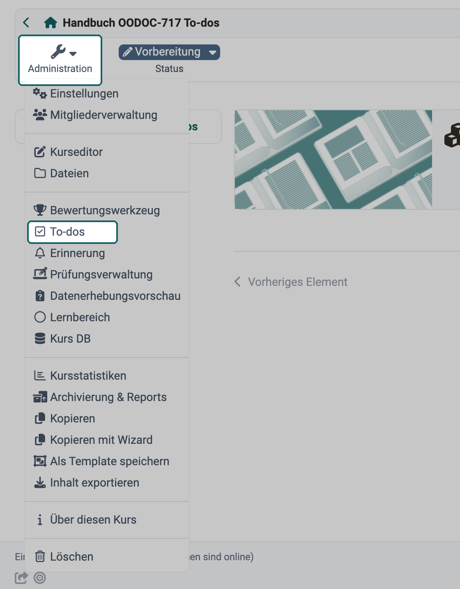
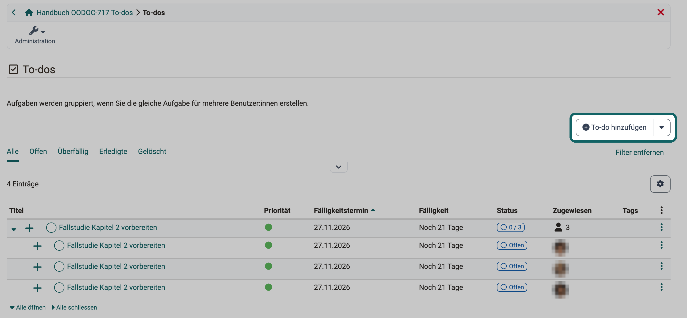
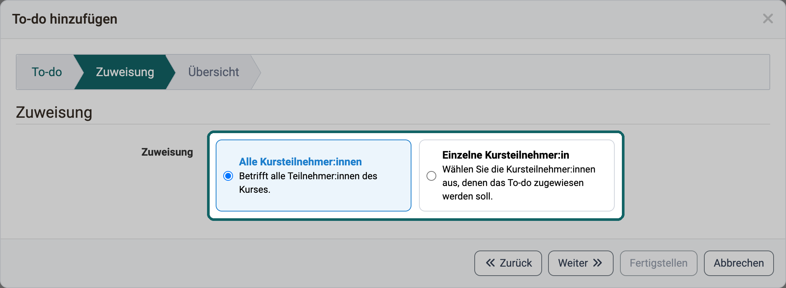
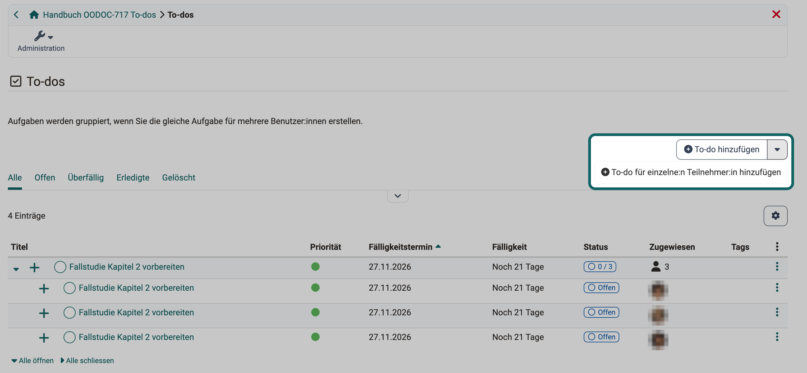
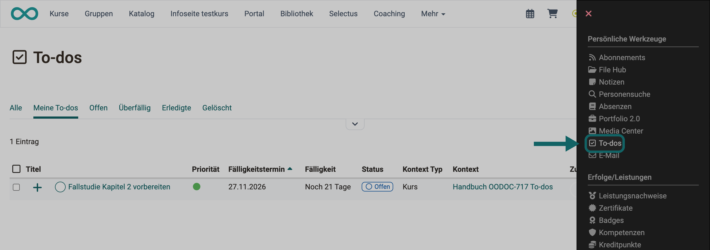

# To-dos im Kurs

[:octicons-tag-16:{ title="ab Release 18.2 (OO-7039)" }](https://track.frentix.com/issue/OO-7039)

Mit einem To-do im Kurs geben Sie Kursteilnehmer:innen einen Auftrag, etwa eine Vorbereitung bis zu einem bestimmten Termin. Die zugewiesenen Personen finden das To-do im Kurs und in ihren persönlichen To-dos und behalten so den Überblick über ihre Aufgaben. To-dos gibt es auch in Projekten, im Kursbaustein "Aufgabe" und im Qualitätsmanagement; was für alle To-dos gilt, steht unter [To-dos: Grundlagen](../basic_concepts/To_Dos_Basics.de.md).

## Wo erstelle ich im Kurs To-dos?

Die To-dos eines Kurses erstellen und verwalten Sie direkt im Kurs unter: 
`Kurs > Administration > To-dos`

{ class="shadow lightbox" title="Menü Administration eines Kurses · 2026.11.06" }

## Wer kann im Kurs To-dos erstellen?

To-dos im Kurs erstellen Kursbesitzer:innen und Betreuer:innen. Dazu kommen alle Rollen mit administrativem Zugriff auf den Kurs, etwa Lernressourcenverwalter:innen und Administrator:innen.

Betreuer:innen erstellen To-dos, solange in den Kurseinstellungen die Option "To-dos bearbeiten" eingeschaltet ist. Das ist die Voreinstellung. Die Option steht im Abschnitt "Einstellungen Betreuer:innen" unter: 
`Kurs > Administration > Einstellungen > Tab "Optionen"` 
Mehr dazu unter [Kurseinstellungen - Tab Optionen](Course_Settings_Options.de.md). In der Liste der To-dos sehen Betreuer:innen die To-dos der Teilnehmer:innen, die sie betreuen.

## To-dos für alle Kursteilnehmer:innen

Oft gilt ein Auftrag für alle Teilnehmer:innen eines Kurses. Den Button "To-do hinzufügen" finden Sie rechts oben über der Liste der To-dos.

{ class="shadow lightbox" title="Seite To-dos im Kurs · 2026.11.06" }

Der Button öffnet einen Wizard mit drei Schritten:

- **To-do**: Sie erfassen Titel, Fälligkeitstermin und die weiteren Angaben. Die Felder beschreibt der Abschnitt [Die Felder eines To-dos](../basic_concepts/To_Dos_Basics.de.md#to_do_fields).
- **Zuweisung**: Sie wählen zwischen "Alle Kursteilnehmer:innen" und "Einzelne Kursteilnehmer:in".
- **Übersicht**: Sie sehen das To-do und die zugewiesenen Personen, bevor Sie mit "Fertigstellen" abschliessen.

{ class="shadow lightbox" title="Schritt Zuweisung im Wizard To-do hinzufügen · 2026.11.06" }

## To-dos für Einzelpersonen

Gilt ein To-do nur für eine Person, klicken Sie auf den kleinen Pfeil neben dem Button "To-do hinzufügen" und wählen "To-do für einzelne:n Teilnehmer:in hinzufügen". Es öffnet sich der Dialog "To-do bearbeiten".

{ class="shadow lightbox" title="Seite To-dos im Kurs · 2026.11.06" }

## Wie wird über die To-dos informiert?

Ein To-do aus dem Kurs erscheint bei den zugewiesenen Personen im Kurs unter `Mein Kurs > To-dos` und in den [persönlichen To-dos](../personal_menu/To-Dos.de.md): 
`Persönliches Menü > To-dos`

{ class="shadow lightbox" title="Persönliches Menü · 2026.11.06" }

Über das Pluszeichen am Zeilenanfang klappen Sie die Details eines To-dos auf. Wann OpenOlat zusätzlich E-Mails verschickt, steht unter [Wann OpenOlat E-Mails zu To-dos verschickt](../basic_concepts/To_Dos_Basics.de.md#notifications).

## Weiterführende Informationen {: #further_information}

[To-dos: Grundlagen >](../basic_concepts/To_Dos_Basics.de.md) 
[Kurseinstellungen - Tab Optionen >](Course_Settings_Options.de.md) 
[Persönliche Werkzeuge: To-dos >](../personal_menu/To-Dos.de.md) 
[Projekte: To-dos >](../area_modules/Project_Todos.de.md) 
[Kursbaustein "Aufgabe" >](Course_Element_Task/index.de.md) 
[Qualitätsmanagement: Massnahmen (To-dos) >](../area_modules/Quality_Management_To-dos.de.md)

[Zum Seitenanfang ^](#to-dos-im-kurs)
