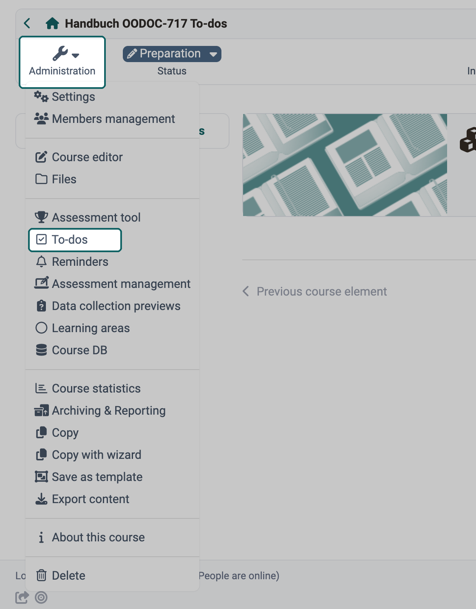
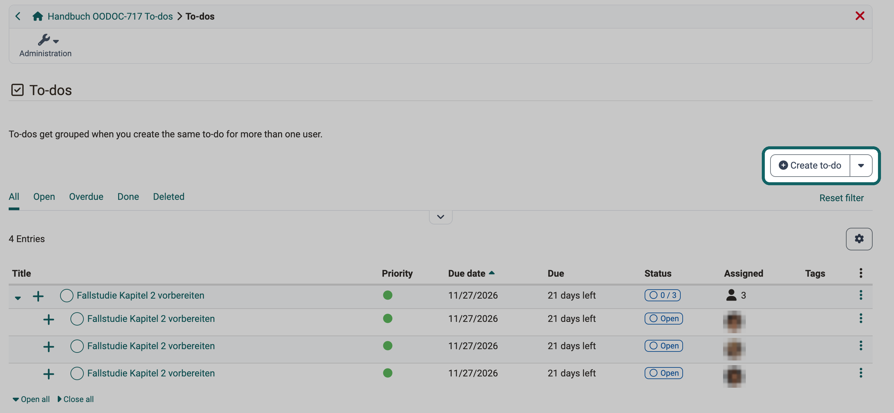
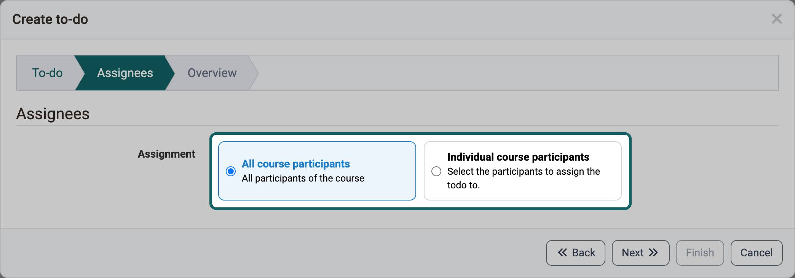
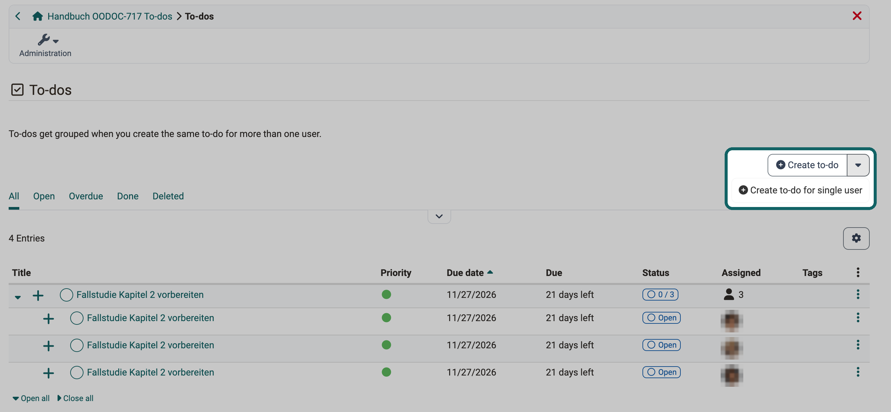
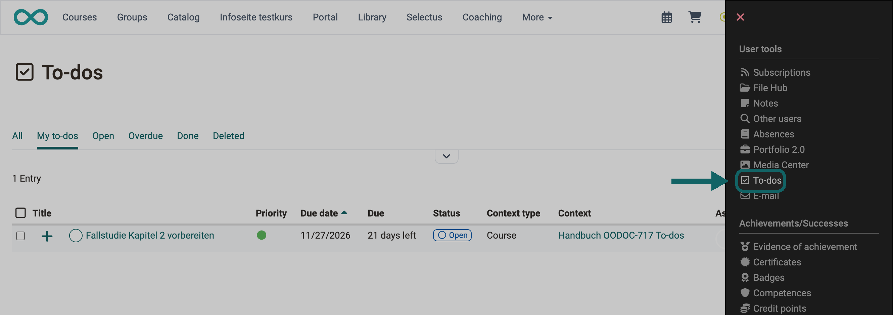

# To-dos in the course

[:octicons-tag-16:{ title="from Release 18.2 (OO-7039)" }](https://track.frentix.com/issue/OO-7039)

With a to-do in the course, you give course participants an assignment, for example a preparation by a certain date. The assigned persons find the to-do in the course and in their personal to-dos and so keep track of their tasks. To-dos also exist in projects, in the course element "Task" and in quality management; what applies to all to-dos is described under [To-dos: basics](../basic_concepts/To_Dos_Basics.md).

## Where do I create to-dos in the course?

You create and manage the to-dos of a course directly in the course under: 
`Course > Administration > To-dos`

{ class="shadow lightbox" title="Administration menu of a course · 2026.11.06" }

## Who can create to-dos in courses?

To-dos in the course are created by course owners and coaches. In addition, all roles with administrative access to the course can create them, for example learning resource managers and administrators.

Coaches create to-dos as long as the option "Edit to-dos" is switched on in the course settings. This is the default setting. The option is in the section "Coach settings" under: 
`Course > Administration > Settings > Tab "Options"` 
More on this under [Course Settings - Tab Options](Course_Settings_Options.md). In the list of to-dos, coaches see the to-dos of the participants they coach.

## To-dos for all course participants

An assignment often applies to all participants of a course. You find the button "Create to-do" at the top right above the list of to-dos.

{ class="shadow lightbox" title="To-dos page in the course · 2026.11.06" }

The button opens a wizard with three steps:

- **To-do**: You enter the title, the due date and the other details. The fields are described in the section [The fields of a to-do](../basic_concepts/To_Dos_Basics.md#to_do_fields).
- **Assignees**: You choose between "All course participants" and "Individual course participants".
- **Overview**: You see the to-do and the assigned persons before you complete it with "Finish".

{ class="shadow lightbox" title="Step Assignees in the Create to-do wizard · 2026.11.06" }

## To-dos for individuals

If a to-do applies to one person only, click the small arrow next to the button "Create to-do" and select "Create to-do for single user". The dialog "Edit to-do" opens.

{ class="shadow lightbox" title="To-dos page in the course · 2026.11.06" }

## How are you informed about the to-dos?

A to-do from the course appears for the assigned persons in the course under `My course > To-dos` and in their [personal to-dos](../personal_menu/To-Dos.md): 
`Personal menu > To-dos`

{ class="shadow lightbox" title="Personal menu · 2026.11.06" }

Use the plus sign at the beginning of a row to expand the details of a to-do. When OpenOlat additionally sends e-mails is described under [When OpenOlat sends e-mails about to-dos](../basic_concepts/To_Dos_Basics.md#notifications).

## Further information {: #further_information}

[To-dos: basics >](../basic_concepts/To_Dos_Basics.md) 
[Course Settings - Tab Options >](Course_Settings_Options.md) 
[User tools: To-dos >](../personal_menu/To-Dos.md) 
[Projects: To-dos >](../area_modules/Project_Todos.md) 
[Course Element "Task" >](Course_Element_Task/index.md) 
[Quality Management: Actions (To-dos) >](../area_modules/Quality_Management_To-dos.md)

[To the top of the page ^](#to-dos-in-the-course)
