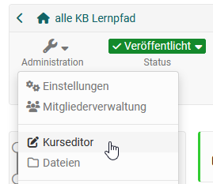
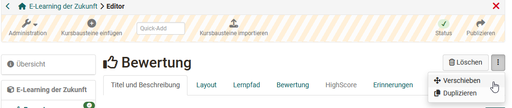
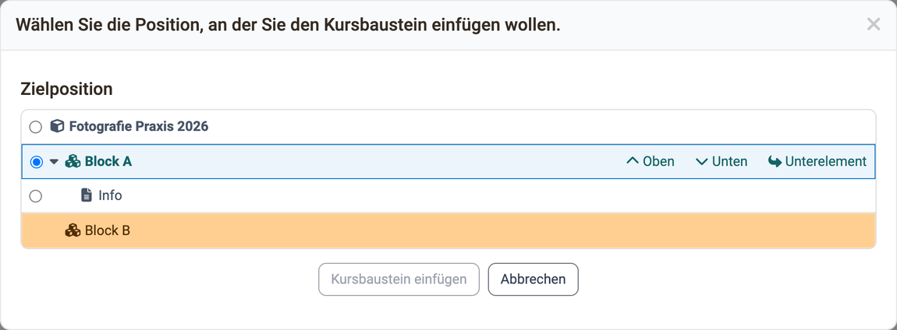
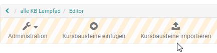
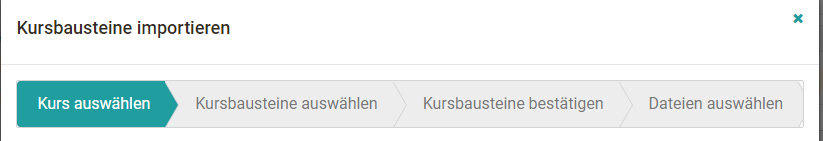

# Löschen, Verschieben und Kopieren von Kursbausteinen

Wächst ein Kurs, ändert sich seine Struktur: Ein Kursbaustein gehört an eine andere Stelle, mehrere Gruppen brauchen dieselbe Struktur, oder ein Kursbaustein ist überflüssig. Kursbausteine löschen, verschieben und duplizieren Sie im Kurseditor. Sie öffnen ihn im gestarteten Kurs unter: 
`Kurs > Administration > Kurseditor`

{ class="shadow lightbox" title="Menü Administration eines Kurses" }

Wählen Sie zuerst den Kursbaustein in der Kursstruktur links aus. Rechts oben erscheinen dann der Button "Löschen" und das Menü mit den drei Punkten, das "Verschieben" und "Duplizieren" enthält.

{ class="shadow lightbox" title="Kurseditor mit markiertem Kursbaustein" }

Jede Aktion gilt für den markierten Kursbaustein und alle ihm untergeordneten Kursbausteine. "Verschieben" und "Duplizieren" öffnen denselben Dialog. Unter "Zielposition" wählen Sie den Kursbaustein, an dem Sie den markierten Kursbaustein einsetzen wollen; der zu verschiebende Kursbaustein ist farblich hervorgehoben und lässt sich nicht als Ziel wählen. Am gewählten Kursbaustein erscheinen die Aktionen "Oben" für die Position oberhalb, "Unten" für die Position unterhalb und "Unterelement" für die untergeordnete Position. Nach der Wahl einer Aktion markiert "Wird hier landen" das Ziel. Erst dann führen Sie die Aktion mit "Kursbaustein einfügen" aus.

{ class="shadow lightbox" title="Dialog zur Wahl der Zielposition im Kurseditor" }

Verschieben können Sie Kursbausteine auch per Drag&Drop in der Kursstruktur links.

Duplizieren empfiehlt sich zum Beispiel, wenn Sie im Kurs Gruppenarbeiten anbieten und dieselbe Struktur für mehrere Gruppen brauchen.

Mit "Löschen" entfernen Sie den markierten Kursbaustein samt allen untergeordneten Kursbausteinen, nachdem Sie die Rückfrage bestätigt haben. OpenOlat markiert ihn bis zum Publizieren als gelöscht. Bis dahin stellen Sie ihn wieder her: Wählen Sie ihn in der Kursstruktur aus und klicken Sie auf "Kursbaustein wiederherstellen".

Für die Teilnehmenden werden alle diese Änderungen erst wirksam, wenn Sie den Kurs publizieren. Wie das Publizieren funktioniert, steht unter [Kurseditorwerkzeuge](Using_additional_Course_Editor_Tools.de.md).

## Kursbausteine importieren [:octicons-tag-16:{ title="ab Release 16.1.0 (OO-5210)" }](https://track.frentix.com/issue/OO-5210) {: #import_course_elements}

Haben Sie in einem anderen Kurs bereits eine Kursstruktur aufgebaut, die Sie weiterverwenden wollen, kopieren Sie deren Kursbausteine mit "Kursbausteine importieren" in den aktuellen Kurs. Den Button finden Sie in der Toolbar des Kurseditors.

{ class="shadow lightbox" title="Toolbar des Kurseditors" }

Der Button öffnet einen Wizard mit vier Schritten.

### Schritte im Wizard {: #import_steps}

{ class="shadow lightbox" title="Wizard Kursbausteine importieren" }

1. **Kurs auswählen**: Sie wählen den Kurs, in dem die zu kopierenden Kursbausteine liegen.
2. **Kursbausteine auswählen**: Sie markieren die Kursbausteine, die Sie übernehmen wollen. Untergeordnete Kursbausteine sind automatisch mit ausgewählt. Brauchen Sie einen davon nicht, entfernen Sie den Haken.
3. **Kursbausteine bestätigen**: Der Schritt zeigt alle gewählten Kursbausteine noch einmal. Bei einigen Kursbausteinen legen Sie fest, was beim Kopieren geschieht. Bei einem Ordner wählen Sie zwischen "Kopieren" und "Nicht konfigurieren". Bei Blog, Wiki und Podcast wählen Sie zwischen "Wiederverwenden", "Neu erstellen" und "Nicht konfigurieren". Bei Aufgabe und Gruppenaufgabe wählen Sie zwischen "Aufgabenstellung und Musterlösung kopieren" und "Aufgabenstellung und Musterlösung nicht kopieren".
4. **Dateien auswählen**: Der Schritt zeigt die Dateien im Ablageordner des Kurses, aus dem Sie importieren. Die Dateien, die zu den gewählten Kursbausteinen gehören, sind vorausgewählt. Die Auswahl können Sie hier ändern.

**Bitte beachten:**

* Gruppen und Lernbereiche übernimmt der Import nicht. Für Gruppenaufgaben und Einschreibungen erstellen Sie neue Gruppen oder verknüpfen später vorhandene Gruppen.
* Beim Kopieren von Foren werden die Forenbeiträge nicht mitkopiert.
* Beim Kopieren von BigBlueButton werden keine Räume und Termine mitkopiert.

## Änderungen am laufenden Kurs

Sie entscheiden, wann die Änderungen im laufenden Kurs erscheinen. Beim Publizieren zeigt OpenOlat, wie viele Benutzer:innen den Kurs gerade verwenden. Diese müssen den Kurs nach dem Publizieren neu starten, und nicht gespeicherte Forumsbeiträge oder Testresultate gehen dabei verloren. Sind Benutzer:innen im Kurs und lässt sich das Publizieren verschieben, brechen Sie den Vorgang ab und wiederholen ihn später.

## Weiterführende Informationen {: #further_information}

[Kurseditorwerkzeuge >](Using_additional_Course_Editor_Tools.de.md) 
[Kursbausteine im Kurseditor >](General_Configuration_of_Course_Elements.de.md) 
[Kursbausteine im Überblick >](Course_Elements.de.md)

[Zum Seitenanfang ^](#loschen-verschieben-und-kopieren-von-kursbausteinen)