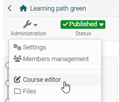
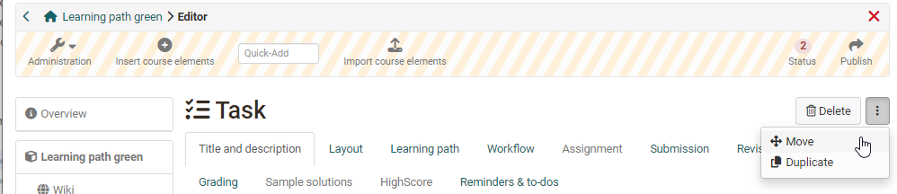
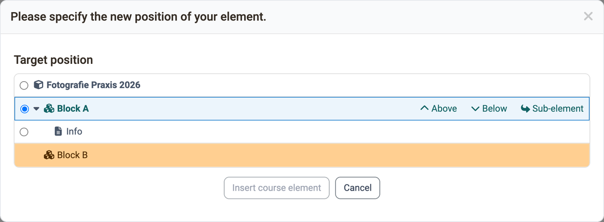
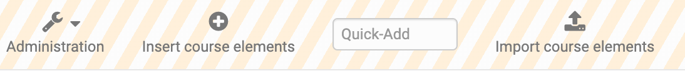
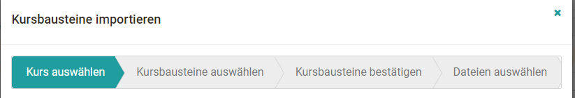

# Deleting, Moving and Copying Course Elements

As a course grows, its structure changes: a course element belongs in a different place, several groups need the same structure, or a course element is no longer needed. You delete, move and duplicate course elements in the course editor. You open it in the started course under: 
`Course > Administration > Course editor`

{ class="shadow lightbox" title="Administration menu of a course" }

First select the course element in the course structure on the left. The button "Delete" and the menu with the three dots, which contains "Move" and "Duplicate", then appear at the top right.

{ class="shadow lightbox" title="Course editor with a selected course element" }

Each action applies to the selected course element and all its subordinate course elements. "Move" and "Duplicate" open the same dialog. Under "Target position", select the course element at which you want to insert the selected course element; the course element to be moved is highlighted in colour and cannot be chosen as a target. The actions "Above" for the position above, "Below" for the position below and "Sub-element" for the subordinate position appear on the chosen course element. After you have chosen an action, "Will be dropped here" marks the target. Only then do you carry out the action with "Insert course element".

{ class="shadow lightbox" title="Dialog for choosing the target position in the course editor" }

You can also move course elements by drag and drop in the course structure on the left.

Duplicating is recommended, for example, if you offer group work in the course and need the same structure for several groups.

With "Delete", you remove the selected course element together with all its subordinate course elements after you have confirmed the prompt. OpenOlat marks it as deleted until you publish. Until then, you can restore it: select it in the course structure and click "Restore course element".

All these changes take effect for the participants only when you publish the course. How publishing works is described under [Course editor tools](Using_additional_Course_Editor_Tools.md).

## Importing course elements [:octicons-tag-16:{ title="from Release 16.1.0 (OO-5210)" }](https://track.frentix.com/issue/OO-5210) {: #import_course_elements}

If you have already built a course structure in another course that you want to continue using, copy its course elements into the current course with "Import course elements". You find the button in the toolbar of the course editor.

{ class="shadow lightbox" title="Toolbar of the course editor" }

The button opens a wizard with four steps.

### Steps in the wizard {: #import_steps}

{ class="shadow lightbox" title="Import course elements wizard" }

1. **Select course**: You select the course in which the course elements to be copied are located.
2. **Select course elements**: You select the course elements you want to transfer. Subordinate course elements are selected automatically. If you do not need one of them, remove the check mark.
3. **Confirm course elements**: The step shows all selected course elements once again. For some course elements, you define what happens during copying. For a folder, you choose between "Copy" and "Do not configure". For blog, wiki and podcast, you choose between "Reuse", "Create new" and "Do not configure". For task and group task, you choose between "Copy assignment and solution" and "Don't copy assignment and solution".
4. **Select files**: The step shows the files in the storage folder of the course you import from. The files that belong to the selected course elements are preselected. You can change the selection here.

**Please note:**

* The import does not take over groups and learning areas. For group tasks and enrolments, create new groups or link existing groups later.
* When copying forums, the forum posts are not copied.
* When copying BigBlueButton, no rooms and appointments are copied.

## Changes to the current course

You decide when the changes appear in the current course. When you publish, OpenOlat shows how many users are currently using the course. These users must restart the course after publishing, and unsaved forum posts or test results are lost. If users are in the course and publishing can be postponed, cancel the process and repeat it later.

## Further information {: #further_information}

[Course editor tools >](Using_additional_Course_Editor_Tools.md) 
[Course elements in the Course editor >](General_Configuration_of_Course_Elements.md) 
[Course elements at a glance >](Course_Elements/index.md)

[To the top of the page ^](#deleting-moving-and-copying-course-elements)

