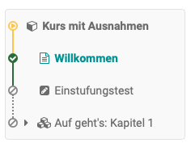
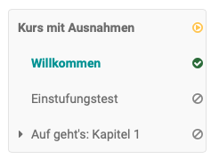
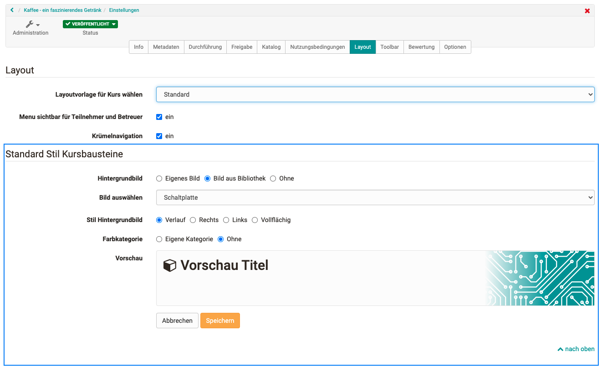
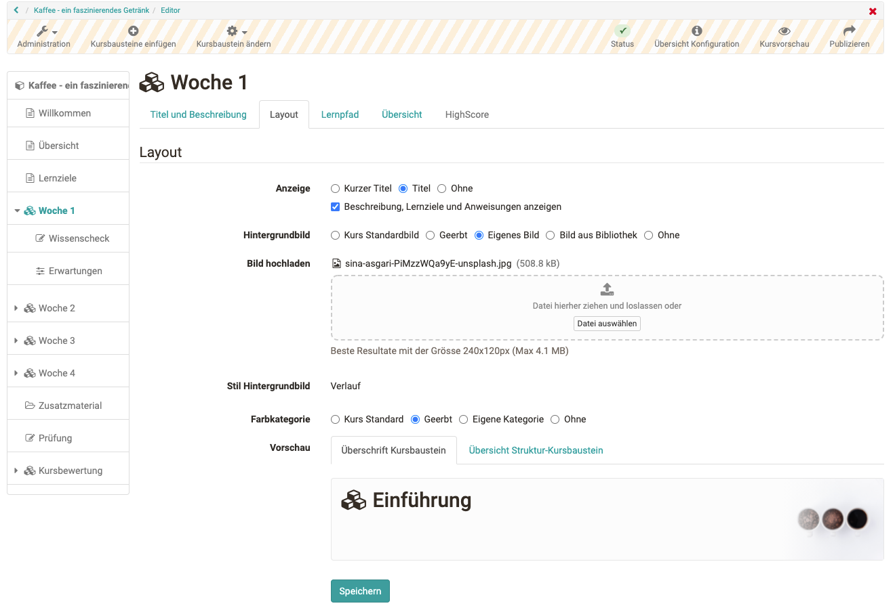
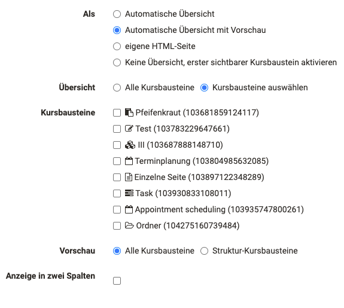
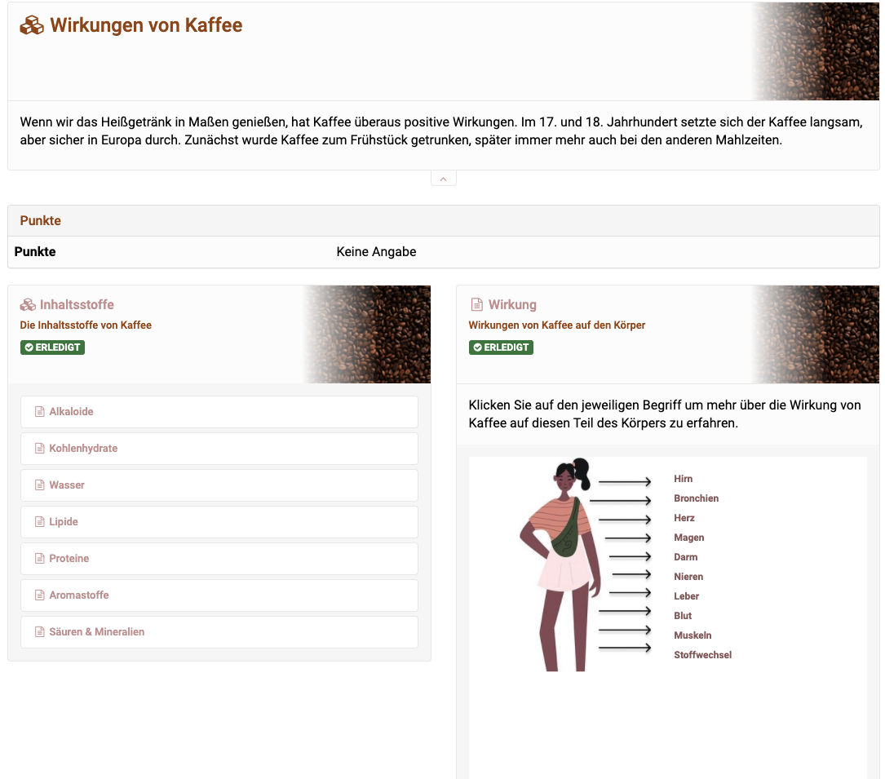

# Gestalterische Möglichkeiten von Kursen und Kursbausteinen

:octicons-device-camera-video-24: **Video-Einführung**: [Kursbausteine konfigurieren](<https://www.youtube.com/embed/SAkzzoOQEoQ>){:target="_blank"}

Die Darstellung eines Kurses und der eingebauten Kursbausteine kann von den Kursbesitzer:innen konfiguriert werden. Die Basis-Einstellungen hierfür werden in der Kurs-Administration im Tab "Layout" definiert. Weitere Details und Anpassungen können im Kurseditor bei den jeweiligen Kursbausteinen vor allem in den Tabs "Titel und Beschreibung" sowie "Layout" vorgenommen werden.

## Layout Einstellungen in der Kurs-Administration

### Tab "Layout" 

Im Tab "Layout" der Kurseinstellungen bestimmen Sie, wie der Kurs aussieht und wie sich Teilnehmende darin bewegen: `Kurs > Administration > Einstellungen > Tab "Layout"`. Sie wählen eine Layoutvorlage, legen die Kursnavigation fest und bestimmen den Standardstil der Kursbausteine.

Welche Layoutvorlagen zur Auswahl stehen, bestimmt das Systemlayout (Theme), das für Ihre ganze OpenOlat-Instanz gilt. Die Vorlage "Standard" ist immer vorhanden. Ein einheitliches Erscheinungsbild für alle Kurse (Farben, Schriften, Logo) wird deshalb zentral über ein individuelles Systemlayout umgesetzt, siehe [Darstellung](../../manual_admin/administration/Customizing.de.md#layout). Für einen einzelnen Kurs wählen Sie die Option "Eigene Konfiguration festlegen": Dort legen Sie Schriftart und Farben für Text, Überschriften, Links, Menü und Toolbox fest und laden ein Logo hoch. Darüber hinaus können Sie im [Ablageordner](Storage_folder.de.md) des Kurses im Ordner "courseCSS" eigene CSS-Dateien hinterlegen, die dann in der Auswahl als "Aus Kursablageordner" erscheinen. Den Ablageordner öffnen Sie unter: 
`Kurs > Administration > Dateien > Ablageordner`

Im Bereich "Navigation" kann die Sichtbarkeit des Menüs und der Krümelnavigation eingestellt werden. In Lernpfadkursen legen Sie zusätzlich fest, ob im Menü die Icons und der Pfad angezeigt werden ("Icons im Menu anzeigen", "Pfad im Menu anzeigen"). Je nach linearem oder flexiblem Szenario bietet sich die eine oder andere Variante an.

{ class="shadow lightbox" title="Kursmenü mit Pfad und Icons" }
{ class="shadow lightbox" title="Kursmenü ohne Pfad und Icons" }

Im Bereich "Standard Stil Kursbausteine" legen Sie die Basisdarstellung der Kursbausteine fest: die Auswahl eines Hintergrundbildes, die Definition des Stils sowie die Zuordnung einer Farbkategorie. In der Vorschau sehen Sie die Auswirkungen.

Kursbesitzer:innen können für die Darstellung der Kursbausteine ein eigenes Bild hochladen (maximal 4 MB), ein Bild aus der Bibliothek wählen oder auf ein Bild ganz verzichten. Das Bild kann rechts oder links positioniert, als Verlauf rechts oder vollflächig dargestellt werden.

{ class="shadow lightbox" title="Tab Layout der Kurseinstellungen" }

## Layout Einstellungen im Kurseditor

Im Kurseditor können die Tabs "Titel und Beschreibung" sowie "Layout" für die weitere Konfiguration des Kurslayouts genutzt werden.

### Tab "Titel und Beschreibung" 

Im Tab "Titel und Beschreibung" eines Kursbausteins können, neben dem Titel und der generellen kurzen Beschreibung des Kursbausteins, ergänzend erweiterte Informationen bereitgestellt werden, die im oberen Bereich des Kursbausteins als Information angezeigt werden. Zu den erweiterten Informationen zählen: Lernziele, Anweisungen sowie spezifische Hinweise für Betreuer:innen.

**Lernziele**: Beschreiben Sie hier, was Sie genau mit dem Kursbaustein erreichen wollen. Beispielsweise können bei Strukturbausteinen die Lernziele für den gesamten untergeordneten Bereich erläutert werden. Generell sollten Sie prüfen, bei welchen Kursbausteinen eine Beschreibung der Lernziele relevant ist.

**Anweisungen**: Instruktionen oder Lernanweisungen für die Teilnehmenden des Kurses.
Erläutern Sie hier genauer, was die Lernenden mit diesem Kursbaustein machen sollen.

**Hinweise für Betreuer:innen**
Hier können den Betreuer:innen weitere Informationen zu diesem Kursbaustein hinterlassen werden. Diese Informationen sind nur für Betreuer:innen und Besitzer:innen des Kurses sichtbar.

### Tab "Layout" 

Im Tab "Layout" eines Kursbausteins überschreiben Sie für diesen Kursbaustein die Standardeinstellungen aus dem Tab "Layout" unter `Kurs > Administration > Einstellungen`.

Für das Hintergrundbild, den Stil und die Farbkategorie kann zwischen "Kurs Standard", "Vererbt" und "Kursbaustein spezifisch" gewählt werden. Der Kurs Standard bezieht sich auf die Einstellungen im Tab "Layout" der Kurseinstellungen. Vererbt bezieht sich auf die Einstellung des übergeordneten Kursbausteins. Und mit "Kursbaustein spezifisch" können Sie eine spezielle Konfiguration für den gewählten Kursbaustein vornehmen. 

**Anzeige**: Wählen Sie ob die im Tab "Titel und Beschreibung" definierten Infos angezeigt werden sollen oder nicht.

{ class="shadow lightbox" title="Tab Layout eines Kursbausteins im Kurseditor" }

### Automatische Übersicht 

Auf dem obersten Kursknoten und allen Struktur-Kursbausteinen können im Tab "Übersicht" weitere Einstellungen zur Darstellung vorgenommen werden. Ein Vorteil ist die Verwendung der automatischen Übersicht, besonders als Orientierungshilfe für den User. Hier können nun alle oder gezielt nur bestimmte Kursbausteine für die automatische Übersicht ausgewählt werden.

{ class="shadow lightbox" title="Tab Übersicht im Kurseditor" }

{ class="shadow lightbox" title="Automatische Übersicht im Kurs" }

!!! tip "Tipp"

    Probieren Sie die unterschiedlichen Darstellungen aus und prüfen Sie welche Anzeige für Ihre Zwecke am besten passt. Überladen Sie die Anzeige nicht. Zu viele Texte, Bilder und Infos führen nämlich rasch zu einer unübersichtlichen Darstellung.

## Weiterführende Informationen {: #further_information}

**Auf dieser Seite erwähnt** 
[Customizing: Übersicht >](../../manual_admin/administration/Customizing.de.md) 
[Ablageordner >](Storage_folder.de.md)

**Weiterführend** 
[Kursbausteine im Überblick >](Course_Elements/index.de.md) 
[Kurseinstellungen >](Course_Settings/index.de.md)

**youtube** 
[Kursbausteine konfigurieren](<https://www.youtube.com/embed/SAkzzoOQEoQ>)

[Zum Seitenanfang ^](#gestalterische-moglichkeiten-von-kursen-und-kursbausteinen)