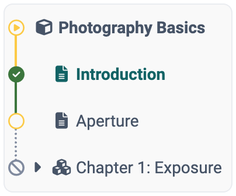
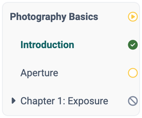
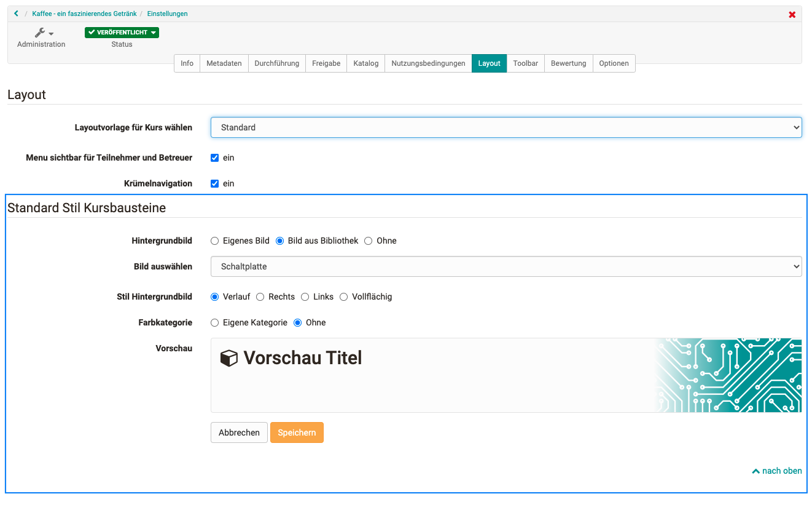
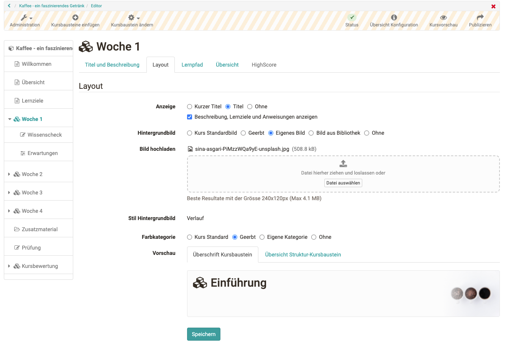
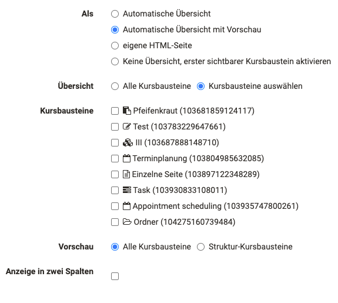
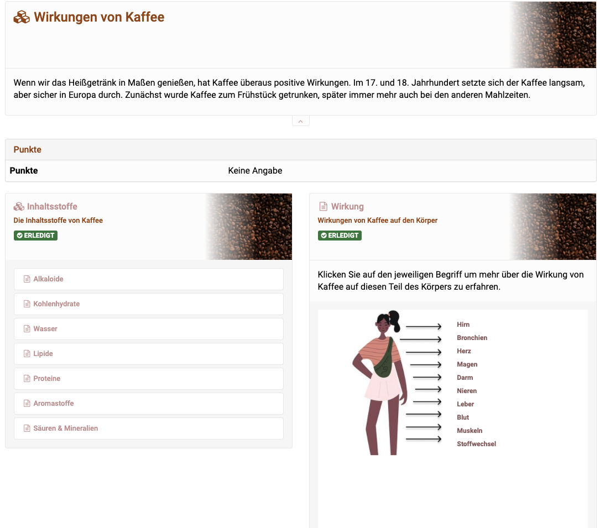

# Design possibilities of courses and course elements

:octicons-device-camera-video-24: **Video Introduction (German)**: [Configuring course elements](<https://www.youtube.com/embed/SAkzzoOQEoQ>){:target="_blank"}

The presentation of a course and its built-in course elements can be configured by the course owners. The basic settings for this are defined in the course administration in the "Layout" tab. Further details and adjustments can be made in the course editor for the respective course elements, especially in the "Title and description" and "Layout" tabs.

## Layout settings in the course administration

### Tab "Layout"

In the tab "Layout" of the course settings, you determine how the course looks and how participants move through it: `Course > Administration > Settings > Tab "Layout"`. You select a layout template, set the course navigation and determine the default style of the course elements.

Which layout templates are available is determined by the system layout (theme) that applies to your entire OpenOlat instance. The "Default" template is always available. A uniform appearance for all courses (colors, fonts, logo) is therefore implemented centrally via a custom system layout, see [Layout](../../manual_admin/administration/Customizing.md#layout). For a single course, choose the option "Customize...": there you set the font and colors for text, headings, links, menu and toolbox and upload a logo. In addition, you can store your own CSS files in the "courseCSS" folder of the course [Storage folder](Storage_folder.md). They then appear in the selection as "from course folder". You open the storage folder under: 
`Course > Administration > Files > Storage folder`

In the "Navigation" section you can set the visibility of the menu and crumb navigation. In learning path courses you also specify whether the icons and the path are displayed in the menu ("Display icons in menu", "Display path in menu"). Depending on the linear or flexible scenario, one or the other variant offers itself.

{ class="shadow lightbox" title="Course menu with path and icons" }
{ class="shadow lightbox" title="Course menu without path and icons" }

In the section "Course element default style" you define the default presentation of the course elements: the selection of a background image, the definition of the style, and the assignment of a color category. In the preview you can see the effects.

Course owners can upload their own image (maximum 4 MB) for the display of the course elements, choose an image from the library, or do without an image altogether. The image can be positioned on the right or the left, displayed as a gradient on the right, or full-screen.

{ class="shadow lightbox" title="Layout tab of the course settings" }

## Layout settings in the course editor

In the course editor, the "Title and description" and "Layout" tabs can be used for further configuration of the course layout.

### Tab "Title and description"

In the "Title and description" tab of a course element, in addition to the title and the general short description of the course element, extended information can be provided, which is displayed as information in the upper part of the course element. The extended information includes: learning objectives, instructions, and specific notes for coaches.

**Learning objectives**: Describe here what exactly you want to achieve with the course element. For example, for structure course elements, the learning objectives for the entire subordinate area can be explained. In general, you should check for which course elements a description of the learning objectives is relevant.

**Instructions**: Instructions or learning guidance for the participants of the course.
Explain in more detail here what learners should do with this course element.

**Notes for coaches**
Further information about this course element can be left here for the coaches. This information is visible only to coaches and owners of the course.

### Tab "Layout"

In the tab "Layout" of a course element, you override for this course element the default settings from the tab "Layout" under `Course > Administration > Settings`.

For the background image, the style, and the color category, you can choose between "Course default", "Inherited", and "Course element specific". Course default refers to the settings in the tab "Layout" of the course settings. Inherited refers to the setting of the parent course element. And with "Course element specific" you can make a special configuration for the selected course element.

**Display**: Choose whether the information defined in the "Title and description" tab is displayed or not.

{ class="shadow lightbox" title="Layout tab of a course element in the course editor" }

### Automatic overview

On the top course node and all structure course elements, further display settings can be made in the "Overview" tab. One advantage is the use of the automatic overview, especially as an orientation aid for the user. Here you can now select either all or specifically only certain course elements for the automatic overview.

{ class="shadow lightbox" title="Overview tab in the course editor" }

{ class="shadow lightbox" title="Automatic overview in the course" }

!!! tip "Tip"

    Try out the different displays and check which one suits your purposes best. Do not overload the display. Too many texts, images, and information items quickly lead to a confusing presentation.

## Further information {: #further_information}

**Mentioned on this page** 
[Customizing: Overview >](../../manual_admin/administration/Customizing.md) 
[Storage folder >](Storage_folder.md)

**Further reading** 
[Course elements at a glance >](Course_Elements/index.md) 
[Course Settings >](Course_Settings/index.md)

**youtube** 
[Configuring course elements](<https://www.youtube.com/embed/SAkzzoOQEoQ>)

[To the top of the page ^](#design-possibilities-of-courses-and-course-elements)
