# Der Formulareditor {: #editor} 

## Aufruf des Editors {: #open_editor} 

Im Formulareditor erstellen und bearbeiten Sie eine Formular-Lernressource. Den Formulareditor öffnen Sie als Besitzer:in der Formular-Lernressource, als Lernressourcenverwalter:in oder als Administrator:in. Die folgenden drei Wege führen in den Editor.

<h3> Möglichkeit 1: Neues Formular im Autorenbereich erstellen</h3>

Für eine neue Formular-Lernressource öffnen Sie im Autorenbereich das Menü "Erstellen" und wählen "Formular":

`Autorenbereich > Erstellen > Formular`

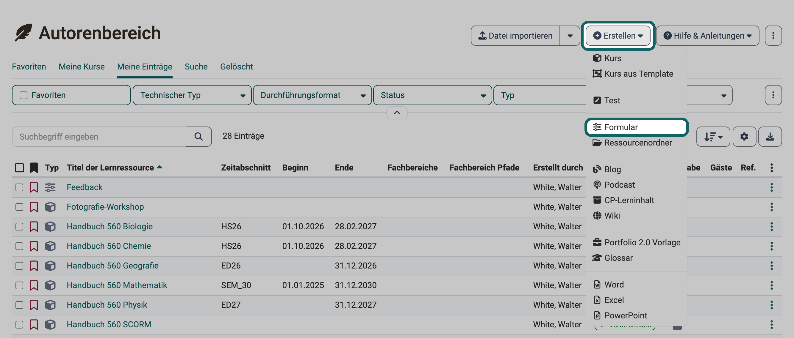{ class="shadow lightbox" title="Menü Erstellen im Autorenbereich · 2026.10.21" }

Geben Sie einen Titel ein und klicken Sie auf "Erstellen". OpenOlat öffnet danach die Einstellungen der neuen Formular-Lernressource. In den Formulareditor wechseln Sie über `Formular > Administration > Formulareditor`.

<h3> Möglichkeit 2: Bestehendes Formular im Autorenbereich öffnen</h3>

Eine bestehende Formular-Lernressource finden Sie im Autorenbereich, zum Beispiel mit dem Filter "Typ" und dem Eintrag "Formular".

Klicken Sie im Suchergebnis am Ende der Zeile auf die 3 Punkte und wählen Sie im Menü den Eintrag "Formulareditor".

`Autorenbereich > Formular-Lernressource suchen > Menü unter den 3 Punkten > Formulareditor`

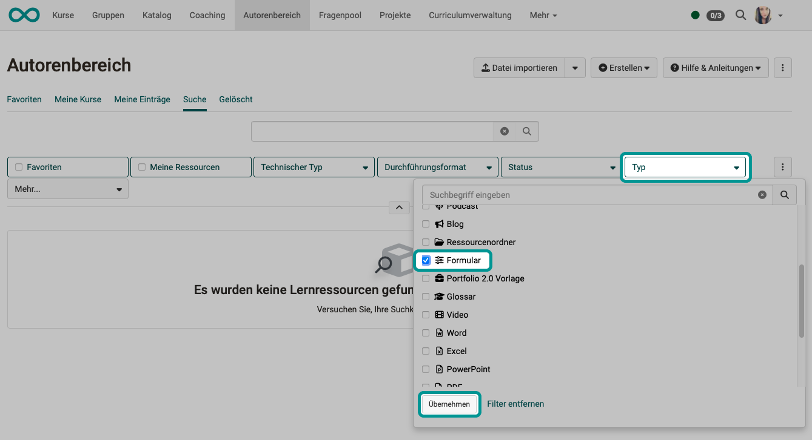{ class="shadow lightbox" title="Suche im Autorenbereich" }

<h3> Möglichkeit 3: Formular in einem Kursbaustein wählen oder erstellen</h3>

Im Kurs binden Sie eine Formular-Lernressource über den Kursbaustein "Formular" ein. Fügen Sie den Kursbaustein im Kurseditor ein und klicken Sie im Tab "Formular" auf "Wählen, erstellen oder importieren". Dort wählen Sie eine bestehende Formular-Lernressource aus dem Autorenbereich, importieren eine oder erstellen eine neue.

`Kurseditor > Kursbausteine einfügen > Formular > Tab "Formular" > Wählen, erstellen oder importieren`

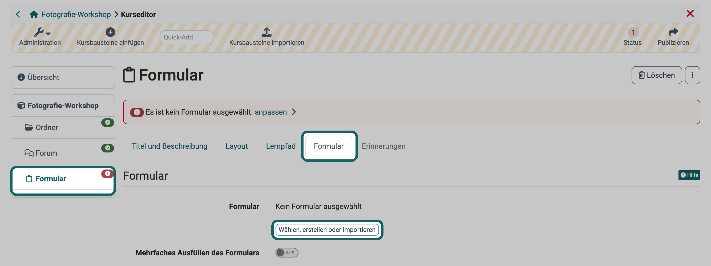{ class="shadow lightbox" title="Tab Formular eines Kursbausteins im Kurseditor · 2026.10.21" }

Ist ein Formular eingebunden, öffnet der Button "Bearbeiten" im Tab "Formular" den Formulareditor. Ebenso öffnen Sie den Formulareditor aus anderen Kursbausteinen, etwa aus dem [Kursbaustein "Umfrage"](../learningresources/Course_Element_Survey.de.md).

Den geöffneten Formulareditor erkennen Sie an der schraffierten Kopfzeile, der Werkzeugleiste mit "Administration" und "Frageregeln" unter der Krümelnavigation. Die Schraffur zeigt, dass Sie das Formular bearbeiten und nicht die Ansicht sehen, in der es ausgefüllt wird. Dieselbe Kennzeichnung tragen der Kurseditor, der Testeditor und der Editor eines CP-Lerninhalts. [:octicons-tag-16:{ title="ab Release 21.1 (OO-9789)" }](https://track.frentix.com/issue/OO-9789){:target="_blank"}

!!! tip "Tipp"

    Eine Formular-Lernressource lässt sich sehr unterschiedlich einsetzen. Berücksichtigen Sie die spätere Verwendung deshalb schon beim Titel, zum Beispiel mit einem passenden Kürzel am Anfang. So finden Sie das Formular später schneller und ordnen es leichter zu.

[zum Seitenanfang ^](#editor)

---

## Erstellen einer Formular-Lernressource {: #create} 

Ein neues Formular enthält bereits ein Layout mit einer Spalte. Dort fügen Sie direkt die ersten Inhaltselemente ein. Weitere Layouts fügen Sie über den Button "Neues Layout einfügen" hinzu. [:octicons-tag-16:{ title="ab Release 20.2 (OO-9019)" }](https://track.frentix.com/issue/OO-9019)

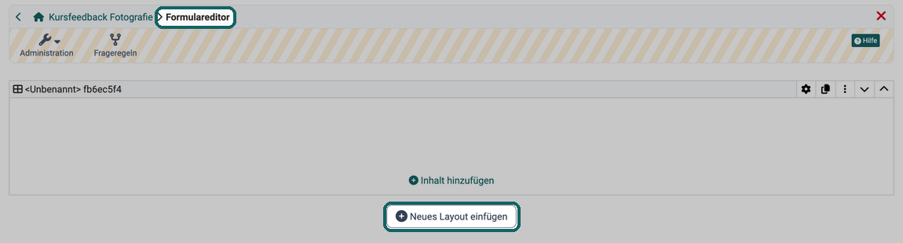{ class="shadow lightbox" title="Formulareditor · 2026.09.28" }

---

### Layout hinzufügen {: #insert_layout} 

Ein Formular ist in Layouts gegliedert, welche die Seitenstruktur wiedergeben.

Ein Layout ist ein übergeordneter Block, der unterschiedliche Strukturierungen des Inhalts durch Spalten und Zeilen ermöglicht. Innerhalb einer Spalte und Zeile können beliebig viele Inhalts-Blöcke (Inhaltselemente) hinzugefügt werden. 

Aktuell sind folgende Layoutvorlagen verfügbar:

{ class="shadow lightbox" title="Layoutvorlagen im Formulareditor" }

[zum Seitenanfang ^](#editor)

---

### Layout bearbeiten {: #edit_layout} 

Die Einstellungen eines Layouts legen Sie im Inspektor fest, einem Fenster, das sich zum markierten Layout oder Inhaltselement öffnet. Wählen Sie dafür das Layout und klicken Sie auf das Zahnrad :material-cog: rechts oben am Markierungsrahmen.

Die Icons rechts daneben duplizieren, löschen oder verschieben das Layout.

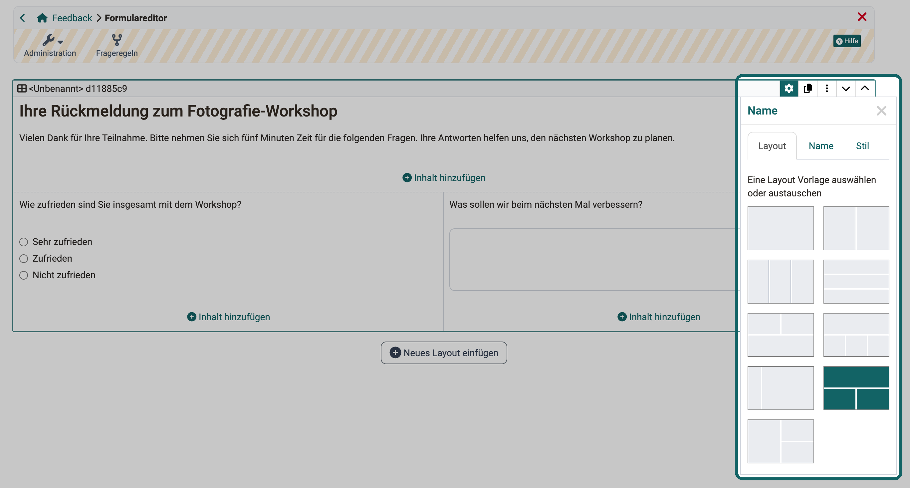{ class="shadow lightbox" title="Inspektor eines Layouts im Formulareditor · 2026.10.21" }

!!! info "Kann ich ein bestehendes Layout noch ändern?"

    Ja. Wählen Sie im Inspektor eine Layoutvorlage mit weniger Spalten, verschiebt OpenOlat die Inhaltselemente der wegfallenden Spalten in die letzte verbleibende Spalte. Löschen Sie ein Layout mit Inhalt, fragt OpenOlat im Dialog "Layout löschen", ob Sie den Inhalt mitlöschen ("Alles löschen") oder in das Layout darüber verschieben ("Nur das Layout löschen und den Inhalt verschieben"). Beim ersten Layout wandert der Inhalt in das Layout darunter.

[zum Seitenanfang ^](#editor)

---

### Inhaltselemente hinzufügen {: #insert_content_element} 

Jeder Bereich eines Layouts hat einen eigenen Button "Inhalt hinzufügen". Das neue Inhaltselement erscheint in dem Bereich, in dem Sie den Button klicken. Ein Bereich nimmt beliebig viele Inhaltselemente auf.

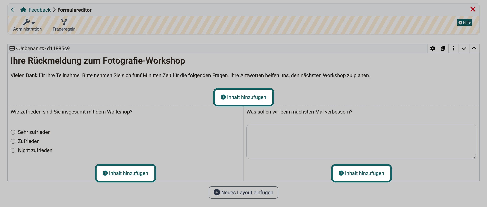{ class="shadow lightbox" title="Layout mit drei Bereichen im Formulareditor · 2026.10.21" }

[zum Seitenanfang ^](#editor)

---

### Verfügbare Inhaltselemente {: #content_elements} 

Der Dialog "Inhalt hinzufügen" ordnet die Inhaltselemente in die Gruppen Text, Fragetypen, Organisatorisch, Medien sowie Andere & Design.

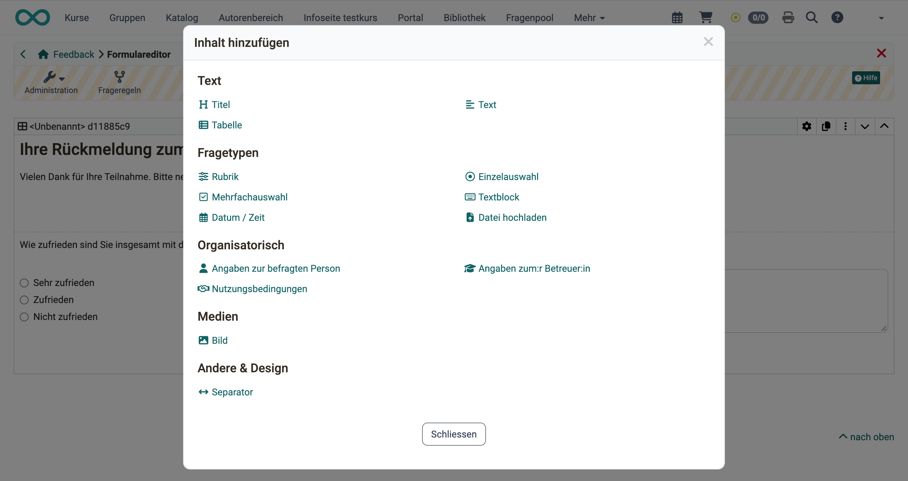{ class="shadow lightbox" title="Dialog Inhalt hinzufügen im Formulareditor · 2026.10.21" }

Was die einzelnen Inhaltselemente können und wie Sie sie einstellen, beschreibt die Seite [Formular-Elemente](Form_Elements.de.md).

[zum Seitenanfang ^](#editor)

---

### Inhaltselemente bearbeiten {: #edit_content_element} 

Die Einstellungen eines Inhaltselements legen Sie wie beim Layout im Inspektor fest. Auf grösseren Bildschirmen öffnet er sich rechts neben dem ausgewählten Inhaltselement. Mit dem Zahnrad :material-cog: blenden Sie ihn ein und aus.

An seiner Titelzeile lässt sich der Inspektor verschieben. Wählen Sie ein anderes Inhaltselement, springt er an seine Ausgangsposition zurück.

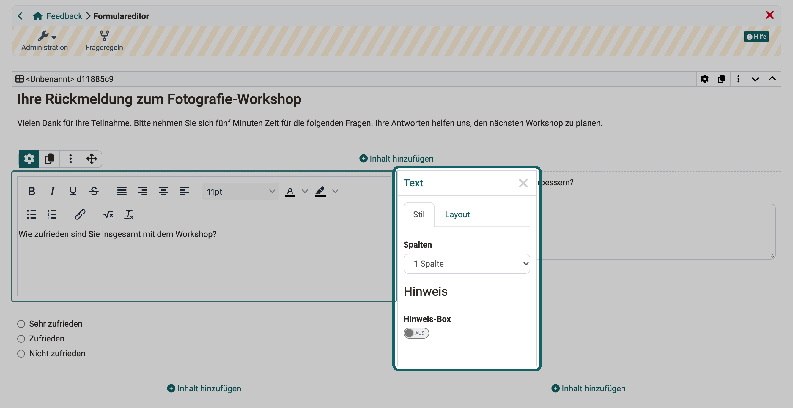{ class="shadow lightbox" title="Inspektor eines Textelements · 2026.10.21" }

Welche Optionen der Inspektor zeigt, hängt vom Inhaltselement ab.

**Beispiel Inspektor zum Titel, Tab "Stil"**

Hier können Sie für den Titel eine vordefinierte Schriftgrösse wählen.

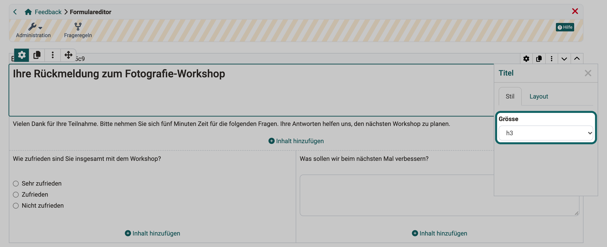{ class="shadow lightbox" title="Inspektor eines Titels, Tab Stil · 2026.10.21" }

**Beispiel Inspektor zum Titel, Tab "Layout"**

Hier wählen Sie unter "Abstand", wie viel Raum das Inhaltselement zu seinen Nachbarn hält, vergleichbar einem leeren Rahmen um das Inhaltselement.

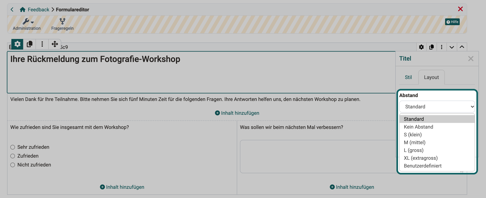{ class="shadow lightbox" title="Inspektor eines Titels, Tab Layout · 2026.10.21" }

[zum Seitenanfang ^](#editor)

---

### Inhaltselemente verschieben {: #move_content_element} 

Wählen Sie ein Inhaltselement aus, erscheinen links oben einige Icons, darunter ein Doppelkreuz. Am Doppelkreuz ziehen Sie das Inhaltselement mit gedrückter Maustaste an eine andere Stelle im Layout, auch in einen anderen Bereich.

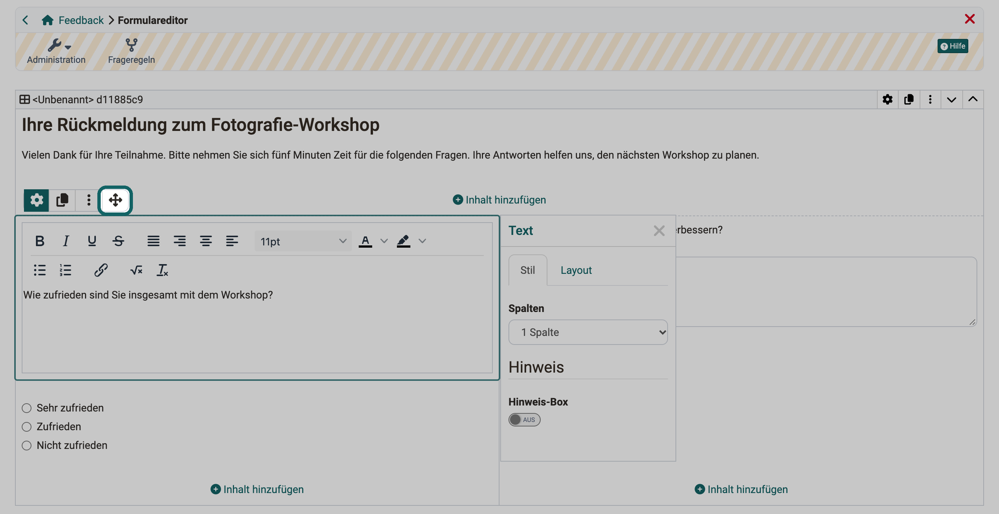{ class="shadow lightbox" title="Ausgewähltes Inhaltselement im Formulareditor · 2026.10.21" }

[zum Seitenanfang ^](#editor)

---

## Formular konfigurieren {: #config} 

Einstellungen für die Formular-Lernressource als Ganzes, etwa Titel, Beschreibung oder Freigabe, legen Sie ausserhalb des Formulareditors fest. Wählen Sie dafür: 
`Formular > Administration > Einstellungen`

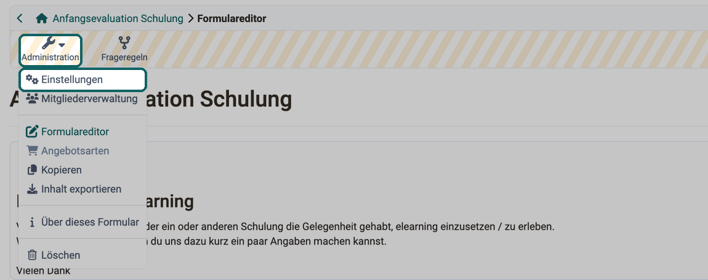{ class="shadow lightbox" title="Menü Administration im Formulareditor · 2026.09.28" }

Im selben Menü öffnet der Eintrag "Formulareditor" jederzeit wieder den Editor: `Formular > Administration > Formulareditor`. Wie dieser Eintrag bei anderen Lernressourcen heisst, steht unter [Eintrag zum Editor](Detailed_View_of_Learning_Resources.de.md#editor_entry). [:octicons-tag-16:{ title="ab Release 21.1 (OO-9780)" }](https://track.frentix.com/issue/OO-9780){:target="_blank"}

Die Einstellungen sind wie bei anderen Lernressourcen in Tabs gegliedert, unter anderem:

* Tab Metadaten (z.B. Titel, Kennzeichen, Lizenz, usw.)
* Tab Info (z.B. Titelbild, Beschreibung, Hauptsprache, usw.)
* Tab Freigabe (z.B. Verwendungszweck, Referenzierbarkeit durch andere Autoren, usw.)

!!! info "Wichtig"

    Setzen Sie das Formular nur in eigenen Kursen ein, brauchen Sie den Tab "Freigabe" nicht einzurichten. Wichtig wird er, wenn andere Autor:innen das Formular in ihren Kursen einbinden sollen oder wenn Sie es als eigenständige Lernressource verwenden.

[zum Seitenanfang ^](#editor)

---

## Tipps zur Nutzung des Formulareditors {: #hints} 

Drei Hinweise erleichtern den Aufbau eines Formulars:

* Im Inhaltselement "Rubrik" erfassen Sie Fragen und Antworten zusammen. Bei den übrigen Fragetypen schreiben Sie die Frage in ein Inhaltselement "Text" und ergänzen die Antworten mit dem passenden Fragetyp.
* Mit [Frageregeln](../learningresources/Form_Question_Rules.de.md) bauen Sie Verzweigungen in ein Formular ein: Ein Layout erscheint nur, wenn eine bestimmte Antwort gewählt wurde.
* Geben Sie den Layouts, Einzelauswahlen und Mehrfachauswahlen, die Sie in Frageregeln verwenden, im Inspektor einen Namen. So erkennen Sie sie beim Erstellen der Regeln wieder.

[zum Seitenanfang ^](#editor)

---

## Weiterführende Informationen {: #further_information}

[Kursbaustein "Umfrage"](../learningresources/Course_Element_Survey.de.md) 
[Formular-Elemente](Form_Elements.de.md) 
[Detailansicht einer Lernressource](Detailed_View_of_Learning_Resources.de.md) 
[Frageregeln in Formularen](Form_Question_Rules.de.md) 
[Wie erstelle ich eine Formular-Lernressource?](../../manual_how-to/create_a_form/create_a_form.de.md) 
[Das Formular-Element Rubrik](Form_Element_Rubric.de.md)

[Zum Seitenanfang ^](#editor)