# The form editor {: #editor}

## Calling up the editor {: #open_editor} 

In the form editor you create and edit a form learning resource. You open the form editor as owner of the form learning resource, as learning resource manager or as administrator. The following three ways lead into the editor.

<h3> Option 1: Create a new form in the authoring area</h3>

For a new form learning resource, open the menu "Create" in the authoring area and select "Form":

`Authoring > Create > Form`

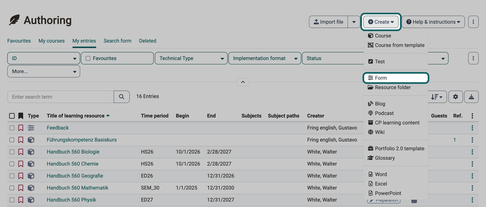{ class="shadow lightbox" title="Menu Create in the authoring area · 2026.10.21" }

Enter a title and click "Create". OpenOlat then opens the settings of the new form learning resource. You switch to the form editor via `Form > Administration > Form editor`.

<h3> Option 2: Open an existing form in the authoring area</h3>

You find an existing form learning resource in the authoring area, for example with the filter "Type" and the entry "Form".

In the search result, click on the 3 dots at the end of the line and select the entry "Form editor" in the menu.

`Authoring > Search for form learning resource > Menu under the 3 dots > Form editor`

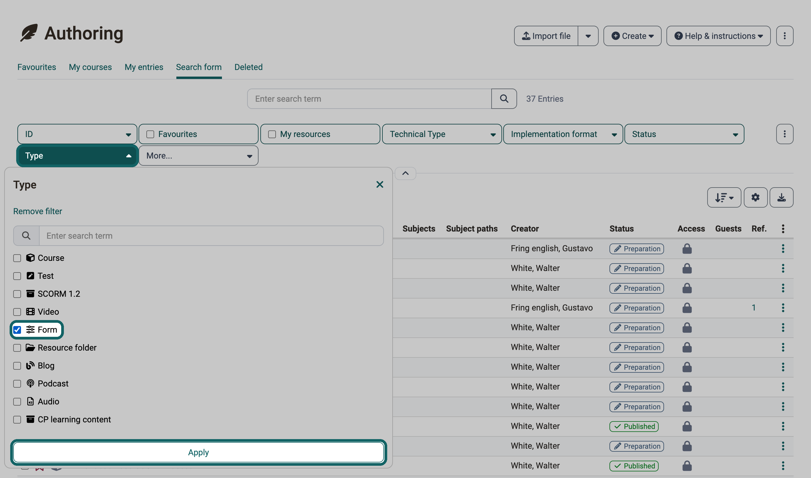{ class="shadow lightbox" title="Tab Search form in the authoring area · 2026.10.21" }

<h3> Option 3: Select or create a form in a course element</h3>

In a course, you integrate a form learning resource via the course element "Form". Insert the course element in the course editor and click "Choose, create or import" in the tab "Form". There you select an existing form learning resource from the authoring area, import one or create a new one.

`Course editor > Insert course elements > Form > Tab "Form" > Choose, create or import`

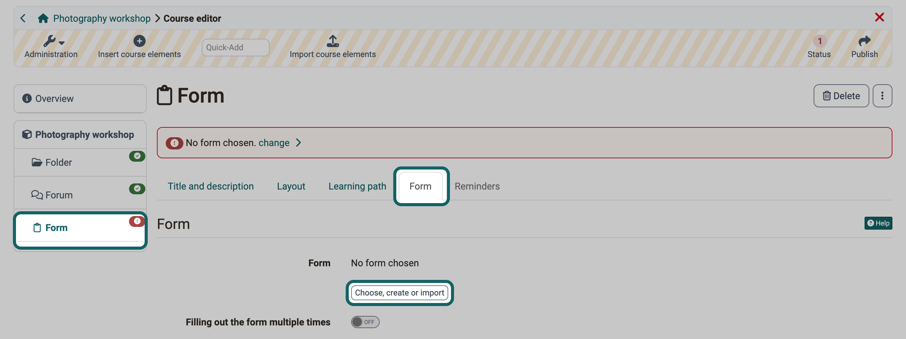{ class="shadow lightbox" title="Tab Form of a course element in the course editor · 2026.10.21" }

Once a form is integrated, the button "Edit" in the tab "Form" opens the form editor. You open the form editor from other course elements in the same way, for example from the [course element "Survey"](../learningresources/Course_Element_Survey.md).

You recognise the open form editor by the hatched header, the toolbar with "Administration" and "Question rules" below the bread-crumb navigation. The hatching shows that you are editing the form and not seeing the view in which it is filled out. The course editor, the test editor and the editor of a CP learning content carry the same marking. [:octicons-tag-16:{ title="from Release 21.1 (OO-9789)" }](https://track.frentix.com/issue/OO-9789){:target="_blank"}

!!! tip "Tip"

    A form learning resource can be used in very different ways. Consider its later use already in the title, for example with a suitable abbreviation at the beginning. This way you find the form faster later and assign it more easily.

[To the top of the page ^](#editor)

---

## Creating a form learning resource {: #create} 

A new form already contains a layout with one column. You can insert the first content elements there directly. You add further layouts with the button "Add a new layout". [:octicons-tag-16:{ title="from Release 20.2 (OO-9019)" }](https://track.frentix.com/issue/OO-9019)

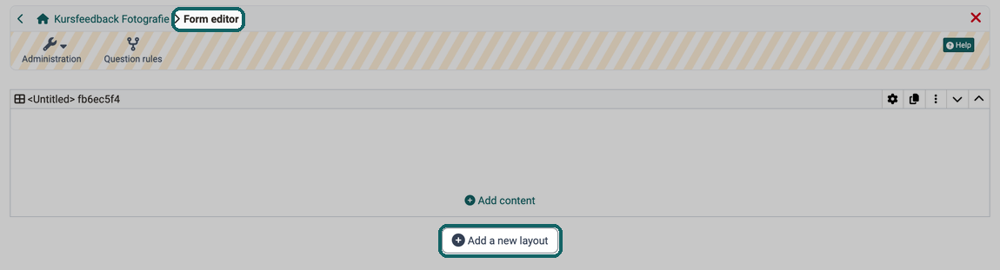{ class="shadow lightbox" title="Form editor · 2026.09.28" }

---

### Insert layout {: #insert_layout}

A form is structured in layouts that reflect the page structure.

A layout is a superordinate block that enables different structuring of the content using columns and rows. Any number of content blocks (content elements) can be added within a column and row.

The following layout templates are currently available:

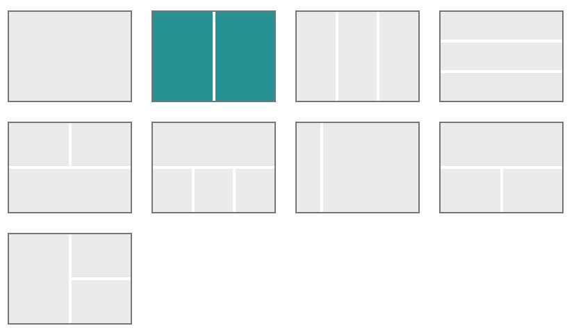{ class="shadow lightbox" title="Layout templates in the form editor" }

[To the top of the page ^](#editor)

---

### Edit layout {: #edit_layout} 

You define the settings of a layout in the inspector, a window that opens for the marked layout or content element. To do so, select the layout and click the gear icon :material-cog: at the top right of the selection frame.

The icons next to it duplicate, delete or move the layout.

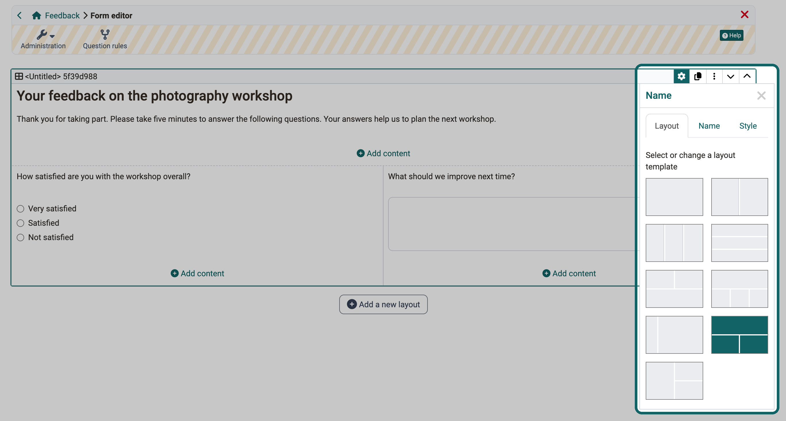{ class="shadow lightbox" title="Inspector of a layout in the form editor · 2026.10.21" }

!!! info "Can I change an already existing layout?"

    Yes. If you select a layout template with fewer columns in the inspector, OpenOlat moves the content elements of the dropped columns into the last remaining column. If you delete a layout with content, OpenOlat asks in the dialog "Delete layout" whether you delete the content as well ("Delete everything") or move it to the layout above ("Only delete the layout and move the content"). For the first layout, the content moves to the layout below.

[To the top of the page ^](#editor)

---

### Insert content elements {: #insert_content_element} 

Each area of a layout has its own button "Add content". The new content element appears in the area in which you click the button. An area holds any number of content elements.

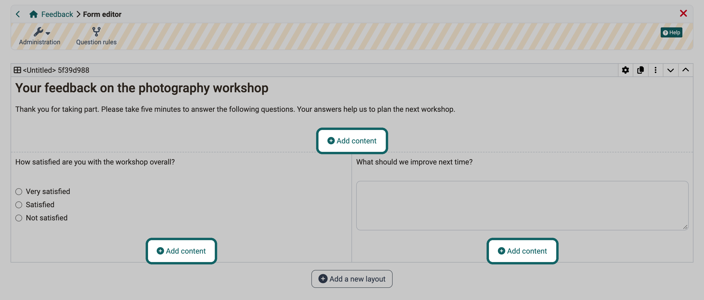{ class="shadow lightbox" title="Layout with three areas in the form editor · 2026.10.21" }

[To the top of the page ^](#editor)

---

### Available content elements {: #content_elements}

The dialog "Add content" arranges the content elements in the groups Text, Question type, Organisational, Media and Other & design.

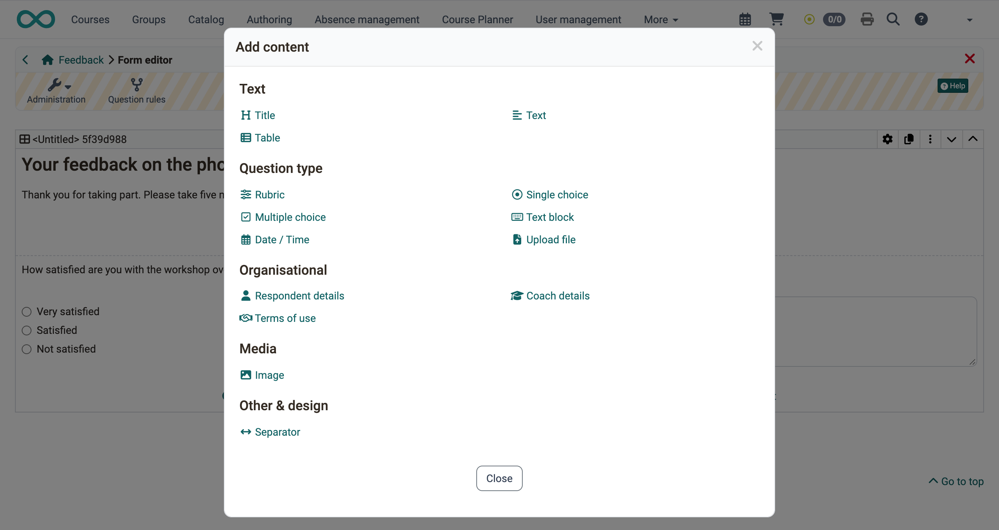{ class="shadow lightbox" title="Dialog Add content in the form editor · 2026.10.21" }

What the individual content elements can do and how you configure them is described on the page [Form elements](Form_Elements.md).

[To the top of the page ^](#editor)

---

### Edit content elements {: #edit_content_element} 

As with the layout, you define the settings of a content element in the inspector. On larger screens, it opens to the right of the selected content element. The gear icon :material-cog: shows and hides it.

You can move the inspector by its title bar. If you select another content element, it jumps back to its initial position.

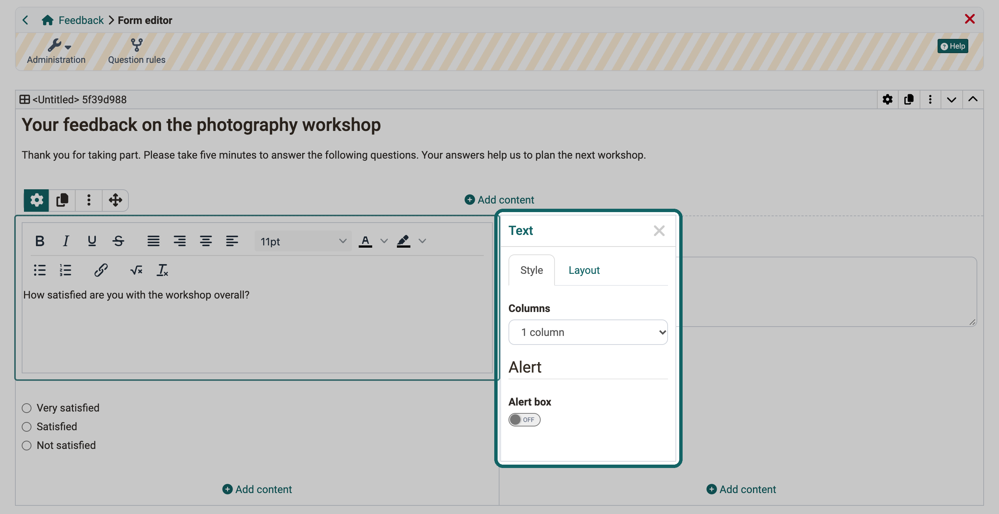{ class="shadow lightbox" title="Inspector of a text element · 2026.10.21" }

Which options the inspector shows depends on the content element.

**Example inspector for the title, "Style" tab**

Here you can select a predefined font size for the title.

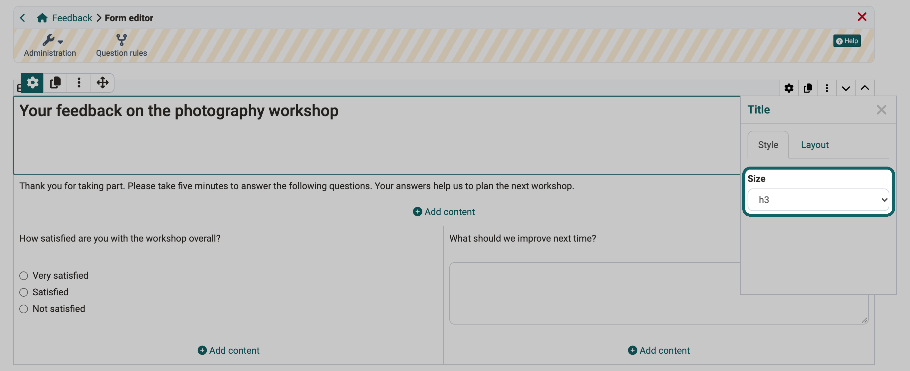{ class="shadow lightbox" title="Inspector of a title, tab Style · 2026.10.21" }

**Example inspector for the title, "Layout" tab**

Here you select under "Spacing" how much room the content element keeps to its neighbours, comparable to an empty frame around the content element.

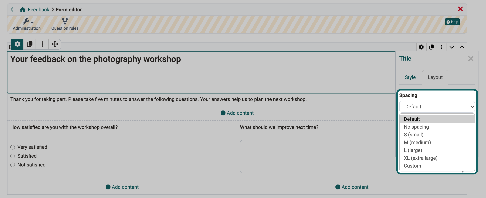{ class="shadow lightbox" title="Inspector of a title, tab Layout · 2026.10.21" }

[To the top of the page ^](#editor)

---

### Move content elements {: #move_content_element} 

When you select a content element, some icons appear at the top left, among them a double cross. Use the double cross to drag the content element with the mouse button held down to another place in the layout, also into another area.

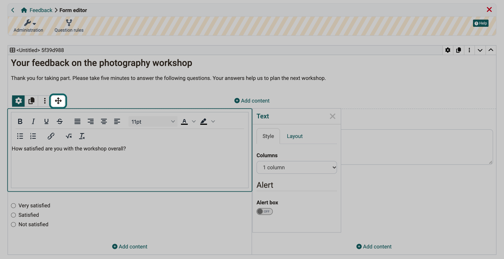{ class="shadow lightbox" title="Selected content element in the form editor · 2026.10.21" }

[To the top of the page ^](#editor)

---

## Configure Form {: #config}

You define settings for the form learning resource as a whole, such as title, description or sharing, outside the form editor. Select: 
`Form > Administration > Settings`

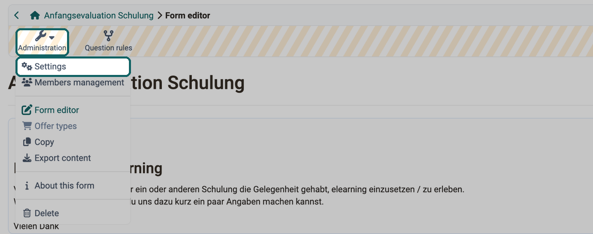{ class="shadow lightbox" title="Menu Administration in the form editor · 2026.09.28" }

In the same menu, the entry "Form editor" opens the editor again at any time: `Form > Administration > Form editor`. What this entry is called for other learning resources is described under [Editor entry](Detailed_View_of_Learning_Resources.md#editor_entry). [:octicons-tag-16:{ title="from Release 21.1 (OO-9780)" }](https://track.frentix.com/issue/OO-9780){:target="_blank"}

As with other learning resources, the settings are organised in tabs, among others:

* Metadata tab (e.g. title, reference, license, etc.)
* Info tab (e.g. cover image, description, main language, etc.)
* Share tab (e.g. intended use, referenceability by other authors, etc.)

!!! info "Important"

    If you use the form only in your own courses, you do not need to set up the tab "Share". It becomes important when other authors are to integrate the form into their courses or when you use it as a stand-alone learning resource.

[To the top of the page ^](#editor)

---

## Tips for using the form editor {: #hints}

Three hints make it easier to build a form:

* In the content element "Rubric" you enter questions and answers together. For the other question types, you write the question in a content element "Text" and add the answers with the appropriate question type.
* With [Question rules](../learningresources/Form_Question_Rules.md) you build branches into a form: a layout only appears if a certain answer was selected.
* In the inspector, give a name to the layouts, single choices and multiple choices that you use in question rules. This way you recognise them when you create the rules.

[To the top of the page ^](#editor)

---

## Further information {: #further_information}

[Course Element "Survey"](../learningresources/Course_Element_Survey.md) 
[Form elements](Form_Elements.md) 
[Detailed View of Learning Resources](Detailed_View_of_Learning_Resources.md) 
[Question rules in forms](Form_Question_Rules.md) 
[How do I create a form learning resource?](../../manual_how-to/create_a_form/create_a_form.md) 
[The form element rubric](Form_Element_Rubric.md)

[To the top of the page ^](#editor)

