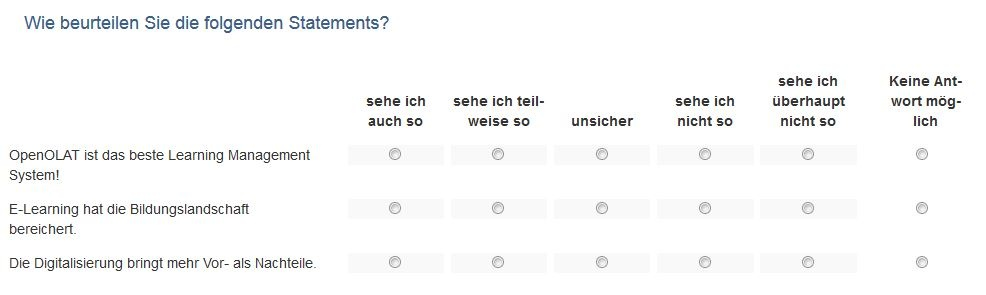
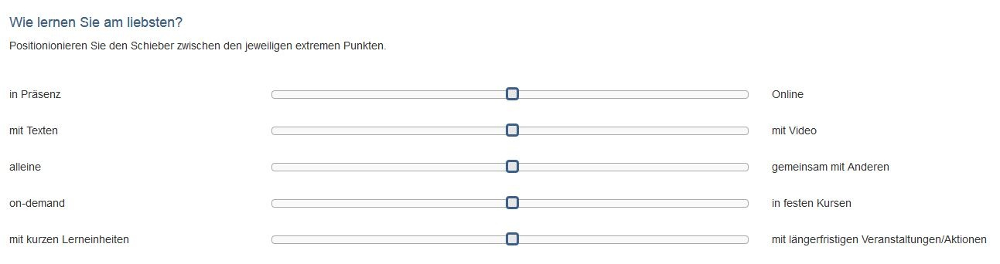
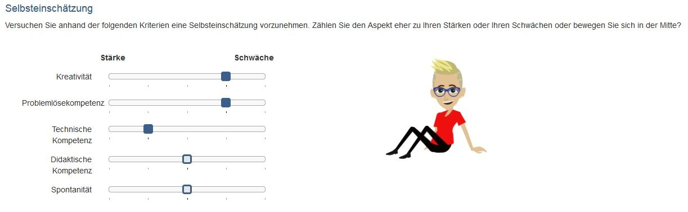
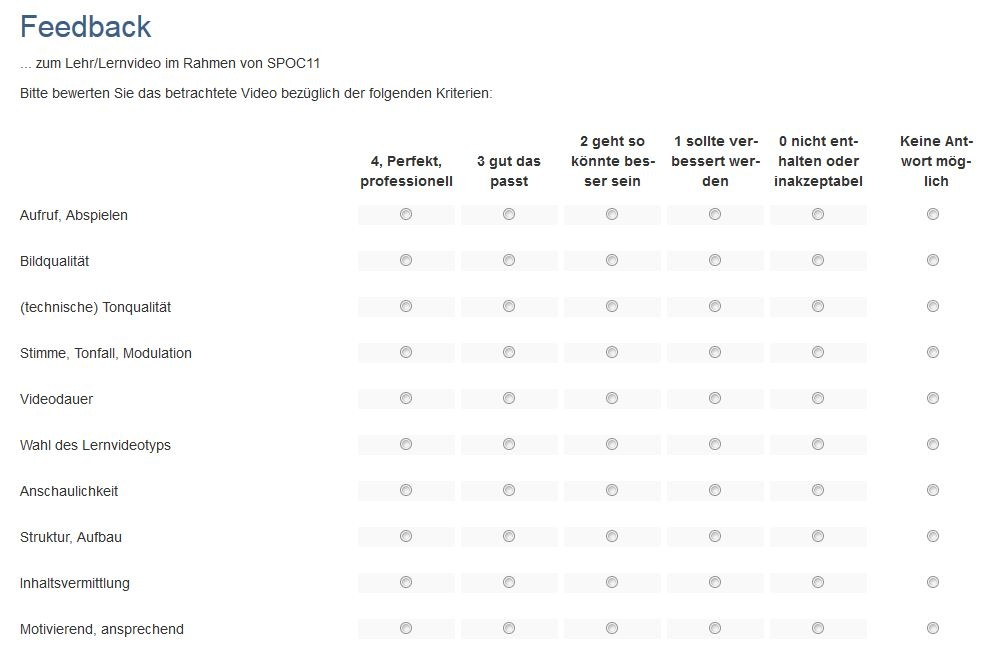
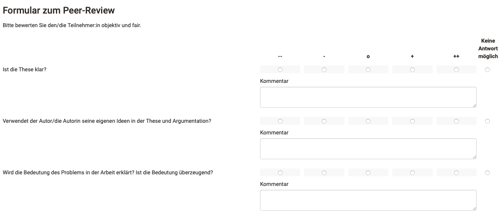
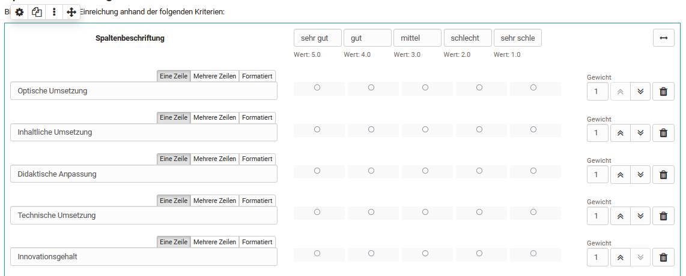
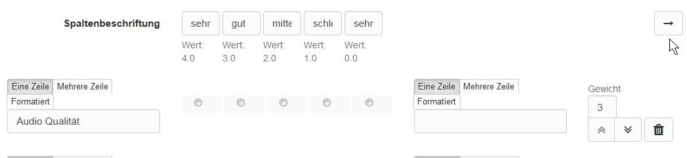
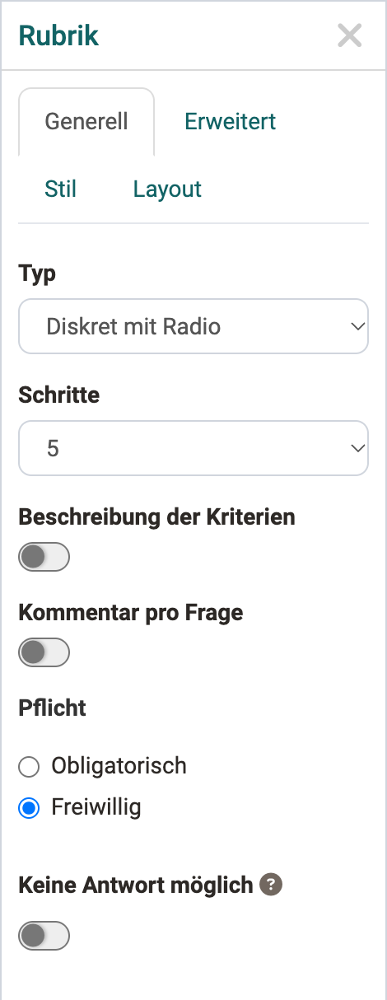
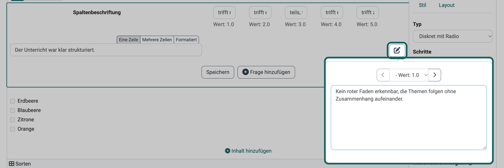

# Das Formular-Element Rubrik

Mit einer Rubrik beantworten oder bewerten Personen mehrere Fragen auf derselben Bewertungsskala. Die Rubrik ist ein Element der Lernressource "Formular" und steht überall zur Verfügung, wo OpenOlat Formulare einsetzt:

* [Kursbaustein Umfrage](../learningresources/Course_Element_Survey.de.md)
* [Kursbaustein Formular](../learningresources/Course_Element_Form.de.md)
* [Kursbaustein Bewertung](Forms_in_Rubric_Scoring.de.md)
* [Kursbaustein Aufgabe mit Peer-Review](Course_Element_Task/Task_Peer_Review.de.md#peer_review_rubric)
* [Portfolio 2.0 Vorlage](Forms_in_the_ePortfolio_template.de.md)

## Einsatzbeispiele für Rubriken

In OpenOlat setzen Sie Rubriken zum Beispiel ein, um

* den Zustimmungsgrad zu einer Fragestellung abzufragen

  { class="shadow lightbox" title="Rubrik beim Ausfüllen, Beispiel Zustimmungsgrad" }

 

* Ausprägungen zwischen zwei extremen Skalen abzufragen

  { class="shadow lightbox" title="Rubrik beim Ausfüllen, Beispiel zwei Skalen-Enden" }

 

* Bewertungsraster für die Arbeiten der Teilnehmer:innen zu erstellen

  { class="shadow lightbox" title="Rubrik beim Ausfüllen, Beispiel Bewertungsraster" }

 

* Teilnehmer:innen ihre Stärken und Schwächen selbst einschätzen zu lassen

  { class="shadow lightbox" title="Rubrik beim Ausfüllen, Beispiel Selbsteinschätzung" }

 

* Punkte je Kriterium zu vergeben

  { class="shadow lightbox" title="Rubrik beim Ausfüllen, Beispiel Punkte je Kriterium" }

 

* in einem Peer-Review andere Teilnehmer:innen zu bewerten oder Arbeiten durch Betreuer:innen bewerten zu lassen

  { class="shadow lightbox" title="Rubrik beim Ausfüllen, Beispiel Peer-Review" }

 

Eine Rubrik fügen Sie im [Formulareditor](Form_Editor/index.de.md) über "Inhalt hinzufügen" in das Formular ein und konfigurieren sie danach.

## Rubrik-Konfiguration im Formulareditor {: #rubric_configuration}

Eine Rubrik besteht aus Zeilen und Spalten: Die Zeilen tragen die Kriterien, Aussagen oder Fragen, die Spalten die Stufen der Bewertungsskala.

{ class="shadow lightbox" title="Konfiguration einer Rubrik" }

Geben Sie unter "Spaltenbeschriftung" für jede Spalte die Stufe der Bewertungsskala ein, zum Beispiel sehr gut, gut, mittel, schlecht, sehr schlecht. Jede Spalte hat einen Wert, den Sie im Tab "Erweitert" des Rubrik-Inspektors unter "Skalentyp" festlegen.

Geben Sie in den Zeilen die Kriterien, Aussagen oder Fragen ein. Weitere Zeilen ergänzen Sie mit "Frage hinzufügen". Die Texte der Zeilen können Sie formatieren. Mit den Doppelpfeilen nach oben und unten verschieben Sie eine Zeile. Im Feld "Gewicht" geben Sie einer Zeile mehr Bedeutung: Ein Kriterium mit doppeltem oder dreifachem Gewicht zählt bei der Punktevergabe entsprechend mehr. Mit dem Gewicht 0 zählt eine Frage nicht zur Punktzahl, die maximal erreichbare Punktzahl sinkt entsprechend. In der Statistik des Kursbausteins "Bewertung" bleibt die Frage mit dem Wert 0 sichtbar.

In einem Kurs kann eine Rubrik automatisch eine Punktzahl ergeben. Das nutzen der Kursbaustein "[Bewertung](../learningresources/Course_Element_Assessment.de.md)" und die Peer-Reviews im Kursbaustein "[Aufgabe](../learningresources/Course_Element_Task/index.de.md)".

Mit dem waagrechten Doppelpfeil erstellen Sie eine Rubrik mit zwei Enden.

{ class="shadow lightbox" title="Konfiguration einer Rubrik mit zwei Enden" }

!!! info "Wichtig"

    Das Gewicht einer Zeile können Sie ändern, solange das Formular noch für keine Bewertung verwendet wurde, auch wenn es bereits in einem Kursbaustein eingebunden ist. Sobald ein Kursbaustein "Bewertung" oder "Aufgabe" das Formular für die Bewertung einer Person verwendet hat, ist das Gewicht gesperrt. Der Formulareditor zeigt dann die Meldung "Die Ressource wird bereits verwendet. Die Bearbeitung ist beschränkt."

### Einstellungen im Rubrik-Inspektor

Im Rubrik-Inspektor legen Sie in den Tabs "Generell", "Erweitert", "Stil" und "Layout" fest, wie die Rubrik aussieht und wie OpenOlat sie auswertet.

{ width="235" class="shadow lightbox" title="Tab Generell des Rubrik-Inspektors · 2026.11.09" }

#### Tab "Generell"

Im Tab "Generell" wählen Sie unter "Typ", wie die Rubrik bewertet wird:

* **Diskret mit Radio**: Je Zeile wählt die Person genau einen Radio-Button. Die Spaltenbeschriftung wird angezeigt. Nur bei diesem Typ können Sie die Kriterien für einzelne Bewertungsfelder genauer beschreiben.
* **Diskret mit Sternen**: Je Zeile vergibt die Person Sterne. Die Spaltenbeschriftung erscheint nur, wenn auch "Keine Antwort möglich" eingeschaltet ist.
* **Diskret mit Slider**: Die Person schiebt einen Regler auf eine Stufe der Skala. Die Spaltenbeschriftung wird angezeigt. Dieser Typ eignet sich besonders für eine Rubrik mit zwei Enden.
* **Kontinuierlich**: Wie "Diskret mit Slider", aber ohne Stufen. Eine Spaltenbeschriftung gibt es nicht.

Das Feld "Schritte" legt die Anzahl der Spalten fest, beim Typ "Diskret mit Sternen" die höchste Anzahl Sterne. Eine kontinuierliche Rubrik hat keine Schritte.

Beim Typ "Diskret mit Radio" erscheint zusätzlich der Schalter "Beschreibung der Kriterien". Ist er eingeschaltet, öffnet das Stiftsymbol ein Eingabefeld, in dem Sie für jedes Kriterium eine genauere Beschreibung hinterlegen. So sieht die Person beim Ausfüllen, was eine Stufe bedeutet.

{ class="shadow lightbox" title="Rubrik mit Beschreibung der Kriterien · 2026.11.09" }

Mit dem Schalter "Kommentar pro Frage" erhält jede Zeile ein Freitextfeld, in dem die Person ihre Bewertung kommentiert.

Unter "Pflicht" legen Sie fest, ob die Rubrik "Obligatorisch" oder "Freiwillig" ist.

Der Schalter "Keine Antwort möglich" fügt die Spalte "Keine Antwort möglich" hinzu. So gilt eine Zeile auch ohne Bewertung als beantwortet, etwa wenn ein Kriterium für eine Person nicht zutrifft.

#### Tab "Erweitert"

Im Tab "Erweitert" geben Sie der Rubrik unter "Name" einen Namen. Unter "Anzeige des Namens" wählen Sie, ob er "In Durchführung" und "In Reports" erscheint.

!!! tip "Tipp"

    Wenn Sie planen, ein Formular mit [Verzweigungen und Frageregeln](../learningresources/Form_Question_Rules.de.md) zu erstellen, sollten Sie für Einzelauswahl- und Mehrfachauswahl-Elemente unbedingt einen sinnvollen Namen vergeben. Das erleichtert Ihnen später die Zuordnung.

Unter "Skalentyp" können Sie die Art der verwendeten Likert-Skala näher bestimmen und somit auch den Wertebereich definieren: Legen Sie fest, an welchem Ende der Skala sich die positive Bewertung befindet, und wo die Skala beginnen soll. Definieren Sie bei Bedarf auch die Bereiche für ungenügend, neutral und gut. Die Reports und die Analyse des Formulars verwenden diese Werte.

#### Tab "Stil"

Im Tab "Stil" stellen Sie die Rubrik in eine [Hinweis-Box](Form_Elements/index.de.md#form_element_alert_box), zum Beispiel um eine besonders wichtige Rubrik hervorzuheben.

#### Tab "Layout"

Im Tab "Layout" legen Sie den Abstand der Rubrik zu den übrigen Elementen des Formulars fest.

!!! tip "Tipp"

    Der Rubrik-Inspektor kann frei im Formularbereich positioniert und verschoben werden. Verschieben Sie ihn so, dass er Sie nicht stört oder andere wichtige Elemente überdeckt.

## Weiterführende Informationen {: #further_information}

**Auf dieser Seite erwähnt** 
[Kursbaustein "Umfrage"](../learningresources/Course_Element_Survey.de.md) 
[Kursbaustein "Formular"](../learningresources/Course_Element_Form.de.md) 
[Formular als Rubrik-Bewertung](Forms_in_Rubric_Scoring.de.md) 
[Aufgabe mit Peer-Review](Course_Element_Task/Task_Peer_Review.de.md) 
[Formular in der Portfolio 2.0 Vorlage](Forms_in_the_ePortfolio_template.de.md) 
[Der Formulareditor](Form_Editor/index.de.md) 
[Kursbaustein "Bewertung"](../learningresources/Course_Element_Assessment.de.md) 
[Kursbaustein "Aufgabe"](Course_Element_Task/index.de.md) 
[Frageregeln in Formularen](../learningresources/Form_Question_Rules.de.md) 
[Formular-Elemente](Form_Elements/index.de.md)

**Weiterführend** 
[Formulare - Übersicht](Form/index.de.md) 
[Wie erstelle ich eine Formular-Lernressource?](../../manual_how-to/create_a_form/create_a_form.de.md)

[Zum Seitenanfang ^](#das-formular-element-rubrik)

