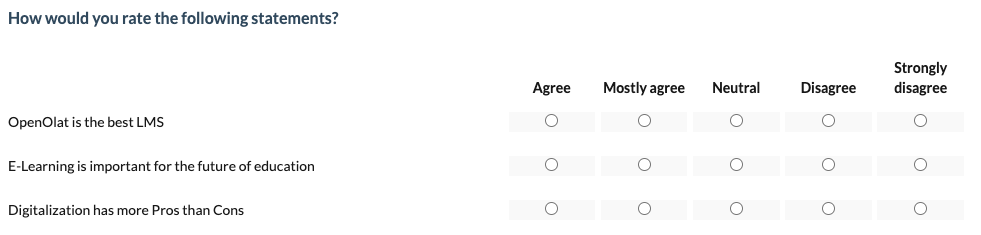
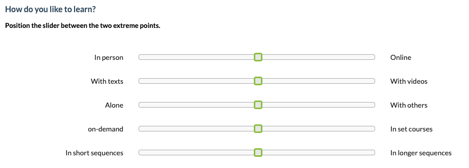
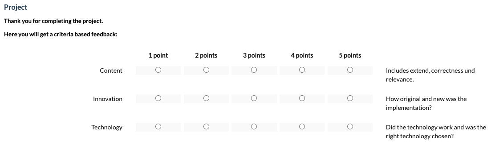
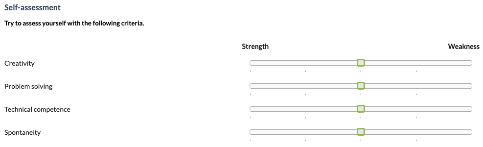
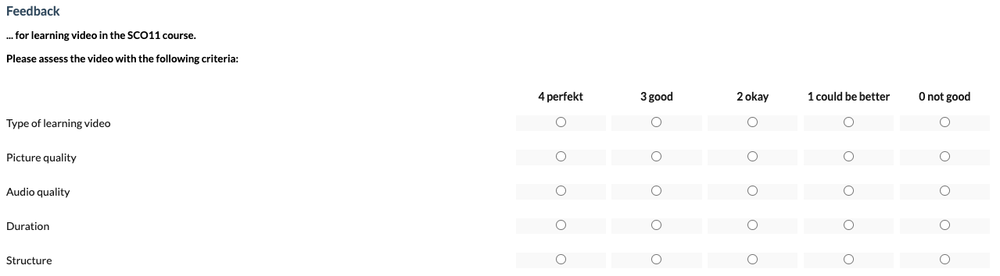
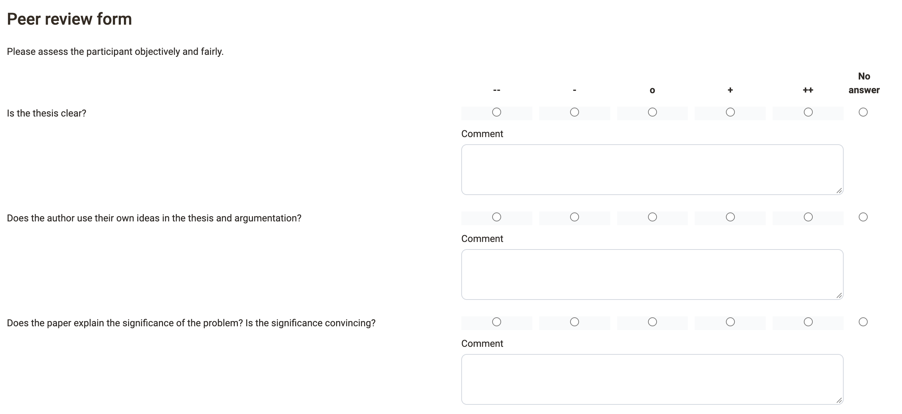
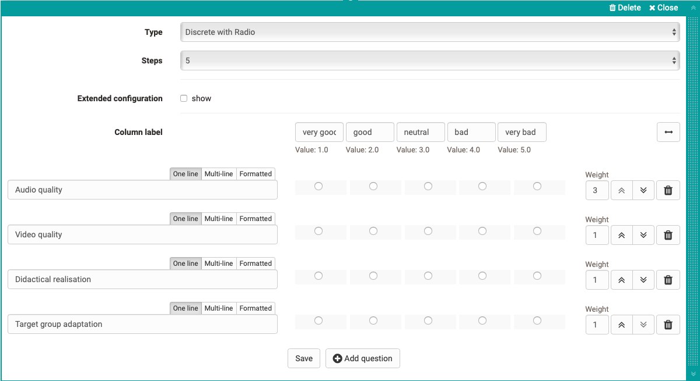
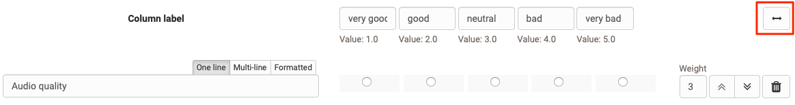
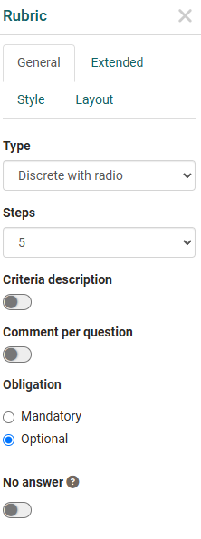
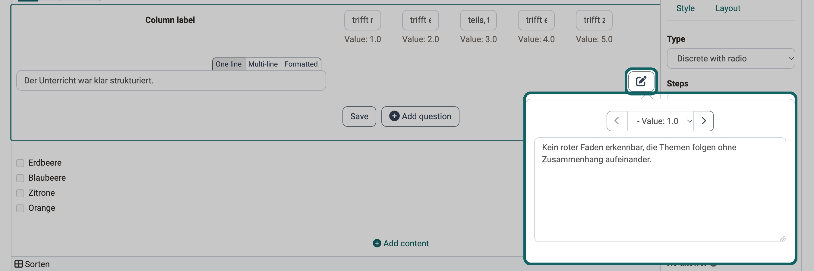

# The form element rubric

With a rubric, people answer or rate several questions on the same rating scale. The rubric is an element of the learning resource "Form" and is available wherever OpenOlat uses forms:

* [Course element Survey](../learningresources/Course_Element_Survey.md)
* [Course element Form](../learningresources/Course_Element_Form.md)
* [Course element Assessment](Forms_in_Rubric_Scoring.md)
* [Course element Task with Peer Review](Course_Element_Task/Task_Peer_Review.md#peer_review_rubric)
* [Portfolio 2.0 template](Forms_in_the_ePortfolio_template.md)

## Examples of use for Rubrics

In OpenOlat, you use rubrics, for example,

* to query the degree of agreement on a question

  { class="shadow lightbox" title="Rubric when filling in, example degree of agreement" }

 

* to query characteristics between two extreme scales

  { class="shadow lightbox" title="Rubric when filling in, example two scale ends" }

 

* to create a grading grid for the work of participants

  { class="shadow lightbox" title="Rubric when filling in, example grading grid" }

 

* to let participants assess their own strengths and weaknesses

  { class="shadow lightbox" title="Rubric when filling in, example self-assessment" }

 

* to award points per criterion

  { class="shadow lightbox" title="Rubric when filling in, example points per criterion" }

 

* to assess other participants in a peer review or to have work assessed by coaches

  { class="shadow lightbox" title="Rubric when filling in, example peer review · 2026.11.10" }

 

You add a rubric to the form in the [form editor](Form_Editor/index.md) via "Add content" and then configure it.

## Rubric configuration in the form editor {: #rubric_configuration}

A rubric consists of rows and columns: the rows hold the criteria, statements or questions, the columns the levels of the rating scale.

{ class="shadow lightbox" title="Configuration of a rubric" }

Under "Column label", enter the level of the rating scale for each column, for example very good, good, medium, bad, very bad. Each column has a value, which you set in the "Extended" tab of the rubric inspector under "Scale type".

Enter the criteria, statements or questions in the rows. You add further rows with "Add question". You can format the texts of the rows. With the up and down double arrows, you move a row. In the "Weight" field, you give a row more importance: a criterion with double or triple weight counts correspondingly more when points are awarded. With the weight 0, a question does not count towards the score, and the maximum achievable score decreases accordingly. In the statistics of the course element "Assessment", the question remains visible with the value 0.

In a course, a rubric can automatically result in a score. The course element "[Assessment](../learningresources/Course_Element_Assessment.md)" and the peer reviews in the course element "[Task](../learningresources/Course_Element_Task/index.md)" use this.

With the horizontal double arrow, you create a rubric with two ends.

{ class="shadow lightbox" title="Configuration of a rubric with two ends" }

!!! info "Important"

    You can change the weight of a row as long as the form has not yet been used for an assessment, even if it is already included in a course element. As soon as a course element "Assessment" or "Task" has used the form to assess a person, the weight is locked. The form editor then shows the message "The resource is already used. Editing is limited."

### Rubric inspector settings

In the rubric inspector, you set in the tabs "General", "Extended", "Style" and "Layout" how the rubric looks and how OpenOlat evaluates it.

{ class="shadow lightbox" title="Tab General of the rubric inspector" }

#### Tab "General"

In the "General" tab, you select under "Type" how the rubric is rated:

* **Discrete with radio**: In each row, the person selects exactly one radio button. The column label is displayed. Only with this type can you describe the criteria for individual rating fields in more detail.
* **Discrete with stars**: In each row, the person awards stars. The column label only appears if "No answer" is also switched on.
* **Discrete with slider**: The person moves a slider to a level of the scale. The column label is displayed. This type is particularly suitable for a rubric with two ends.
* **Continuous**: Like "Discrete with slider", but without levels. There is no column label.

The "Steps" field sets the number of columns, for the type "Discrete with stars" the maximum number of stars. A continuous rubric has no steps.

For the type "Discrete with radio", the switch "Criteria description" appears in addition. If it is switched on, the pencil symbol opens an input field in which you enter a more detailed description for each criterion. This way, the person filling in the form sees what a level means.

{ class="shadow lightbox" title="Rubric with criteria description · 2026.11.09" }

With the switch "Comment per question", each row gets a free text field in which the person comments on their rating.

Under "Obligation", you set whether the rubric is "Mandatory" or "Optional".

The switch "No answer" adds the column "No answer". This way, a row counts as answered even without a rating, for example if a criterion does not apply to a person.

#### Tab "Extended"

In the "Extended" tab, you give the rubric a name under "Name". Under "Show name", you choose whether it appears "In execution" and "In reports".

!!! tip "Tip"

    If you are planning to create a form with [Branches and question rules](../learningresources/Form_Question_Rules.md), you should always assign a meaningful name for single selection and multiple selection elements. This will make it easier for you to assign them later.

Under "Scale type" you can specify the type of Likert scale used and thus also define the value range: specify at which end of the scale the positive rating is located, and where the scale should start. If required, also define the ranges for unsatisfactory, neutral and good. The reports and the analysis of the form use these values.

#### Tab "Style"

In the "Style" tab, you place the rubric in an [alert box](Form_Elements/index.md#form_element_alert_box), for example to highlight a particularly important rubric.

#### Tab "Layout"

In the "Layout" tab, you set the distance between the rubric and the other elements of the form.

!!! tip "Tip"

    The rubric inspector can be freely positioned and moved in the form area. Move it so that it does not disturb you or cover other important elements.

## Further information {: #further_information}

**Mentioned on this page** 
[Course Element "Survey"](../learningresources/Course_Element_Survey.md) 
[Course Element "Form"](../learningresources/Course_Element_Form.md) 
[Forms in Rubric Scoring](Forms_in_Rubric_Scoring.md) 
[Task with peer review](Course_Element_Task/Task_Peer_Review.md) 
[Form in the Portfolio 2.0 template](Forms_in_the_ePortfolio_template.md) 
[The form editor](Form_Editor/index.md) 
[Course Element "Assessment"](../learningresources/Course_Element_Assessment.md) 
[Course Element "Task"](Course_Element_Task/index.md) 
[Question rules in forms](../learningresources/Form_Question_Rules.md) 
[Form elements](Form_Elements/index.md)

**Further reading** 
[Forms - Overview](Form/index.md) 
[How do I create a form learning resource?](../../manual_how-to/create_a_form/create_a_form.md)

[To the top of the page ^](#the-form-element-rubric)