# Formular-Elemente {: #form_elements} 

Ein Formular bauen Sie im [Formulareditor](../Form_Editor/index.de.md) aus Elementen auf. Über "Inhalt hinzufügen" fügen Sie einem Layout die folgenden Elemente hinzu:

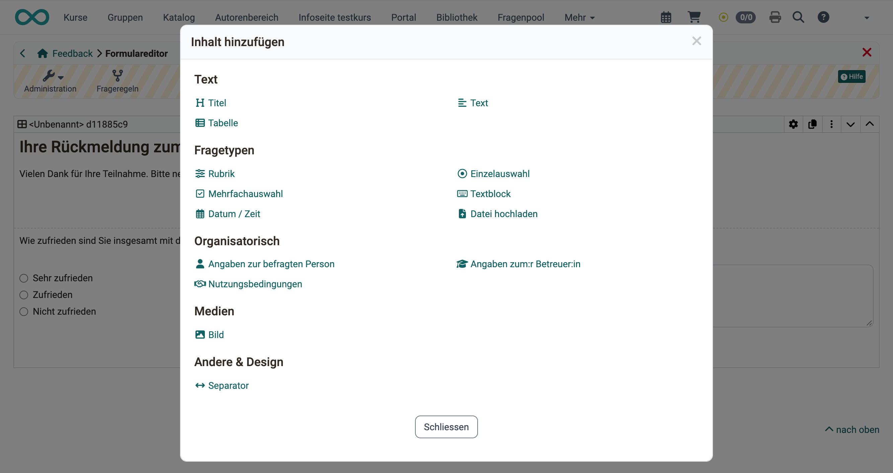{ class="shadow lightbox" title="Dialog Inhalt hinzufügen im Formulareditor · 2026.11.10" }

Die Elemente der Gruppe "Fragetypen" stellen Sie auf "Obligatorisch" oder "Freiwillig". Ein obligatorisches Element füllen die Teilnehmenden aus, bevor sie das Formular abschliessen. Ein freiwilliges Element darf leer bleiben.

Viele Elemente stellen Sie im Tab "Stil" in eine [Hinweis-Box](#form_element_alert_box). Im Tab "Layout" legen Sie den Abstand zu den übrigen Elementen fest.

---

## Titel {: #form_element_title} 

Mit dem Element "Titel" gliedern Sie das Formular mit Überschriften. Die Grösse wählen Sie in den Stufen h1 bis h6.

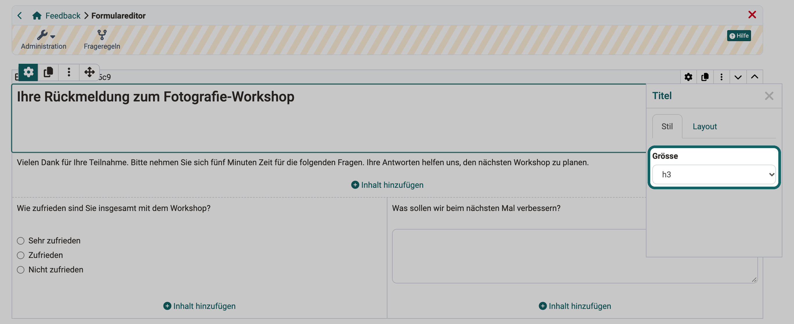{ class="shadow lightbox" title="Element Titel im Formulareditor, Inspektor, Tab Stil · 2026.11.10" }

[Zum Seitenanfang ^](#form_elements)

---

## Text {: #form_element_text} 

Mit dem Element "Text" fügen Sie dem Formular Informationen oder Fragestellungen hinzu. Ein kleiner Editor formatiert den Text und fügt Links und Aufzählungen ein.

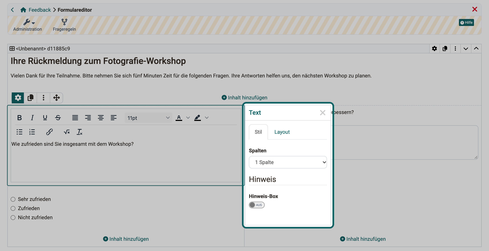{ class="shadow lightbox" title="Element Text im Formulareditor, Inspektor, Tab Stil · 2026.11.10" }

[Zum Seitenanfang ^](#form_elements)

---

## Tabelle [:octicons-tag-16:{ title="ab Release 13.2 (OO-3856)" }](https://track.frentix.com/issue/OO-3856) {: #form_element_tabelle} 

Mit dem Element "Tabelle" stellen Sie Angaben übersichtlich in Zeilen und Spalten dar. Im Inspektor legen Sie unter anderem "Zeile", "Spalte", "Kopfzeile" und "Kopfspalte" fest.

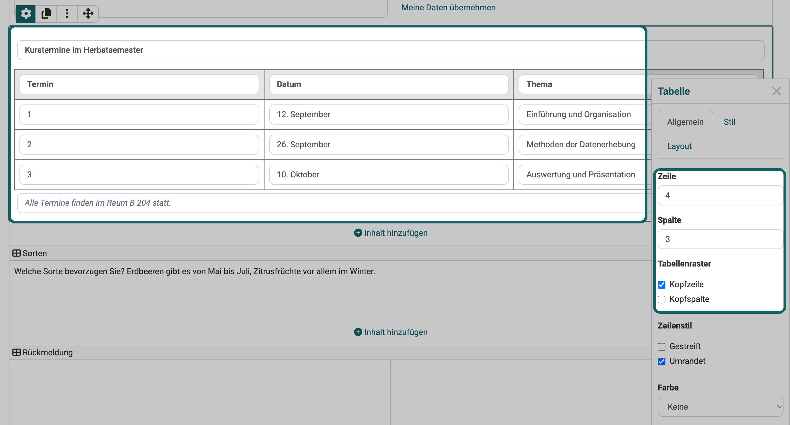{ class="shadow lightbox" title="Element Tabelle im Formulareditor, Inspektor, Tab Allgemein · 2026.11.10" }

[Zum Seitenanfang ^](#form_elements)

---

## Rubrik {: #form_element_rubric}

Mit einer Rubrik bewerten Personen mehrere Kriterien oder Aussagen auf derselben Skala. Die Zeilen tragen die Kriterien oder Aussagen, die Spalten die Stufen der Bewertungsskala. In Kursen dient die Rubrik zum Beispiel Betreuer:innen als Bewertungsraster oder Teilnehmenden für [Peer-Reviews](../Course_Element_Task/index.de.md) im Kursbaustein "Aufgabe".

Wie Sie eine Rubrik konfigurieren, beschreibt die Seite [Das Formular-Element Rubrik](../Form_Element_Rubric.de.md).

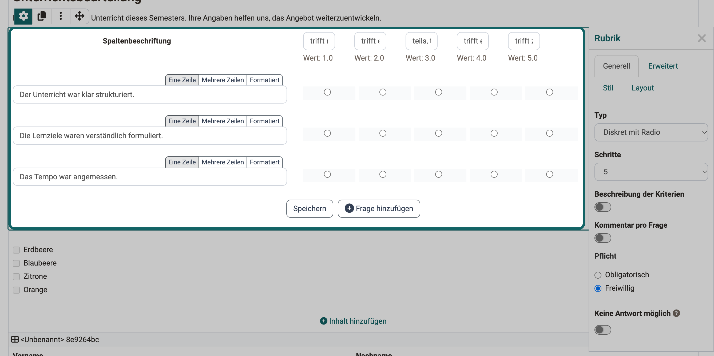{ class="shadow lightbox" title="Element Rubrik im Formulareditor, Inspektor, Tab Generell · 2026.11.10" }

[Zum Seitenanfang ^](#form_elements)

---

## Einzelauswahl [:octicons-tag-16:{ title="ab Release 13.0 (OO-3678)" }](https://track.frentix.com/issue/OO-3678) {: #form_element_sc}

In einer Einzelauswahl (Single Choice) wählen die Teilnehmenden genau eine Option aus einer Liste.

* Mit dem Button "Eintrag hinzufügen" ergänzen Sie weitere Optionen.
* Mit den Pfeilen verschieben Sie einen Eintrag nach oben oder unten.
* Unter "Darstellung" wählen Sie, ob die Optionen "Untereinander", "Nebeneinander" oder als "Auswahlliste" erscheinen.

!!! tip "Tipp"

    Die Fragestellung zur Auswahl schreiben Sie in ein eigenes Element "Text". Gleiches gilt für die Mehrfachauswahl.

Die Einzelauswahl kann die Bedingung einer [Frageregel](../Form_Question_Rules.de.md) sein. Je nach gewählter Antwort zeigt das Formular dann bestimmte Container mit ihren Inhalten an.

Geben Sie dem Element im Inspektor unter "Name" einen sprechenden Namen, damit Sie es in den Frageregeln wiederfinden.

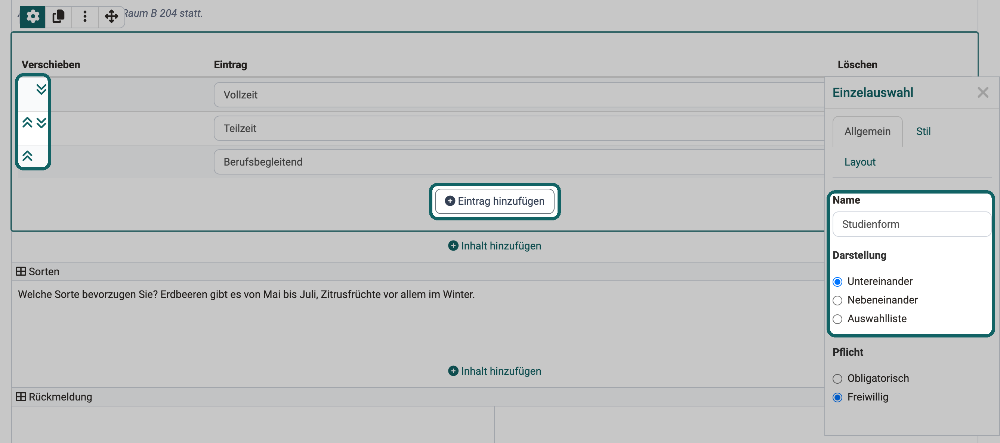{ class="shadow lightbox" title="Element Einzelauswahl im Formulareditor, Inspektor, Tab Allgemein · 2026.11.10" }

[Zum Seitenanfang ^](#form_elements)

---

## Mehrfachauswahl [:octicons-tag-16:{ title="ab Release 13.0 (OO-3679)" }](https://track.frentix.com/issue/OO-3679) {: #form_element_mc}

In einer Mehrfachauswahl (Multiple Choice) wählen die Teilnehmenden eine oder mehrere Optionen aus einer Liste.

* Mit dem Button "Eintrag hinzufügen" ergänzen Sie weitere Optionen.
* Mit den Pfeilen verschieben Sie einen Eintrag nach oben oder unten.
* Unter "Darstellung" wählen Sie, ob die Optionen "Untereinander", "Nebeneinander" oder als "Auswahlliste" erscheinen.
* Mit der Option "Teilnehmer:in kann weitere Werte erfassen" ergänzen die Teilnehmenden eigene Antworten.

Die Mehrfachauswahl kann die Bedingung einer [Frageregel](../Form_Question_Rules.de.md) sein. Je nach gewählter Antwort zeigt das Formular dann bestimmte Container mit ihren Inhalten an.

Geben Sie dem Element im Inspektor unter "Name" einen sprechenden Namen, damit Sie es in den Frageregeln wiederfinden.

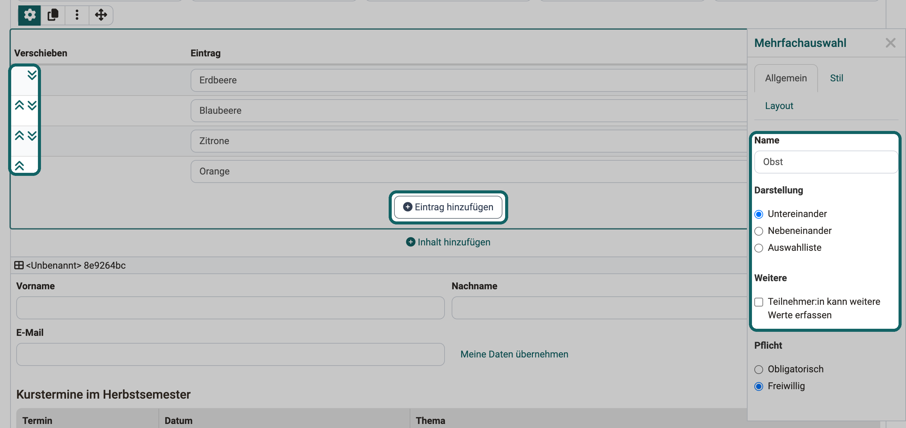{ class="shadow lightbox" title="Element Mehrfachauswahl im Formulareditor, Inspektor, Tab Allgemein · 2026.11.10" }

[Zum Seitenanfang ^](#form_elements)

---

## Textblock {: #form_element_text_input}

Im Element "Textblock" tragen die Teilnehmenden eigenen Text in ein Freitextfeld ein.

* Unter "Erlaubte Werte" legen Sie fest, ob die Teilnehmenden "Text" oder eine "Zahl" eingeben. Für ein Datum fügen Sie das eigene Element [Datum / Zeit](#form_element_date_input) ein.
* Unter "Zeilentyp" wählen Sie "Eine Zeile" oder "Mehrere Zeilen".

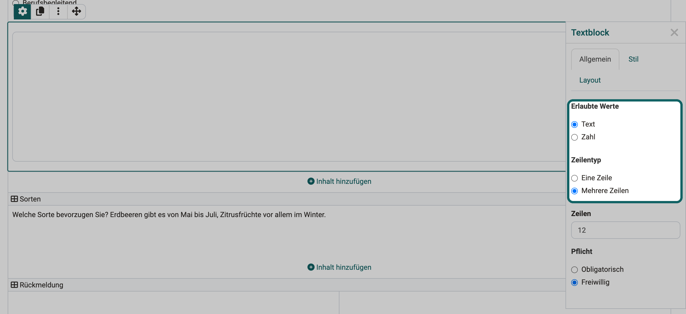{ class="shadow lightbox" title="Element Textblock im Formulareditor, Inspektor, Tab Allgemein · 2026.11.10" }

[Zum Seitenanfang ^](#form_elements)

---

## Datum / Zeit [:octicons-tag-16:{ title="ab Release 20.2.1 (OO-9079)" }](https://track.frentix.com/issue/OO-9079) {: #form_element_date_input}

Mit dem Element "Datum / Zeit" erfassen die Teilnehmenden ein Datum, auf Wunsch mit Uhrzeit, zum Beispiel den Beginn einer Prüfung. Das Datum wählen sie im Kalender des Feldes.

* Unter "Erlaubte Werte" legen Sie fest, ob die Teilnehmenden nur ein "Datum" oder "Datum / Zeit" eingeben.
* Unter "Aktion" kreuzen Sie "Mit Ausfüllaktion" an. Neben dem Feld erscheint dann ein Button, der mit einem Klick das aktuelle Datum einträgt, bei "Datum / Zeit" auch die aktuelle Uhrzeit. Die Beschriftung des Buttons legen Sie selbst fest, vorgegeben ist "Aktuelles Datum setzen".
* Unter "Pflicht" wählen Sie "Obligatorisch" oder "Freiwillig".

[Zum Seitenanfang ^](#form_elements)

---

## Datei hochladen [:octicons-tag-16:{ title="ab Release 12.4 (OO-3181)" }](https://track.frentix.com/issue/OO-3181) {: #form_element_file_upload}

Mit dem Element "Datei hochladen" laden die Teilnehmenden eine Datei in das Formular hoch.

* Unter "Maximale Dateigrösse" begrenzen Sie die Grösse der Datei.
* Unter "Dateityp" erlauben Sie nur bestimmte Dateitypen, zum Beispiel "PDF" oder "Bilder".

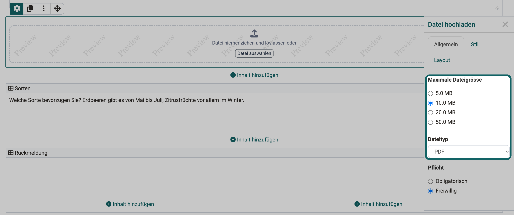{ class="shadow lightbox" title="Element Datei hochladen im Formulareditor, Inspektor, Tab Allgemein · 2026.11.10" }

[Zum Seitenanfang ^](#form_elements)

---

## Angaben zur befragten Person {: #form_element_info}

Mit dem Element "Angaben zur befragten Person" fragen Sie Angaben zur Person ab, die das Formular ausfüllt, zum Beispiel Vorname, Nachname oder E-Mail. Unter "Informationen" kreuzen Sie die gewünschten Angaben an. Ein Formular enthält das Element höchstens einmal.

Unter "Pflicht" wählen Sie eine von drei Varianten:

* **Optional - kann leer gelassen werden**: Die Teilnehmenden füllen die Angaben freiwillig aus.
* **Obligatorisch - bearbeitbar**: Die Teilnehmenden füllen die Angaben zwingend aus.
* **Obligatorisch - nicht bearbeitbar**: OpenOlat trägt die Angaben aus dem Benutzerprofil ein, die Teilnehmenden können sie nicht ändern.

!!! info "Wichtig"

    Mit diesem Element ordnet das Formular die Antworten der befragten Person zu. Das Formular ist damit nicht mehr anonym.

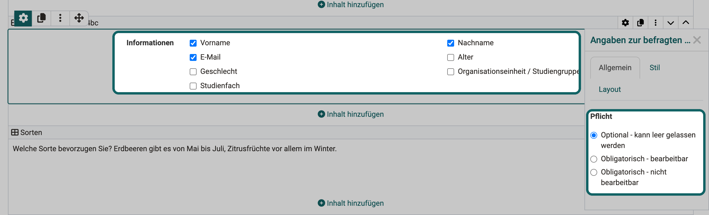{ class="shadow lightbox" title="Element Angaben zur befragten Person im Formulareditor, Inspektor, Tab Allgemein · 2026.11.10" }

[Zum Seitenanfang ^](#form_elements)

---

## Angaben zum:r Betreuer:in [:octicons-tag-16:{ title="ab Release 20.2.1 (OO-9069)" }](https://track.frentix.com/issue/OO-9069) {: #form_element_coach_info}

Mit dem Element "Angaben zum:r Betreuer:in" halten Sie im Formular fest, welche:r Betreuer:in zuständig ist, zum Beispiel wer eine Prüfung abgenommen hat. Unter "Informationen" kreuzen Sie an, welche Angaben das Formular abfragt: Vorname, Nachname oder E-Mail. Ein Formular kann das Element mehrmals enthalten, jedes wird für sich ausgefüllt.

Beim Ausfüllen zeigt das Element über den Feldern den Button "Angaben zum:r Betreuer:in übernehmen". Er listet die Betreuer:innen des Kurses. Wer das Formular ausfüllt, wählt dort eine Person, und OpenOlat trägt deren Angaben aus dem Benutzerprofil ein. Den Button zeigt das Element in Formularen, die ein Kurs verwendet, zum Beispiel im Kursbaustein "Formular" oder "Umfrage".

Im Inspektor, Tab "Allgemein", wählen Sie unter "Verfügbare Betreuer:innen", wen der Button anbietet: "Betreuer:innen" oder "Betreuer:innen und Besitzer:innen" des Kurses.

Unter "Pflicht" wählen Sie eine von drei Varianten:

* **Optional - kann leer gelassen werden**: Die Angaben dürfen leer bleiben.
* **Obligatorisch - bearbeitbar**: Alle angekreuzten Angaben müssen ausgefüllt sein, von Hand oder über den Button.
* **Obligatorisch - nicht bearbeitbar**: Die Angaben kommen ausschliesslich über den Button. Von Hand lassen sie sich nicht ändern.

!!! info "Wichtig"

    Die Variante "Obligatorisch - nicht bearbeitbar" braucht einen Kurs mit Betreuer:innen. Findet OpenOlat keine, zeigt das Element den Hinweis "Es sind keine Betreuer:innen verfügbar." und das Formular lässt sich nicht abschliessen.

[Zum Seitenanfang ^](#form_elements)

---

## Nutzungsbedingungen [:octicons-tag-16:{ title="ab Release 13.0 (OO-3674)" }](https://track.frentix.com/issue/OO-3674) {: #form_element_terms_of_use}

Mit dem Element "Nutzungsbedingungen" fügen Sie dem Formular eine Einverständniserklärung mit Checkbox hinzu. Die Teilnehmenden haken sie an, bevor sie das Formular abschliessen. Zwischenspeichern können sie das Formular auch vorher.

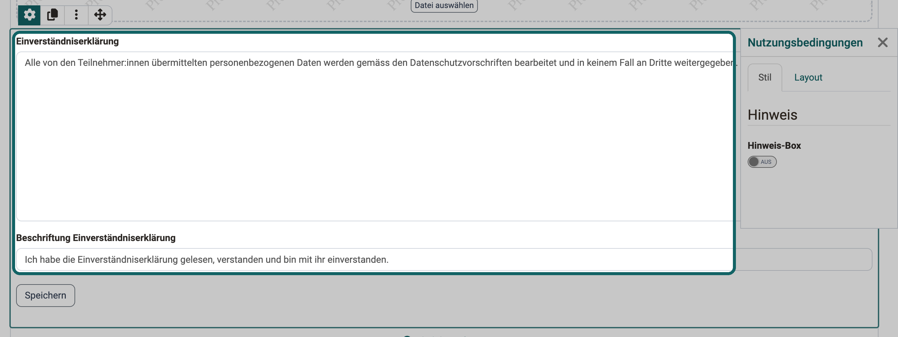{ class="shadow lightbox" title="Element Nutzungsbedingungen im Formulareditor · 2026.11.10" }

[Zum Seitenanfang ^](#form_elements)

---

## Bild [:octicons-tag-16:{ title="ab Release 13.2 (OO-3857)" }](https://track.frentix.com/issue/OO-3857) {: #form_element_picture}

Mit dem Element "Bild" zeigen Sie im Formular ein Bild. Wählen Sie unter "Inhalt hinzufügen" das Element "Bild", fordert OpenOlat Sie zuerst auf, eine Bilddatei hochzuladen. Danach zeigt der Formulareditor das Bild mit dem Inspektor.

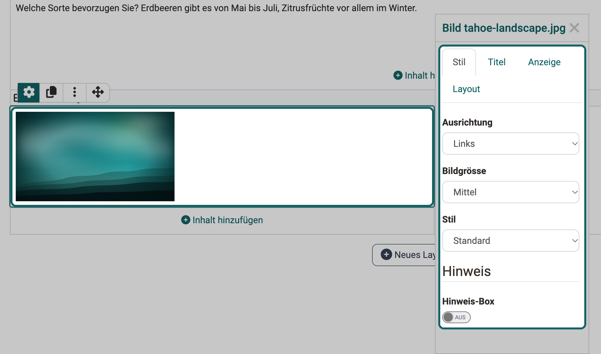{ class="shadow lightbox" title="Element Bild im Formulareditor, Inspektor, Tab Stil · 2026.11.10" }

Im Inspektor legen Sie fest, wie das Bild erscheint:

**Tab "Stil"**

* **Ausrichtung**: Lage des Bildes im Layoutbereich
* **Bildgrösse**: Skalierung des Bildes
* **Stil**: Darstellung, zum Beispiel mit Rahmen oder Schatten
* **Hinweis-Box**: Darstellung in einer [Hinweis-Box](#form_element_alert_box)

**Tab "Titel"**

* **Titel**: Titel zum Bild
* **Wo**: Position des Titels, zum Beispiel über dem Bild oder auf dem Bild in der Mitte
* **Titelstil**: "Hell" für dunkle Bilder, "Dunkel" für helle Bilder

**Tab "Anzeige"**

* **Beschreibung**: Text zum Bild, den die Teilnehmenden über ein kleines Fragezeichensymbol öffnen
* **Bildunterschrift**: Text in kleinerer Schrift unter dem Bild

**Tab "Layout"**

* **Abstand**: Abstand des Bildes zu den übrigen Elementen

[Zum Seitenanfang ^](#form_elements)

---

## Separator {: #form_element_separator}

Der Separator ist eine feine Trennlinie zum Gliedern Ihres Formulars in Bereiche.

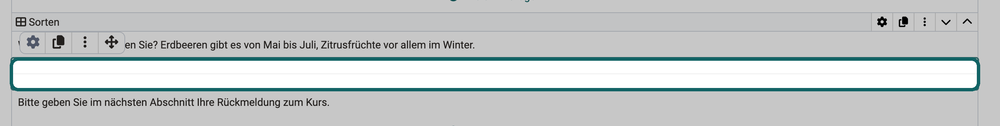{ class="shadow lightbox" title="Element Separator im Formulareditor · 2026.11.10" }

[Zum Seitenanfang ^](#form_elements)

---

## Container {: #form_element_container}

Ein Container nimmt die Elemente des Formulars in Spalten und Zeilen auf. Im Formulareditor heisst er "Layout": Jedes Element steht in einem Container, ein neues Formular enthält bereits einen mit einer Spalte. Einen weiteren Container fügen Sie nicht über "Inhalt hinzufügen" ein, sondern mit dem Button "Neues Layout einfügen".

Im Inspektor des Containers legen Sie fest:

* **Layout**: die Layout Vorlage, also die Aufteilung in Spalten und Zeilen
* **Name**: den Namen, über den Sie den Container in den [Frageregeln](../Form_Question_Rules.de.md) auswählen
* **Stil**: eine [Hinweis-Box](#form_element_alert_box) um den ganzen Container

Mit einer Frageregel erscheint ein Container erst, wenn die Teilnehmenden in einer Einzel- oder Mehrfachauswahl eine bestimmte Antwort gewählt haben. Einen solchen Container kennzeichnet der Formulareditor mit "Wird gesteuert durch Regel".

Wie Sie Container einfügen, ändern und löschen, beschreibt die Seite [Der Formulareditor](../Form_Editor/index.de.md#insert_layout).

[Zum Seitenanfang ^](#form_elements)

---

## Hinweis-Box [:octicons-tag-16:{ title="ab Release 18.2.3 (OO-7138)" }](https://track.frentix.com/issue/OO-7138) {: #form_element_alert_box}

Mit der Hinweis-Box heben Sie ein Element hervor, zum Beispiel einen wichtigen Text oder eine Rubrik. Die Hinweis-Box ist kein eigenes Element, sondern eine Einstellung im Tab "Stil" vieler Elemente wie Text, Tabelle, Bild, Rubrik und Nutzungsbedingungen.

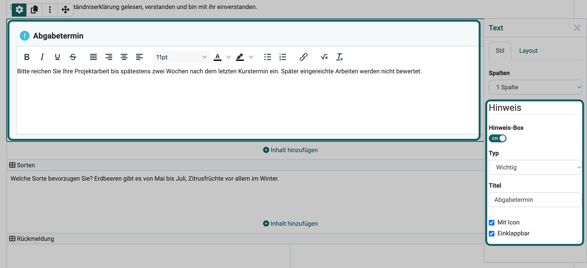{ class="shadow lightbox" title="Hinweis-Box eines Text-Elements im Formulareditor, Inspektor, Tab Stil · 2026.11.10" }

Ist der Schalter "Hinweis-Box" eingeschaltet, legen Sie die folgenden Einstellungen fest.

#### Typ {: #alert_box_type}

Der Typ bestimmt, welche vorformatierte Box erscheint oder ob Sie die Box selbst gestalten. Zur Auswahl stehen:

* Notiz
* Information
* Tipp
* Wichtig
* Warnung
* Fehler
* Erfolg
* Benutzerdefiniert: Sie wählen selbst ein Icon und die Hintergrundfarbe der Box.

#### Titel {: #alert_box_title}

Der Titel erscheint in der Kopfzeile der Hinweis-Box.

#### Mit Icon {: #alert_box_icon}

Ist die Option eingeschaltet, zeigt die Hinweis-Box oben links ein Icon, zum Beispiel ein "i" beim Typ "Information".

#### Einklappbar {: #alert_box_collapsible}

Ist die Option eingeschaltet, klappen die Teilnehmenden die Box mit dem Symbol oben rechts ein. Dann ist nur noch die Titelzeile sichtbar. Ein weiterer Klick auf das Symbol öffnet die Box wieder.

---

## Weiterführende Informationen {: #further_information}

[Wie erstelle ich eine Formular-Lernressource?](../../../manual_how-to/create_a_form/create_a_form.de.md) 
[Der Formulareditor](../Form_Editor/index.de.md) 
[Das Formular-Element Rubrik](../Form_Element_Rubric.de.md) 
[Frageregeln in Formularen](../Form_Question_Rules.de.md)

[Zum Seitenanfang ^](#form_elements)

