# Form elements {: #form_elements} 

You build a form from elements in the [form editor](../Form_Editor/index.md). Via "Add content", you add the following elements to a layout:

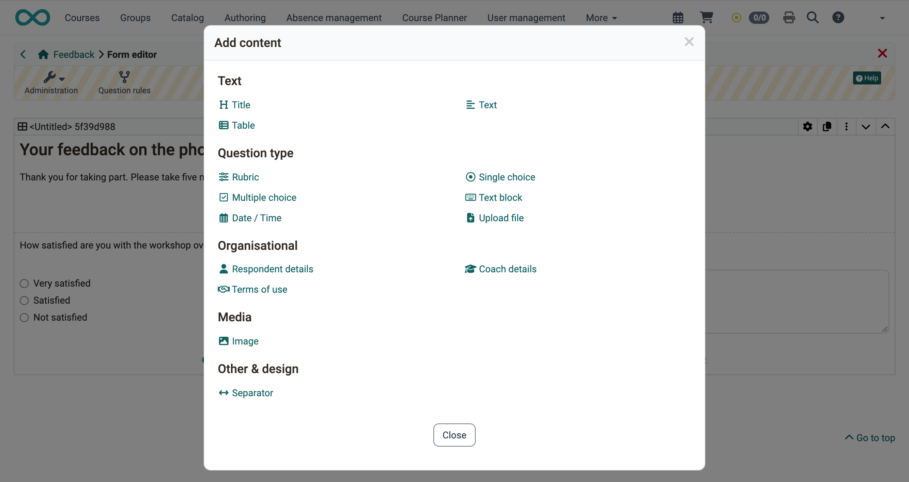{ class="shadow lightbox" title="Dialog Add content in the form editor · 2026.11.10" }

You set the elements of the group "Question types" to "Mandatory" or "Optional". Participants fill in a mandatory element before they finish the form. An optional element may stay empty.

Many elements can be placed in an [alert box](#form_element_alert_box) in the "Style" tab. In the "Layout" tab, you set the distance to the other elements.

---

## Title {: #form_element_title} 

With the element "Title", you structure the form with headings. You choose the size in the levels h1 to h6.

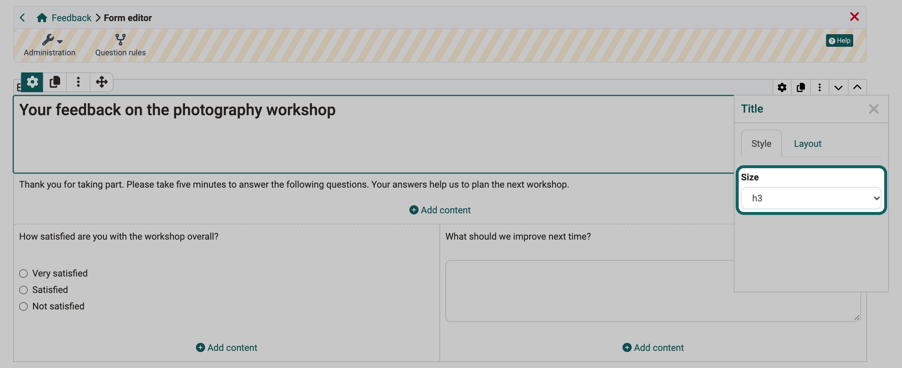{ class="shadow lightbox" title="Title element in the form editor, inspector, tab Style · 2026.11.10" }

[To the top of the page ^](#form_elements)

---

## Text {: #form_element_text} 

With the element "Text", you add information or questions to the form. A small editor formats the text and inserts links and bullet points.

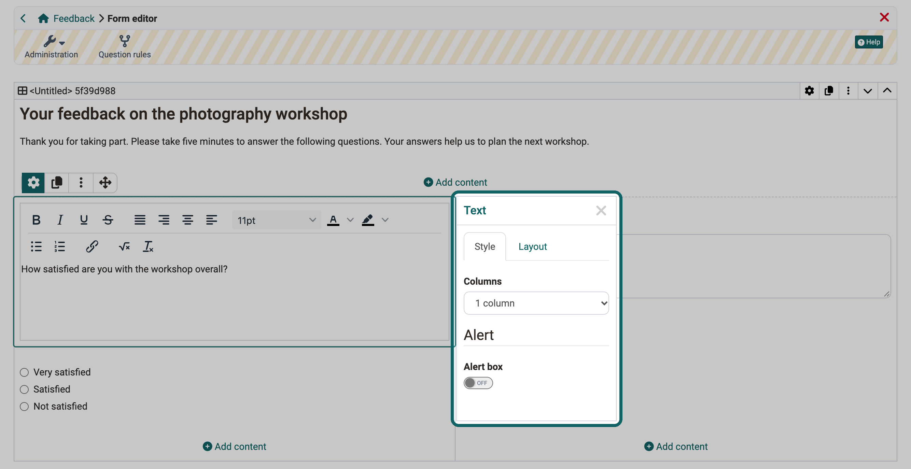{ class="shadow lightbox" title="Text element in the form editor, inspector, tab Style · 2026.11.10" }

[To the top of the page ^](#form_elements)

---

## Table [:octicons-tag-16:{ title="from Release 13.2 (OO-3856)" }](https://track.frentix.com/issue/OO-3856) {: #form_element_tabelle} 

With the element "Table", you present information clearly in rows and columns. In the inspector, you set among other things "Row", "Column", "Row header" and "Column header".

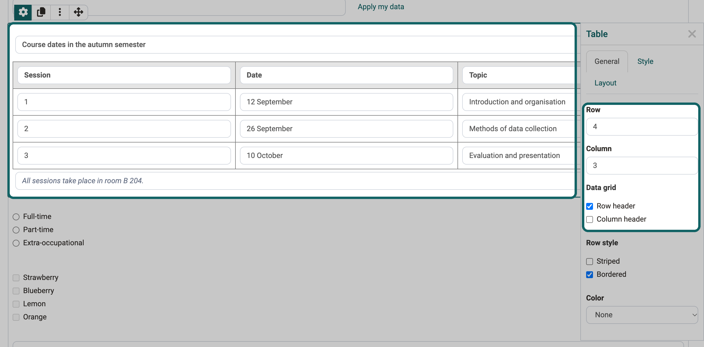{ class="shadow lightbox" title="Table element in the form editor, inspector, tab General · 2026.11.10" }

[To the top of the page ^](#form_elements)

---

## Rubric {: #form_element_rubric}

With a rubric, people rate several criteria or statements on the same scale. The rows hold the criteria or statements, the columns the levels of the rating scale. In courses, the rubric serves, for example, coaches as a grading grid or participants for [peer reviews](../Course_Element_Task/index.md) in the course element "Task".

How you configure a rubric is described on the page [The form element rubric](../Form_Element_Rubric.md).

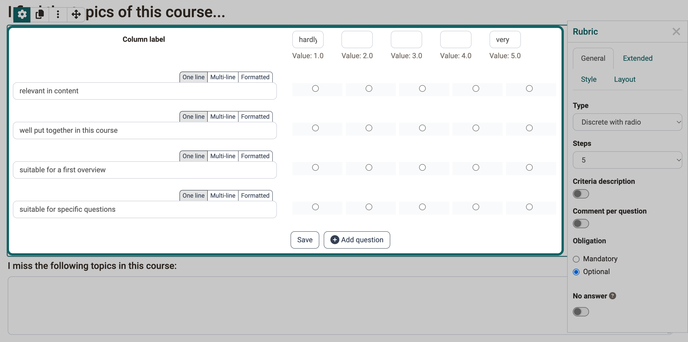{ class="shadow lightbox" title="Rubric element in the form editor, inspector, tab General · 2026.11.10" }

[To the top of the page ^](#form_elements)

---

## Single choice [:octicons-tag-16:{ title="from Release 13.0 (OO-3678)" }](https://track.frentix.com/issue/OO-3678) {: #form_element_sc}

In a single choice, participants select exactly one option from a list.

* With the button "Add choice", you add further options.
* With the arrows, you move an entry up or down.
* Under "Presentation", you choose whether the options appear "Vertical", "Horizontal" or as a "Dropdown".

!!! tip "Tip"

    Write the question for the selection in a separate element "Text". The same applies to the multiple choice.

The single choice can be the condition of a [question rule](../Form_Question_Rules.md). Depending on the selected answer, the form then shows certain containers with their contents.

In the inspector, give the element a meaningful name under "Name" so that you find it again in the question rules.

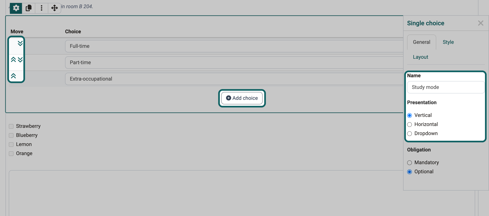{ class="shadow lightbox" title="Single choice element in the form editor, inspector, tab General · 2026.11.10" }

[To the top of the page ^](#form_elements)

---

## Multiple choice [:octicons-tag-16:{ title="from Release 13.0 (OO-3679)" }](https://track.frentix.com/issue/OO-3679) {: #form_element_mc}

In a multiple choice, participants select one or more options from a list.

* With the button "Add choice", you add further options.
* With the arrows, you move an entry up or down.
* Under "Presentation", you choose whether the options appear "Vertical", "Horizontal" or as a "Dropdown".
* With the option "Participant can insert other values", participants add their own answers.

The multiple choice can be the condition of a [question rule](../Form_Question_Rules.md). Depending on the selected answer, the form then shows certain containers with their contents.

In the inspector, give the element a meaningful name under "Name" so that you find it again in the question rules.

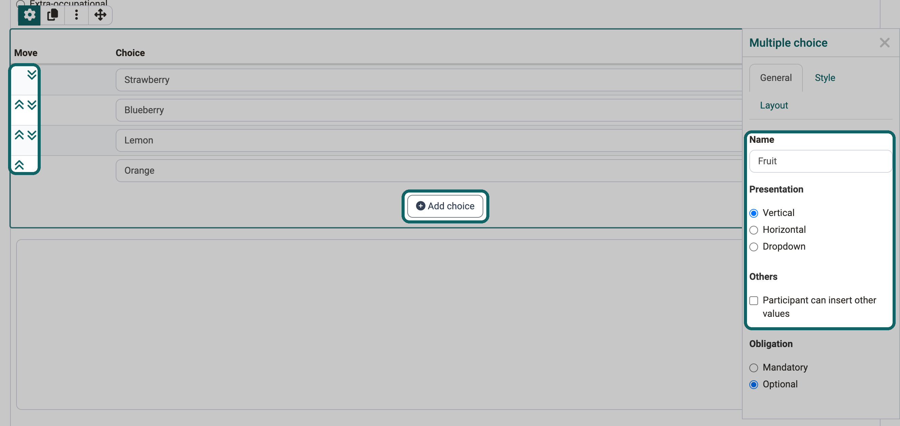{ class="shadow lightbox" title="Multiple choice element in the form editor, inspector, tab General · 2026.11.10" }

[To the top of the page ^](#form_elements)

---

## Text block {: #form_element_text_input}

In the element "Text block", participants enter their own text in a free text field.

* Under "Input type", you set whether participants enter "Text" or a number ("Numeric"). For a date, add the separate element "Date / Time".
* Under "Row type", you choose "Single row" or "Multiple rows".

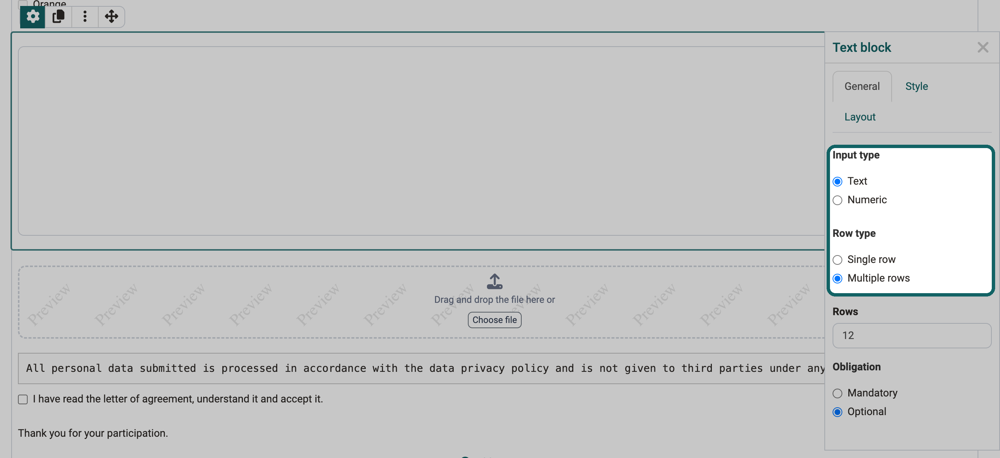{ class="shadow lightbox" title="Text block element in the form editor, inspector, tab General · 2026.11.10" }

[To the top of the page ^](#form_elements)

---

## Upload file [:octicons-tag-16:{ title="from Release 12.4 (OO-3181)" }](https://track.frentix.com/issue/OO-3181) {: #form_element_file_upload}

With the element "Upload file", participants upload a file into the form.

* Under "Maximum file size", you limit the size of the file.
* Under "File type", you allow only certain file types, for example "PDF" or "Image".

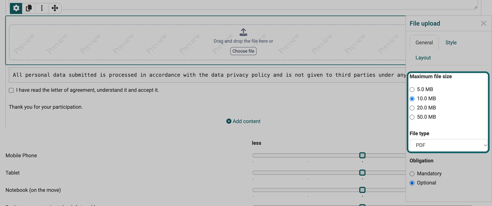{ class="shadow lightbox" title="Upload file element in the form editor, inspector, tab General · 2026.11.10" }

[To the top of the page ^](#form_elements)

---

## Respondent details {: #form_element_info}

With the element "Respondent details", you ask for details about the person who fills in the form, for example first name, last name or email. Under "Information", you tick the details you need. A form contains the element at most once.

Under "Obligation", you choose one of three variants:

* **Optional - can be left blank**: Participants fill in the details voluntarily.
* **Mandatory - editable**: Participants must fill in the details.
* **Mandatory - not editable**: OpenOlat enters the details from the user profile, participants cannot change them.

!!! info "Important"

    With this element, the form assigns the answers to the respondent. The form is therefore no longer anonymous.

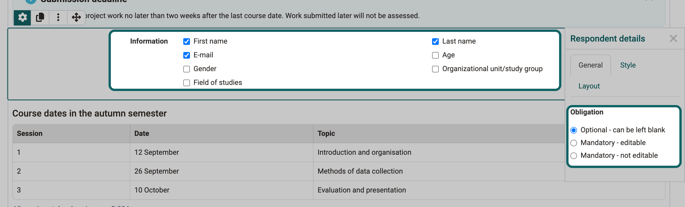{ class="shadow lightbox" title="Respondent details element in the form editor, inspector, tab General · 2026.11.10" }

[To the top of the page ^](#form_elements)

---

## Terms of use [:octicons-tag-16:{ title="from Release 13.0 (OO-3674)" }](https://track.frentix.com/issue/OO-3674) {: #form_element_terms_of_use}

With the element "Terms of use", you add a letter of agreement with a checkbox to the form. Participants tick it before they finish the form. They can save the form in between before that.

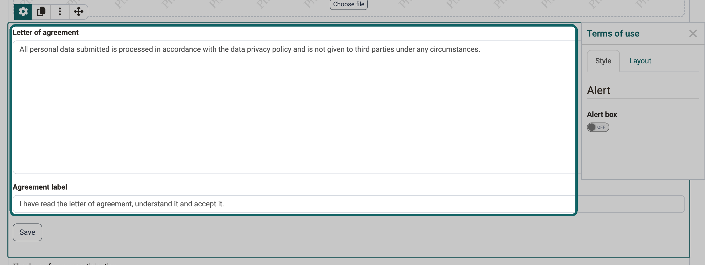{ class="shadow lightbox" title="Terms of use element in the form editor · 2026.11.10" }

[To the top of the page ^](#form_elements)

---

## Image [:octicons-tag-16:{ title="from Release 13.2 (OO-3857)" }](https://track.frentix.com/issue/OO-3857) {: #form_element_picture}

With the element "Image", you show an image in the form. If you select the element "Image" under "Add content", OpenOlat first asks you to upload an image file. Then the form editor shows the image with the inspector.

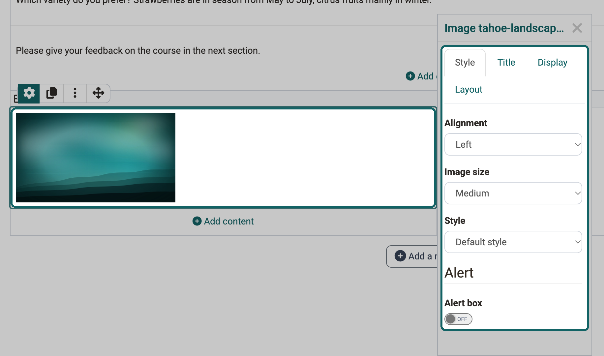{ class="shadow lightbox" title="Image element in the form editor, inspector, tab Style · 2026.11.10" }

In the inspector, you set how the image appears:

**Tab "Style"**

* **Alignment**: position of the image in the layout area
* **Image size**: scaling of the image
* **Style**: display, for example with a frame or shadow
* **Alert box**: display in an [alert box](#form_element_alert_box)

**Tab "Title"**

* **Title**: title of the image
* **Title position**: position of the title, for example above the image or on the image in the middle
* **Title style**: "Bright" for dark images, "Dark" for bright images

**Tab "Display"**

* **Description**: text about the image, which participants open via a small question mark symbol
* **Caption**: text in a smaller font below the image

**Tab "Layout"**

* **Spacing**: distance of the image to the other elements

[To the top of the page ^](#form_elements)

---

## Separator

The separator is a fine dividing line that structures your form into areas.

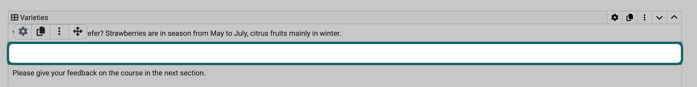{ class="shadow lightbox" title="Separator element in the form editor · 2026.11.10" }

[To the top of the page ^](#form_elements)

---

## Alert box [:octicons-tag-16:{ title="from Release 18.2.3 (OO-7138)" }](https://track.frentix.com/issue/OO-7138) {: #form_element_alert_box}

With the alert box, you highlight an element, for example an important text or a rubric. The alert box is not an element of its own but a setting in the "Style" tab of many elements such as text, table, image, rubric and terms of use.

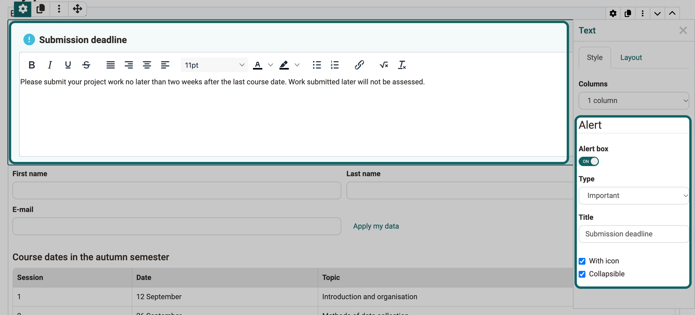{ class="shadow lightbox" title="Alert box of a text element in the form editor, inspector, tab Style · 2026.11.10" }

If the switch "Alert box" is switched on, you set the following settings.

#### Type {: #alert_box_type}

The type determines which pre-formatted box appears or whether you design the box yourself. The options are:

* Note
* Info
* Tip
* Important
* Warning
* Error
* Success
* Custom: you choose an icon and the background color of the box yourself.

#### Title {: #alert_box_title}

The title appears in the header of the alert box.

#### With icon {: #alert_box_icon}

If the option is switched on, the alert box shows an icon at the top left, for example an "i" for the type "Info".

#### Collapsible {: #alert_box_collapsible}

If the option is switched on, participants collapse the box with the symbol at the top right. Then only the title bar is visible. Another click on the symbol opens the box again.

---

## Further information {: #further_information}

[How do I create a form learning resource?](../../../manual_how-to/create_a_form/create_a_form.md) 
[The form editor](../Form_Editor/index.md) 
[The form element rubric](../Form_Element_Rubric.md) 
[Question rules in forms](../Form_Question_Rules.md)

[To the top of the page ^](#form_elements)