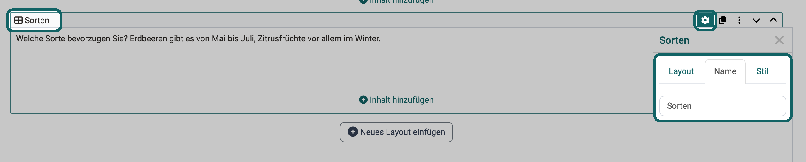
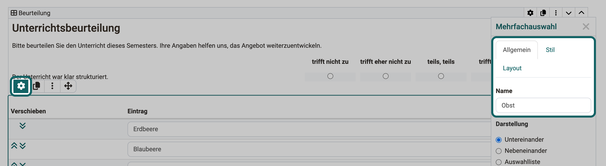
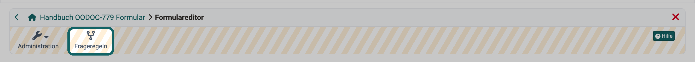
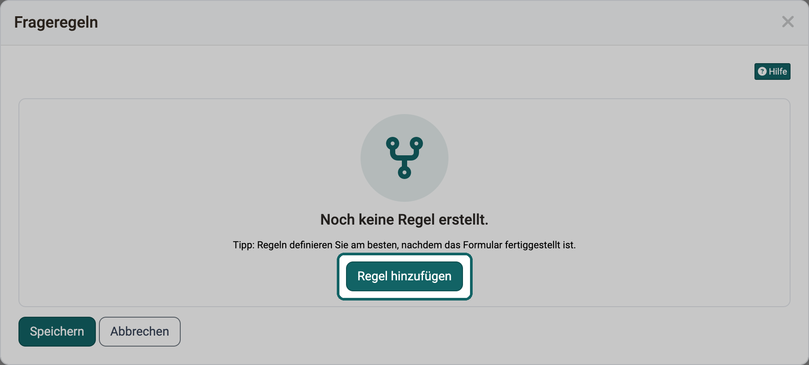
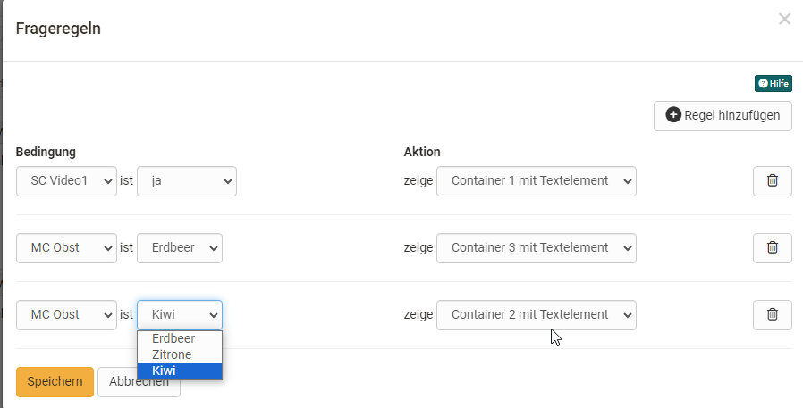

# Frageregeln in Formularen {: #form_question_rules}

Mit Frageregeln zeigt ein Formular einen Bereich nur dann an, wenn er zur Antwort passt: Ein Container mit seinen Elementen erscheint erst, wenn die Person in einer Einzel- oder Mehrfachauswahl eine bestimmte Antwort gewählt hat.

Mit mehreren Regeln bilden Sie in einem Formular unterschiedliche Fragestränge.

## Erstellung einer Regel [:octicons-tag-16:{ title="ab Release 15.5 (OO-5384)" }](https://track.frentix.com/issue/OO-5384)

Legen Sie zuerst fest, welche Bereiche bei welcher Antwort erscheinen sollen. Danach setzen Sie das mit Frageregeln um.

### Voraussetzungen
Für eine Frageregel braucht das Formular:

* eine Mehrfachauswahl oder Einzelauswahl mit mindestens einer Antwort
* einen Container mit Inhalt, der nicht die Einzel- oder Mehrfachauswahl der Bedingung enthält

Fehlt eine Voraussetzung, zeigt OpenOlat im Dialog "Frageregeln" eine Warnung, und Sie können keine Regel erstellen.

### Passende Namen vergeben

In einer Frageregel wählen Sie Container und Auswahl-Elemente über ihren Namen aus. Geben Sie deshalb jedem Container und jeder Einzel- oder Mehrfachauswahl, die Sie für eine Regel brauchen, einen sprechenden Namen. Den Namen tragen Sie im Inspektor ein, den das Zahnrad-Symbol des Elements öffnet.

Hier tragen Sie den Namen für einen Container ein:

{ class="shadow lightbox" title="Inspektor eines Containers im Formulareditor · 2026.11.09" }

So tragen Sie den Namen für eine Einzel- oder Mehrfachauswahl ein:

{ class="shadow lightbox" title="Inspektor einer Mehrfachauswahl im Formulareditor · 2026.11.09" }

### Frageregeln im Menü hinterlegen
Die Frageregeln öffnen Sie im Formulareditor über das Symbol "Frageregeln" rechts neben dem Menü "Administration": 
`Formular > Administration > Formulareditor > Frageregeln`

{ class="shadow lightbox" title="Kopfzeile des Formulareditors · 2026.11.10" }

Es öffnet sich der Dialog "Frageregeln". Dort erstellen Sie mit "Regel hinzufügen" neue Regeln und sehen alle bestehenden Regeln.

{ class="shadow lightbox" title="Dialog Frageregeln ohne Regel · 2026.11.09" }

Eine Frageregel besteht aus einer Bedingung und einer Aktion. Die Bedingung ist eine Antwort einer Einzel- oder Mehrfachauswahl. Die Aktion zeigt einen Container, zum Beispiel mit weiteren Informationen oder Fragen. Zum Schluss klicken Sie auf "Speichern".

{ class="shadow lightbox" title="Dialog Frageregeln mit drei Regeln" }

## Weiterführende Informationen {: #further_information}

[Der Formulareditor](Form_Editor/index.de.md) 
[Formular-Elemente](Form_Elements/index.de.md) 
[Formulare - Übersicht](Form/index.de.md)

[Zum Seitenanfang ^](#form_question_rules)
