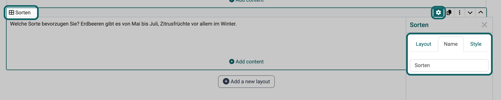
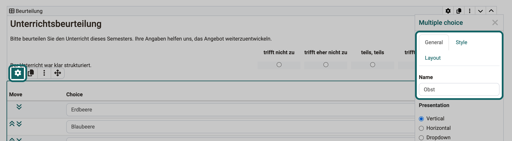
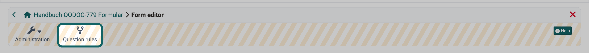
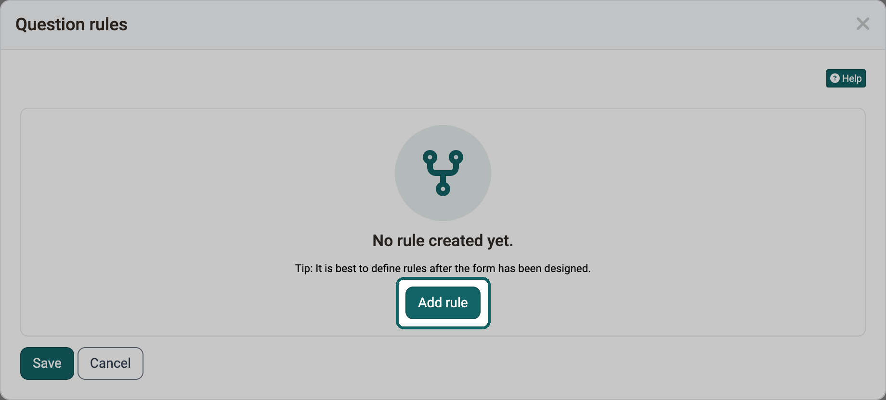
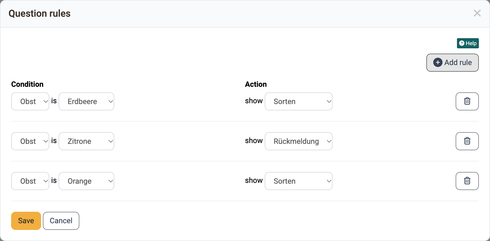

# Question rules in forms {: #form_question_rules}

With question rules, a form shows an area only if it matches the answer: a container with its elements appears only once the person has selected a certain answer in a single or multiple choice.

With several rules, you build different question strands in a form.

## Creation of a rule [:octicons-tag-16:{ title="from Release 15.5 (OO-5384)" }](https://track.frentix.com/issue/OO-5384)

First decide which areas are to appear for which answer. Then implement this with question rules.

### Requirements
For a question rule, the form needs:

* a multiple choice or single choice with at least one answer
* a container with content that does not contain the single or multiple choice of the condition

If a requirement is missing, OpenOlat shows a warning in the "Question rules" dialog, and you cannot create a rule.

### Assign suitable names

In a question rule, you select containers and choice elements by their name. Therefore, give every container and every single or multiple choice that you need for a rule a meaningful name. You enter the name in the inspector, which the cogwheel symbol of the element opens.

Enter the name for a container here:

{ class="shadow lightbox" title="Inspector of a container in the form editor · 2026.11.09" }

To enter the name for a single or multiple choice:

{ class="shadow lightbox" title="Inspector of a multiple choice in the form editor · 2026.11.09" }

### Store question rules in the menu
You open the question rules in the form editor via the "Question rules" symbol to the right of the "Administration" menu: 
`Form > Administration > Form editor > Question rules`

{ class="shadow lightbox" title="Header of the form editor · 2026.11.10" }

The "Question rules" dialog opens. There, you create new rules with "Add rule" and see all existing rules.

{ class="shadow lightbox" title="Question rules dialog without a rule · 2026.11.09" }

A question rule consists of a condition and an action. The condition is an answer of a single or multiple choice. The action shows a container, for example with further information or questions. Finally, click "Save".

{ class="shadow lightbox" title="Question rules dialog with three rules · 2026.11.10" }

## Further information {: #further_information}

[The form editor](Form_Editor/index.md) 
[Form elements](Form_Elements/index.md) 
[Forms - Overview](Form/index.md)

[To the top of the page ^](#form_question_rules)
