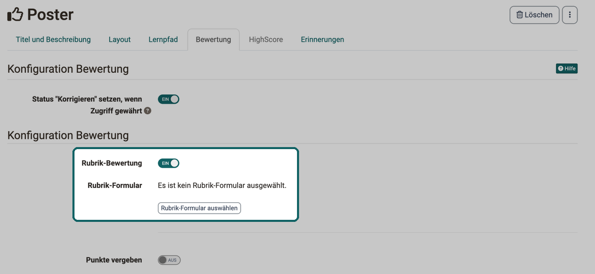
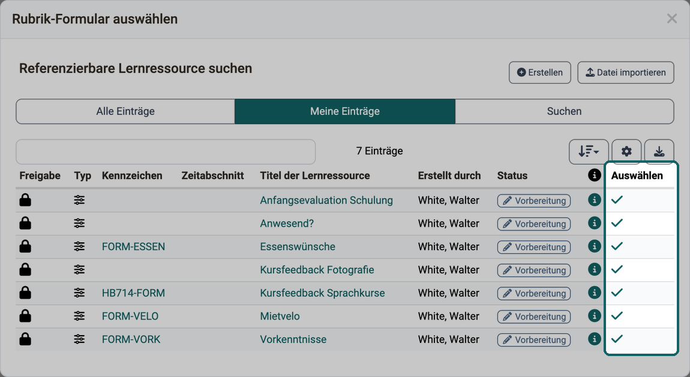
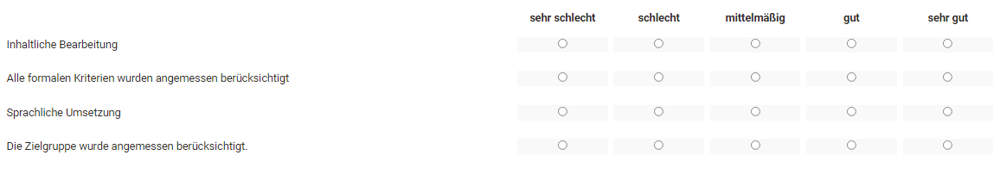
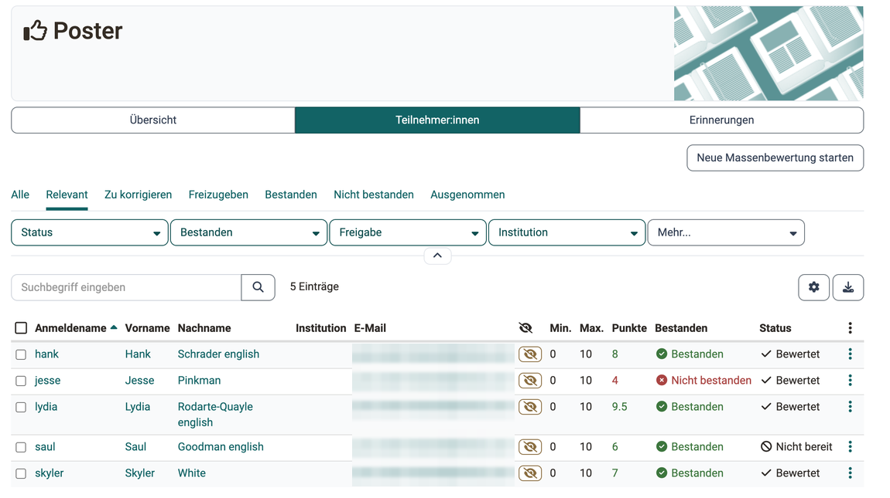

# Formular als Rubrik-Bewertung

Wer Leistungen nach festen Kriterien bewerten will, etwa ein Referat nach Inhalt, Sprache und Form, verknüpft den Kursbaustein "Bewertung" mit einem Formular, das ein Element [Rubrik](../learningresources/Form_Element_Rubric.de.md) enthält. Die Betreuenden wählen dann je Kriterium eine Stufe, und OpenOlat kann aus der Rubrik die Punkte übernehmen. Die Bewertung wird so für alle Teilnehmenden nach denselben Massstäben nachvollziehbar.

Besitzer:innen des Kurses richten die Rubrik-Bewertung im Kurseditor ein. Bewerten können Besitzer:innen und Betreuer:innen.

!!! note "Hinweis"

    Auch Bewertungen im Rahmen eines Peer-Reviews arbeiten mit Rubrik-Formularen. Dafür ist der [Kursbaustein "Aufgabe"](../learningresources/Course_Element_Task.de.md) zuständig.

## Im Kurseditor

Fügen Sie im Kurseditor den [Kursbaustein "Bewertung"](../learningresources/Course_Element_Assessment.de.md) hinzu. Öffnen Sie den Tab "Bewertung" des Kursbausteins und schalten Sie "Rubrik-Bewertung" ein.

{ class="shadow lightbox" title="Tab Bewertung eines Kursbausteins Bewertung im Kurseditor · 2026.10.20" }

Klicken Sie danach auf "Rubrik-Formular auswählen". Im Dialog wählen Sie ein vorhandenes Formular aus oder legen ein neues an.

{ class="shadow lightbox" title="Dialog Rubrik-Formular auswählen im Kurseditor · 2026.10.20" }

Grundlage der Rubrik-Bewertung ist eine Lernressource Formular, der im [Formulareditor](../learningresources/Form_Editor.de.md) ein Element Rubrik hinzugefügt wurde.

Der Dialog öffnet im Tab "Meine Einträge" mit den Formularen, deren Besitzer:in Sie sind. In den Tabs "Alle Einträge" und "Suchen" finden Sie weitere Formulare, die Sie einbinden dürfen. Mit einem Klick auf das Häkchen in der Spalte "Auswählen" übernehmen Sie ein Formular in den Kursbaustein.

Gibt es noch kein passendes Formular, legen Sie mit "Erstellen" eine neue Lernressource Formular an oder laden mit "Datei importieren" ein vorhandenes Formular hoch. Das neue Formular erscheint danach ebenfalls in der Liste und lässt sich auswählen.

Ein neu erstelltes Formular enthält noch kein Element Rubrik. Fügen Sie es im Kurseditor über "Bearbeiten" hinzu oder direkt in der Lernressource im [Formulareditor](../learningresources/Form_Editor.de.md).

Ein Formular, das Sie im Kurseditor erstellen, ist eine eigene Lernressource. Sie finden es im [Autorenbereich](../area_modules/Authoring.de.md) unter "Meine Einträge" und können es in weiteren Kursen einbinden.

Ist ein Formular ausgewählt, zeigt der Tab seinen Titel und die Schaltflächen "Ersetzen" und "Bearbeiten". Mit "Bearbeiten" gestalten Sie das Formular; war es schon vorher passend eingerichtet, ist das nicht nötig. "Ersetzen" erscheint nur, solange in diesem Kursbaustein noch keine Rubrik-Bewertung begonnen wurde.

### Bewertungsrubrik Beispiel

Eine Rubrik mit vier Kriterien und fünf Stufen kann so aussehen:

{ class="shadow lightbox" title="Element Rubrik eines Formulars · 2023.06.01" }

### Rubrik-Bewertung konfigurieren

Ist ein Rubrik-Formular verknüpft, legen Sie im Tab "Bewertung" fest, was die Teilnehmenden aus der Rubrik-Bewertung erhalten: Punkte, Note, Bestanden und persönliche Rückmeldungen.

**Status "Korrigieren" setzen, wenn Zugriff gewährt**: Damit die Betreuenden sehen, wo eine Bewertung ansteht, setzt OpenOlat in Lernpfadkursen den Status der teilnehmenden Person auf "Korrigieren", sobald sie Zugriff auf den Kursbaustein hat. Die Teilnehmenden sehen dann "In Korrektur". Ist der Schalter ausgeschaltet, steht der Status zunächst auf "Nicht gestartet".

**Punkte vergeben**: Ist der Schalter eingeschaltet, wählen Sie unter "Punkte", wie die Punkte entstehen: "Summe aus Rubrik-Formular übernehmen", "Durchschnitt aus Rubrik-Formular übernehmen" oder "Punkte manuell vergeben". Übernimmt OpenOlat die Punkte aus dem Rubrik-Formular, ergeben sich "Minimal erreichbare Punkte" und "Maximal erreichbare Punkte" aus dem Formular, und mit dem "Skalierungsfaktor" passen Sie die Punkte an. Bei manueller Vergabe tragen Sie beide Grenzen selbst ein.

**Bewertung mit Einstufung/Noten**: Sind Punkte eingeschaltet, rechnet OpenOlat sie auf Wunsch in eine Note um. Unter "Zuweisung" wählen Sie "Manuell" oder "Automatisch bei Punktänderungen", mit "Bewertungsskala bearbeiten" wählen Sie die Skala. Mehr dazu auf der Seite [Einstufung/Noten](../learningresources/Assessment_translate_points_in_grades.de.md).

**Bestanden/Nicht bestanden ausgeben**: Schalten Sie die Option ein, wenn die Teilnehmenden sehen sollen, ob sie den Kursbaustein bestanden haben. Sind zusätzlich Punkte eingeschaltet, wählen Sie unter "Art der Ausgabe" zwischen "Automatisch durch Punkteschwelle" und "Manuell durch Betreuer:in". Bei der automatischen Ausgabe geben Sie die "Punkteschwelle für Bestanden" an.

!!! info "Wichtig"

    Ist "Bewertung mit Einstufung/Noten" eingeschaltet, bestimmt die Bewertungsskala das Bestehen. Die Option "Bestanden/Nicht bestanden ausgeben" erscheint dann nicht.

**Bei Kurs-Bewertung berücksichtigen**: In Lernpfadkursen erscheint der Schalter, sobald "Punkte vergeben" oder "Bestanden/Nicht bestanden ausgeben" eingeschaltet ist. Ist er eingeschaltet, zählen Punkte und Bestehen des Kursbausteins für die Bewertung des ganzen Kurses, die Sie in den [Kurseinstellungen im Tab "Bewertung"](../learningresources/Course_Settings_Assessment.de.md) festlegen.

**Individueller Kommentar**: Ist das Häkchen gesetzt, hinterlassen die Betreuenden zur Bewertung einen Kommentar, etwa um einen Punktabzug zu erklären.

**Individuelle Bewertungsdokumente**: Ist das Häkchen gesetzt, stellen die Betreuenden der teilnehmenden Person zusätzlich eigene Dokumente zur Bewertung bereit.

Alle Optionen des Tabs beschreibt die Seite [Kursbaustein "Bewertung"](../learningresources/Course_Element_Assessment.de.md).

### Rubrik-Bewertung vornehmen

Besitzer:innen und Betreuer:innen bewerten die Teilnehmenden bei geschlossenem Kurseditor, entweder direkt im Kursbaustein oder im [Bewertungswerkzeug](../learningresources/Assessment_tool_overview.de.md). Im Kursbaustein zeigt der Tab "Teilnehmer:innen" alle Teilnehmenden mit Punkten, Bestanden und Status. Die Tabs über der Liste filtern die Personen, zum Beispiel "Zu korrigieren" oder "Freizugeben".

{ class="shadow lightbox" title="Tab Teilnehmer:innen eines Kursbausteins Bewertung im Kurs · 2026.10.20" }

Wählen Sie die zu bewertende Person in der Liste aus, um ihre Bewertung zu öffnen. Dort öffnet "Editieren" im Abschnitt "Rubrik-Bewertung" das Rubrik-Formular, in dem Sie je Kriterium die zutreffende Stufe markieren. "Anzeigen" zeigt die Rubrik ohne Bearbeitung, und eine abgeschlossene Rubrik-Bewertung öffnen Sie mit "Wieder öffnen" erneut. Übernimmt der Kursbaustein die Punkte aus dem Rubrik-Formular, setzt OpenOlat sie aus der Rubrik ein. [:octicons-tag-16:{ title="ab Release 19.0 (OO-7757)" }](https://track.frentix.com/issue/OO-7757){:target="_blank"}

Mit "Neue Massenbewertung starten" bewerten Sie mehrere Personen in einem Durchgang, siehe [Kursbaustein "Bewertung"](../learningresources/Course_Element_Assessment.de.md).

## Weiterführende Informationen {: #further_information}

**Auf dieser Seite erwähnt** 
[Das Formular-Element Rubrik >](../learningresources/Form_Element_Rubric.de.md) 
[Kursbaustein "Aufgabe" >](../learningresources/Course_Element_Task.de.md) 
[Kursbaustein "Bewertung" >](../learningresources/Course_Element_Assessment.de.md) 
[Der Formulareditor >](../learningresources/Form_Editor.de.md) 
[Autorenbereich - Übersicht >](../area_modules/Authoring.de.md) 
[Einstufung/Noten >](../learningresources/Assessment_translate_points_in_grades.de.md) 
[Kurseinstellungen - Tab Bewertung >](../learningresources/Course_Settings_Assessment.de.md) 
[Bewertungswerkzeug - Übersicht >](../learningresources/Assessment_tool_overview.de.md)

**Weiterführend** 
[Formulare - Übersicht >](../learningresources/Form.de.md) 
[Formulare in Kursen >](../learningresources/Forms_in_Courses.de.md)

[Zum Seitenanfang ^](#formular-als-rubrik-bewertung)

