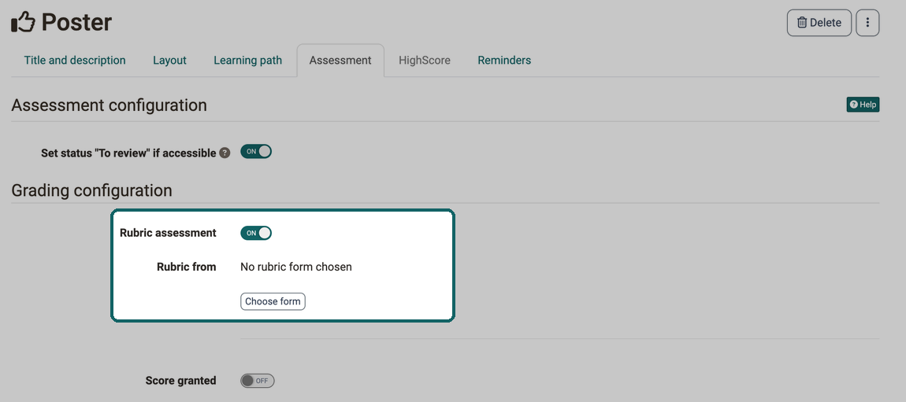
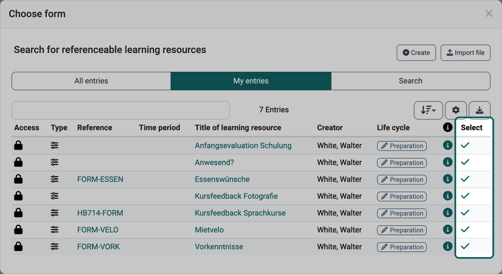
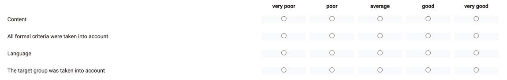
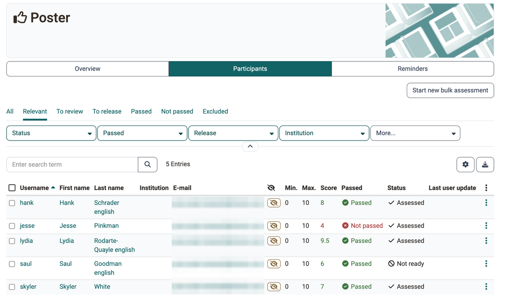

# Forms in Rubric Scoring

If you want to assess achievements against fixed criteria, for example a presentation by content, language and form, link the course element "Assessment" to a form that contains a [rubric](Form_Element_Rubric.md) element. The coaches then choose a level for each criterion, and OpenOlat can take the score from the rubric. This way the assessment follows the same standards for all participants and remains traceable.

Course owners set up the rubric assessment in the course editor. Owners and coaches can assess.

!!! note "Note"

    Assessments as part of a peer review also work with rubric forms. The [course element "Task"](../learningresources/Course_Element_Task.md) handles them.

## In the course editor

In the course editor, add the [course element "Assessment"](../learningresources/Course_Element_Assessment.md). Open the "Assessment" tab of the course element and switch on "Rubric assessment".

{ class="shadow lightbox" title="Assessment tab of an Assessment course element in the course editor · 2026.10.20" }

Then click "Choose form". In the dialog you select an existing form or create a new one.

{ class="shadow lightbox" title="Choose form dialog in the course editor · 2026.10.20" }

The rubric assessment is based on a learning resource form to which a rubric element has been added in the [form editor](Form_Editor.md).

The dialog opens in the "My entries" tab with the forms you own. In the "All entries" and "Search" tabs you find further forms that you may embed. Click the checkmark in the "Select" column to add a form to the course element.

If there is no suitable form yet, create a new learning resource form with "Create" or upload an existing form with "Import file". The new form then also appears in the list and can be selected.

A newly created form does not yet contain a rubric element. Add it in the course editor via "Edit" or directly in the learning resource in the [form editor](Form_Editor.md).

A form that you create in the course editor is a learning resource of its own. You find it in the [authoring area](../area_modules/Authoring.md) under "My entries" and can embed it in further courses.

Once a form is selected, the tab shows its title and the buttons "Replace" and "Edit". With "Edit" you design the form; if it was already set up appropriately, this is not necessary. "Replace" only appears as long as no rubric assessment has been started in this course element.

### Evaluation rubric example

A rubric with four criteria and five levels can look like this:

{ class="shadow lightbox" title="Rubric element of a form · 2026.10.20" }

### Configure rubric assessment

Once a rubric form is linked, you define in the "Assessment" tab what the participants receive from the rubric assessment: score, grade, passed and personal feedback.

**Set status "To review" if accessible**: So that the coaches see where an assessment is pending, OpenOlat sets the status of the participant to "To review" in learning path courses as soon as they have access to the course element. The participants then see "In review". If the switch is off, the status is initially "Not started".

**Score granted**: If the switch is on, you choose under "Score" how the score is determined: "Transfer sum from rubric form", "Transfer average from rubric form" or "Set score manually". If OpenOlat takes the score from the rubric form, "Minimum score" and "Maximum score" result from the form, and you adjust the score with the "Scaling factor". If you set the score manually, you enter both limits yourself.

**Levels/Grading**: If score is switched on, OpenOlat can convert it into a grade. Under "Assignment" you choose "Manually by coach" or "Automatically on score change", and with "Edit rating scale" you choose the scale. More on the page [Levels/Grading](../learningresources/Assessment_translate_points_in_grades.md).

**Display passed / not passed**: Switch the option on if the participants should see whether they passed the course element. If score is switched on as well, you choose under "Type of display" between "Automatic (using cut value)" and "Manually by coach". For the automatic display, you enter the "Passed cut value".

!!! info "Important"

    If "Levels/Grading" is switched on, the rating scale determines the passing. The option "Display passed / not passed" does not appear then.

**Include in course assessment**: In learning path courses, the switch appears as soon as "Score granted" or "Display passed / not passed" is switched on. If it is on, score and passing of the course element count towards the assessment of the whole course, which you define in the [course settings in the "Assessment" tab](../learningresources/Course_Settings_Assessment.md).

**Individual comment**: If the checkbox is ticked, the coaches leave a comment on the assessment, for example to explain a deduction of points.

**Individual assessment documents**: If the checkbox is ticked, the coaches provide the participant with additional documents of their own for the assessment.

All options of the tab are described on the page [Course Element "Assessment"](../learningresources/Course_Element_Assessment.md).

### Carry out rubric assessment

Owners and coaches assess the participants with the course editor closed, either directly in the course element or in the [assessment tool](../learningresources/Assessment_tool_overview.md). In the course element, the "Participants" tab shows all participants with score, passed and status. The tabs above the list filter the persons, for example "To review" or "To release".

{ class="shadow lightbox" title="Participants tab of an Assessment course element in the course · 2026.10.20" }

Select the person to be assessed in the list to open their assessment. There, "Edit" in the "Rubric assessment" section opens the rubric form, in which you mark the applicable level for each criterion. "Open" shows the rubric without editing, and you reopen a completed rubric assessment with "Reopen". If the course element takes the score from the rubric form, OpenOlat fills it in from the rubric. [:octicons-tag-16:{ title="from Release 19.0 (OO-7757)" }](https://track.frentix.com/issue/OO-7757){:target="_blank"}

With "Start new bulk assessment" you assess several persons in one go, see [Course Element "Assessment"](../learningresources/Course_Element_Assessment.md).

## Further information {: #further_information}

**Mentioned on this page** 
[The form element rubric >](Form_Element_Rubric.md) 
[Course Element "Task" >](Course_Element_Task.md) 
[Course Element "Assessment" >](Course_Element_Assessment.md) 
[The form editor >](Form_Editor.md) 
[Authoring - Overview >](../area_modules/Authoring.md) 
[Levels/Grading >](Assessment_translate_points_in_grades.md) 
[Course Settings - Tab Assessment >](Course_Settings_Assessment.md) 
[Assessment tool - overview >](Assessment_tool_overview.md)

**Further reading** 
[Forms - Overview >](Form.md) 
[Forms in courses >](Forms_in_Courses.md)

[To the top of the page ^](#forms-in-rubric-scoring)

