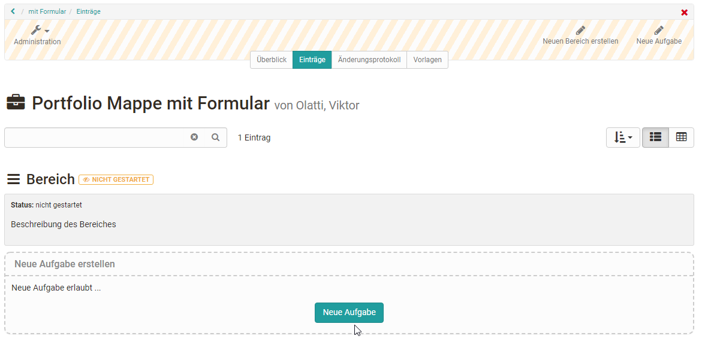
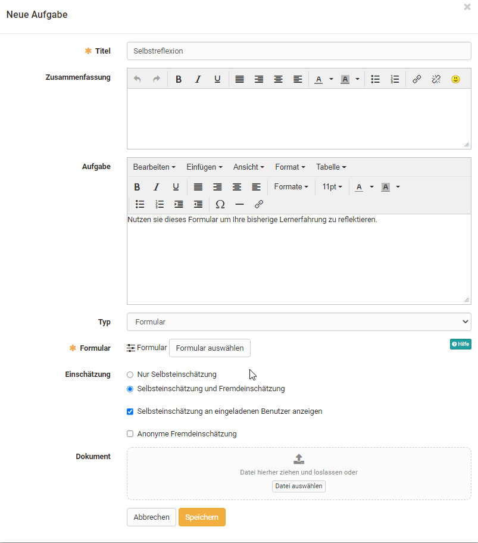
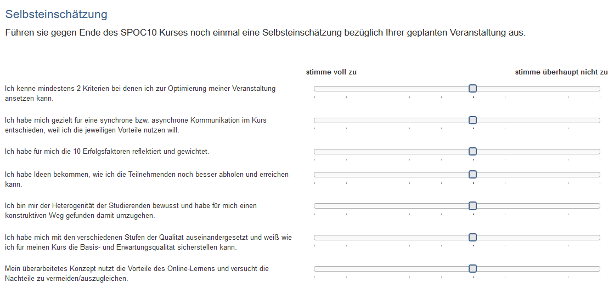

# Formular in der Portfolio 2.0 Vorlage {: #eportfolio_template_forms}

Mit einem Formular in der Lernressource "[Portfolio 2.0 Vorlage](Portfolio_template_Creation.de.md)" reflektieren Teilnehmende ihre Arbeit, schätzen ihre eigenen Leistungen ein oder beantworten einen Fragebogen.

Dafür brauchen Sie eine Portfolio 2.0 Vorlage. Wählen oder erstellen Sie darin einen "Bereich" und wählen Sie "Neue Aufgabe". Wie Sie eine Portfolio 2.0 Vorlage bearbeiten, beschreibt die Seite [Portfoliovorlage: Administration und Bearbeitung](../learningresources/Portfolio_template_Administration_and_editing.de.md).

{ class="shadow lightbox" title="Tab Einträge einer Portfoliomappe" }

Für ein Formular in einer Portfolio-Aufgabe wählen Sie unter "Typ" den Eintrag "Formular". Mit dem Button "Formular auswählen" wählen Sie danach ein vorbereitetes Formular oder erstellen ein neues.

{ class="shadow lightbox" title="Dialog Neue Aufgabe" }

Haben Sie noch kein Formular erstellt, können Sie eine neue Lernressource "Formular" über den Button "Erstellen" erstellen oder ein extern vorliegendes Formular importieren. Anschliessend erscheint das gerade angelegte oder importierte Formular ebenfalls in der Liste und kann für die Portfolio-Aufgabe ausgewählt werden.

Ein neu erstelltes Formular enthält noch keine Elemente. Diese fügen Sie direkt in der Lernressource im [Formulareditor](Form_Editor/index.de.md) hinzu: 
`Formular > Administration > Formulareditor`

Ein Formular, das Sie hier erstellen, ist eine eigene Lernressource "Formular". Sie finden es auch im [Autorenbereich](../area_modules/Authoring/index.de.md) unter "Meine Einträge" und können es in weiteren Portfolio-Aufgaben, Kursen und Kursbausteinen einbinden.

**Weitere Einstellungen:**

Unter "Einschätzung" legen Sie fest, wer das Formular ausfüllt: "Nur Selbsteinschätzung" oder "Selbsteinschätzung und Fremdeinschätzung", bei der eingeladene Personen das Formular ebenfalls ausfüllen. Mit "Anonyme Fremdeinschätzung" bleibt die Fremdeinschätzung anonym.

Über den Kursbaustein "[Portfolioaufgabe](../learningresources/Creating_Portfolio_Tasks.de.md)" binden Sie die Portfolio 2.0 Vorlage in einen Kurs ein.

## Beispiel für ein Portfolio-Formular

Das folgende Formular zeigt eine Selbsteinschätzung, wie die Teilnehmenden sie beim Ausfüllen sehen.

{ class="shadow lightbox" title="Formular beim Ausfüllen" }

## Weiterführende Informationen {: #further_information}

**Auf dieser Seite erwähnt** 
[Portfoliovorlage: Erstellung >](Portfolio_template_Creation.de.md) 
[Portfoliovorlage: Administration und Bearbeitung >](../learningresources/Portfolio_template_Administration_and_editing.de.md) 
[Der Formulareditor >](Form_Editor/index.de.md) 
[Autorenbereich - Übersicht >](../area_modules/Authoring/index.de.md) 
[Portfolioaufgabe erstellen >](../learningresources/Creating_Portfolio_Tasks.de.md)

[Zum Seitenanfang ^](#eportfolio_template_forms)

